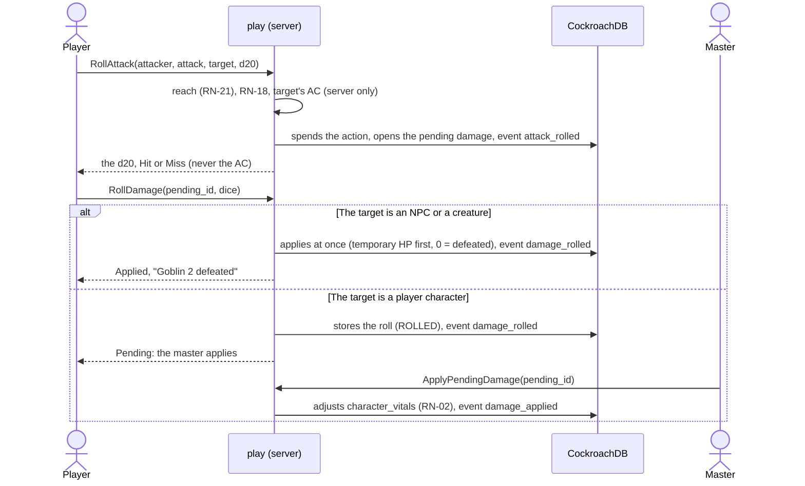

# Attacks and damage

An attack is two calls, `RollAttack` then `RollDamage`, because with physical dice the player types the d20 and then the damage (RN-18, MR-012, MR-014).
This page covers the two steps, pending damage, roll modes, damage parts, resistance, combatant states, conditions and concentration, and the feature actions.

## The two-step attack

`RollAttack` checks who may: the player on their own character, on their turn, with the action free, the target in sight and in reach; the master on any combatant on turn, with no limit of reach or action (the Captain with several weapons is theirs).
It rolls the d20 (`crypto/rand` in the app, or the typed face 1 to 20), spends the action and compares with the target's AC (`rules/combat.ResolveAttackFrom`).
A natural roll in the sheet's critical range or more is a critical hit for a weapon attack, a natural roll in the spell critical range or more is one for a spell attack roll (20 unless a table feature lowers it), and a natural 1 misses.
The natural roll is the d20 as it counts: a table's roll minimum can raise a 1 to a number that hits.
The response carries the roll in numbers (`1d20 (13) + 6 = 19`) and the result, never the AC for the player; the master's response carries `target_armor_class`, with a Shield's +5 stored in the event so a resend finds the same.
`TestRN20_PlayersNeverReceiveCAOrHiddenLogEntries` searches the AC in the player's JSON and checks the master's has it.
A hit opens a `pending_damages` row (stored, so a resend or a reload finds it).
The AC is the sheet's: a shield beside an equipped two-handed weapon adds nothing, in the combat and in the comparison alike.
A Protection used on the attack gives the roll disadvantage, with its own source in the mode (see [Reactions](reactions.md#protection)).
A weapon attack held for a Lucky or Bardic Inspiration question is in [Held rolls](held-rolls.md); a hit that waits for a reaction is in [Reactions](reactions.md).
`RollAttackRequest.maneuver_key` adds a table die of applies `attack` to a weapon attack of the player's own character.
The die is described in [Rests and resources](rests-and-resources.md#table-dice-on-the-characters-own-rolls).
It joins the dice an effect adds (Bless), after them.
It is rolled with the attack, or typed as the last of `extra_die_faces`.
It is added to the total and listed in the roll's `extra_dice` and in the attacker's log line.
The log line names each extra die by its `source_name_pt`.
A source the master hides reads "Outra fonte".
The roll is refused for an NPC attacker, a spell attack and a die of another `applies` (`invalid_argument`).
It is refused when the pool has no use left (`NO_USES_LEFT`).
The checks run before the roll and again on the replay of a held roll.
One use is spent when the attack is written.
A held roll spends it once, on the replay.
The master's undo gives the use back.
A replay refused because the pool changed is dropped, and only the master reads it in the log.
A natural 1 still misses, and a critical hit does not double the die.
The die counts as an extra die for Stroke of Luck: the question comes blind, before the die is known.
An opportunity attack and an attack as a reaction take the die like any other.
`GetTurnOptionsResponse.maneuver_dice` lists those dice for a player's character, each with the name of its resource pool and the uses left. `GetTurnOptions` reads the character's sheet and vitals once (`turnReads`, `combat_turn_reads.go`) for Metamagic, the table's cast options, the power attacks list and these dice, and the dice read neither when none fits. The web tells two pools apart by `RollDie.resource`, never by name.
A die with no use left stays listed with `uses_left` 0.
An NPC gets none.

`RollAttackRequest.power_attack_key` makes the trade of a `power_attack` effect ([Rules: table content](../rules-table-content.md)) on a weapon attack of the player's own character.
The server checks the key against the character's own power attacks, whatever the screen listed.
It refuses an NPC attacker, a spell attack, a key the character has not and a weapon the effect's filter does not accept (`invalid_argument`; the filter's reason, in Portuguese, is the text).
It refuses a trade whose resource has no use left (`NO_USES_LEFT`).
A maneuver die and a trade that spend the same resource need two uses, and with fewer the attack is refused with `NO_USES_LEFT` before anything is spent.
Every refusal comes before anything is written.
The effect's attack penalty comes off the roll's bonus, so the roll's modifier, its total and a held roll's offer all count it.
A natural 20 still hits and a natural 1 still misses.
A held roll keeps the bonus it was made with, so the answer's replay counts the penalty once.
A request the server keeps for a roll that waits (a Lucky, Bardic Inspiration or Stroke of Luck question, a reaction window) also keeps the trade's name, penalty, flat damage and resource (`power_attack_pin`).
The replay and the answer use those numbers for the roll, the event's marker and the damage part, whatever the master edits in the feature's penalty, damage or resource meanwhile.
The feature itself and its weapon filter are read from the sheet again on the replay, so a feature removed or a filter changed between the hold and the answer refuses the answer (a window's replay is dropped).
A caller's own `power_attack_pin` is cleared.
The checks, the resource's included, run again on the replay of a held roll, and a replay they refuse (the pool was spent meanwhile) is dropped.
One use of the effect's resource is spent when the attack is written, and a held roll spends it on the replay.
The master's undo gives the use back.
The attack's event keeps the trade (`key`, `name`, `penalty`, `damage_bonus`), so a resend finds the same and applies nothing twice.
`AttackOption.power_attacks` lists, on each weapon line of a player's character, the trades whose filter accepts that line (`key`, `name`, `penalty`, `damage_bonus`).
A spell line, a line the filter refuses and an NPC list none.
A feature lists one trade, whatever its content holds: the first `power_attack` effect of a key that is listed stands (an effect left out for a resource the character lacks does not count).
A trade whose resource has no use left is listed with `disabled` and `disabled_reason_pt`; the roll refuses it with `NO_USES_LEFT`.
A druid in a beast form keeps their power attacks, and the filter reads the beast's attack lines: natural attack lines of the stat block, melee or ranged, with no weapon property, and proficient.
A trade that asks only for melee fits a melee line of the beast, one that names a weapon property (as heavy) fits none, and `only_proficient` does not exclude a beast's line.
On Deflect Missiles' throw back the missile has no line on the sheet and is not marked proficient, so a trade with no weapon filter goes on it, while a trade with `only_proficient` is refused (`invalid_argument`, "sem proficiência") and spends no use.

`RollDamage` rolls the damage dice (on a critical as the table rule says; the modifier once; the attack's type) or validates the typed sum (`dice.Physical`, from N to N × faces).

The Attack action makes one attack, or more with Extra Attack: `combatants.attacks_made` counts the turn's attacks, the first spends the action, the following fit while any remain (`AttacksLeft`) and the last gives `ATTACKS_USED`; the counter returns to 0 at the start of the turn.
Extra Attack belongs to weapon attacks only: a cantrip spends the whole action and counts no attack, and after a weapon attack a cantrip gives `ACTION_USED`, and vice versa.
The master has the last word on an NPC, with one exception: an NPC from a creature with a Multiattack (`AttacksPerAction` above 1) is held to the count of its routine, and the attack after the last gives `ATTACKS_USED` to the master too (`routineLeft`); a creature without Multiattack, a reaction, the extra action and a player's character the master acts for are not counted. The routine itself (which attacks, in which mix) is not stored: the screen reads it from the stat block, and ending the routine early is the screen's.

**Ammunition.**
A player's character that attacks at range with a weapon that fires ammunition (a bow, a crossbow, a sling, a blowgun) takes one piece of it for each attack roll, so Extra Attack takes one for each attack (`combat_ammunition.go`).
The sheet's attack line carries the kind (`rules.Attack.AmmunitionKey`, from `effects/ammunition.json`, and `link.Attack.Ammunition`).
`prepare` refuses with `AMMUNITION_EMPTY` when the kind is counted and none is left, and nothing is written.
A kind the character has no row for is not counted: the attack goes, spends nothing and writes no `ammunition_spent` event.
`writeAttack` takes the piece after the roll settled, in the same transaction, through the characters keeper with the combat's id.
It writes the `ammunition_spent` event just before the attack's own event, a line that only the master and the character's player read.
The attack's event keeps the kind and the line's id (`ammo`, `ammo_line`).
The undo of the attack means the attack did not happen, so it gives the piece back in its own transaction (`undoer.ammunitionBack`, then the keeper's `RefundAmmunition`) and takes the line out of the log with the attack.
Extra Attack undoes one attack at a time, so each undo gives back one piece.
The keeper lowers the combat's count of fired pieces by the refund, and a row left with nothing fired belongs to no combat again, so there is nothing to search for.
An attack that took no piece (a thrown weapon, a melee weapon, the improvised line) gives nothing back.
The `ammunition_spent` event still never closes the undo chain (`chainAmmunition`), so the undo of a later shot leaves the shot before it to undo.
Two attacks at the last piece give one shot: the keeper locks the stock, and the second gets `AMMUNITION_EMPTY`.
A thrown weapon, a melee weapon, the creatures and the master's NPCs spend nothing.

**The improvised line.**
A weapon that fires ammunition has a second attack line, keyed `<weapon key>:melee` and named "<weapon>, corpo a corpo" (`improvised` is true).
It is a melee attack of 1d4 plus Strength, bludgeoning, without proficiency or the weapon's bonuses, and it spends no ammunition.
`GetTurnOptions` fills `ammunition_left` on the ammunition line of a counted kind (0 when none is left, absent when the kind is not counted) for the character's player and the master, and leaves it absent on every other line.
`GetTurnOptions` also fills `ammunition_key` with the catalog key of the kind on every line of a weapon that fires ammunition, counted or not, and leaves it empty on every other line, the improvised melee line included.
A sheet's derived attacks never carry it.
The line is a weapon attack and a melee one (`Kind` weapon), so what reads those two facts treats it as a Strength melee weapon attack: Rage, Divine Smite, Improved Divine Smite, the hit extras, the maneuvers and Hunter's Mark.
It is not a weapon of its kind: it has no finesse, two-handed or light property, no proficiency and no magic of the bow, so Dueling, Great Weapon Fighting, Two-Weapon Fighting and Sneak Attack (which needs a finesse or ranged weapon) never apply to it.

**Beams and bonus action attacks.**
A cantrip with several beams (Eldritch Blast) is one attack roll per `RollAttack`, each beam with its own damage (Agonizing Blast on each), up to `Attack.Beams`; the combatant row remembers the attack of the action (`action_attack_key`) and `attacks_made` counts the beams.
`GetTurnOptions` offers the next beam the same way (`beams_left`).
When the action's attacks are all made, a weapon attack goes on as a bonus action attack if a rule lets it (`combat.BonusAttack`):

- after the Attack action with a light melee weapon, a different light melee weapon (Two-Weapon Fighting; the character must carry two light melee weapons, because the app does not track hands: `BonusAttackTurn.NoSecondLight`; the damage leaves out the ability modifier unless negative or the character has the style);
- after the Attack action with an unarmed strike or a monk weapon, one unarmed strike (Martial Arts, full modifier);
- after Flurry of Blows, its two unarmed strikes (`bonus_attacks_left`);
- for a frenzied rage, a melee weapon attack (see [States](#states)).

The bonus action attack spends the bonus action (`BONUS_ACTION_USED` when spent), never an attack of the Attack action, and the undo gives it back.
The server picks the rule from the state of the turn, so the request has no flag; `GetTurnOptions` shows the same choice beforehand and the app lists the attack with the "Ação bônus" tag and a line saying which rule makes it one.

## Pending damage

`pending_damages` stores a hit's damage, with the dice copied from the sheet at the time of the hit: a sheet changed later does not touch an open roll.
A critical already comes with the table rule applied (see [Table rules in combat](table-rules.md)).
The state goes `awaiting_reaction` → `awaiting_roll` → `rolled` (player characters only) → `applied` or `discarded`. A take-out of a part of a typed group sends an applied or rolled damage to `awaiting_group_sum`, which waits for the sum of one damage type and goes back to `rolled` or `applied` when it is rolled.

- **An NPC or creature applies at once** (`ApplyDamage`: temporary HP first, floor at 0); at 0 HP it is `defeated` and `nextTurn` skips it.
- **A player character's damage waits for the master** (RN-02): `ApplyPendingDamage` goes through `character_vitals` (the same path as the correction), with a floor at 0 and any `amount` the master wants in place of the rolled one; `DiscardPendingDamage` is "Não aplicar".
  At 0 HP the character is down: `GetEncounter` shows `COMBATANT_STATE_DOWN` ("Caído") to everyone who sees them, with no numbers.
  Death saves are in [Death and revival](death-and-revival.md).
- **`EndTurn` with open damage** of the combatant on turn refuses with `PENDING_DAMAGE`; only the master passes anyway (`discard_pending_damage`, "Passar o turno mesmo assim?"), and the open damage is discarded in the same transaction.
- **A heal** is a pending damage that is a heal; `RollDamage` heals at once, up to the maximum, by NPC and by character (through `character_vitals`); whoever was at 0 rises and the death saves reset.
- **Brutal Critical and Savage Attacks.** `pending_damages.extra_dice` carries the extra dice a melee critical adds: `Derived.BrutalCriticalDice` from the barbarian and `Derived.SavageAttacks` from the half-orc (`savage_dice` is the half-orc's share, used to name the extra die).
  A thrown weapon beyond its melee reach is not melee (`thrownAtRange`).
  `RollDamage` rolls `dice_count + extra_dice` dice of the weapon's die in one roll and `typed_sum` is checked against all of them.
- **Relentless Endurance** (`combat_relentless.go`) runs where a character's damage reaches its vitals (`ApplyPendingDamage` and the trap damage the master settles): when `combat.ApplyDamage` says the character fell to 0, the left-over damage is below the hit point maximum and the `relentless_endurance` resource has a use, the use is spent in the same transaction and the HP set to 1.
  The `damage_applied` event keeps `relentless` for the log (`CombatLogDamage.relentless_endurance`) and the undo.
- **A `drop_to_zero` hook** (`table_effects.go`, `dropToZeroHook`) runs in the same place, after Relentless Endurance: when the damage took a character from above 0 to 0, the left-over damage is below the hit point maximum (massive damage kills outright and no hook prevents it) and the character has an `on_event` hook for `drop_to_zero` it can pay (`link.Sheet.Hooks`: the resource it spends has the uses), the hook's heal replaces the 0 before the character is unconscious, so it stays on its feet, and the uses it spends are written in the same `AdjustVitals`.
  Damage counts wherever it lands on a character's vitals: `ApplyPendingDamage` (a trap's damage in a combat is a pending damage of it) and the settling of a trap damage waiting for the master (`ApplyTrapDamage`, in a combat or outside one: `trapDropHook` asks the same `dropToZeroHook`, so the rule has one copy).
  The master's corrections (`AdjustCharacterVitals` "Ajustar PV"; `AdjustCombatantHitPoints` refuses a player's character) are not something that happened in the fiction and never run the hook; neither does a druid's beast form taking the damage, a character already at 0 hit points (damage there is a death save failure, so the hook never raises a dying or dead character), or a blow that kills outright.
  An event runs the first hook that can be paid.
  The `damage_applied` event (a trap damage's too) keeps `hook` (the feature's key, the hit points healed, the uses spent), which the undo gives back with the hit points; the master and the target's own player read it in the log (`CombatLogDamage.hook`).

### The damage minimum

A table's [`roll_minimum`](../rules-table-content.md#roll-minimum) on `damage` makes a die of damage that shows less than the minimum count as the minimum, and a die smaller than the minimum counts as its own highest face.
The highest applicable minimum counts; one with a `damage_type` applies only to the dice of that type (`damage_floor.go`).
The minimum counts the dice of the weapon and spell damage of a player's character that the app rolls (not a heal), and the fire of Hellish Rebuke (damage-type:fire) for the reactor's minimums.
It counts every die of every part the app rolled, whether the part counts in the total or not: a part that does not count is floored too, so a line tells nothing about the target.
A reroll runs first, on the face that came up, and the minimum counts the dice that stay.
`faces` keep what came up; `total` and each part's `sum` use what the dice count as.
The dice the minimum changed are listed as `counted_dice` (`CountedDie`: `index`, `face`, `counted_as`, `source_key`); a die it did not change is not listed.
A damage with parts keeps them in each part's `counted_dice`, and a damage with no parts of its own in `pending_damages.counted_dice` ([Combat data](../../data/combat.md#pending_damages)).
A damage roll of typed physical dice is never floored, because the app did not roll the dice, while a typed d20 is.
The damage of a zone, of a lasting effect, of a trap, and of a creature or an NPC does not count a minimum.
Whoever reads the faces of a roll reads `counted_dice`: the roller's player and the master, never another player.

### Damage reduction

A flat reduction of weapon damage comes from the `damage.reduction.weapon` and `damage.reduction.nonmagical_weapon` modifiers of a table feature ([Rules: table content](../rules-table-content.md#the-closed-menu-of-effects)).
`modifiersOf` lists each one as a `combat.Modifier` of kind `StepReduction` with its `Amount`; the nonmagical one carries `QualifierNonmagical`.
It covers a damage only when `combat.Origin` says it is an attack made with a weapon (`Origin.Weapon`, an unarmed strike included) and, for the nonmagical kind, not a magical one; a spell, a trap, a zone and an ongoing effect are never reduced.
The amounts of every covering source add, and the reduction is taken once from the whole weapon attack, not once for each damage type: `combat.Reduce` takes it from the types largest first (a tie by the type key) until it is spent or the damage is 0.
It comes before immunity, resistance and vulnerability, which then work on what is left of each type.
The step has no damage type and its label is "Redução de dano de arma" (with "não mágica" and the sources); the master leaving a source out (`ignore_modifiers`) removes its amount.
The group of the step keeps the damage of every type (`stepGroup.Allot`), so the apply and the preview work the same.
The master and the owner of the target read the step as `DamageStep` of kind `DAMAGE_STEP_KIND_REDUCTION`.
The step's sources go through the same hiding as every other step (`hidingNames`): a source marked `Hidden` reads "Outra fonte" for a player.

### Resistance

The damage of each type goes through the target's modifiers (`combat.Adjust`, SRD 5.1 "Damage Resistance and Vulnerability"): resistance halves rounding down, vulnerability doubles, immunity nulls, and the same resistance from two sources counts once.
`modifiersOf` (`combat_parts.go`) lists them:

- a creature's or an NPC's with a `monster_key` (what "Pôr no combate" and "Criar NPC" make, and a character's creature) from its SRD stat block, through `CombatRoster.DamageModifiers`;
- a player character's from its race and features (`effects/damage_resistances.json`: the tiefling's fire, the dwarf's poison, the draconic lineages) and the Rage's, which holds only while the state lasts and no heavy armor is worn.

A stat block entry counts when it has no condition, or when its only condition is a limit to nonmagical attacks.
The snapshot's `qualifier` says which: `nonmagical` ("from nonmagical attacks"), `nonmagical-unless-silvered` ("from nonmagical weapons that aren't silvered") or `nonmagical-unless-adamantine` ("... that aren't adamantine").
`cmd/srdimport` sets it from the SRD's words and `rules.CreatureDamageMod.Qualifier` carries it.
`characters.typeModifiersOf` keeps the plain entries and each qualifier apart (`TypeModifiers.ResistantNonmagical`, `ResistantUnlessSilvered`, `ResistantUnlessAdamantine` and the `Immune` twins).
`statBlockModifiers` turns them into `combat.Modifier`s with `Qualifier: combat.QualifierNonmagical`, `QualifierNonmagicalUnlessSilvered` or `QualifierNonmagicalUnlessAdamantine`.
An entry with any other condition ("damage from spells") is not applied, and the master corrects an NPC's HP by hand (`AdjustCombatantHitPoints`).
A modifier with the nonmagical qualifier covers a damage only when `combat.Origin` says it is an attack and not a magical one.
The silvered qualifier also needs `Origin.Silvered` to be false, and the adamantine qualifier needs `Origin.Adamantine` to be false.
`damageFlow.originOf` answers it for a pending damage: the damage of a cast is a magical attack.
An attack of the attacker's sheet or stat block is magical when `link.Attack.Magical` is, and it carries `link.Attack.Silvered` and `link.Attack.Adamantine` (from `rules.Attack`) into the origin as the weapon's material.
A spell or cantrip attack is magical.
A creature's attack is magical when its stat block has the trait "Magic Weapons", and it is never silvered or adamantine.
A weapon of a character is marked by the sheet (`full.weapon_marks`), by a `weapon_rule` or by a magic bonus that counts (`full.item_bonuses`, which makes it magical only); `rules.deriver.weaponMarks` is the one place that merges them.
The unarmed strike has no sheet mark: `rules.unarmedStrike` calls `weaponMarks` too, so a `weapon_rule` marks it.
Ki-Empowered Strikes (`feature:ki-empowered-strikes` in `Derived.Features`, monk 6, multiclass included, not an effect) makes it magical on its own, and the `magic` filter reads that.
A `pseudo_weapon` line is never marked by a `weapon_rule`.
A damage with no attack behind it (a trap, a zone, an ongoing effect, a reaction's own damage) is no attack: `AdjustForType` does not read the nonmagical lists, so no nonmagical clause reduces it.
The step is the usual resistance or immunity step with `combat.Step.Qualifier` set, and its label says so ("Resistência a perfurante de ataque não mágico (Grick)", "... de ataque não mágico nem prateado", "... de ataque não mágico nem adamantino"). `stepGroup.From` keeps the origin so the steps are worked out the same when the master leaves a source out.
The steps are kept per type with their sources (`pending_damages.steps`) and shown to the master and the target's player as `DamageStep[]`. The working out of the steps, their stored form and their Portuguese text are in the subpackage `play/damagesteps`.
The master may leave a source out when applying (`ignore_modifiers`, at most `maxIgnoredSources`).
An NPC's resistances reach the master alone (RN-20).
`leaktest.TestAMaterialResistanceIsTheMastersAlone` proves it for a wight hit by a plain and a silvered weapon: the step, its label and the amounts are the master's, and no player reads the qualifier words in the roll, the combat, the log or the stream.
The conditions a stat block is immune to do not go through these modifiers: they ride on the traits and `immuneToCondition` reads them when a condition is given (see [Creatures](creatures.md#what-the-combat-does-with-a-creature)).
A trap's damage on an NPC or creature goes through the same adjustment.

### Damage by parts

A hit with more than the weapon opens `PendingDamage.parts[]`:

- the weapon;
- the **offered** extras (Sneak Attack, Divine Smite with the slot to spend, Hunter's Mark, Colossus Slayer); a line that cannot be chosen is disabled and says why;
- the **automatic** lines (Rage's bonus, only on a melee Strength weapon attack; Improved Divine Smite; Dueling; Brutal Critical through `automaticLines`; the damage a spell left on the caster's hits, [below](#a-spells-hit-effect));
- the power attack's flat damage, when the attack made the trade ([below](#a-power-attacks-damage)).

A critical doubles the dice of every part (or follows the table's "maximum plus a roll"), never the fixed numbers (SRD 5.1 "Critical Hits").
In the app the server rolls every part; with physical dice the player types a sum for each part (`typed_parts[]`).
A `typed_parts` entry names one part (`part_key`) or one damage type (`damage_type`, a `damage-type:` key), never both.
A `damage_type` entry covers every dice part of that type in the attack: the weapon, a hit effect, the extras that roll dice and count.
Its sum is checked against the group's combined dice (each part's count to count times faces, doubled on a critical hit as the table's rule says, or the rule's own numbers under "maximum plus a roll").
A group and a `part_key` of a part in it, the same type twice, and a type with no dice part in the attack are `invalid_argument`; every other dice part still needs its own `part_key` or its type's group.
The group's total counts under its type, so a resistance, vulnerability or immunity acts on the sum plus the fixed numbers of its parts; no part of the group keeps faces.
The sum is kept on the first part of the group the other players can read (not a spell's hidden hit effect; the first of all when every part is hidden), and every part of a group of two or more counted dice parts keeps `partRoll.group`, the type that covered it. A `damage_type` entry that covers one part is no group: its sum stays on that part, as a `part_key` sum does, with no `group` set.
A `typed_parts` entry that names neither a `part_key` nor a `damage_type`, and one that names both, are `invalid_argument` with words of their own; the entries are read in the order of the request and the groups checked in the order of their type keys.
RN-10: "hidden" (`Hide`) is hidden from the other players; the roller is the owner or the master, who read every part whole. For the roller a group that holds a hidden part is a group like any other: the range error gives its bounds, a `part_key` typed beside the type for a part of the group (hidden or not) is `invalid_argument`, a `part_key` of no part is passed over, and a type whose only dice are hidden has dice (it is refused as a type with none only when no part has dice). The other players read a group that holds a part hidden from them as one row (`mergeHiddenGroups`): the names of its visible parts and "Outra fonte", the damage type, the group's sum and the parts' fixed numbers, never the hidden effect's key or name and never a 0 that was not rolled; `partRoll.group_hidden` marks the row that carries the sum. The owner and the master read each part as before. The total of the damage stays the damage as rolled, which includes the hidden part (it is the hit points the table sees change).
The master takes an extra out of a group, a type with two or more parts, with `RemoveDamagePart` (`combat_group_sum.go`, `takeOutOfGroup`). The sum sits on the group, so the app does what the undo of the roll does and asks for a new sum: `takeBackAction` (the undo's own steps: `checkHolds`, `snapBack`, `takeBack`, `alsoUndone`, `takeBackAround`) puts back what the damage did (an NPC's hit points, the rider save and condition, holds, resistance steps) but not what the parts that stay paid: the event is handed to the undo through `onlyWhatComesOut`, which strips the slot and the maneuver uses it spent and keeps, of the once-per-turn marks, the removed extra's alone (Sneak Attack's, Colossus Slayer's, a table's once-per-turn extra), as the removal from an ordinary damage does; the use of a reroll rule stays the undo's (it is the roll's); on a fog map the take-out's event keeps the audience of the roll it takes back (`stampLine` does not stamp it, as it does not stamp an undo), so the line follows one rule with the undo, the part is marked `Removed` with the reason, and the pending damage goes to `awaiting_group_sum` with `awaited_damage_type_key` set to the group's type (`SetPendingDamageGroupSum`); the rolls of the other damage types are kept (`keptRolls`). A weapon, an automatic part, a smite and a part of a spell's damage are still `DAMAGE_PART_NOT_REMOVABLE`; a part alone in its type, and a damage rolled with a sum for each part, come out as before with no new sum.
The limit is the undo's rule, no wider: an applied damage whose event is no longer the last undoable action of the session is refused with `NOTHING_TO_UNDO` (a later attack, an adjustment of hit points, any action on the same target); if the target's hit points, temporary hit points, Wild Shape pool or defeat changed with no event to close the chain, it is refused with `UNDO_TARGET_CHANGED` and the `combatant_ids` of the targets. Nothing is written in either case. A player's character already given the damage stays `DAMAGE_RESOLVED`. A damage that is only rolled (not applied) releases its holds and hit-effect riders as the undo does (`forgetHoldsOfPending`, `effectsBack`, `closeDamageWindows`), and is refused with `NOTHING_TO_UNDO` when a rider of it was already used. The roll must be among the session's latest events (the undo's window). Taking out another part while the damage is in `awaiting_group_sum`, and `ApplyPendingDamage` on it, are `DAMAGE_NOT_ROLLED`; a cast pending damage is `DAMAGE_PART_NOT_REMOVABLE`.
`RollDamage` on `awaiting_group_sum` takes the sum of the awaited type alone (`typed_sum`, or the app's roll; `groupSumTyped` refuses a `typed_parts` entry of another type with `invalid_argument`), keeps the rolls of the other groups (`rollParts` with `awaited` and `kept`), works the damage out, applies it (an NPC at once; a player's character waits for the master) and asks the riders again. A group left with one part is a typed group of one. The roll spends nothing for the parts (`settleParts` with `paid`, true while the status is `awaiting_group_sum`, which a reaction's replay keeps): a Divine Smite's slot and a maneuver's use were paid once, by the first roll, which declared them, and the take-out kept them spent, so the second roll goes through with no slot left and the slot is never spent twice. Nothing gives the slot back afterwards but the master's correction of the vitals: the discard of the damage that waits for the sum drops it as it drops a rolled damage (the undo of a discard only puts the damage back to waiting), and the undo of the second roll goes back to the wait with the slot still spent. Once-per-turn marks are re-marked by the second roll for the extras that count (the removed extra's stays free). A first roll with a typed group has no faces, so no reroll of the first roll is kept or given back; a second roll made in the app rerolls and spends a use like any roll, and goes through with no use left. The combat's highlights read the take-out as an undo of the first roll (`ListEncounterCombatEvents` lists `damage_part_removed`). `EndTurn` blocks a player and the master's discard drops it as for `awaiting_roll`; `DiscardPendingDamage` works in the state. The take-out itself cannot be undone by `UndoLastAction`: its event (`eventDamagePartRemoved`) is not undoable and closes the chain; the roll that follows it is undoable and goes back to `awaiting_group_sum` with the part still out, the awaited type and the other types' rolls as they were (`sumWaitBack`: the roll's event keeps `awaits_sum`), so the roll after the undo spends nothing either.
The master's screen offers the take-out on a damage already applied to an NPC or a creature, so `GetTurnOptions` of the attacker lists for the master alone, beside the damage that waits, the one a take-out could still undo, with the status `applied` (`takeOutListing`, called by `listPendingDamage`): the attacker's, not a cast's, on a target that holds hit points, whose roll is the last action of the session (`isLastAction`, the function `rollToTakeBack` refuses by) and with a part `mayComeOut`. The check of the target's hit points stays with the take-out (`UNDO_TARGET_CHANGED`). It is gone after any later action. The attacker's player gets the open damage alone, as before (RN-10); the leaktest row reads both lists in `attackrolls_test.go`. Clients that list `pending_damages` must read `applied` as done: it is no damage that waits.
RN-10: the pending row in `awaiting_group_sum` is read by the master and the attacker's player only; the removal line (`DAMAGE_PART_REMOVED`) carries the part's key, its name and the reason for them. Another player reads the line too (`removalView`): "O mestre tirou" and the name the roll line gave the part, "Outra fonte" for a part hidden from them (`partRoll.Hide`, stored as `actionEvent.PartHidden` because the group's rolls are rewritten), and never the key or the reason; this holds for a part taken out of a group and out of an ordinary damage. The roll is taken back as an undo takes it back, so the attack line goes back to `awaiting_roll` for them, and the status `awaiting_group_sum` and the awaited type never reach them (the turn options are the master's and the attacker's player's). The leaktest row is in `attackrolls_test.go` (the removal reason marker, and a hidden extra's name and key markers: Ana reads neither).
A part of a spell's hit effect is told apart by its effect row, not its key (`partIdent`), so two casters of one spell give two parts of one group and its sum is counted once.
Divine Smite's extra die stays out of every group and keeps its `part_key`, since whether it counts depends on the target.
The attack sheet sends a `damage_type` entry for every damage type it types, one field for each type however many parts share it, and a `part_key` entry only for a part the server keeps out of the groups (Divine Smite's extra die) or one with no damage type.
A held roll and its replay read the same request, so a group rolls the same way there.
Divine Smite's extra die against an undead or fiend is rolled as its own part and only counts when the target is one: the player sees "+1d8" and never why, and the damage a player reads on an NPC is the damage as rolled (`damageHit.Shown`), so the total says nothing either.
The `extra_damage` effect of a table feature ([Rules: table content](../rules-table-content.md#extra-damage)) is one more choosable extra after a weapon hit by a player's character: a fixed damage and/or dice, of the feature's damage type or the weapon's. The dice are a part like a maneuver's die (`partRecord.Count` and `Sides`), rolled in the app or typed per part, and a critical hit doubles them (`partCriticalDice`) unless the feature keeps them (`partRecord.NoCrit`); the fixed damage never doubles. Each part lands in `byType` under its own damage type, so a resistance takes only that line. It is listed off, with its reason, when the target is not larger (the sizes are public), when the weapon is of the other kind (melee or ranged; a thrown weapon at range is ranged), when it was used this turn (only for `once_per_turn`) or when the resource has no use left; marking it spends a use and the rider is the master's alone. The once-per-turn mark is kept by feature key in `combatants.feature_state` ([Feature state](feature-state.md)), and the master's undo puts it and the use back. `each_hit` sets no mark. It is not a maneuver: the one-maneuver-per-attack limit does not count it.

### A power attack's damage

A hit whose attack made the trade of a `power_attack` effect writes one automatic part, `power_attack`, at the time of the hit.
The part is flat, has no dice and cannot be chosen.
Its label is the feature's name, its source is the feature's key and its damage type is the weapon's.
A miss writes no part.
The part counts in the total and in the damage of its type, so a resistance of the target takes its share.
A critical hit never doubles it.
A held roll's replay writes it once, and undoing the attack or the damage removes it with the rest.
The master's `RemoveDamagePart` does not take it out.
The attack's event keeps `hidden` when the feature was retired or switched off when the attack was made.
What each viewer reads (RN-10; `TestAPowerAttackIsTheAttackersAndTheMastersAlone`):

- the master and the attacker's player read the feature's name, key, flat number and the penalty;
- another player reads the part's label (the feature's name, or "Outra fonte" when the feature is hidden) and never its flat number, key or reason, nor those of its roll;
- the damage total another player reads is the damage as rolled, so it includes the bonus, like the hit effect of a spell.

The attack's line in the log tells another player only "usou um ataque poderoso", hidden feature or not.
The name another player reads (the feature's, or "Outra fonte") is in the damage part's label and in the log marker's `name_pt`, and the app prints neither in the log line.
The feature is hidden from the moment of the attack, so a later change by the master does not alter what the attack's damage and log say.

Sneak Attack and Colossus Slayer are once per turn (the keys `sneak_attack` and `colossus_slayer` of `combatants.feature_state`); Hunter's Mark follows the caster's concentration (`combatant_states`).
Great Weapon Fighting rerolls 1s and 2s once, shown on the part.
A table `reroll` effect that covers `damage` rolls again each die at or below its `at_most`, once, in the damage step (`combat_damage_reroll.go`); the player is never asked.
One use of its resource (none for a free rule) covers one damage roll and is spent in the transaction of the damage, and undoing the damage gives it back.
It skips typed sums, damage held for a reaction window and a die Great Weapon Fighting already rolled again.
A roll with parts (a weapon hit and its extras) lists the dice in the part's `Rerolled` with the rule's feature as `source_key`; a roll without parts changes only its faces and total.
The attack's critical range is `Derived.CriticalRange` for a weapon attack and `Derived.SpellCriticalRange` for a spell attack roll (`criticalFrom`); both are 20 unless a feature lowers them, and a table's `critical_range` modifier lowers the one its scope names ([Critical range](../rules-table-content.md#critical-range)).
Improved Critical and Superior Critical never lower the spell range.
The master sees the damage by part and takes an extra out with a reason (`RemoveDamagePart`); the weapon and automatic lines stay.
Undoing a damage roll gives back the slot, the once-per-turn marks and the rolls.
An area spell's damage is one roll for the whole cast: it settles every pending damage of the cast still waiting for a roll with the same damage type, in the combat's order (`sortByCombatOrder`), so `settled` in the event and `cast_pending_damages` in the answer read the same way on every run.

The rays of Scorching Ray are not an area: each hit opens a pending damage with no `cast_id`, so several rays at one creature are several separate rolls, listed in `cast.pending_damages` in the order of the rays (the request's target order, a target's rays together).

### A spell's hit effect

A table spell can leave weapon damage on its caster's hits (the `weapon_hit_damage` modifier, [Table content: rules](../rules-table-content.md#the-lasting-effect-of-a-spell)).
The effect is a row of the caster ([Lasting effects](lasting-effects.md#the-damage-a-spell-adds-to-the-casters-hits)).
After a weapon hit, `hitFacts.hitEffectParts` (`combat_hit_effects.go`) offers one part for each such row that is not spent and whose trigger holds.
The part is automatic: the player never chooses it, it is the spell's rider.
Its key and label are the spell's.
Its roll (`DamagePartRoll`) carries `hit_effect` true.
The flag follows the key: a reader who gets the effect row's id for a key (an effect the master hides, or the owner's) reads it false, so it never says a spell is behind the part.
The caster's player and the master read it true, and so do the other players when the effect is public.

| Trigger | The hit it rides on | Used up |
| --- | --- | --- |
| `next_hit` | The caster's next weapon hit, melee or ranged | By the damage roll of that hit |
| `next_melee_hit` | The next melee weapon hit; a thrown weapon at range is not melee (`thrownAtRange`) | By the damage roll of that hit |
| `each_hit` | Every weapon hit while the caster concentrates | Never; ends with the concentration |
| `marked_target` | Every weapon hit on the creature that carries the spell's mark ("Cada golpe no alvo marcado"), while the caster concentrates | Never; ends with the concentration |

- **What does not count.**
  A spell attack offers no part: it is not a weapon hit.
  A miss opens no damage, so it offers nothing and keeps the effect for the next hit.
  A row of another caster is never read, and Hunter's Mark stays its own hard-coded path (an offered extra on `combatant_states`), not a `weapon_hit_damage`.
- **The words.**
  The part's `note_pt` is the effect's own sentence, built from the modifier by `hitEffectNote`: what the trigger means, then, with a `save`, "Depois do dano, o alvo faz um teste de resistência de <habilidade>; se falhar, fica <condições> <duração>".
  Without a save, or when the ability cannot be named, it is the trigger's sentence alone; a condition that cannot be named is left out.
  Only the part that rides on the hit has these words: the off part carries its reason and no note.
- **Listed off.**
  A `next_melee_hit` row meeting a ranged weapon, or a thrown one at range, is listed with its dice but off (`hitEffectOffPart`): `available` false, `reason_pt` "só num golpe corpo a corpo. Continua esperando.", never automatic, never chosen, never rolled and not in the total.
  Its row stays unspent through the damage roll and the undo.
  Only the caster's player and the master read it and its reason.
  A spent row, another caster's row and a `marked_target` on an unmarked target are not listed at all.
- **The dice.**
  The row holds the dice already worked out for the slot of the cast: `dice` plus `per_slot_dice` for each slot level above the spell's own, never more than `max_dice` when it has one (`hitDiceAt`).
  The part rolls them like every other part, with the app's dice or the typed sum of the part.
  A critical hit doubles them (`partCriticalDice`, as for a maneuver's die or an extra damage), never the fixed damage.
- **The damage type.**
  The modifier's `damage_type`, or the weapon's when it has none.
  The part lands in `byType` under it, so a resistance takes only that line.
- **Spend timing.**
  The effect is used when the damage is rolled and counted, not when the hit is made (`useHitEffects`, called from `damageFlow.landAll`).
  A `next_hit` or `next_melee_hit` row gets `combatant_states.spent_at` and its id goes in `EffectsSpent` of the damage event; the row stays until its clock ends it.
  Two hits of one turn can both wait for their damage: the effect goes to the earlier attack, whichever damage is rolled first: `liveHitParts` takes the part out of a damage while an earlier attack of the same attacker still waits to roll it (it also drops a part whose effect was used or ended in between).
  An earlier attack whose damage is never rolled holds the effect until it closes: the master's undo of the attack, the end of the attacker's turn (the master passes it over and the damage is discarded) or the end of the combat, which leaves nothing held for the next one.
  A replay of a held roll never spends it twice.
  `each_hit` and `marked_target` are never spent.
- **The save.**
  With a `save` the target rolls it against the DC kept on the row (the caster's spell save DC, 10 if there was none) through the hit-riders path (`rollRiderSave`: Magic Resistance, Legendary Resistance, the held rolls), as a monk's rider does.
  On a fail the target takes the `on_fail_conditions` it is not immune to (`hitConditions`), as a lasting effect of the same casting.
  They last until the end of the target's next turn, or, with `condition_duration` `spell_end`, as long as the spell does (a spell that asks for concentration, lasts a set time or lasts until dispelled): the end of the concentration ends them.
  A new failed save of the same casting replaces the old conditions on that target (`endHitConditions`); the undo of that damage puts the replaced rows back with their ids and clocks (`Restore`, `effectsBack`).
  A pass leaves nothing.
  An NPC or a creature that the hit's damage left defeated rolls no save (`hitTargetGone`): there is no line and no condition, and the effect is still used.
  A player's character at 0 hit points, dying, still rolls it, because its conditions still apply (its damage waits for the master, so the hit never defeats it at the roll).
- **What is logged.**
  The damage line carries the part by the spell's name.
  The save is a `hit_rider` line with the roll, the DC and the result, the master's, the attacker's player's and the target's own player's to read, no other player's (the line says the effect has a save: `riderEvent.OwnersOnly`, `viewerGets`). When the effect's lines are not the players' to read (`riderEvent.EffectHidden`: hidden by the master, a hidden target, or for its owner alone on an NPC) the line is the master's and the attacker's player's: the attacker's player reads the result and the condition, never the NPC's die, modifier or total, and the spell's name when they cast it (`riderEvent.SourceID` is theirs) or its audience is all players, and "Outra fonte" otherwise (`ownersOnly`, `spellRiderKey`); a failed save adds the line of the new effect, which follows the effect's visibility.
  The ids of the effect rows and of the lines go in the event (`EffectsAdded`, `EffectLines`).
- **Undo.**
  The undo is a chain: an ending of the effect (the concentration, the master's dismissal, a clock) is a later change, so the damage's undo is reached only after the ending is undone, and the row comes back with its id, its clock and its `spent_at` (`restoreEffects`), never as an effect that waits again. The master's dismissal closes the chain: the log offers no undo of the damage behind it.
  The master's undo of the damage clears `spent_at` (the same `EffectsSpent` path as Vicious Mockery), deletes the conditions the save put on the target and takes the lines away (`effectsAddedBack`).
  The undo of the cast takes the caster's row and the mark away with the cast.
  The spell's part is an automatic line, so the master's `RemoveDamagePart` refuses it (`takeOut`): the effect stays spent and the save stays made, and the master's undo of the damage is the way back.
- **Who reads what (RN-10).**
  The master and the attacker's own player read the part whole: spell, dice, faces, words, and the off part with its reason.
  Every other player reads the amount and never the dice or the words of an effect they may read (`partsProtoFor`, `hitRollForOthers`), and when the master hides the effect, or its audience is `owner`, the part reads "Outra fonte" with the row's id for a key and no source (`hitPartForOthers`).
  The off part is never read by another player, hidden effect or public: it is dropped from their parts, and a hit whose only extra is an off row reads to them as a hit with no parts (`partRecord.Plain` on the weapon part, `plainToOthers`), before and after the roll. A hit that also made a power attack is never plain: they read the weapon and the power attack as they would with no effect waiting.
  The row's modifier, trigger, dice and save never reach another player, in the damage, the log or the effect lists, and neither does whether the row is spent (`readsSpent`).

## Roll modes

Every d20 the app rolls for a creature (weapon, spell and creature attacks, spell saves, traps, puzzle hints, scene checks, trap searches) goes through one rule: the server works out the sources of advantage and disadvantage (`rules/combat/advantage.go`), and the mode follows SRD 5.1 "Advantage and Disadvantage": one or more of each cancel to a normal roll, and sources of the same kind never add up.
The pure rules are `AttackMode`, `SaveMode` and `Resolve`; the facts they read (positions, conditions, states, traits) are gathered in `combat_advantage.go`. The modes as the database and the API spell them, the source kinds of the API and the Portuguese sentence of each source are in the subpackage `play/advantage`; a viewer who may not know a source reads "Outra fonte" in its place (`advantage.SourceProto`).
`GetTurnOptions` and every roll answer carry `mode`, `suggested_mode` and `sources[]` (`AdvantageSource`: kind, effect, Portuguese sentence).
Death saves and initiative are untouched.

- **Who sets the mode.** The player rolls the suggestion, or disadvantage with a reason of 1 to 120 characters.
  Advantage the server did not suggest, and "normal" where it suggested disadvantage, is the master's to give: the player sends `RequestRollMode` with the reason and the master answers (`AnswerRollModeRequest`: approve, refuse or any mode), and the attack names `roll_mode_request_id`.
  The master sets any mode on his own rolls with a reason.
  A request closes when the attack uses it, when the player takes it back (`CancelRollModeRequest`), or when the turn or combat ends.
  Every change is a log line.
- **The master's Inspiração.** `spend_favor` on `RollAttack` and on a spell attack gives the roll advantage before the mode is chosen, so typed dice are two faces, and a worse `roll_mode` asked with it is refused with `invalid_argument`; the roll's event says it (`Favor`) ([Inspiração](favor.md#the-spend)).
  `RollSceneCheck`, `RollGroupCheck`, `StartContest`, `RespondContest`, `Hide`, `SearchForTraps` and `TryPuzzleHint` carry it too, with the same rules; a trap search in a combat spends the action and the Inspiração together.
- **Where the text lives.** `session_events` holds ids and numbers only, so reasons are rows of `combat_reasons` and `roll_mode_requests`; the event carries the row's id.
  A reason is read by the master and the attacker's player only.
- **Physical dice.** With a real die the player types both faces (`d20_faces`, in the order rolled); the server picks the one that counts (`counted_index`).
  A call with the wrong number of faces is refused with a message saying how many.
  `RollSceneCheck`, `SearchForTraps` and `TryPuzzleHint` take the same field.
- **What counts as a source.** Conditions of attacker and target (Blinded, Frightened, Invisible, Paralyzed, Poisoned, Prone with the 5 ft rule, Restrained, Stunned, Unconscious, Petrified); an attacker or target the other cannot see (a fog map hides it from the player; the master's own "hidden" mark changes no roll); long range (not for a weapon attack whose attacker has a `ranged_attack` with `no_long_range_disadvantage`) and a hostile within 5 ft for ranged attacks; Reckless Attack; Danger Sense (only against an effect the character sees); Dodge; Pack Tactics; Magic Resistance (`Creature.MagicResistance`, from a stat block's trait; advantage on a save whose `Against` holds magic, never on a check; Turn Undead's and a rider's saves list no source, so it does not apply to them); Rage on Strength checks and saves; armor or a shield without proficiency (`armor_untrained`, a player's character only: `armorTrainingOf` in `characters` gives it to no NPC, creature or beast form, and `combat.ArmorSpoilsAbility` says which rolls, Strength and Dexterity checks, saves and weapon attacks, never a Constitution save such as concentration nor a spell attack; see [Casting](casting.md#casting-in-combat) for the spells it stops); Frightened and Poisoned on ability checks; the racial advantages on saves against one kind of source (`TaggedSave`: Brave, Fey Ancestry, Gnome Cunning, Dwarven Resilience, read from the sheet's `against:` hints by `taggedSavesOf`), which apply only when the save lists what it is against (`SaveScene.Against`, worked out in `combat_against.go` for a spell's save, an effect's and a trap's; a save with no known source keeps the sheet's reminder) and read "Bravura: vantagem no teste de resistência contra ficar amedrontado" on the roll card; the Help; lasting effects (see [Lasting effects](lasting-effects.md)).
  A hit within 5 ft against a Paralyzed or Unconscious target is a critical hit (`critical_on_hit`).
  A ranged weapon attack made by a character with the `ignore_hostile_nearby` flag gets no disadvantage for a hostile creature within 5 ft (`combat_advantage.go`); a spell attack still does.
- **What the player sees.** Only the sources they can see are listed; the mode counts all of them.
- **The shape of an attack** (`shapeOfAttack`, `attackShape`) says whether it is melee or ranged.
  A spell attack is ranged when its range is beyond touch.
  A melee weapon is a thrown weapon when its long range is beyond its melee reach (a spear, a dagger, a javelin).
  A thrown weapon is a melee attack up to its melee reach, and a ranged attack made by throwing it beyond the reach, up to its throwing range.
  The melee reach is 5 ft, or the longer reach the line has (`attackMeleeReach` reads it for a melee attack).
  A `weapon_rule`, a `pseudo_weapon` or a creature's stat block gives it as `link.Attack.ReachFt`.
  A melee weapon with the reach property (a glaive, a halberd, a whip) has it as its `RangeFt`, with no long range.
  On a creature's stat block, an attack that says "reach 10 ft. or range 20/60 ft." has both: `ReachFt` 10 and the throwing range 20/60.
  A `weapon_rule` leaves the `RangeFt` and `LongRangeFt` of a weapon from the SRD list alone: its reach is `ReachFt`.
  The unarmed strike and a `pseudo_weapon` keep `RangeFt` equal to their reach.
  The proto attack (`range_ft`) is at least the reach of a melee attack, so the screens that read `range_ft` as a reach and the list of targets keep working.
  `thrownAtRange` and the roll mode both ask the shape (`shapeOfAttack`, `rangedAt`).
  An opportunity attack is a melee attack at the line's melee reach.
  Cover, Rage and the other rules for a ranged attack follow the same reach.
  Without a map the distance is unknown, and a thrown weapon with the usual 5 ft reach is a melee attack within 5 ft.
  A thrown weapon with a longer reach has no known "within 5 ft" there, like any reach weapon: a hit on a paralyzed or unconscious target is not a critical hit by itself, and a prone target gives no advantage.
- **Spell attacks.** `GetTurnOptions` writes the same `roll_mode`, `sources` and `critical_on_hit` on each target of a spell that makes an attack roll (`turnModes.annotateShape` with `shapeOfSpell`), so the cast sheet suggests the mode `CastSpell` will roll and asks for the right number of typed d20.
  A spell attack of the `half_on_miss` kind (Acid Arrow) that misses opens a pending damage with `half` set: the dice are rolled as usual and the amount is half of the total, rounded down, taken through the target's resistance like any damage.

## States

`combatant_states` holds what lasts a while: Rage, Marcado (Hunter's Mark), Esquivando (Dodge, also from Patient Defense) and Ataque descuidado, each with its source and end.
A condition's source and end (Stunned by a Stunning Strike) live in `combatants.condition_sources`.
The app refuses a spell to a raging character.
The log has one line for each state that begins or ends.

- **Rage** lasts 10 rounds.
  It ends early at the end of the barbarian's turn if it neither attacked a hostile creature nor took damage since its last turn: the player is asked first (`AnswerRageEnd`: "Voltar e atacar" or "Deixar a fúria acabar"); the master's end applies the rule by itself.
  Unconsciousness, defeat or the end of the combat ends a Rage.
  `EndRage` ends it with the bonus action.
- **Frenzy** (`combat_frenzy.go`).
  `TakeActionRequest.frenzy` on `feature:rage` makes the rage a frenzy, refused with `FRENZY_UNAVAILABLE` unless the sheet has the Berserker's `feature:frenzy` (`link.Traits.Frenzy`).
  It is stored on the rage's own `combatant_states` row with no new column: a frenzied rage has its own combatant as `source_id`, and the view sets `CombatantEffect.frenzy` ("Em frenesi").
  On the barbarian's turns after the one the rage began in, `combat.BonusAttack` returns `BonusFrenzy` for a melee weapon attack with no Attack action required (`BonusAttackTurn.FrenzyReady`); `ActionOption.offers_frenzy` tells the screen to ask.
  When a frenzied rage ends (`endRage`, `afterStatesEnded`, or `endEncounter` with reason `left`), `addExhaustionLevel` adds one level of exhaustion in the same transaction (level 6 goes to the death confirmation) and writes an `exhaustion` event with `Reason: "frenzy"`; the owner and master read "Frenesi: +1 nível de exaustão".

## Conditions and concentration

Conditions are labels (`combatants.conditions`, SRD keys like `condition:poisoned`): `SetCombatantConditions` swaps the whole set (master only; a player may only end the concentration of their own character).
Players see the conditions of the combatants they see (keys and Portuguese names, `condition_names_pt`), never a hidden one's.
Conditions that come from lasting effects are managed there (see [Lasting effects](lasting-effects.md)).
The browser keeps a list of the 15 condition names in `core/combat/conditions.ts`; it must match `names_pt.json`.

A concentration spell puts its name in the caster's `concentration_spell`; a second swaps it, and the log says which ended (RN-22).
When damage is applied to someone concentrating, the response and log carry `concentration_dc` (`combat.ConcentrationDC` of the damage taken, without what temporary HP absorbed), only for the master and the target's player.
A spell is one source of damage however many types it deals: the reminder comes once per target and cast, on the damage that settles the cast's last pending damage for that target in any way (applied, or discarded: the DC then comes with the discard, from what landed before it, and there is none when nothing landed), with the DC from the sum of what the cast cost the target (`pending_damages.taken`, set when damage lands and cleared by the undo).
The save itself is `ResolveConcentrationSave` (see [Reactions](reactions.md)).

## Standard and feature actions

`TakeAction` accepts the ten standard actions (Dash, Disengage, Dodge, Help, Hide, Ready, Search, Use an Object and more, from `effects/standard_actions.json`) and the `TurnOptions`' `feature_actions`.
It spends the economy (a free action spends nothing) and, for a feature action, a use of its resource (`NO_USES` with the `recharge`; only player characters count uses) and goes to the log.
Uses spent live in `character_vitals.resources_used` (`{key: uses}`, clipped to the sheet's maximum on read).
A race trait key (`trait:`) is treated as a feature action.
Dash is a mark (`markDashed`), not a count: a second Dash in the same turn still gives double the speed, not triple.
Dodge adds the `dodging` state until the start of the dodger's next turn.

| Feature action | Economy | How combat treats it |
| --- | --- | --- |
| Second Wind (fighter) | Bonus action, 1 use per short rest | Heals 1d10 + level through the HP path |
| Wholeness of Body (Open Hand monk 6) | Action, 1 use per long rest | Heals 3 times the monk level with no roll through the HP path (`wholenessOfBodyHeal`, `link.Sheet.MonkLevel`: a multiclass character counts its monk levels only); spends the use even at full hit points, like Second Wind. The event keeps the heal (`heal`, `amount`, hit points before and after), which the undo puts back with the use and the action; the owner and the master read the number in the log. There is no flow outside a combat |
| Action Surge (fighter 2) | Free; 2 uses from level 17 but once per turn (`combatants.action_surged`, `ALREADY_USED_THIS_TURN`, which the master may override) | Returns the action and the attacks |
| Rage (barbarian) | Bonus action; unlimited at level 20 (99 uses, shown "ilimitado") | Spends the use; the effects are the states above |
| Bardic Inspiration (bard) | Bonus action | `GiveBardicInspiration` (see [Vitals, rests and class resources](rests-and-resources.md)) |
| Cutting Words, Uncanny Dodge, Deflect Missiles (reaction) | Reaction | Spend the reaction; their windows are in [Reactions](reactions.md) |
| Divine Sense (paladin) | Action | Spends a use |
| Lay on Hands (paladin) | Action | `UseLayOnHands` (see [Vitals, rests and class resources](rests-and-resources.md)) |
| Channel Divinity (paladin: Sacred Weapon, Turn the Unholy) | Action | Spends the action and one use of the shared `channel_divinity` pool |
| Channel Divinity: Preserve Life (Life cleric) | Action | Spends the action and a use, and restores the hit points the request asks (`preserve_life`: a creature and its points; a request that names no one shares the points among the cleric's side, the creature hurt the most in proportion first, `neediest`), at most five times the cleric's level in all, to creatures within 30 ft (`distanceFt`) that are not undead or constructs, each to no more than half its maximum (`healCombatant`, `combat_channel.go`). The event keeps what each creature got (`channel.heals`, with the hit points before for the undo); the master and the cleric's player read it in the log (`channel_divinity`) |
| Channel Divinity: Turn Undead (cleric) | Action | Spends the action and a use; each undead within 30 ft that is not both blind and deaf makes a Wisdom save against the cleric's DC (`link.Sheet.ChannelDC`: 8 + proficiency + Wisdom), rolled by the app with the creature's own save mode, and the ones that fail get the effect `effect:turned` for 10 rounds (a lasting effect whose texts tell the master what a turned creature does; it does not end by itself on damage). The event keeps each save and the rows of the effect, which the undo deletes |
| Wild Shape (druid) | Action | Not through `TakeAction` (it needs the beast): `AssumeWildShape` (see [Creatures](creatures.md)) |
| Flexible Casting (sorcerer) | Bonus action | `CreateSpellSlot`, `ConvertSpellSlot` |
| Flurry of Blows (monk 2) | Bonus action | Needs the Attack action first (`ATTACK_ACTION_FIRST`); spends 1 ki and gives two unarmed strikes rolled as bonus action attacks |
| Patient Defense, Step of the Wind (monk 2) | Bonus action | 1 ki each (the feature's `grant_action` names the resource). One action per choice (`feature:step-of-the-wind:disengage`, `:dash`; Patient Defense takes Dodge), with the standard action's effect. Step of the Wind doubles every jump distance until the monk's next turn |
| Slow Fall (monk 4) | Reaction | The fallback of the Slow Fall window ([reactions](reactions.md)): takes 5 times the monk level off the pit fall damage waiting for the monk (`combat_slowfall.go`; refused, with the reaction kept, when none waits; the event keeps `fall_cuts`, and an undo opens the monk's window again) |
| Cunning Action (rogue 2) | Bonus action | One action per choice (`feature:cunning-action:dash`, `:disengage`, `:hide`), with the standard action's effect (`rules.featureStandards`; `link.FeatureAction.Standard`). A table bonus action whose text names Disengage, Hide or Dash routes the same way (`rules.standardsNamedIn`) |
| Fast Hands (rogue) | Bonus action | Spends the economy and logs |
| Hunter's Prey: Giant Killer (ranger); Fighting Style: Protection (fighter, paladin) | Reaction | Spends the reaction and logs; usable off turn |
| Breath Weapon (dragonborn) | Action | Spends the action and a use and logs |

Second Wind, Wholeness of Body, Action Surge, Preserve Life and Turn Undead change numbers; the rest spend and log, and the effect is the table's.

### The table's actions that spend, heal and give (MR-025)

A feature action from the table's content (a `grant_action`, see [Costs, healing actions and hooks](../rules-table-content.md#costs-healing-actions-and-hooks)) reaches `TakeAction` as `link.FeatureAction` with its `Cost`, `CostMax`, `Heal`, `HealPerPoint`, `TempHP` and `TempHPPerPoint` (`characters.featureActionOf`), and the option is off with `NO_USES` while fewer uses than one use costs are left (`actionOption`).
`takeActionFlow.spendFeatureUse` reads the uses left in the transaction of the use and asks `rules.Action.Spend` for what to spend: `TakeActionRequest.spend` is the number the player picked (0 takes the cost; ignored when the cost is fixed), and a number outside the cost to `cost_max` or what is left is `invalid_argument` with nothing spent, never trusted beyond the number.
An action with `spends_slot` reads `spend` as the level of the slot (1 to 9; outside it is `invalid_argument`) and expends a free slot of it through the vitals keeper (`SpendSpellSlot`; no free slot is `ResourceBlocked` `NO_FREE_SLOT`), and the heal is `Outcome(level)` with the level 1 as the base cost.
An action with `gives_slot` spends its uses as above and then adds the slot (`GiveSpellSlot`).
Both write `resourceEvent` (`slot_give`, `slot_spend`) with the slot's level, which the log shows as a resource line (`CombatLogResource.slot_level`, the uses in `spent`, the hit points in `healed` for the master and the players of the actor and the healed) and `takeBackResource` takes back.
`grantResult` then gives the result:

- **The heal** is `Action.Outcome(spent)`: the dice of `heal` plus those of `heal_per_point` for each point above the cost, rolled like a damage (RN-18: `roll_in_app` or `typed_sum`, which must be set for an action that heals), through `healCombatant`, so it never passes the maximum and whoever was at 0 stands up and the death saves reset.
- **The temporary hit points** go through `giveTempHP`, the spells' path: they do not stack, the larger number is kept, and the answer says how many were gained (`temp_hp_gained`, 0 when the target already had more).
- **The target** is the actor, or one ally named in `heal_target_combatant_id`: another player's character the caller sees. An NPC or a creature is `invalid_argument`; a dead target is refused with `TARGET_DEAD` (`refuseTheDead`) and nothing is spent.
- **The event** is the action's: `resource`, `points_spent`, the roll (`heal`, `dice_count`, `faces`...), `temp_tried` and `temp_gained`, the target when it is not the actor, and the target's hit points before for the undo, which also gives the uses back.
  The master and the actor's player read the numbers in the log (`CombatLogDamage` with `healing`, `amount` and `temp_hp_gained`); everyone else reads the line without them (RN-10).

### The monk's riders (RN-35)

A hit that qualifies opens one row per rider in `hit_riders` (`combat_riders.go`): the Open Hand technique when the attack was one of Flurry of Blows' by a monk with `feature:open-hand-technique`, and Stunning Strike for any melee hit by a monk with `feature:stunning-strike`.
The features reach play as `link.Traits.OpenHand`, `StunningStrike` and `KiSaveDC`.
`Encounter.hit_riders` carries the open offers (the master's all, a player's their own character's).
`CombatService.UseHitRider` spends the ki, rolls the target's save in the transaction, and applies the failure: Prone as a condition, or a lasting effect from `combat_effects.json` (`effect:stunning-strike`, `effect:open-hand-no-reactions`) anchored to the monk's end of turn.
The no-reactions effect uses the modifier `no_reaction`, which `refreshCombatants` copies to `combatants.effect_no_reaction`; the opportunity, reaction-window and `kit.canReact` gates read it.
A failed Strength save on the push moves the target through the forced-movement mechanism (see [Movement](movement.md#forced-movement)); the answer records the move in `rider.pushed`.
The answer is a `hit_rider` event (`CombatLogKind.HIT_RIDER`) and cannot be undone.
When the target is an NPC with Legendary Resistance and a use left, the answer waits for the master first, as a cast does (hold kind `hit_rider`; [Creatures](creatures.md#legendary-resistance)).
Its log line carries the target's d20, save total and the DC only for the master, and for the target's player when a player's character made the save; the monk's player reads only the result, since an NPC's roll never reaches a player (`TestOpenHandRidersOnlyOnFlurryHits`).

### A creature's actions and riders

An NPC's stat block carries more than its sheet attacks: `rules.ActionPlan` (see [Rules: creatures](../rules-creatures-items.md#creatures)) says which action asks a saving throw, which attack has a rider and which attack has several damage parts. `combat_creature_plan.go` ties a combatant to its plan by its monster key; an NPC's basic-sheet attack (`basic:i`) is matched to the action by its name, cut to the sheet's 40 characters.
Actions that share the cut name are told apart by the attack's numbers: the attack bonus, the first damage part and the range.
When the numbers do not tell them apart and one of the actions is limited, the attack is refused with `CREATURE_ACTION_UNAVAILABLE`; when none is limited, the attack has no plan.

- **`CombatService.UseCreatureAction`** (master only). An action that asks a save (a breath weapon, a gaze) or rolls nothing (a reminder). It is the cast flow with the plan as the spell: `spellOfPlan` turns the plan into a `link.Spell`, and the targets, the area (`SpellOrigin` or `SpellDirection`, through `planArea`), the save roll (`rollSpellSave`), the pending damage the save governs (`openSavePendings`, half on a save when the plan says so) and the condition on a failure (`giveCondition`) are the ones of `CastSpell`. It spends the actor's action, and the actor must be the combatant on turn. The event is a `spell_cast` whose `creature_action` field holds the action's name, its reminder and its condition, so the log (`CombatLogEntry.creature_action`), the undo and the fog work as for a cast. An attack made with a roll is refused (`CREATURE_ACTION_UNAVAILABLE`): it is made from the sheet.
- **Attack riders.** A hit by an NPC attack whose plan has a save on hit (a ghoul's claws, a spider's bite) or a condition on hit (a constrictor's grapple) opens a `hit_riders` row of the kind `creature` with the action's key once its damage has landed (`offerCreatureRider`, from `afterDamage`). The master answers with `UseHitRider`: apply rolls the target's save as a spell save is rolled, opens the damage the save governs as pending damage and gives the condition on a failure, or gives the grapple's condition and notes the escape DC in the line; decline skips it. Like the monk's riders the answer is a `hit_rider` event and cannot be undone; the offer is tied to the damage that opened it (`hit_riders.pending_id`), is offered once per damage and not to a target the hit downed, and the undo of that damage takes it back. The damage a rider opens is hosted by the rider's own `hit_rider` event (`riderEvent.Pending` and `More`, the ids `spellSave` opened), as a cast hosts its targets' damage, so the roll and the apply that follow land on the rider's log line (`CombatLogHitRider.damage`, `more_damages`), read by a player as a cast target's damage is (`TestCreatureRider_TheDamageItOpensIsInTheLog`).
- **Damage parts.** The parts of an NPC attack after the first come from the plan (`plannedParts`) as automatic parts of the same pending damage, so one apply, one concentration check, and each part takes the resistance of its own type. A character's attack is unchanged.

Who sees what: the creature's numbers (the DC, the escape DC, the plan's text) are the master's. A player reads the save his own character makes and the damage he takes; a creature rider is never in a player's `hit_riders`, and a player who answers one gets `permission_denied` whether it exists or not. The stat block's key (`monster:ghoul#claws`) names the creature's type, so a player never reads it (`shownKey`): the log, the damage lines and the rider lines give the action's name only; the condition, its duration and its repeating are told only with a target the viewer may read it on. A creature's action is no spell: its save is not against magic and its damage is not magical unless the stat block's attack is a spell attack. A hidden creature's action is masked as a hidden NPC's attack is (`TestACreatureActionShowsThePlayersTheirSaveNeverTheStatBlock`, `TestACreatureRiderShowsThePlayersTheirSaveNeverTheStatBlock`).

## Not modeled

- Wild Shape's duration (hours) is not counted.
- A druid already in a beast form cannot use Wild Shape again to change form: they return to the normal form first.
- Swimming and climbing cost no extra (see [Movement](movement.md)).
- A stat block resistance with a condition is left to the master (above).
