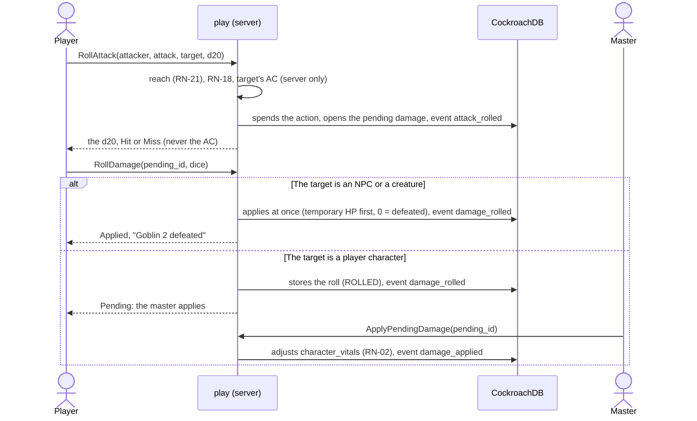

# Attacks and damage

An attack is two calls, `RollAttack` then `RollDamage`, because with physical dice the player types the d20 and then the damage (RN-18, MR-012, MR-014).
This page covers the two steps, pending damage, roll modes, damage parts, resistance, combatant states, conditions and concentration, and the feature actions.

## The two-step attack

`RollAttack` checks who may: the player on their own character, on their turn, with the action free, the target in sight and in reach; the master on any combatant on turn, with no limit of reach or action (the Captain with several weapons is theirs).
It rolls the d20 (`crypto/rand` in the app, or the typed face 1 to 20), spends the action and compares with the target's AC (`rules/combat.ResolveAttackFrom`).
A natural roll in the sheet's critical range or more is a critical hit for a weapon attack, a spell attack needs the 20, and a natural 1 misses.
The response carries the roll in numbers (`1d20 (13) + 6 = 19`) and the result, never the AC for the player; the master's response carries `target_armor_class`, with a Shield's +5 stored in the event so a resend finds the same.
`TestRN20_PlayersNeverReceiveCAOrHiddenLogEntries` searches the AC in the player's JSON and checks the master's has it.
A hit opens a `pending_damages` row (stored, so a resend or a reload finds it).
The AC is the sheet's: a shield beside a two-handed weapon on the sheet adds nothing, in the combat and in the comparison alike.
A Protection used on the attack gives the roll disadvantage, with its own source in the mode (see [Reactions](reactions.md#protection)).
A weapon attack held for a Lucky or Bardic Inspiration question is in [Held rolls](held-rolls.md); a hit that waits for a reaction is in [Reactions](reactions.md).

`RollDamage` rolls the damage dice (on a critical as the table rule says; the modifier once; the attack's type) or validates the typed sum (`dice.Physical`, from N to N × faces).

The Attack action makes one attack, or more with Extra Attack: `combatants.attacks_made` counts the turn's attacks, the first spends the action, the following fit while any remain (`AttacksLeft`) and the last gives `ATTACKS_USED`; the counter returns to 0 at the start of the turn.
Extra Attack belongs to weapon attacks only: a cantrip spends the whole action and counts no attack, and after a weapon attack a cantrip gives `ACTION_USED`, and vice versa.
The master has the last word on an NPC, with one exception: an NPC from a creature with a Multiattack (`AttacksPerAction` above 1) is held to the count of its routine, and the attack after the last gives `ATTACKS_USED` to the master too (`routineLeft`); a creature without Multiattack, a reaction, the extra action and a player's character the master acts for are not counted. The routine itself (which attacks, in which mix) is not stored: the screen reads it from the stat block, and ending the routine early is the screen's.

**Beams and bonus action attacks.**
A cantrip with several beams (Eldritch Blast) is one attack roll per `RollAttack`, each beam with its own damage (Agonizing Blast on each), up to `Attack.Beams`; the combatant row remembers the attack of the action (`action_attack_key`) and `attacks_made` counts the beams.
`GetTurnOptions` offers the next beam the same way (`beams_left`).
When the action's attacks are all made, a weapon attack goes on as a bonus action attack if a rule lets it (`combat.BonusAttack`):

- after the Attack action with a light melee weapon, a different light melee weapon (Two-Weapon Fighting; the character must carry two light melee weapons, because the app does not track hands: `BonusAttackTurn.NoSecondLight`; the damage leaves out the ability modifier unless negative or the character has the style);
- after the Attack action with an unarmed strike or a monk weapon, one unarmed strike (Martial Arts, full modifier);
- after Flurry of Blows, its two unarmed strikes (`bonus_attacks_left`);
- for a frenzied rage, a melee weapon attack (see [States](#states)).

The bonus action attack spends the bonus action (`BONUS_ACTION_USED` when spent), never an attack of the Attack action, and the undo gives it back.
The server picks the rule from the state of the turn, so the request has no flag; `GetTurnOptions` shows the same choice beforehand and the app lists the attack with the "Ação bônus" tag and a line saying which rule makes it one.

## Pending damage

`pending_damages` stores a hit's damage, with the dice copied from the sheet at the time of the hit: a sheet changed later does not touch an open roll.
A critical already comes with the table rule applied (see [Table rules in combat](table-rules.md)).
The state goes `awaiting_reaction` → `awaiting_roll` → `rolled` (player characters only) → `applied` or `discarded`.

- **An NPC or creature applies at once** (`ApplyDamage`: temporary HP first, floor at 0); at 0 HP it is `defeated` and `nextTurn` skips it.
- **A player character's damage waits for the master** (RN-02): `ApplyPendingDamage` goes through `character_vitals` (the same path as the correction), with a floor at 0 and any `amount` the master wants in place of the rolled one; `DiscardPendingDamage` is "Não aplicar".
  At 0 HP the character is down: `GetEncounter` shows `COMBATANT_STATE_DOWN` ("Caído") to everyone who sees them, with no numbers.
  Death saves are in [Death and revival](death-and-revival.md).
- **`EndTurn` with open damage** of the combatant on turn refuses with `PENDING_DAMAGE`; only the master passes anyway (`discard_pending_damage`, "Passar o turno mesmo assim?"), and the open damage is discarded in the same transaction.
- **A heal** is a pending damage that is a heal; `RollDamage` heals at once, up to the maximum, by NPC and by character (through `character_vitals`); whoever was at 0 rises and the death saves reset.
- **Brutal Critical and Savage Attacks.** `pending_damages.extra_dice` carries the extra dice a melee critical adds: `Derived.BrutalCriticalDice` from the barbarian and `Derived.SavageAttacks` from the half-orc (`savage_dice` is the half-orc's share, used to name the extra die).
  A thrown weapon beyond its melee reach is not melee (`thrownAtRange`).
  `RollDamage` rolls `dice_count + extra_dice` dice of the weapon's die in one roll and `typed_sum` is checked against all of them.
- **Relentless Endurance** (`combat_relentless.go`) runs where a character's damage reaches its vitals (`ApplyPendingDamage` and the trap damage the master settles): when `combat.ApplyDamage` says the character fell to 0, the left-over damage is below the hit point maximum and the `relentless_endurance` resource has a use, the use is spent in the same transaction and the HP set to 1.
  The `damage_applied` event keeps `relentless` for the log (`CombatLogDamage.relentless_endurance`) and the undo.
- **A `drop_to_zero` hook** (`table_effects.go`, `dropToZeroHook`) runs in the same place, after Relentless Endurance: when the damage took a character from above 0 to 0, the left-over damage is below the hit point maximum (massive damage kills outright and no hook prevents it) and the character has an `on_event` hook for `drop_to_zero` it can pay (`link.Sheet.Hooks`: the resource it spends has the uses), the hook's heal replaces the 0 before the character is unconscious, so it stays on its feet, and the uses it spends are written in the same `AdjustVitals`.
  Damage counts wherever it lands on a character's vitals: `ApplyPendingDamage` (a trap's damage in a combat is a pending damage of it) and the settling of a trap damage waiting for the master (`ApplyTrapDamage`, in a combat or outside one: `trapDropHook` asks the same `dropToZeroHook`, so the rule has one copy).
  The master's corrections (`AdjustCharacterVitals` "Ajustar PV"; `AdjustCombatantHitPoints` refuses a player's character) are not something that happened in the fiction and never run the hook; neither does a druid's beast form taking the damage, a character already at 0 hit points (damage there is a death save failure, so the hook never raises a dying or dead character), or a blow that kills outright.
  An event runs the first hook that can be paid.
  The `damage_applied` event (a trap damage's too) keeps `hook` (the feature's key, the hit points healed, the uses spent), which the undo gives back with the hit points; the master and the target's own player read it in the log (`CombatLogDamage.hook`).

### Resistance

The damage of each type goes through the target's modifiers (`combat.Adjust`, SRD 5.1 "Damage Resistance and Vulnerability"): resistance halves rounding down, vulnerability doubles, immunity nulls, and the same resistance from two sources counts once.
`modifiersOf` (`combat_parts.go`) lists them:

- a creature's or an NPC's with a `monster_key` (what "Pôr no combate" and "Criar NPC" make, and a character's creature) from its SRD stat block, through `CombatRoster.DamageModifiers`;
- a player character's from its race and features (`effects/damage_resistances.json`: the tiefling's fire, the dwarf's poison, the draconic lineages) and the Rage's, which holds only while the state lasts and no heavy armor is worn.

A stat block entry counts when it has no condition, or when its only condition is "from nonmagical attacks" (the snapshot's `qualifier: "nonmagical"`, set by `cmd/srdimport` from the SRD's words and carried by `rules.CreatureDamageMod.Qualifier`): `characters.typeModifiersOf` keeps those apart (`TypeModifiers.ResistantNonmagical`, `ImmuneNonmagical`) and `statBlockModifiers` turns them into `combat.Modifier`s with `Qualifier: combat.QualifierNonmagical`.
An entry limited by a material ("... that aren't silvered", "... that aren't adamantine", qualifiers `nonmagical-unless-silvered` and `nonmagical-unless-adamantine`) is not applied: no attack carries a material, so the master corrects an NPC's HP by hand (`AdjustCombatantHitPoints`).
A modifier with the nonmagical qualifier covers a damage only when `combat.Origin` says it is an attack and not a magical one. `damageFlow.originOf` answers it for a pending damage: the damage of a cast is a magical attack; an attack of the attacker's sheet or stat block is magical when `link.Attack.Magical` is (a cantrip or spell attack; a creature's attack when its stat block has the trait "Magic Weapons"; the sheet can mark any attack, an unarmed strike included, through `rules.Attack.Magical`); a weapon of a character and the unarmed strike are not magical unless marked, and `rules.unarmedStrike` marks the unarmed strike of a sheet that has `feature:ki-empowered-strikes` (monk 6, multiclass included; read from `Derived.Features`, not an effect), never a weapon line. A damage with no attack behind it (a trap, a zone, an ongoing effect, a reaction's own damage) is no attack: `AdjustForType` does not read the nonmagical lists, so the clause does not reduce it.
The step is the usual resistance or immunity step with `combat.Step.Qualifier` set, and its label says so ("Resistência a perfurante de ataque não mágico (Grick)"). `stepGroup.From` keeps the origin so the steps are worked out the same when the master leaves a source out.
The steps are kept per type with their sources (`pending_damages.steps`) and shown to the master and the target's player as `DamageStep[]`.
The master may leave a source out when applying (`ignore_modifiers`, at most `maxIgnoredSources`).
An NPC's resistances reach the master alone (RN-20).
The conditions a stat block is immune to do not go through these modifiers: they ride on the traits and `immuneToCondition` reads them when a condition is given (see [Creatures](creatures.md#what-the-combat-does-with-a-creature)).
A trap's damage on an NPC or creature goes through the same adjustment.

### Damage by parts

A hit with more than the weapon opens `PendingDamage.parts[]`:

- the weapon;
- the **offered** extras (Sneak Attack, Divine Smite with the slot to spend, Hunter's Mark, Colossus Slayer); a line that cannot be chosen is disabled and says why;
- the **automatic** lines (Rage's bonus, only on a melee Strength weapon attack; Improved Divine Smite; Dueling; Brutal Critical through `automaticLines`).

A critical doubles the dice of every part (or follows the table's "maximum plus a roll"), never the fixed numbers (SRD 5.1 "Critical Hits").
In the app the server rolls every part; with physical dice the player types a sum for each part (`typed_parts[]`).
Divine Smite's extra die against an undead or fiend is rolled as its own part and only counts when the target is one: the player sees "+1d8" and never why, and the damage a player reads on an NPC is the damage as rolled (`damageHit.Shown`), so the total says nothing either.
The `extra_damage` effect of a table feature ([Rules: table content](../rules-table-content.md#extra-damage)) is one more choosable extra after a weapon hit by a player's character: a fixed damage and/or dice, of the feature's damage type or the weapon's. The dice are a part like a maneuver's die (`partRecord.Count` and `Sides`), rolled in the app or typed per part, and a critical hit doubles them (`partCriticalDice`) unless the feature keeps them (`partRecord.NoCrit`); the fixed damage never doubles. Each part lands in `byType` under its own damage type, so a resistance takes only that line. It is listed off, with its reason, when the target is not larger (the sizes are public), when the weapon is of the other kind (melee or ranged; a thrown weapon at range is ranged), when it was used this turn (only for `once_per_turn`) or when the resource has no use left; marking it spends a use and the rider is the master's alone. The once-per-turn mark is kept by feature key in `combatants.table_once_turns`, and the master's undo puts it and the use back. `each_hit` sets no mark. It is not a maneuver: the one-maneuver-per-attack limit does not count it.

Sneak Attack and Colossus Slayer are once per turn (`sneak_attack_turn`, `colossus_slayer_turn`); Hunter's Mark follows the caster's concentration (`combatant_states`).
Great Weapon Fighting rerolls 1s and 2s once, shown on the part.
The master sees the damage by part and takes an extra out with a reason (`RemoveDamagePart`); the weapon and automatic lines stay.
Undoing a damage roll gives back the slot, the once-per-turn marks and the rolls.
An area spell's damage is one roll for the whole cast: it settles every pending damage of the cast still waiting for a roll with the same damage type, in the combat's order (`sortByCombatOrder`), so `settled` in the event and `cast_pending_damages` in the answer read the same way on every run.

The rays of Scorching Ray are not an area: each hit opens a pending damage with no `cast_id`, so several rays at one creature are several separate rolls, listed in `cast.pending_damages` in the order of the rays (the request's target order, a target's rays together).

## Roll modes

Every d20 the app rolls for a creature (weapon, spell and creature attacks, spell saves, traps, puzzle hints, scene checks, trap searches) goes through one rule: the server works out the sources of advantage and disadvantage (`rules/combat/advantage.go`), and the mode follows SRD 5.1 "Advantage and Disadvantage": one or more of each cancel to a normal roll, and sources of the same kind never add up.
The pure rules are `AttackMode`, `SaveMode` and `Resolve`; the facts they read (positions, conditions, states, traits) are gathered in `combat_advantage.go`.
`GetTurnOptions` and every roll answer carry `mode`, `suggested_mode` and `sources[]` (`AdvantageSource`: kind, effect, Portuguese sentence).
Death saves and initiative are untouched.

- **Who sets the mode.** The player rolls the suggestion, or disadvantage with a reason of 1 to 120 characters.
  Advantage the server did not suggest, and "normal" where it suggested disadvantage, is the master's to give: the player sends `RequestRollMode` with the reason and the master answers (`AnswerRollModeRequest`: approve, refuse or any mode), and the attack names `roll_mode_request_id`.
  The master sets any mode on his own rolls with a reason.
  A request closes when the attack uses it, when the player takes it back (`CancelRollModeRequest`), or when the turn or combat ends.
  Every change is a log line.
- **Where the text lives.** `session_events` holds ids and numbers only, so reasons are rows of `combat_reasons` and `roll_mode_requests`; the event carries the row's id.
  A reason is read by the master and the attacker's player only.
- **Physical dice.** With a real die the player types both faces (`d20_faces`, in the order rolled); the server picks the one that counts (`counted_index`).
  A call with the wrong number of faces is refused with a message saying how many.
  `RollSceneCheck`, `SearchForTraps` and `TryPuzzleHint` take the same field.
- **What counts as a source.** Conditions of attacker and target (Blinded, Frightened, Invisible, Paralyzed, Poisoned, Prone with the 5 ft rule, Restrained, Stunned, Unconscious, Petrified); an attacker or target the other cannot see (a fog map hides it from the player; the master's own "hidden" mark changes no roll); long range (not for a weapon attack whose attacker has a `ranged_attack` with `no_long_range_disadvantage`) and a hostile within 5 ft for ranged attacks; Reckless Attack; Danger Sense (only against an effect the character sees); Dodge; Pack Tactics; Rage on Strength checks and saves; armor or a shield without proficiency (`armor_untrained`, a player's character only: `armorTrainingOf` in `characters` gives it to no NPC, creature or beast form, and `combat.ArmorSpoilsAbility` says which rolls, Strength and Dexterity checks, saves and weapon attacks, never a Constitution save such as concentration nor a spell attack; see [Casting](casting.md#casting-in-combat) for the spells it stops); Frightened and Poisoned on ability checks; the racial advantages on saves against one kind of source (`TaggedSave`: Brave, Fey Ancestry, Gnome Cunning, Dwarven Resilience, read from the sheet's `against:` hints by `taggedSavesOf`), which apply only when the save lists what it is against (`SaveScene.Against`, worked out in `combat_against.go` for a spell's save, an effect's and a trap's; a save with no known source keeps the sheet's reminder) and read "Bravura: vantagem no teste de resistência contra ficar amedrontado" on the roll card; the Help; lasting effects (see [Lasting effects](lasting-effects.md)).
  A hit within 5 ft against a Paralyzed or Unconscious target is a critical hit (`critical_on_hit`).
- **What the player sees.** Only the sources they can see are listed; the mode counts all of them.
- **The shape of an attack** (`shapeOfAttack`, `attackShape`) says whether it is melee or ranged.
  A spell attack is ranged when its range is beyond touch.
  A melee weapon is a thrown weapon when its long range is beyond its melee reach (a spear, a dagger, a javelin).
  A thrown weapon is a melee attack up to its melee reach, and a ranged attack made by throwing it beyond the reach, up to its throwing range.
  The melee reach is 5 ft, or the longer reach a `weapon_rule` or a `pseudo_weapon` gives the line (`link.Attack.ReachFt`, read by `attackMeleeReach`).
  Cover, Rage and the other rules for a ranged attack follow the same reach.
  Without a map the distance is unknown, and a thrown weapon with the usual 5 ft reach is a melee attack within 5 ft.
  A thrown weapon with a longer reach has no known "within 5 ft" there, like any reach weapon: a hit on a paralyzed or unconscious target is not a critical hit by itself, and a prone target gives no advantage.
  An opportunity attack is melee at any distance.
- **Spell attacks.** `GetTurnOptions` writes the same `roll_mode`, `sources` and `critical_on_hit` on each target of a spell that makes an attack roll (`turnModes.annotateShape` with `shapeOfSpell`), so the cast sheet suggests the mode `CastSpell` will roll and asks for the right number of typed d20.
  A spell attack of the `half_on_miss` kind (Acid Arrow) that misses opens a pending damage with `half` set: the dice are rolled as usual and the amount is half of the total, rounded down, taken through the target's resistance like any damage.

## States

`combatant_states` holds what lasts a while: Rage, Marcado (Hunter's Mark), Esquivando (Dodge, also from Patient Defense) and Ataque descuidado, each with its source and end.
A condition's source and end (Stunned by a Stunning Strike) live in `combatants.condition_sources`.
The app refuses a spell to a raging character.
The log has one line for each state that begins or ends.

- **Rage** lasts 10 rounds.
  It ends early at the end of the barbarian's turn if it neither attacked a hostile creature nor took damage since its last turn: the player is asked first (`AnswerRageEnd`: "Voltar e atacar" or "Deixar a fúria acabar"); the master's end applies the rule by itself.
  Unconsciousness, defeat or the end of the combat ends a Rage.
  `EndRage` ends it with the bonus action.
- **Frenzy** (`combat_frenzy.go`).
  `TakeActionRequest.frenzy` on `feature:rage` makes the rage a frenzy, refused with `FRENZY_UNAVAILABLE` unless the sheet has the Berserker's `feature:frenzy` (`link.Traits.Frenzy`).
  It is stored on the rage's own `combatant_states` row with no new column: a frenzied rage has its own combatant as `source_id`, and the view sets `CombatantEffect.frenzy` ("Em frenesi").
  On the barbarian's turns after the one the rage began in, `combat.BonusAttack` returns `BonusFrenzy` for a melee weapon attack with no Attack action required (`BonusAttackTurn.FrenzyReady`); `ActionOption.offers_frenzy` tells the screen to ask.
  When a frenzied rage ends (`endRage`, `afterStatesEnded`, or `endEncounter` with reason `left`), `addExhaustionLevel` adds one level of exhaustion in the same transaction (level 6 goes to the death confirmation) and writes an `exhaustion` event with `Reason: "frenzy"`; the owner and master read "Frenesi: +1 nível de exaustão".

## Conditions and concentration

Conditions are labels (`combatants.conditions`, SRD keys like `condition:poisoned`): `SetCombatantConditions` swaps the whole set (master only; a player may only end the concentration of their own character).
Players see the conditions of the combatants they see (keys and Portuguese names, `condition_names_pt`), never a hidden one's.
Conditions that come from lasting effects are managed there (see [Lasting effects](lasting-effects.md)).
The browser keeps a list of the 15 condition names in `core/combat/conditions.ts`; it must match `names_pt.json`.

A concentration spell puts its name in the caster's `concentration_spell`; a second swaps it, and the log says which ended (RN-22).
When damage is applied to someone concentrating, the response and log carry `concentration_dc` (`combat.ConcentrationDC` of the damage taken, without what temporary HP absorbed), only for the master and the target's player.
A spell is one source of damage however many types it deals: the reminder comes once per target and cast, on the damage that settles the cast's last pending damage for that target in any way (applied, or discarded: the DC then comes with the discard, from what landed before it, and there is none when nothing landed), with the DC from the sum of what the cast cost the target (`pending_damages.taken`, set when damage lands and cleared by the undo).
The save itself is `ResolveConcentrationSave` (see [Reactions](reactions.md)).

## Standard and feature actions

`TakeAction` accepts the ten standard actions (Dash, Disengage, Dodge, Help, Hide, Ready, Search, Use an Object and more, from `effects/standard_actions.json`) and the `TurnOptions`' `feature_actions`.
It spends the economy (a free action spends nothing) and, for a feature action, a use of its resource (`NO_USES` with the `recharge`; only player characters count uses) and goes to the log.
Uses spent live in `character_vitals.resources_used` (`{key: uses}`, clipped to the sheet's maximum on read).
A race trait key (`trait:`) is treated as a feature action.
Dash is a mark (`markDashed`), not a count: a second Dash in the same turn still gives double the speed, not triple.
Dodge adds the `dodging` state until the start of the dodger's next turn.

| Feature action | Economy | How combat treats it |
| --- | --- | --- |
| Second Wind (fighter) | Bonus action, 1 use per short rest | Heals 1d10 + level through the HP path |
| Action Surge (fighter 2) | Free; 2 uses from level 17 but once per turn (`combatants.action_surged`, `ALREADY_USED_THIS_TURN`, which the master may override) | Returns the action and the attacks |
| Rage (barbarian) | Bonus action; unlimited at level 20 (99 uses, shown "ilimitado") | Spends the use; the effects are the states above |
| Bardic Inspiration (bard) | Bonus action | `GiveBardicInspiration` (see [Vitals, rests and class resources](rests-and-resources.md)) |
| Cutting Words, Uncanny Dodge, Deflect Missiles (reaction) | Reaction | Spend the reaction; their windows are in [Reactions](reactions.md) |
| Divine Sense (paladin) | Action | Spends a use |
| Lay on Hands (paladin) | Action | `UseLayOnHands` (see [Vitals, rests and class resources](rests-and-resources.md)) |
| Channel Divinity (paladin: Sacred Weapon, Turn the Unholy) | Action | Spends the action and one use of the shared `channel_divinity` pool |
| Channel Divinity: Preserve Life (Life cleric) | Action | Spends the action and a use, and restores the hit points the request asks (`preserve_life`: a creature and its points; a request that names no one shares the points among the cleric's side, the creature hurt the most in proportion first, `neediest`), at most five times the cleric's level in all, to creatures within 30 ft (`distanceFt`) that are not undead or constructs, each to no more than half its maximum (`healCombatant`, `combat_channel.go`). The event keeps what each creature got (`channel.heals`, with the hit points before for the undo); the master and the cleric's player read it in the log (`channel_divinity`) |
| Channel Divinity: Turn Undead (cleric) | Action | Spends the action and a use; each undead within 30 ft that is not both blind and deaf makes a Wisdom save against the cleric's DC (`link.Sheet.ChannelDC`: 8 + proficiency + Wisdom), rolled by the app with the creature's own save mode, and the ones that fail get the effect `effect:turned` for 10 rounds (a lasting effect whose texts tell the master what a turned creature does; it does not end by itself on damage). The event keeps each save and the rows of the effect, which the undo deletes |
| Wild Shape (druid) | Action | Not through `TakeAction` (it needs the beast): `AssumeWildShape` (see [Creatures](creatures.md)) |
| Flexible Casting (sorcerer) | Bonus action | `CreateSpellSlot`, `ConvertSpellSlot` |
| Flurry of Blows (monk 2) | Bonus action | Needs the Attack action first (`ATTACK_ACTION_FIRST`); spends 1 ki and gives two unarmed strikes rolled as bonus action attacks |
| Patient Defense, Step of the Wind (monk 2) | Bonus action | 1 ki each (the feature's `grant_action` names the resource). One action per choice (`feature:step-of-the-wind:disengage`, `:dash`; Patient Defense takes Dodge), with the standard action's effect. Step of the Wind doubles every jump distance until the monk's next turn |
| Slow Fall (monk 4) | Reaction | Takes 5 times the monk level off the pit fall damage waiting for the monk (`combat_slowfall.go`; refused, with the reaction kept, when none waits; the event keeps `fall_cuts`) |
| Cunning Action (rogue 2) | Bonus action | One action per choice (`feature:cunning-action:dash`, `:disengage`, `:hide`), with the standard action's effect (`rules.featureStandards`; `link.FeatureAction.Standard`). A table bonus action whose text names Disengage, Hide or Dash routes the same way (`rules.standardsNamedIn`) |
| Fast Hands (rogue) | Bonus action | Spends the economy and logs |
| Hunter's Prey: Giant Killer (ranger); Fighting Style: Protection (fighter, paladin) | Reaction | Spends the reaction and logs; usable off turn |
| Breath Weapon (dragonborn) | Action | Spends the action and a use and logs |

Second Wind, Action Surge, Preserve Life and Turn Undead change numbers; the rest spend and log, and the effect is the table's.

### The table's actions that spend, heal and give (MR-025)

A feature action from the table's content (a `grant_action`, see [Costs, healing actions and hooks](../rules-table-content.md#costs-healing-actions-and-hooks)) reaches `TakeAction` as `link.FeatureAction` with its `Cost`, `CostMax`, `Heal`, `HealPerPoint`, `TempHP` and `TempHPPerPoint` (`characters.featureActionOf`), and the option is off with `NO_USES` while fewer uses than one use costs are left (`actionOption`).
`takeActionFlow.spendFeatureUse` reads the uses left in the transaction of the use and asks `rules.Action.Spend` for what to spend: `TakeActionRequest.spend` is the number the player picked (0 takes the cost; ignored when the cost is fixed), and a number outside the cost to `cost_max` or what is left is `invalid_argument` with nothing spent, never trusted beyond the number.
`grantResult` then gives the result:

- **The heal** is `Action.Outcome(spent)`: the dice of `heal` plus those of `heal_per_point` for each point above the cost, rolled like a damage (RN-18: `roll_in_app` or `typed_sum`, which must be set for an action that heals), through `healCombatant`, so it never passes the maximum and whoever was at 0 stands up and the death saves reset.
- **The temporary hit points** go through `giveTempHP`, the spells' path: they do not stack, the larger number is kept, and the answer says how many were gained (`temp_hp_gained`, 0 when the target already had more).
- **The target** is the actor, or one ally named in `heal_target_combatant_id`: another player's character the caller sees. An NPC or a creature is `invalid_argument`; a dead target is refused with `TARGET_DEAD` (`refuseTheDead`) and nothing is spent.
- **The event** is the action's: `resource`, `points_spent`, the roll (`heal`, `dice_count`, `faces`...), `temp_tried` and `temp_gained`, the target when it is not the actor, and the target's hit points before for the undo, which also gives the uses back.
  The master and the actor's player read the numbers in the log (`CombatLogDamage` with `healing`, `amount` and `temp_hp_gained`); everyone else reads the line without them (RN-10).

### The monk's riders (RN-35)

A hit that qualifies opens one row per rider in `hit_riders` (`combat_riders.go`): the Open Hand technique when the attack was one of Flurry of Blows' by a monk with `feature:open-hand-technique`, and Stunning Strike for any melee hit by a monk with `feature:stunning-strike`.
The features reach play as `link.Traits.OpenHand`, `StunningStrike` and `KiSaveDC`.
`Encounter.hit_riders` carries the open offers (the master's all, a player's their own character's).
`CombatService.UseHitRider` spends the ki, rolls the target's save in the transaction, and applies the failure: Prone as a condition, or a lasting effect from `combat_effects.json` (`effect:stunning-strike`, `effect:open-hand-no-reactions`) anchored to the monk's end of turn.
The no-reactions effect uses the modifier `no_reaction`, which `refreshCombatants` copies to `combatants.effect_no_reaction`; the opportunity, reaction-window and `kit.canReact` gates read it.
A failed Strength save on the push moves the target through the forced-movement mechanism (see [Movement](movement.md#forced-movement)); the answer records the move in `rider.pushed`.
The answer is a `hit_rider` event (`CombatLogKind.HIT_RIDER`) and cannot be undone.
Its log line carries the target's d20, save total and the DC only for the master, and for the target's player when a player's character made the save; the monk's player reads only the result, since an NPC's roll never reaches a player (`TestOpenHandRidersOnlyOnFlurryHits`).

### A creature's actions and riders

An NPC's stat block carries more than its sheet attacks: `rules.ActionPlan` (see [Rules: creatures](../rules-creatures-items.md#creatures)) says which action asks a saving throw, which attack has a rider and which attack has several damage parts. `combat_creature_plan.go` ties a combatant to its plan by its monster key; an NPC's basic-sheet attack (`basic:i`) is matched to the action by name.

- **`CombatService.UseCreatureAction`** (master only). An action that asks a save (a breath weapon, a gaze) or rolls nothing (a reminder). It is the cast flow with the plan as the spell: `spellOfPlan` turns the plan into a `link.Spell`, and the targets, the area (`SpellOrigin` or `SpellDirection`, through `planArea`), the save roll (`rollSpellSave`), the pending damage the save governs (`openSavePendings`, half on a save when the plan says so) and the condition on a failure (`giveCondition`) are the ones of `CastSpell`. It spends the actor's action, and the actor must be the combatant on turn. The event is a `spell_cast` whose `creature_action` field holds the action's name, its reminder and its condition, so the log (`CombatLogEntry.creature_action`), the undo and the fog work as for a cast. An attack made with a roll is refused (`CREATURE_ACTION_UNAVAILABLE`): it is made from the sheet.
- **Attack riders.** A hit by an NPC attack whose plan has a save on hit (a ghoul's claws, a spider's bite) or a condition on hit (a constrictor's grapple) opens a `hit_riders` row of the kind `creature` with the action's key once its damage has landed (`offerCreatureRider`, from `afterDamage`). The master answers with `UseHitRider`: apply rolls the target's save as a spell save is rolled, opens the damage the save governs as pending damage and gives the condition on a failure, or gives the grapple's condition and notes the escape DC in the line; decline skips it. Like the monk's riders the answer is a `hit_rider` event and cannot be undone; the offer is tied to the damage that opened it (`hit_riders.pending_id`), is offered once per damage and not to a target the hit downed, and the undo of that damage takes it back. The damage a rider opens is hosted by the rider's own `hit_rider` event (`riderEvent.Pending` and `More`, the ids `spellSave` opened), as a cast hosts its targets' damage, so the roll and the apply that follow land on the rider's log line (`CombatLogHitRider.damage`, `more_damages`), read by a player as a cast target's damage is (`TestCreatureRider_TheDamageItOpensIsInTheLog`).
- **Damage parts.** The parts of an NPC attack after the first come from the plan (`plannedParts`) as automatic parts of the same pending damage, so one apply, one concentration check, and each part takes the resistance of its own type. A character's attack is unchanged.

Who sees what: the creature's numbers (the DC, the escape DC, the plan's text) are the master's. A player reads the save his own character makes and the damage he takes; a creature rider is never in a player's `hit_riders`, and a player who answers one gets `permission_denied` whether it exists or not. The stat block's key (`monster:ghoul#claws`) names the creature's type, so a player never reads it (`shownKey`): the log, the damage lines and the rider lines give the action's name only; the condition, its duration and its repeating are told only with a target the viewer may read it on. A creature's action is no spell: its save is not against magic and its damage is not magical unless the stat block's attack is a spell attack. A hidden creature's action is masked as a hidden NPC's attack is (`TestACreatureActionShowsThePlayersTheirSaveNeverTheStatBlock`, `TestACreatureRiderShowsThePlayersTheirSaveNeverTheStatBlock`).

## Not modeled

- Wild Shape's duration (hours) is not counted.
- A druid already in a beast form cannot use Wild Shape again to change form: they return to the normal form first.
- Swimming and climbing cost no extra (see [Movement](movement.md)).
- A stat block resistance with a condition is left to the master (above).
