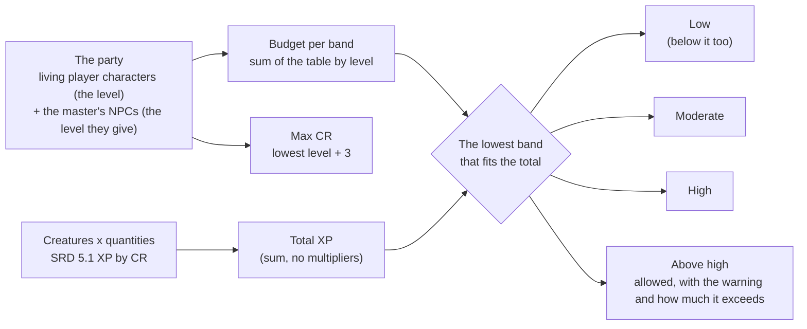

# Monsters in combat and the encounter builder

"Pôr no combate" puts SRD monsters into a combat (MR-042, RN-29); the encounter builder measures an encounter against the party, generates one from a seed and stores it on a battle point (MR-043).

## Monsters in combat: "Pôr no combate"

`CombatService.AddMonsters` (`combat_monsters.go`) puts 1 to 10 monsters of an SRD creature into a combat in `SETUP` or `ACTIVE`, like `AddCombatants`, and only the master calls it.

**Monsters are copies, in the combat, of a single NPC per campaign and creature** (RN-29, "one per creature").
`characters` makes it the first time and reuses it (`CombatRoster.MonsterNpc`, `characters/combatmonsters.go`).
It is a minion with the basic sheet "Criar NPC" makes (`npcSheetFromCreature`, the same function), average HP and `BasicSheet.combat_only` on (a server-only field: `checkSheet` zeroes it on input and `keepCreatureLink` keeps it).
The creation key is a fixed UUID v5 of the campaign and the creature, and `INSERT ...
ON CONFLICT (campaign_id, create_key) DO NOTHING` followed by a read in the same transaction makes a single NPC even with two adds at once (`GetOpenGameSessionForUpdate` already queues them).
The NPC never appears in the master's list (`ListCharacters` filters it by `sheet->'basic'->>'combat_only'`; no column), and `participants()` (`StartEncounter`, `AddCombatants`) and the stage refuse it with `invalid_argument`: the only way in is `AddMonsters`.
It is never deleted: combatants, XP and the summary point to it.

Each monster's name and HP live on the combatant row.
`planned` carries the base name (`copyLabels` counts from what is already in the combat, and a lone monster gets the plain name unless the combat already has a copy of it: "Goblin" or "Goblin 2"; a creature whose name only begins with it, "Goblin Boss", is not a copy) and each copy's HP, which `addParticipants` uses in place of the sheet's maximum.
From there the combat treats the monster as any NPC: the state word and hidden (RN-20, RN-10), the sheet's attacks through `RollAttack` (so the critical hit follows the table rule, RN-24), and XP for enemies, which adds the `xp_value` copied from the sheet to the combatant (the creature's CR XP, RN-09), with the usual split and remainder (`TestMR042_ThreeBanditsGiveTheirXPToTheParty`).
The base name is the master's (1 to 30 characters) or the creature's in Portuguese; the bestiary is the public SRD, so a player who knows the creature can find its numbers, and the app only tells the player the name the master gave (whoever wants secrecy gives another base name, RN-20).
HP is the creature's average (the default) or rolled: the server rolls the hit dice (`2d8+2`, read from `Creature.HitPointsRoll`) once per monster, at least 1, before the initiative d20s (one rolled per monster, with the Dexterity modifier, RN-19).
They enter hidden unless the request says `hidden = false`, and without a square on the map: the master places them (in theatre nobody has a square, RN-25).
In a combat already running, the turn does not change.

**The idempotency key covers the whole request.**
The `combatants_added` event stores the parameters (the creature, the quantity, a hash of the name, the HP and hidden; never a name) and each monster's ids and HP (a start with many rolled monsters writes them as several `combatants_added` events, each within the payload limit, one log line each).
An identical repeat returns the same ids without rolling or creating anything; one with other parameters, or with a key an `AddCombatants` used, is `invalid_argument`.

**What only the master reads.**
`Combatant` carries `bestiary_creature_key` and `challenge_rating` (they come from the NPC and also hold for an NPC made by "Criar NPC"), and the log has the line `COMBAT_LOG_KIND_MONSTERS_ADDED` ("Bandido 1: 9 PV (2d8+2: 3, 4)"), master only and also from before the combat starts (round 0, the only line the log keeps of the preparation).
None of this reaches the player, neither through `GetEncounter`, nor the log, nor the stream.

## The encounter builder

The builder measures an encounter against the party, builds one from scratch from a seed, swaps a creature for another of the same XP and stores the encounter on a battle point.
The calculation is `rules/encounter` (pure: no database, clock or draw of its own; the seed is an input) and the budget table is content (`effects/encounter_budget.json`, the SRD 5.2.1's "XP Budget per Character", credited in `NOTICE`).
The RPCs are `EncounterService`'s, in the `play` module (`encounters.go`), which already talks to `characters` (the party), `maps` (the battle point) and the content.

- **The calculation (`EvaluateEncounter`).** The party's budget is the sum, band by band, of each member's budget by their level (1 to 20).
  The encounter's XP is the sum of creature XP × quantity (XP from the CR in SRD 5.1; no multipliers).
  The band is the lowest among low, moderate and high whose budget fits the total: below the low budget is still "Baixa", and above the high is `ABOVE_HIGH`, allowed, with `over_xp` and the warning, without the word "mortal".
  The max CR is the party's lowest level plus 3 (party NPCs count, with the level the master gave); a creature above it is not refused, it is a warning (`above_cap` on the row and `ABOVE_CR_CAP`).
  The other warnings: `NO_PARTY` (the budget is 0) and `TOO_MANY` (the creatures plus the party's combatants exceed 40; the party's combatants are the player characters and their living creatures, which enter with their owner).
  An empty encounter is valid (0 XP, "Baixa").
  The response carries the party, the budgets, the rows (each with the creature as the bestiary list shows it, the quantity and the subtotal), the total, the band, the max CR and the warnings: the browser does no arithmetic.
- **The party.** The campaign's living player characters with the sheet's total level (`CombatRoster.PartyLevels`, in the same query as `CombatParty`: never a dead, pending or archived one), plus the request's `extra_party`: NPCs the master puts at that point in the story, with the level they say (1 to 20).
  An `extra_party` may point to a campaign NPC (`character_id`: living, not a player's, never the NPC the app keeps for creatures) or be a name and a level.
  At most 10.
  The request's party is not stored: each read reads it again, so if a character dies the budget changes by itself.
- **The generator (`GenerateEncounter`; `rules/encounter/generate.go`).** Ours, written for the app without reading anyone's code (ADR-0015).
  Inputs are the requested band's budget, the max CR, the optional creature type, the seed and the max creatures (what is left of a 40-combatant combat after the party's combatants, at most 24).
  The candidates are the SRD creatures of the type with XP above 0, CR up to the max and XP up to the budget, in key order (so the list's order never changes the answer).
  One attempt draws a leader and spends what is left on a group of one creature or two: the group never has a creature of CR above the leader's; the first creature takes 50 to 70% of what is left (all, if the group is one) and the second the rest, and finally the dearest of the group get more copies while they fit.
  No creature has more than 10 copies.
  Two rules make the generator reach the requested band even for lopsided parties: on odd attempts the leader comes from all candidates, not only those costing one eighth to six tenths of the budget; and the group's creature type is drawn preferably among those that can spend its share in up to 10 copies, and, if none can, among the dearer half.
  The generator makes 48 attempts and keeps the one that spent the most ("spend as much of your XP budget as you can without going over", SRD 5.2.1), the first on a tie, and stops if one spends the whole budget.
  The cost never exceeds the budget, no creature exceeds the max CR, and the same seed gives the same encounter (a 32-bit splitmix64, the same on every machine).
  With no creature that fits, `failed_precondition` with reason `NOTHING_FITS`; with no party, `NO_PARTY`; with the party filling the combat, `NOTHING_FITS` too.
  The seed is the request's (`uint32`); with 0 the server draws one (two d100, 1 to 10,000) and returns it, which is "Gerar outro".
  `BenchmarkGenerateEncounter` measures it.
- **"Trocar" (`ListEncounterSwaps`).** For a row, the SRD creatures of the same XP (so the total does not change) and, if the master chose a type, of the same type; the creature itself is left out, in Portuguese-name order.
  The quantity stays with the row.
  The app removes from the list those the encounter already has.
- **Storing on a battle point.** `SaveBattleEncounter` stores, in place of what the point had, the encounter (`BattleEncounter`: creatures and quantities, each group's base name, how HP are chosen and whether the monsters start hidden) in the `battle_encounters` table (the `play` module).
  `GetBattleEncounter` reads it already measured against the day's party (with `extra_party`, if the request sends it), `ClearBattleEncounter` removes it (clearing a point without an encounter is not an error), and `ListBattleEncounters` says which points of a map hold one ("Já guarda um encontro").
  The encounter is stored normalized (counts, HP mode and hidden explicit), so storing the same encounter again writes nothing, not even the time.
  The point must be a battle point of the campaign (`MapKeeper.BattlePoint`, read before the transaction; a point that vanished is `not_found`).
  XP and the band are never stored.
- **Who reads (RN-10).** All RPCs are the master's, and the player, the pending member and outsiders get `not_found`, not `permission_denied`: neither the builder's existence nor a stored encounter's is confirmed.
  The table is read only by this file (`maps` never reads it, so `GetMap`, the point and a player's stream do not reach it), and the RPCs publish nothing to the stream.
- **A creature that vanished.** A stored encounter survives a content change: `GetBattleEncounter` still returns it, leaves the creature out of the calculation and lists it in `unknown_creature_keys` with the `UNKNOWN_CREATURE` warning; storing or measuring an encounter with a key that is not in the SRD is `failed_precondition` with the reason `UNKNOWN_CREATURE`, until the master removes it.
- **A point that stopped being a battle point.** `ListBattleEncounters` only lists battle points (it joins `map_points`), but `ClearBattleEncounter` deletes the row while it exists; without a row, a point that is not a battle point is `not_found`.

### "Começar este combate"

`StartEncounter` carries `monsters` (the groups: creature key, quantity from 1 to 40, optional base name), `monster_hit_points` and `monsters_hidden`.
The monsters travel in the request, not read from the point by the server: the master changes what the point stores before starting; theatre of the mind carries no point (`THEATRE_HAS_NO_MAP`), so a combat without a map started from a stored encounter only works if the monsters come in the request; and a read of the point inside the start's transaction would be one more cross-module calculation with no gain (the app reads the point first with `GetBattleEncounter`, and `StartEncounter` checks each creature again).
The monsters enter in the same transaction as the start and under the same idempotency key, by the same code as `AddMonsters` (`planMonsters`): each creature's NPC (one per campaign and creature, RN-29), the average or rolled HP (everyone's dice before the d20s), the names numbered together, hidden by default, each with initiative rolled at once and without a square.
The master's log line is written like `AddMonsters`' (a `combatants_added` event with the monsters, with no key of its own).
With monsters, `participants` may come empty (the whole party enters); monsters and the party together are at most 40 combatants, counting the characters' living creatures; each creature may have up to 40 monsters (the start does not have `AddMonsters`' limit of 10).
A repeated request with the same key returns the same combat without rolling anything: the start event stores a `digest` of the whole request (monsters, modes, participants, the combat's mode, the point and the name), and the same key with another request is `invalid_argument`.
It works the same in theatre and in a combat on a map.
The player reads only the players: hidden monsters do not even reach them, and the rest follows RN-20.

## In the browser

The screen only draws what the server measures and sends.

| Piece | What it does |
| --- | --- |
| `core/encounters/encounters-client.ts` | `EncountersClient`: a thin wrapper of `EncounterService` (`evaluate`, `generate`, `swaps`, `save`, `get`, `clear`, `list`), `providedIn: 'root'`, imported only by lazy code |
| `core/encounters/encounter-draft.ts` | `EncounterDraft`: the encounter the master builds (creatures, party NPCs) in signals, and the measurement. Each change asks `EvaluateEncounter` after a 250 ms pause, one at a time (a change arriving midway asks again when the first ends, with the newest draft) and discards the response that is no longer the draft on screen |
| `core/encounters/encounter-text.ts` | The words: the band ("Acima de alta", never "mortal"), the headline "Moderada · 1.550 de 1.875 XP", the warnings, the cap line, the party by level, the position of the bar's ticks, and the refusals by code and typed detail (`EncounterBuildBlocked`: `NO_PARTY`, `NOTHING_FITS`, `UNKNOWN_CREATURE`) |
| `core/combat/monsters.ts` | The names the monsters take, the room left in the 40, `AddKeys` (one idempotency key per opened sheet, repeated on the retry with the same parameters; the choice changed, another key) and `AddMonsters`' refusals. The combat's 40 is `invalid_argument` without a typed detail on the server, so the sheet checks the room before asking |
| `core/combat/combat-client-turn.ts` | `turn.addMonsters` and `turn.start` with the extras (`monsters`, `monster_hit_points`, `monsters_hidden`, the point and `mode`; left out, the table rule holds, and `THEATRE` never carries a point). The 40-combatant cap arrives as `EncounterBlocked` `TOO_MANY_COMBATANTS` |
| `shared/monsters/put-sheet`, `pages/encounters/*`, `pages/live-session/battle-encounters` | "Pôr no combate" (sheet), the builder (lazy page `campaigns/:id/encounters`), the bar, "Pôr um NPC no grupo", "Gerar encontro" with "Trocar", "Guardar no ponto de batalha", and the session's "Começar este combate" card, which opens the `StartCombatDialog` filled in (`StartCombatData.saved`) from the encounter the point keeps at that moment (it reads `GetBattleEncounter` again on the tap, since another tab can have changed it). The designs are in [Design](../../design/combat.md#monsters-creatures-and-encounters) |
