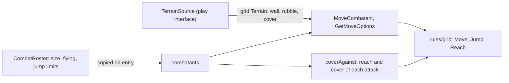
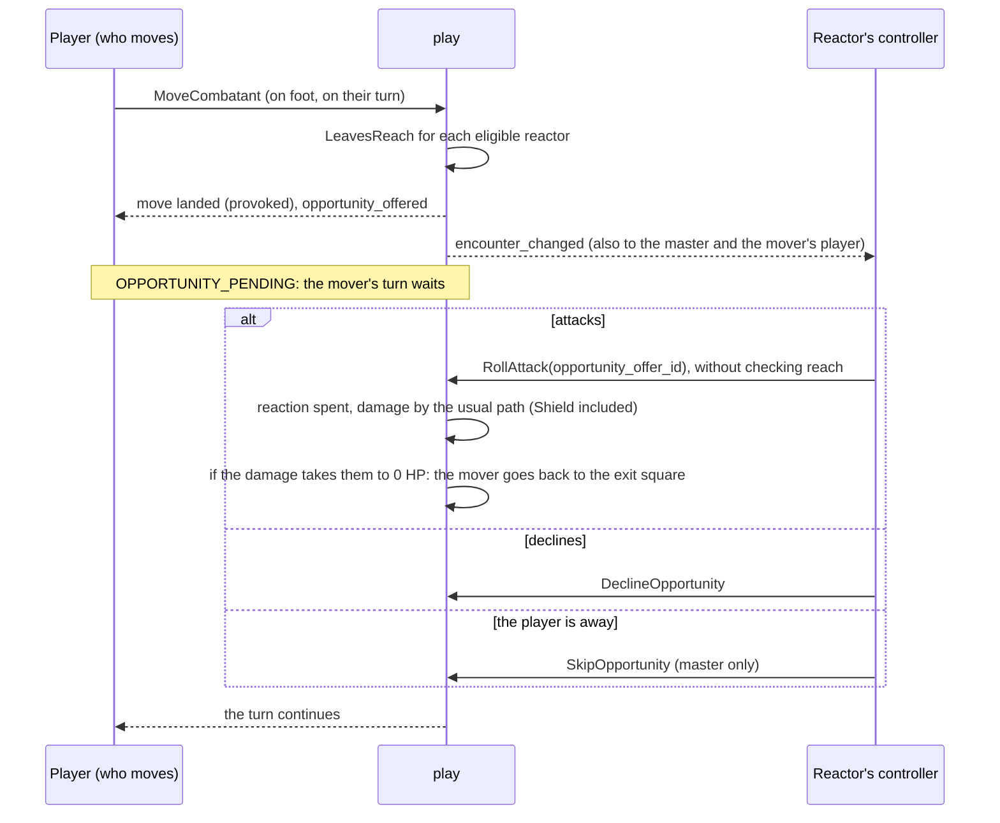

# Movement

Movement, reach, jumping, cover, opportunity attacks and area spells placed on the map belong to `play`, which calls `rules/grid` and `rules/combat.JumpLimits` and does not redo the geometry (MR-034, RN-21; `combat_move.go`, `combat_cover.go`, `combat_opportunity.go`, `combat_area.go`).
The numbers combat needs from a sheet are copied to the combatant when it enters, like speed: side, size, the flying, swimming, climbing and burrowing speeds and jump limits.
The turn's movement is the better of the walking and flying speeds; a creature with neither (a shark, a spider on its web) moves on the better of its swim and climb speeds (`speedFtOf`).
The swim and climb speeds (`combatants.speed_swim_ft`, `speed_climb_ft`) lift the extra cost of the water and of a climbable surface, and the burrow speed (`speed_burrow_ft`) is carried and shown.
A Wild Shape form and a creature bring their own (`applyBody`).
What stays on the server (RN-20): the AC with cover never goes to a player.
Without a grid (theatre of the mind) none of this applies; see [Theatre of the mind](theatre.md).

## How movement works

| Piece | What it does |
| --- | --- |
| `TerrainSource` | `Terrain(ctx, campaign, map) (grid.Terrain, error)`, declared in `play`, implemented by `maps.Service` (`terrain.go`): the grid and the wall, difficult terrain, cover and door layers the master painted (doors as they are, the truth), read with the same `gridOf` and `loadLayers` as `GetMapLayers`. With no layer row it is open floor; a map of another campaign is `not_found`; light does not enter. `cmd/api` wires it with `play.Service.SetTerrain`; a nil source is open floor. The terrain only counts if its grid is the combat's: layers of another grid, or a deleted map, become open floor |
| `MoveCombatant` | A straight line from the combatant's square to the chosen one. The player pays the exact length in tenths of a foot (`grid.Terrain.Move`; a diagonal step is worth 7.1 ft) with terrain and creatures counted, limited by the movement left; past it, `TOO_FAR` with `missing_dft`. The master moves for free, except an NPC (a combatant no player owns) he drags on its own turn in a plain walk (no `forced`, no jump, no placement): that is planned like a player's on everything there is (`planNPCWalk`, `paysItsWay`), costs the line and the terrain, spends the NPC's movement, stops for walls, creatures and squares marked "Não dá para passar", and past the movement left it is `TOO_FAR`, so the app asks "Mover mesmo assim" and sends the same drag `forced`. A player's walk to the square the mover already stands on is refused (the master's moves are not) (`INVALID_ARGUMENT`, "a move needs another square", like the jump to it): it travels nothing, so there is nothing to spend or log. A jump that a creature the player does not see holds at the landing is stopped at take-off: nothing is spent, the running start stays and the answer says `stopped_early`. `occupantsFor` builds each move's `grid.Occupants`: the other combatants on the map and alive, hostile when the side is the other, with the largest size of the square. The player plans with those they see; the real move runs `Terrain.MoveUntil` against everyone, stops before a hidden creature, charges the cost up to there and answers only `stopped_early`. A square occupied by someone they see is `SQUARE_OCCUPIED`; a hidden combatant does not block in the plan, so the error never reveals it. Closed doors the line crosses open, and a locked one stops it (see [Architecture](../maps/doors.md#doors)). Whoever has `speed_fly_ft` flies (the better of the two speeds, without paying rubble, water or a climb). Swimming and climbing cost the SRD's extra (see the Swimming and climbing row) |
| `GetMoveOptions` | `Terrain.Reach` for the reachable squares and `Terrain.Move` for the refused ones within the circle, each with a reason (`WALL`, `ENEMY`, `OCCUPIED`, `TOO_COSTLY`). Only the player's own combatant on their turn, or anyone for the master. A walk warns who may provoke (`provokes_reactor_ids`, only reactors the asker sees) and marks known traps (`known_trap_point_id`, `known_trap_name`) |
| Jump | `MoveCombatant` with `jump`. `LONG` uses `Terrain.Jump` (cost = length, no difficult terrain, no wall, no landing on a creature); `HIGH` spends the feet without moving. The limits come from `combat.JumpLimits` (stored on the combatant; standing still is half) and the running start from `combat.HasRunningStart` over `last_move_dft`, which sums consecutive moves on foot and is broken by an action, attack, spell or jump (`breakRun`; undo returns it). `GetTurnOptions` returns them (`TurnOptions.jumps`). Second-Story Work (Thief 3) adds the Dexterity modifier (feet, never below 0) to the running long jump only (`jump_long_bonus_dft`); Step of the Wind doubles every jump distance until the start of the monk's next turn (`combatants.jump_doubled`, cleared by `ResetCombatantTurn`, put back by the undo). `GetMoveOptions` with `jump = LONG` runs the same warning over the squares a long jump can land on. The `combatant_moved` event carries `jump`, `height_dft` and `landing_difficult`; the Acrobatics reminder is in the master's log only. A jump is on foot: the floor's speed (a flier's fly speed) pays for it and it is charged its length; what is left once it lands is at the speed of the surface of the landing square, as the counter reads it afterwards, and each square of the jump's options carries that as `left_after_dft` (the app never sums it) |
| Side and size | `combatants.side` (`party` or `enemy`) and `size`. Player characters and their creatures are `party`, NPCs `enemy`; the master switches an NPC with `SetCombatantSide`. Size comes from the race (the `Catalog`), `BasicSheet.size` (no value: Medium) or the creature's sheet (`CreatureByKey`). Every combatant occupies one square, Large or not |
| Reach | `grid.RangeFt`: the squares between centres rounded down, times 5 ft. A diagonal neighbour is 5 ft away |
| Speed and movement left | The turn has one counter of what was spent (`movement_used_dft`) and a speed for each surface (`speedsOf`, `grid.Speeds`; SRD 5.1 "Using Different Speeds"). The floor's is `FloorDFt`: the better of walking and flying, doubled after Dash, 0 under a condition that leaves no speed (grappled, restrained) or no movement (paralyzed, petrified, stunned, unconscious). The water's is the swim speed and the climbable surface's is the climb speed when the combatant has one, and the floor's otherwise (the surface then keeps its extra cost); the Dash, the effects and those conditions apply to each alike. A step is allowed while what was spent plus the line's cost up to it is within the speed of the surface it enters: after 20 ft on the floor, 20 ft more in the water is paid from the swim speed, and a step back onto the floor is held to the walking speed less all of that, and with nothing left the move ends. A swim speed below the walking speed is the limit in the water. `Terrain.Move`, `MoveUntil` and `Reach` share one step function (`lineCost`), so the options, the plan and the real move agree. The counter is the speed of the surface the combatant stands on: `Combatant.speed_dft` and `movement_left_dft`, and the lead of `GetMoveOptions`, say what is left at that speed (a swimmer on dry land reads its walking speed), and `ReachableSquare.left_after_dft` says what is left once on that square, so the screen never subtracts across a switch. Every counter comes from the one `speedsOf`: the stream, the Mover page's lead, `GetTurnOptions.economy.movement` (`movementLeftOf`) and the cost of standing up; none keeps a formula of its own. The stream reads the surface layer alone (`maps.Service.Surface`, one indexed read of one column) once per view, only for a view that carries a counter; a square the viewer does not see is floor (RN-10). A drag's factor divides the speeds and what was spent; a legendary move keeps its own budget |
| Swimming and climbing | `Terrain.Surface` is the master's surface layer (`MAP_LAYER_SURFACE`, `map_layers.surface`, two bits a square: floor, water, climbable), read through `TerrainSource` like the difficult terrain. Each foot of a move over water, or over a climbable surface, costs 1 extra foot (SRD 5.1 "Climbing, Swimming, and Crawling"), unless the mover has the matching speed: `moverOf` sets `grid.Mover.Swims` and `Climbs` from `speed_swim_ft` and `speed_climb_ft`, which `combatCharacter` (the sheet, a feature's or effect's grant), the creature join and `applyBody` (a Wild Shape form) already fill. A swim speed does not climb and a climb speed does not swim. The extra is the line's length times the share of the squares entered that are swum or climbed, so a line over water from end to end costs twice its length and a diagonal step in water 14.1 ft. A flier pays none; a jump clears the surface and costs its length. `Terrain.Move`, `MoveUntil` and `Reach` charge it in the same place (`surfaceCount.extraDFt`), so the options, the plan and the real move agree. Each `ReachableSquare` says it: `extra_dft` is the part of `cost_dft` that the surface adds and `surface_extra` names it (SWIM or CLIMB, whichever is on most squares of that line, SWIM on a tie); a line that crosses water and a climbable surface pays both, so `swim_extra_dft` and `climb_extra_dft` give the two parts apart, `crawl_extra_dft` is the crawl's part and `path_dft` is the rest (the line and its difficult terrain), and the four add up to `cost_dft`. The screen writes "+1,5 m nadando · +1,5 m escalando", or "1,5 m do caminho + 1,5 m nadando + 1,5 m rastejando" for a crawl, from them, with no arithmetic (`grid.Move.ClimbDFt` is the climbing part of `SurfaceDFt`). RN-10: a player plans on the surface they see or remember; one they do not know is floor to the plan, so the real move pays it, is cut short where the movement runs out and says only `stopped_early`, never why. The master's free moves stay free; an NPC walk pays |
| Standing up | Standing up costs half the speed, without the Dash, of the surface the combatant stands on (`standUpCostDFt`), checked against what is left on that surface: a prone swimmer in water pays half its swim speed. The surface is the real one (the server decides); a theatre combat has none, so the floor's. `stand_up_cost_dft` reads the same number |
| Crawling | While prone and on foot, every foot costs 1 extra foot (SRD 5.1 "Being Prone"): `grid.Mover.Crawls` adds the line's length to the cost (`crawls`), on top of the difficult terrain's and the swim's extras, which the SRD adds, so a crawl over rubble costs 3 per foot . `GetMoveOptions` offers each square at that cost. The drag's half speed is still a factor of the cost (`setFactor`). A flier on its fly speed does not crawl; the master's free moves are unaffected |
| Disengage | `standard:disengage` turns on `combatants.disengaged`, reset at the start of the turn and returned by undo |
| Undo | `combatant_moved` is undoable: the event stores where the combatant came from (`from`: square, distance walked, running start, cover mark) and the undo restores all of it. A move that dragged a grappled creature also keeps where it stood and its cover mark (`dragged_id`, `dragged_from`): the undo puts the creature back with the mark, and the fog follows it from the square it was dragged to |

**In tenths of a foot.** The server stores and charges movement in tenths of a foot (`movement_used_dft`, `last_move_dft`; `Combatant.movement_*_dft`, `MovementLeft.*_dft`); the fields in feet stay filled, rounded down.
The app draws what `GetMoveOptions` sends.

### Cover

`coverAgainst` takes the greater of `Terrain.CoverBetween` (with the other creatures' squares) and the master's mark (`SetCombatantCover`, event `cover_set`, cleared when the combatant moves; the move that clears it also sends `encounter_changed`, because `combatant_moved` carries only the square).
It adds +2 or +5 to the AC of weapon and spell attacks and to a spell's Dexterity save.
Total cover makes `RollAttack` and `CastSpell` refuse the player (`TARGET_COVER_TOTAL`; an area spell does not refuse) and the target list annotates it (`TargetInReach.cover`, `cover_source`, `untargetable`).
The AC with cover (`target_armor_class`, `cover_bonus`) goes only to the master; it is stored in the pending damage (`pending_damages.attack_armor_class`) so Shield can compare the blow with it plus 5.
A spell with the `ignores_cover` type in `effects/spells.json` (Sacred Flame; `Content.IgnoresCover`, `link.Spell.IgnoresCover`) adds no cover to the save, but total cover still refuses the target.
An attacker whose table feat has a `ranged_attack` with `ignore_cover` (`link.Traits.SpellAttackIgnoresCover`, `RangedWeaponIgnoresCover`) gets no half or three-quarters cover against its ranged spell or weapon attacks (a thrown weapon beyond its melee reach too; an opportunity attack is melee): `coverView.ignoring` makes that cover none for the roll, the event and the target lists.
A creature hidden from the players does not count as cover for a player's attack; when the master attacks, all count.

### Legendary moves

A legendary option of kind `move` (`MoveCombatant` with `legendary_option`; see [Combat](combat.md#legendary-actions)) is the master's walk of an NPC off its own turn.
It is planned like the NPC's own drag: the line, terrain, walls, creatures, doors, drag and crawl, and `TOO_FAR` past the budget.
The budget is a whole speed of its own.
It is the whole speed the conditions and effects leave the creature (the better of walking and flying), as at the start of a turn.
The Dash of its turn does not add to it and what it walked then is not subtracted.
`LegendaryOption.MoveSpeedPercent` scales it (half for "moves up to half its speed", the tarrasque).
Each spend gets the whole budget again.
It does not read the creature's movement of its own turn and does not write it: `movement_used_dft` and the running start stay as they were.
The undo puts the square back and gives the cost back.
It is a plain walk (no jump, no forced move, no placement; `invalid_argument`) and needs a map and a placed creature.
A creature with no square spends the option as text instead ([Combat](combat.md#legendary-actions)).
It is refused while a reaction window or hold is open (`REACTION_PENDING`).
A move to the square the creature stands on is refused (`invalid_argument`) and spends nothing.
It makes no opportunity offer: the offers belong to the mover's own turn, and the vampires' Move says it provokes none.
Known limit: this holds for every legendary move, including the tarrasque's, which by the SRD would provoke.
Its event is a normal `combatant_moved` with `spend_cost`; the log reads it as any move.

## Opportunity attacks

A move that leaves an enemy's reach lands at once and offers an attack to that enemy; the mover's turn waits for the answer (`combat_opportunity.go`).
`play` calls `grid.LeavesReach` (the whole line, the exit square included, and the last square still inside the reach) and the existing attack and damage path.
In theatre the server finds no offer, so the master makes it by hand (see [Theatre of the mind](theatre.md)).
On a grid the master can also offer one by hand, for a reach the server cannot see (`OfferOpportunity`; no square, and no reach check).
On a fog map the reactor's player must still see the mover to read the offer; otherwise the master withdraws or skips it.
A by-hand offer follows the same refusals as a move's: a surprised reactor, a reactor on the mover's side or with its reaction used, a hidden mover, and the same mover and reactor already waiting.

| Piece | What it does |
| --- | --- |
| Who provokes | `opportunityReactors`: the other `side`, on the map, not defeated, with the reaction free, no incapacitating condition (Incapacitated, Paralyzed, Petrified, Stunned, Unconscious) nor Blinded, not down, able to attack with its reaction (`mayAttack`) with a melee attack; whoever is in the same turn group also reacts. The reach is the sheet's greatest melee reach, at least 5 ft (`meleeReachOf`, from `attackMeleeReach` of each melee attack: the range of a thrown weapon does not count, the reach of its line does). The opportunity attack itself is a melee attack at the reach of its own line (`attackReach`, `modeShape`), so a glaive attacks at 10 ft where it provokes. For an NPC made from a creature, `basicDerived` reads from the stat block's attack of the same name whether it is melee and its throwing range. A hidden mover is seen by no one; on a fogged map the reactor must see the mover (see [Combat under fog](fog.md)); whoever used Disengage does not provoke; a creature being dragged by its grappler does not provoke (it never leaves the reach). A long jump provokes; the high jump, the master's placement outside the mover's turn, the master's `forced` move and the 0 HP rule's move back do not. A surprised creature's turn options are all disabled with `SURPRISED`, and an opportunity attack skips it |
| Offers | `opportunity_offers`: one per reactor per move, with the exit square (`jumped` for a jump). `MoveCombatant` writes an `opportunity_offered` event per offer before the move's event and puts the `move_id` on the move's event. A move that provokes sends `encounter_changed` to the master, the mover's player and the reactors' players (`publishOffersMade`), without a revision (players read again) |
| The turn waits | `mustNotWait` (called by `mustActNow`, which the attack, action and spell use, by `MoveCombatant`, by standing up and by the theatre move; `EndTurn` only waits for the offers, through `mustNotWaitForOffers`, and then passes them over): `OPPORTUNITY_PENDING` for the player of whoever has a pending offer or an opportunity attack with damage still to roll, apply or discard; it holds for the mover and for the same player's creatures in the turn group. `pruneOffers` marks as `skipped` the offers nobody answers any more. The master is never stopped, and when they end the mover's turn the pending offers become `skipped`. Other combatants' reactions do not wait |
| Answers | Attacking is `RollAttack` with `opportunity_offer_id` (implies `as_reaction`, does not check reach, writes `offer_id` in the event); `DeclineOpportunity`; `SkipOpportunity` (master only). The last two write `reaction_declined` with the `offer_id`. Who may: the reactor's controller (the character's or creature's player; the master for an NPC) and the master for any; a reactor the player does not see is `not_found`. An offer that no longer exists (move undone, turn passed) or was answered is `aborted` |
| 0 HP rule | The attack stores the damage it opened in `attack_pending_id`. When that damage takes the mover from above 0 HP to 0, `returnToReach` puts the combatant on the offer's exit square (the damage event stores `returned_from`, restored by its undo); if the exit square is occupied the mover stays and the event stores `return_blocked`. The move is published (`combatant_moved`) |
| Undo | Undoing the move deletes its pending offers (`move_id`). A move whose offer was answered is undone only after undoing the answer; undoing an opportunity attack, a decline or a skip returns the offer to `pending`. A decline and a skip have no log line of their own: the event attaches to the move's line, which becomes the undoable one. `opportunity_offered` events do not close the undo chain |
| Who sees what | `Encounter.opportunity_offers`: the master sees all, with names; the reactor's controller theirs, with the melee attacks and exit square; the mover's player sees `mover_id` and the reactor (id and name) only if the reactor is not hidden from them; other players none. The stream carries only the `encounter_changed` hint (and `combatant_moved` when someone goes back) |

## Area spells placed on the map

Rules: RN-21 and RN-10 in [Rules](../../product/rules.md).
The geometry is pure and in `rules/grid/area.go` (`Area.FromPoint`, `Area.FromCaster`, `Terrain.OpenArea`, `Terrain.NearSide`, `Toward`); `combat_area.go` puts it on a combat.

| Piece | What it does |
| --- | --- |
| Which spells | `placementOf(link.Spell)`: the twelve spells that keep their area ([Spell zones](spell-zones.md)) are laid out as their row in `zoneDefs` says (a cube at a range is a `POINT` for Web). Otherwise a sphere or cylinder at a range is a `POINT`; at range Self it is `CASTER`; a cone, line or cube at range Self is `DIRECTION`; anything else keeps the target list. The shape, size, a line's width (the text's "10 feet wide", else 5 ft) and "spreads around corners" come from `SpellDetails` (`Target`, `AreaWidthFt`, `SpreadsAroundCorners`) through `link.Spell`. `GetTurnOptions.spell_targets[]` carries `placement`, `area_shape`, `area_size_ft`, `area_width_ft`, `range_ft`; in theatre it is always `UNSPECIFIED` |
| Who is inside | `planArea`: the point (a player's is range-checked and moved to the near side of a wall; the master's is not), the shape's squares, `OpenArea` (a straight line blocked only by total cover, or the spread for a corner spell), then every combatant not defeated and placed on one of those squares whose cover from the origin is not total. Hidden creatures count: the effect applies to all of them |
| Cover | From the origin, the larger of the map's and the master's mark; `resolveOnTarget` adds it only to a Dexterity save that does not ignore cover. A creature reached only around a corner has the mark alone |
| Preview and cast | `PreviewSpellArea` runs `planArea` on a player's known terrain and lists only creatures the viewer sees. `CastSpell` runs it on the real terrain in its transaction and builds the hits from it (`targets` is not read); the event keeps the choice (`placed`, `area_col`, `area_row`, `dx`, `dy`, and `wall` for a wall) and each hit's `hidden_at_cast`, and the answer draws the area again from the choice. A player's log line leaves out `hidden_at_cast` hits; a placed cast is `Secret` only for a hidden caster |
| Sculpt Spells | `CastSpellRequest.sculpted_ids` (the evocation wizard): `sculptedOf` (`combat_metamagic.go`) checks it before the slot is spent (the caster has the feature, the spell is of evocation, at most 1 + the cast level, each among the targets, seen by the caller, not the caster, no repeats); `spellSave` gives each spared creature a save with `sculpted` and no roll, and opens no damage when the spell halves on a success. A held cast (Counterspell) replays it with the stored request |
| Hidden hits | `settleHidden` (`combat_reveal.go`): the table rule read in the transaction, the master's `reveal_hidden` over it, then reveal (`combatant_hidden_set` with `by_area`), keep, or open a `hidden_reveals` question. `mustNotHold` refuses with `HIDDEN_REVEAL_PENDING` while one is pending; `Encounter.turn_held` says it to everyone and `pending_hidden_reveals` to the master. `ResolveHiddenReveal` answers a player `permission_denied` before it reads the id |

## Forced movement

`combat_forced.go` moves a creature that failed a save, away from the source in a straight line. The table `forcedRiders` says how far (`PushFeet`, and an optional `MaxSize`) for each rider key: `spell:thunderwave` pushes 10 ft and `feature:open-hand-technique` 15 ft; another pusher is another row. The spell's SRD text and the technique's name no size limit, so `MaxSize` is empty for both.

| Aspect | Rule |
|---|---|
| Path | `planPush` takes the squares of `grid.Line` from the target outwards whose distance (`grid.LengthDFt`, 5 ft a square) is within the feet, and enters them one at a time with `Terrain.Move`. A wall, a three-quarters cover square, a locked or barred door, a closed door (a push opens none), the edge of the grid or any other creature (all as large as the pushed one, so none can be passed or shared) ends the push in the last free square |
| Effects | One `SetCombatantPlace` write: no movement spent, no opportunity offer, no damage, the master's cover mark cleared. Cover and fog follow the new square because both read the combatant's square |
| Casts | `castFlow.pushFailedSaves` runs after the hits, for the hits whose save failed (an automatic failure included), the farthest from the caster first; each hit keeps `pushed` in the event (`forcedMove`: target, `from` as a `moveState`, end square, feet, `short`) |
| Heights | The map has no heights, so a push never makes a creature fall |
| Monk | `riderConsequence` calls `pushByRider` for the Open Hand push; the rider event keeps `pushed` |
| No map | A combat in theatre mode (or a source with no square) moves nobody; the event keeps `no_map` and the log line (`CombatLogSpellTarget.push_no_map`, `CombatLogHitRider.push_no_map`) says the push is the table's to imagine |
| Log | `pushed_ft` and `push_stopped` on the two log messages |
| Stopped push | `push_stopped` is set when a wall, a door, the edge of the grid or a creature ended the push before its whole distance (`short`) |
| Blocked push | A failed save with no free square is a stopped push of 0 ft: nobody moves and no move is published |
| Log text | The app writes "empurrão de 3 m · 2 quadrados" (`pushText`, `combat-log-words.ts`), adds "que parou antes" for a stopped push and writes "não saiu do lugar" for a blocked one |
| Saved | A creature that saves has no push in its line |
| Streams | After the commit `publishPushed` sends `combatant_moved` to who may see the creature and `positionChanged` to the fog, as a move does |
| Undo | The undo of the cast puts each pushed creature back (`putPushedBack`) and the fog follows it. A rider answer is not undoable, so its push is not either |

## Mounted combat

A rider and its mount stay two combatants.
The rider row names the mount it sits on (`mounted_on_id`); the mount row says whether it is a willing mount (`mount_kind`).
A mount carries one rider, and a combatant that rides is not a mount.

| Aspect | Rule |
|---|---|
| Kinds | `""` is not a mount, `controlled` obeys its rider, `independent` keeps its own turn. The kind is the master's: `SetCombatantMount` marks an NPC or a creature, never a player's character |
| Refusals | `ALREADY_MOUNTED` for a rider that is marked, `MOUNT_TAKEN` for taking the mark off a mount that carries a rider. A mount that carries one may change between `controlled` and `independent` |
| Events | `mount_kind_set` is a session event the undo does not take back, like `side_set` |
| Mounting | `MountCombatant` puts the rider on a mount within 5 ft (a diagonal square included) that is at least one size larger. `DismountCombatant` puts it on a free square next to the mount that the request names, a square the server lists in `TurnOptions.mount.landing` |
| Landing on a hidden creature | A player plans the landing on the creatures they see, so `TurnOptions.mount.landing` offers a square only a hidden creature holds like any free one, and the master's does not. The real dismount runs on everyone and does what a move into that square does: the rider stays on the mount, nothing is spent, `mount_move_used` stays clear, no line is written and the answer says `stopped_early` (`DismountCombatantResponse`), never why. The rider may choose another square at once. A square a creature the caller sees holds is `NO_ROOM_TO_DISMOUNT`, and the master sees every creature, so it is refused that way for him |
| A rider at 0 hit points | A down rider stays on its mount and the pair keeps its order and its group. The mount keeps its Dash, Disengage and Dodge limit; its rider's player does not move it (`COMBATANT_DOWN`: a down rider directs nothing) and the master does. Nothing throws the rider off yet; the fall of a rider that drops to 0 belongs to the forced dismount, which is not built |
| Who may mount | The master mounts any combatant that is not a player's character. A player mounts their own creatures and the combatants of the party that the master marked as mounts. `NOT_A_MOUNT` otherwise, `MOUNT_TOO_SMALL`, `MOUNT_TOO_FAR`, `ALREADY_MOUNTED` and `MOUNT_TAKEN` for the rest |
| Cost | Half the rider's speed on the surface it stands on, without the Dash (`mountCostDFt`, next to `standUpCostDFt`), charged to its one `movement_used_dft`. A speed of 0 or too little movement left is `TOO_FAR` with `missing_dft` |
| Prone and defeated | Mounting asks nothing of the rider's or the mount's posture: a prone rider mounts for half its speed without standing up. A mount at 0 hit points keeps its rider linked, and the rider dismounts with `DismountCombatant` like any rider |
| When | A ride is made only in a running combat (`NOT_ACTIVE` in SETUP, for the master too), so no initiative is written while a rider exists: a total that changes later is the order's (`SetInitiativeOrder` and a join keep every controlled mount right after its rider) |
| Once per move | A rider mounts or dismounts once in a move: `mount_move_used` is set by either and the start of its turn clears it (`MOUNT_MOVE_USED`) |
| One square | The rider's square becomes the mount's, and the pair is one occupant: `samePair` keeps the two rows out of each other's way in the occupants of a move, a push, a drag, a teleport and a return to reach |
| Moving | A rider's own `MoveCombatant` or teleport spell is refused with `MOUNTED` (`MOVE_BLOCKED` when the mount is hidden from the caller, which names nothing; for a teleport spell a hidden mount changes nothing before the last check: the destination is checked as for a caster on foot, `DESTINATION_UNAVAILABLE` stands for a square that would be free, as for a wall or a hidden creature). The mount's move is the mount's: its own counter and its own `speedsOf`, with the rider's player acting for a `controlled` mount while both the rider's part of the joint turn and the mount's own are running (`NOT_YOUR_TURN` once either ended; the master moves it at any time). `carryRider` puts the rider on the mount's square after every write that moves the mount: a move, a push, a shove, a drag, a teleport, the return to reach and the undo |
| Undo | A mount, a dismount and the mount's move are undoable: the event keeps the rider's square, `movement_used_dft`, `mount_move_used` and the cover mark the master put on the rider, and the undo writes both rows back. A mount that carried a rider and is dismissed puts the rider on foot where it stands; the undo of the dismissal seats it again |
| Chain | A mount that carries a rider does not ride another mount: the carry is one level, so `ALREADY_MOUNTED` |
| Shove | A shove can knock a rider prone but never pushes it: the push is refused as `PUSH_BLOCKED` for a viewer who sees the mount, and offered and resolved as `STAYS` for one who does not |
| Grapple | A grappler cannot drag a mounted creature on foot: the drag is refused with `MOUNTED` (`MOVE_BLOCKED` when the mount is hidden from the caller). A grappler that drags a mount takes its rider along |
| Zones and traps | A rider enters what its mount's move, push, shove, drag or teleport brings it into, and what its own mount or dismount brings it into: `zonesAfterSteps` adds a step for the rider of every creature that stepped, and the trap of the square it lands on fires as for a move. A trap's area also catches the rider of a mount that fired it |
| Opportunity attacks | A rider and its mount are not foes of each other: `couldReactTo` leaves the pair out whatever side each fights on |
| Turn | A `controlled` mount that carries a rider takes the rider's initiative and sits right after it, so the two are one joint group; an `independent` mount keeps its own turn. A mount the master marks `controlled` while its rider's turn runs joins the rider's part of that turn at once, whatever made it join (`joinTurn`). See [Joint turn](combat.md#joint-turn) |
| Actions | A `controlled` mount that carries a rider takes only Dash, Disengage and Dodge. Every other action of the combat is refused with `MOUNT_ACTION_LIMITED` (`mustActNow`; `TakeAction` lets the three through). The legendary attack and text options are refused too; a legendary move is a move and stays. `UseFeature` does not ask. Its reactions stay free: an opportunity attack, and a feature action of the reaction economy taken with `TakeAction`. The master answers for the mount's reaction attacks and rolls their damage, as for any creature of his. `GetTurnOptions` of the mount lists the other rows disabled, with the reason in Portuguese. A player who only drives the mount reads the three actions and the mount's economy, and none of its pending damage, contest state, effect notes or jump limits. A mount that carries nobody, or an independent one, acts as any creature |
| Log | `combatant_mounted` and `combatant_dismounted` write the lines "Toren montou em Pônei" and "Toren desmontou de Pônei" (`COMBAT_LOG_KIND_MOUNTED`, `COMBAT_LOG_KIND_DISMOUNTED`). The line is the master's alone when either row is hidden |
| Options | `GetTurnOptions` carries `mount`: the mounts the viewer sees with the cost and why not, or, when mounted, the mount, the cost of getting off, the refusal and the landing squares. `GetMoveOptions` answers as `MoveCombatant` does: the rider's player asks for the controlled mount they drive, in the rider's turn, and a rider gets `MOUNTED` |
| Audience | The master reads every field. A player reads `mounted_on_id` and `rider_id` only when both rows are visible to them, so a hidden mount leaves its rider plain. A mount with a hidden rider, or a mount that rides a hidden mount, is answered to a player as no mount (`NOT_A_MOUNT`) and left out of the options, so no refusal names the hidden creature. `mount_kind` goes to the master and to the player who controls the combatant, and `mount_move_used` to whoever reads the combatant's economy |

## On screen

The browser only draws what the server sends (RN-21, RN-20).
The "Mover" page (`pages/live-session/combat/move-page`) reads `GetMoveOptions` (`core/combat/move-options-state.ts`, asked again at every combat change; a slow answer never overrides a newer one) and `GetMapLayers` (`core/maps/layers-state.ts`, read again when `layers_revision` changes; `core/maps/layers.ts` decodes the `rules/grid` byte format).
Everything it writes comes from `core/combat/move-plan.ts`: find the square in the answer (reachable with the cost, refused with the reason, or outside the circle), state the cost and what is left, warn who may provoke and ask about the known trap.
Nothing there computes a cost, a wall or a cover.
While the options are unanswered or failed, no square is judged "beyond": the page keeps the last good answer, and without one it sends the move and shows the server's refusal.
A jump keeps one idempotency key across its retries (`ActionKey`), and a call that fails with `UNAVAILABLE` or `DEADLINE_EXCEEDED` makes the page read the combat again.
The only length the browser measures is a long jump's line (`core/combat/jump-plan.ts`), to write "Saltar 4,5 m" before confirming; the server decides and answers `TOO_FAR` with the limit.
"Passar o turno mesmo assim?" belongs to the turn and the owed damage it was asked on: it closes when either changes.
Opportunity offers (`Encounter.opportunity_offers`) become the player's `alertdialog` (`OpportunitySheet`, opened once per offer), the master's card (`OpportunityCard`) and the mover's wait (`core/combat/opportunity.ts`); "Atacar com <arma>" opens the `AttackSheet` with the offer, which makes `RollAttack` carry `opportunity_offer_id`.
The offer reaches the player through `encounter_changed` without a revision, and the page reads the combat again at each of those; with a revision it reads only when newer.
Each target's cover comes from `TargetInReach` (`core/combat/cover.ts`).

## Limits

Every combatant occupies one square.
Fly is a mode of the whole turn: a creature that flies faster than it walks (`flies`) flies on every surface, and its swim and climb speeds do not apply. Switching between walking and flying in the middle of a turn is not built.
A jump runs on the floor speed (the fly speed for a flier) and charges its length.
A line that crosses both water and a climbable surface names one `surface_extra` (the kind on most of its squares) for the whole extra.
