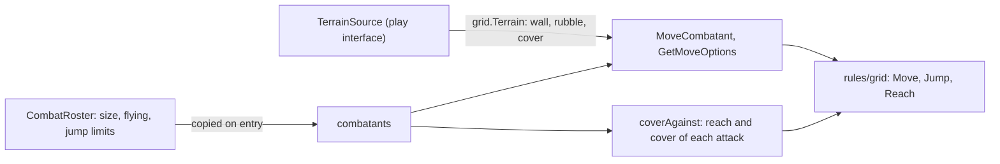
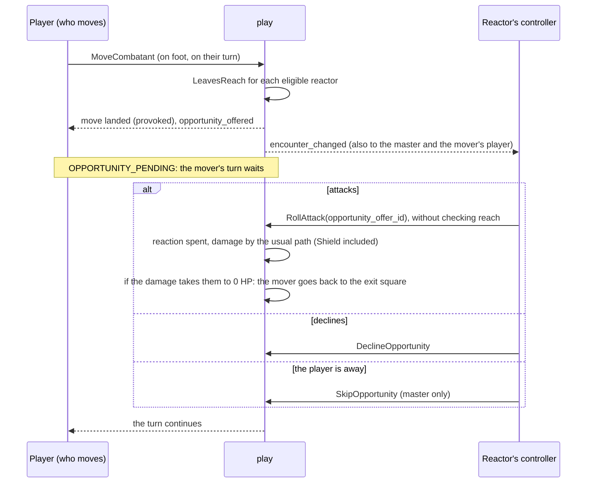

# Movement

Movement, reach, jumping, cover, opportunity attacks and area spells placed on the map belong to `play`, which calls `rules/grid` and `rules/combat.JumpLimits` and does not redo the geometry (MR-034, RN-21; `combat_move.go`, `combat_cover.go`, `combat_opportunity.go`, `combat_area.go`).
The numbers combat needs from a sheet are copied to the combatant when it enters, like speed: side, size, flying speed and jump limits.
What stays on the server (RN-20): the AC with cover never goes to a player.
Without a grid (theatre of the mind) none of this applies; see [Theatre of the mind](theatre.md).

## How movement works

| Piece | What it does |
| --- | --- |
| `TerrainSource` | `Terrain(ctx, campaign, map) (grid.Terrain, error)`, declared in `play`, implemented by `maps.Service` (`terrain.go`): the grid and the wall, difficult terrain, cover and door layers the master painted (doors as they are, the truth), read with the same `gridOf` and `loadLayers` as `GetMapLayers`. With no layer row it is open floor; a map of another campaign is `not_found`; light does not enter. `cmd/api` wires it with `play.Service.SetTerrain`; a nil source is open floor. The terrain only counts if its grid is the combat's: layers of another grid, or a deleted map, become open floor |
| `MoveCombatant` | A straight line from the combatant's square to the chosen one. The player pays the exact length in tenths of a foot (`grid.Terrain.Move`; a diagonal step is worth 7.1 ft) with terrain and creatures counted, limited by the movement left; past it, `TOO_FAR` with `missing_dft`. The master moves for free, except an NPC (a combatant no player owns) he drags on its own turn in a plain walk (no `forced`, no jump, no placement): that is planned like a player's on everything there is (`planNPCWalk`, `paysItsWay`), costs the line and the terrain, spends the NPC's movement, stops for walls, creatures and squares marked "Não dá para passar", and past the movement left it is `TOO_FAR`, so the app asks "Mover mesmo assim" and sends the same drag `forced`. A player's walk to the square the mover already stands on is refused (the master's moves are not) (`INVALID_ARGUMENT`, "a move needs another square", like the jump to it): it travels nothing, so there is nothing to spend or log. A jump that a creature the player does not see holds at the landing is stopped at take-off: nothing is spent, the running start stays and the answer says `stopped_early`. `occupantsFor` builds each move's `grid.Occupants`: the other combatants on the map and alive, hostile when the side is the other, with the largest size of the square. The player plans with those they see; the real move runs `Terrain.MoveUntil` against everyone, stops before a hidden creature, charges the cost up to there and answers only `stopped_early`. A square occupied by someone they see is `SQUARE_OCCUPIED`; a hidden combatant does not block in the plan, so the error never reveals it. Closed doors the line crosses open, and a locked one stops it (see [Architecture](../maps/doors.md#doors)). Whoever has `speed_fly_ft` flies (the better of the two speeds, without paying rubble); swimming and climbing cost nothing extra |
| `GetMoveOptions` | `Terrain.Reach` for the reachable squares and `Terrain.Move` for the refused ones within the circle, each with a reason (`WALL`, `ENEMY`, `OCCUPIED`, `TOO_COSTLY`). Only the player's own combatant on their turn, or anyone for the master. A walk warns who may provoke (`provokes_reactor_ids`, only reactors the asker sees) and marks known traps (`known_trap_point_id`, `known_trap_name`) |
| Jump | `MoveCombatant` with `jump`. `LONG` uses `Terrain.Jump` (cost = length, no difficult terrain, no wall, no landing on a creature); `HIGH` spends the feet without moving. The limits come from `combat.JumpLimits` (stored on the combatant; standing still is half) and the running start from `combat.HasRunningStart` over `last_move_dft`, which sums consecutive moves on foot and is broken by an action, attack, spell or jump (`breakRun`; undo returns it). `GetTurnOptions` returns them (`TurnOptions.jumps`). Second-Story Work (Thief 3) adds the Dexterity modifier (feet, never below 0) to the running long jump only (`jump_long_bonus_dft`); Step of the Wind doubles every jump distance until the start of the monk's next turn (`combatants.jump_doubled`, cleared by `ResetCombatantTurn`, put back by the undo). `GetMoveOptions` with `jump = LONG` runs the same warning over the squares a long jump can land on. The `combatant_moved` event carries `jump`, `height_dft` and `landing_difficult`; the Acrobatics reminder is in the master's log only |
| Side and size | `combatants.side` (`party` or `enemy`) and `size`. Player characters and their creatures are `party`, NPCs `enemy`; the master switches an NPC with `SetCombatantSide`. Size comes from the race (the `Catalog`), `BasicSheet.size` (no value: Medium) or the creature's sheet (`CreatureByKey`). Every combatant occupies one square, Large or not |
| Reach | `grid.RangeFt`: the squares between centres rounded down, times 5 ft. A diagonal neighbour is 5 ft away |
| Speed and movement left | `speedDFt` is the only place that works the turn's speed out: the better of walking and flying, doubled after Dash, 0 under a condition that leaves no speed (grappled, restrained) or no movement (paralyzed, petrified, stunned, unconscious). The combatant view (`movement_left_*`), `GetMoveOptions`, the move itself and `GetTurnOptions` all read it, so they never disagree |
| Crawling | While prone, every foot costs 1 extra foot (SRD 5.1 "Being Prone"): the cost is multiplied by 2 (`crawls`, with the drag's factor) and `GetMoveOptions` offers only the squares half the movement left pays for. A flier on its fly speed does not crawl; the master's free moves are unaffected. On difficult terrain the factor over-charges (4 per foot against the SRD's 3) |
| Disengage | `standard:disengage` turns on `combatants.disengaged`, reset at the start of the turn and returned by undo |
| Undo | `combatant_moved` is undoable: the event stores where the combatant came from (`from`: square, distance walked, running start, cover mark) and the undo restores all of it. A move that dragged a grappled creature also keeps where it stood and its cover mark (`dragged_id`, `dragged_from`): the undo puts the creature back with the mark, and the fog follows it from the square it was dragged to |

**In tenths of a foot.** The server stores and charges movement in tenths of a foot (`movement_used_dft`, `last_move_dft`; `Combatant.movement_*_dft`, `MovementLeft.*_dft`); the fields in feet stay filled, rounded down.
The app draws what `GetMoveOptions` sends.

### Cover

`coverAgainst` takes the greater of `Terrain.CoverBetween` (with the other creatures' squares) and the master's mark (`SetCombatantCover`, event `cover_set`, cleared when the combatant moves; the move that clears it also sends `encounter_changed`, because `combatant_moved` carries only the square).
It adds +2 or +5 to the AC of weapon and spell attacks and to a spell's Dexterity save.
Total cover makes `RollAttack` and `CastSpell` refuse the player (`TARGET_COVER_TOTAL`; an area spell does not refuse) and the target list annotates it (`TargetInReach.cover`, `cover_source`, `untargetable`).
The AC with cover (`target_armor_class`, `cover_bonus`) goes only to the master; it is stored in the pending damage (`pending_damages.attack_armor_class`) so Shield can compare the blow with it plus 5.
A spell with the `ignores_cover` type in `effects/spells.json` (Sacred Flame; `Content.IgnoresCover`, `link.Spell.IgnoresCover`) adds no cover to the save, but total cover still refuses the target.
An attacker whose table feat has a `ranged_attack` with `ignore_cover` (`link.Traits.SpellAttackIgnoresCover`, `RangedWeaponIgnoresCover`) gets no half or three-quarters cover against its ranged spell or weapon attacks (a thrown weapon beyond its melee reach too; an opportunity attack is melee): `coverView.ignoring` makes that cover none for the roll, the event and the target lists.
A creature hidden from the players does not count as cover for a player's attack; when the master attacks, all count.

## Opportunity attacks

A move that leaves an enemy's reach lands at once and offers an attack to that enemy; the mover's turn waits for the answer (`combat_opportunity.go`).
`play` calls `grid.LeavesReach` (the whole line, the exit square included, and the last square still inside the reach) and the existing attack and damage path.
In theatre the master makes the offer by hand (see [Theatre of the mind](theatre.md)).

| Piece | What it does |
| --- | --- |
| Who provokes | `opportunityReactors`: the other `side`, on the map, not defeated, with the reaction free, no incapacitating condition (Incapacitated, Paralyzed, Petrified, Stunned, Unconscious) nor Blinded, not down, able to attack with its reaction (`mayAttack`) with a melee attack; whoever is in the same turn group also reacts. The reach is the sheet's greatest melee reach, at least 5 ft (`meleeReachOf`; a thrown weapon with long range does not count). For an NPC made from a creature, `basicDerived` reads from the stat block's attack of the same name whether it is melee and its throwing range. A hidden mover is seen by no one; on a fogged map the reactor must see the mover (see [Combat under fog](fog.md)); whoever used Disengage does not provoke; a creature being dragged by its grappler does not provoke (it never leaves the reach). A long jump provokes; the high jump, the master's placement outside the mover's turn, the master's `forced` move and the 0 HP rule's move back do not. A surprised creature's turn options are all disabled with `SURPRISED`, and an opportunity attack skips it |
| Offers | `opportunity_offers`: one per reactor per move, with the exit square (`jumped` for a jump). `MoveCombatant` writes an `opportunity_offered` event per offer before the move's event and puts the `move_id` on the move's event. A move that provokes sends `encounter_changed` to the master, the mover's player and the reactors' players (`publishOffersMade`), without a revision (players read again) |
| The turn waits | `mustNotWait` (called by `mustActNow`, which the attack, action and spell use, by `MoveCombatant`, by standing up and by the theatre move; `EndTurn` only waits for the offers, through `mustNotWaitForOffers`, and then passes them over): `OPPORTUNITY_PENDING` for the player of whoever has a pending offer or an opportunity attack with damage still to roll, apply or discard; it holds for the mover and for the same player's creatures in the turn group. `pruneOffers` marks as `skipped` the offers nobody answers any more. The master is never stopped, and when they end the mover's turn the pending offers become `skipped`. Other combatants' reactions do not wait |
| Answers | Attacking is `RollAttack` with `opportunity_offer_id` (implies `as_reaction`, does not check reach, writes `offer_id` in the event); `DeclineOpportunity`; `SkipOpportunity` (master only). The last two write `reaction_declined` with the `offer_id`. Who may: the reactor's controller (the character's or creature's player; the master for an NPC) and the master for any; a reactor the player does not see is `not_found`. An offer that no longer exists (move undone, turn passed) or was answered is `aborted` |
| 0 HP rule | The attack stores the damage it opened in `attack_pending_id`. When that damage takes the mover from above 0 HP to 0, `returnToReach` puts the combatant on the offer's exit square (the damage event stores `returned_from`, restored by its undo); if the exit square is occupied the mover stays and the event stores `return_blocked`. The move is published (`combatant_moved`) |
| Undo | Undoing the move deletes its pending offers (`move_id`). A move whose offer was answered is undone only after undoing the answer; undoing an opportunity attack, a decline or a skip returns the offer to `pending`. A decline and a skip have no log line of their own: the event attaches to the move's line, which becomes the undoable one. `opportunity_offered` events do not close the undo chain |
| Who sees what | `Encounter.opportunity_offers`: the master sees all, with names; the reactor's controller theirs, with the melee attacks and exit square; the mover's player sees `mover_id` and the reactor (id and name) only if the reactor is not hidden from them; other players none. The stream carries only the `encounter_changed` hint (and `combatant_moved` when someone goes back) |

## Area spells placed on the map

Rules: RN-21 and RN-10 in [Rules](../../product/rules.md).
The geometry is pure and in `rules/grid/area.go` (`Area.FromPoint`, `Area.FromCaster`, `Terrain.OpenArea`, `Terrain.NearSide`, `Toward`); `combat_area.go` puts it on a combat.

| Piece | What it does |
| --- | --- |
| Which spells | `placementOf(link.Spell)`: the six spells that keep their area ([Spell zones](spell-zones.md)) are laid out as their row in `zoneDefs` says (a cube at a range is a `POINT` for Web). Otherwise a sphere or cylinder at a range is a `POINT`; at range Self it is `CASTER`; a cone, line or cube at range Self is `DIRECTION`; anything else keeps the target list. The shape, size, a line's width (the text's "10 feet wide", else 5 ft) and "spreads around corners" come from `SpellDetails` (`Target`, `AreaWidthFt`, `SpreadsAroundCorners`) through `link.Spell`. `GetTurnOptions.spell_targets[]` carries `placement`, `area_shape`, `area_size_ft`, `area_width_ft`, `range_ft`; in theatre it is always `UNSPECIFIED` |
| Who is inside | `planArea`: the point (a player's is range-checked and moved to the near side of a wall; the master's is not), the shape's squares, `OpenArea` (a straight line blocked only by total cover, or the spread for a corner spell), then every combatant not defeated and placed on one of those squares whose cover from the origin is not total. Hidden creatures count: the effect applies to all of them |
| Cover | From the origin, the larger of the map's and the master's mark; `resolveOnTarget` adds it only to a Dexterity save that does not ignore cover. A creature reached only around a corner has the mark alone |
| Preview and cast | `PreviewSpellArea` runs `planArea` on a player's known terrain and lists only creatures the viewer sees. `CastSpell` runs it on the real terrain in its transaction and builds the hits from it (`targets` is not read); the event keeps the choice (`placed`, `area_col`, `area_row`, `dx`, `dy`) and each hit's `hidden_at_cast`, and the answer draws the area again from the choice. A player's log line leaves out `hidden_at_cast` hits; a placed cast is `Secret` only for a hidden caster |
| Sculpt Spells | `CastSpellRequest.sculpted_ids` (the evocation wizard): `sculptedOf` (`combat_metamagic.go`) checks it before the slot is spent (the caster has the feature, the spell is of evocation, at most 1 + the cast level, each among the targets, seen by the caller, not the caster, no repeats); `spellSave` gives each spared creature a save with `sculpted` and no roll, and opens no damage when the spell halves on a success. A held cast (Counterspell) replays it with the stored request |
| Hidden hits | `settleHidden` (`combat_reveal.go`): the table rule read in the transaction, the master's `reveal_hidden` over it, then reveal (`combatant_hidden_set` with `by_area`), keep, or open a `hidden_reveals` question. `mustNotHold` refuses with `HIDDEN_REVEAL_PENDING` while one is pending; `Encounter.turn_held` says it to everyone and `pending_hidden_reveals` to the master. `ResolveHiddenReveal` answers a player `permission_denied` before it reads the id |

## Forced movement

`combat_forced.go` moves a creature that failed a save, away from the source in a straight line. The table `forcedRiders` says how far (`PushFeet`, and an optional `MaxSize`) for each rider key: `spell:thunderwave` pushes 10 ft and `feature:open-hand-technique` 15 ft; another pusher is another row. The spell's SRD text and the technique's name no size limit, so `MaxSize` is empty for both.

| Aspect | Rule |
|---|---|
| Path | `planPush` takes the squares of `grid.Line` from the target outwards whose distance (`grid.LengthDFt`, 5 ft a square) is within the feet, and enters them one at a time with `Terrain.Move`. A wall, a three-quarters cover square, a locked or barred door, a closed door (a push opens none), the edge of the grid or any other creature (all as large as the pushed one, so none can be passed or shared) ends the push in the last free square |
| Effects | One `SetCombatantPlace` write: no movement spent, no opportunity offer, no damage, the master's cover mark cleared. Cover and fog follow the new square because both read the combatant's square |
| Casts | `castFlow.pushFailedSaves` runs after the hits, for the hits whose save failed (an automatic failure included), the farthest from the caster first; each hit keeps `pushed` in the event (`forcedMove`: target, `from` as a `moveState`, end square, feet, `short`) |
| Monk | `riderConsequence` calls `pushByRider` for the Open Hand push; the rider event keeps `pushed` |
| No map | A combat in theatre mode (or a source with no square) moves nobody; the event keeps `no_map` and the log line (`CombatLogSpellTarget.push_no_map`, `CombatLogHitRider.push_no_map`) says the push is the table's to imagine |
| Log and streams | `pushed_ft` on the same two log messages; after the commit `publishPushed` sends `combatant_moved` to who may see the creature and `positionChanged` to the fog, as a move does |
| Undo | The undo of the cast puts each pushed creature back (`putPushedBack`) and the fog follows it. A rider answer is not undoable, so its push is not either |

## On screen

The browser only draws what the server sends (RN-21, RN-20).
The "Mover" page (`pages/live-session/combat/move-page`) reads `GetMoveOptions` (`core/combat/move-options-state.ts`, asked again at every combat change; a slow answer never overrides a newer one) and `GetMapLayers` (`core/maps/layers-state.ts`, read again when `layers_revision` changes; `core/maps/layers.ts` decodes the `rules/grid` byte format).
Everything it writes comes from `core/combat/move-plan.ts`: find the square in the answer (reachable with the cost, refused with the reason, or outside the circle), state the cost and what is left, warn who may provoke and ask about the known trap.
Nothing there computes a cost, a wall or a cover.
While the options are unanswered or failed, no square is judged "beyond": the page keeps the last good answer, and without one it sends the move and shows the server's refusal.
A jump keeps one idempotency key across its retries (`ActionKey`), and a call that fails with `UNAVAILABLE` or `DEADLINE_EXCEEDED` makes the page read the combat again.
The only length the browser measures is a long jump's line (`core/combat/jump-plan.ts`), to write "Saltar 4,5 m" before confirming; the server decides and answers `TOO_FAR` with the limit.
"Passar o turno mesmo assim?" belongs to the turn and the owed damage it was asked on: it closes when either changes.
Opportunity offers (`Encounter.opportunity_offers`) become the player's `alertdialog` (`OpportunitySheet`, opened once per offer), the master's card (`OpportunityCard`) and the mover's wait (`core/combat/opportunity.ts`); "Atacar com <arma>" opens the `AttackSheet` with the offer, which makes `RollAttack` carry `opportunity_offer_id`.
The offer reaches the player through `encounter_changed` without a revision, and the page reads the combat again at each of those; with a revision it reads only when newer.
Each target's cover comes from `TargetInReach` (`core/combat/cover.ts`).

## Limits

Swimming and climbing do not cost differently; every combatant occupies one square.
