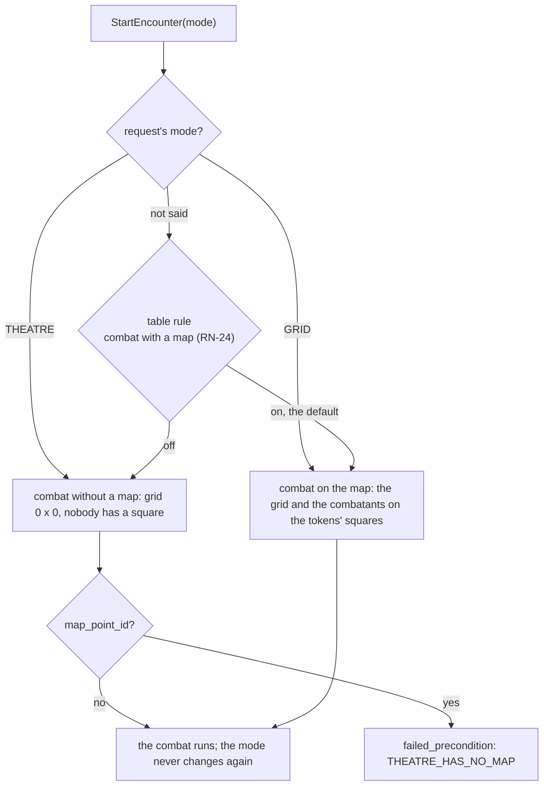

# Theatre of the mind

A combat has a mode, chosen when it starts and never changing (`encounters.mode`: `grid` or `theatre`; MR-025, RN-25, ADR-0017).
In `grid` the server knows where everyone is.
In `theatre`, the "teatro da mente", it knows no place at all: no combatant has a square, the combat has no map or grid (0 by 0), the server never checks a player's reach, distance or spell range (the master judges), movement is a number and the opportunity attack is an offer from the master.
The code is `combat_theatre.go`.

**The choice.** `StartEncounter` carries `mode`.
A `map_point_id` without a mode is a combat on the map, whatever the table rule.
Without a mode (`UNSPECIFIED`), the table rule "combat with a map" (RN-24) holds, read in the start's own transaction (`campaigns.Service.CombatWithoutMap`, wired to `play` in `Config.Defaults`; without it every combat is on the map).
`theatre` asks for no map and leaves the session's current map as it is; it refuses a `map_point_id` (`THEATRE_HAS_NO_MAP`).
Combat reads the mode from `Encounter.mode`, and the `encounter_changed` hint carries it too.

## What `theatre` does on each path

| Path | In `theatre` |
| --- | --- |
| Initiative, turns, `BeginCombat`, `EndTurn`, `SetInitiativeOrder`, reinforcements, `EndEncounter` | The same. Nobody is put on a square on entering, and the end returns no token anywhere. Defeated NPCs' XP counts as always |
| `MoveCombatant` (walking, jumping, putting a combatant on the map) | Refused, `failed_precondition` `NEEDS_A_MAP`, for the master and the player |
| `GetMoveOptions` | A valid, empty response: no square reachable or refused, and `movement_left_dft` with what can still be spent |
| `SpendMovement(distance_ft)` | The player spends movement by number, in whole feet (the screen steps 5 ft, 1.5 m), in `combatants.movement_used_dft`, never beyond the turn's movement (the better of walking and flying, doubled after Dash). On the combatant's own turn (or a character creature's); the master spends for any combatant, off turn too, with the same limit. Past what is left: `TOO_FAR` (with `missing_ft` and `missing_dft`); a waiting opportunity offer stops the player (`OPPORTUNITY_PENDING`). In `grid`: `THEATRE_ONLY`. The response says what is left (`movement_left_dft`: "Restam 3,0 m" is 100). It writes a `combatant_moved` without a square, which the log shows as "gastou 6,0 m de movimento" and the master's undo restores |
| `StandUp` | The controller of a prone combatant on its turn (the player for their character and creatures; the master for any), on a map or in theatre. Spends half the turn's speed without the Dash (`standUpCostDFt`, `Combatant.stand_up_cost_dft`) from `movement_used_dft` and takes `condition:prone` off in the same transaction. `NOT_PRONE`, `CANNOT_STAND_UP` (speed 0) and `TOO_FAR` (less movement left than the cost) refuse it. It writes a `combatant_moved` event with the movement before (`From`), the conditions before (`CondBefore`) and the line `stood_up`; the master's undo puts both back |
| An attack's targets and reach (`GetTurnOptions`, `RollAttack`) | The list has every combatant the rules let attack (not themselves, not a defeated one, not one hidden from the player), without `distance_ft` and `too_far`. The player's `RollAttack` checks neither position nor reach (in `grid`, `NOT_PLACED` and `TARGET_OUT_OF_REACH`) |
| Spells (`CastSpell`, the target list) | No distance, no `too_far`, no reach check; an area spell is "any number of targets". The number of targets, the darts and total cover are still checked |
| Help, Dash, Dodge, Disengage | The same. Dash doubles what `SpendMovement` can spend |
| Cover (`SetCombatantCover`) | The master sets the four degrees (none, half +2, three-quarters +5, total = cannot be aimed at); it holds until they change it. Map cover does not exist |
| Opportunity attack | The server never decides that someone left reach. The master offers (`OfferOpportunity(mover, reactor)`, only in `theatre`): the mover is whoever is on turn, the reactor whoever they left the reach of. The offer is the usual (`opportunity_offers`, no square, `by_hand`): the reactor's player attacks with `RollAttack` (`opportunity_offer_id`, no reach check) or declines; the NPC's reaction is the master attacking by hand; one reaction per round holds (`REACTION_USED`). The server refuses (`NO_OPPORTUNITY`) a defeated, down, incapacitated or blinded reactor, one on the mover's side or without a melee attack, and a mover who is defeated, hidden or after Disengage. The master also withdraws the offer (`WithdrawOpportunity`, "Retirar a oferta"; `THEATRE_ONLY` for a move's offer) or continues without waiting (`SkipOpportunity`). The mover's turn, if a player, waits for the answer; only the reactor's player, the mover's and the master hear the offer (RN-10). The offer is a log line (`OPPORTUNITY_OFFERED`: "Goblin 1 saiu do alcance de Toren"; the master, the reactor's player and the mover's player receive it, and a hidden combatant in it removes it from every player); the answer belongs to that line, which stays undoable for the master. The offer itself closes the undo chain (it is withdrawn, not undone); withdrawing it can be undone |
| Summoned creatures, Wild Shape, character creatures | The same, without a square: the creature enters the order, plays on the group's turn, attacks without reach and spends movement by number |
| The familiar's eyes | Refused in combat, `FAMILIAR_SIGHT_BLOCKED` with reason `NO_MAP`; stopping still works |
| Fog, light, doors | They do not exist: with no map, `fogSightOf` is nil and no player receives anything of the map |
| Traps (`FireTrap`, `SearchForTraps`, triggering on entry, the warning) | They do not exist: with a theatre combat open in the session, `FireTrap` and `SearchForTraps` answer `NEEDS_A_MAP`, and dropping a token or a creature triggers none. The order of errors is the usual (a trap that does not exist is `not_found` first), and the repeat of a trigger or search made before the combat receives the stored response |
| Conditions without speed (both modes) | `speedDFt` is 0 for grappled and restrained and for paralyzed, petrified, stunned and unconscious, so the movement left is 0 in `GetMoveOptions`, the player's `MoveCombatant` and `SpendMovement`. Prone does not set the speed to 0: `StandUp` costs half of it, and a prone creature crawls |
| Death saves, highlights, the log, undo, XP | The same |

- **RN-10 continues.** A hidden NPC is never in a player's target list, log, order or offers, in `theatre` as in `grid` (`TestRN25_AttacksAndCoverWithoutReach` reads the player's JSON).
- **In the code.** `combat_theatre.go` has the mode, the refusals, `SpendMovement`, `OfferOpportunity` and `WithdrawOpportunity`; each path that read position asks `isTheatre(enc)` in the places that already checked `placed(...)`: `RollAttack` and `checkTargets` (reach), `targetsFor` and `spellTargetList` (distance), `MoveCombatant`, `GetMoveOptions`, the traps and the familiar's eyes.
  An offer made by hand has null `left_col` and `left_row`, and whoever read them handles null (`seesAtOffer`, the cover calculation, and the 0 HP rule, which takes no one anywhere).

## On screen

The theatre screen only draws what the server sends: it branches on `Encounter.mode` (`core/combat/theatre.ts`: `isTheatre`), never reads `col`, `row` or `placed` in that mode and does no dice, reach or cover arithmetic.

| Piece | What it does |
| --- | --- |
| `core/combat/theatre.ts` | The "Gastar movimento" plan (`spendPlan`, `stepSpend`: the 5 ft, 1.5 m step; "Restam 3,0 m" comes from `movement_left_dft`), the rows whoever offers the opportunity attack picks (`reactorRows`: the other side from whoever is on turn, standing; the server still decides with `NO_OPPORTUNITY` and `REACTION_USED`), the cover targets and its four rows |
| `core/combat/combat-client-move.ts`, `combat-client-turn.ts` | `moves.spendMovement`, `moves.offerOpportunity`, `moves.withdrawOpportunity` and `turn.start(..., mode)`; the refusals `THEATRE_ONLY`, `NEEDS_A_MAP`, `THEATRE_HAS_NO_MAP` and `NO_OPPORTUNITY` in Portuguese |
| `pages/live-session/combat/theatre/` | `spend-sheet` (the player's number, "Depois restam", "Gastar 6,0 m", "Cancelar"), `master-spend`, `spend-stepper`, `offer-panel` ("Saiu do alcance de"), `cover-panel` ("Cobertura dos alvos"), `no-map-panel` (takes the player's map place and the "Reação" card) and `theatre-pill` ("Teatro da mente") |
| `start-combat-dialog` | "Como este combate é jogado": the default comes from `GetTableRules` (`combat_starts_with_map`, read separately: if it fails the default is "Com mapa"); without a current map, "Com mapa" is dashed with the reason; in "Sem mapa" the dialog shows no map and the button asks for no grid |
| `combat-view` | For the master, `theatre()` swaps the map for two columns (the card, the offer, the cover and the log; the order); for the player, the "Combate sem mapa" panel and "Gastar movimento" in place of "Mover" (also for a player's creature). The session shows neither fog nor traps in a combat without a map. `CombatState.applyMove` does not apply `combatant_moved` (no square): the screen reads the combat again |
| `opportunity-card` | For an offer made by hand (`by_hand`) it says nothing about a square and gives "Seguir sem esperar" and "Retirar a oferta". "Seguir sem esperar" takes no one's reaction |

- A "Gastar movimento" refusal that means "the screen is stale" reads the combat again before speaking, and `TOO_FAR` uses the already-updated number.
- The log (`combat-log.ts`) knows the mode: a move is "gastou 6,0 m de movimento", the start says "sem mapa (teatro da mente)" and the master's offer is "Goblin saiu do alcance de Toren".
- Tests: Vitest (`theatre.spec.ts`, `critical.spec.ts`, `start-combat-dialog.spec.ts`, `hidden-death-saves.spec.ts`, `opportunity-card.spec.ts`, `action-groups.spec.ts`, `pending-damages.spec.ts`); e2e `theatre.spec.ts` and the screens in `a11y.spec.ts`.
