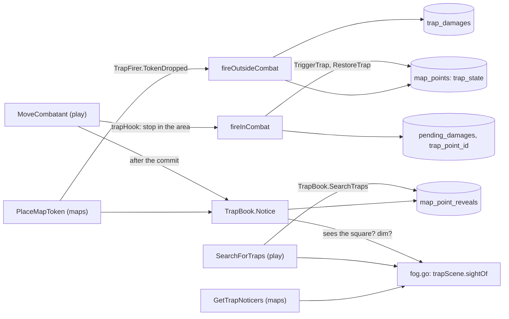

# Traps in play

Noticing, searching for, triggering and disarming a trap (MR-035, RN-10, RN-02) are split between two modules that call each other both ways.
`maps` owns the trap: where the area is, its state, who knows it and what each character sees of it.
`play` owns the game around it: the moves, the dice, the damage, the history and the undo.
They are wired in `cmd/api` (`playService.SetTraps(mapsService)` and `mapsService.SetTrapFirer(playService)`); without the wiring no trap does anything in play.
The trap content (the SRD's eight example traps) is `effects/traps.json`.

| Piece | What it does |
| --- | --- |
| `play.TrapBook` | The interface `play` declares and `maps.Service` implements (`maps/traps_play.go`): `Traps` and `KnownTraps` (the map's traps, with the master's data or only the name and area), `Notice`, `SearchTraps`, `Told`, `TriggerTrap` and `RestoreTrap` (inside `play`'s transaction), `TrapChanged` (the notice to everyone after the commit) and `TrapNames`. The types are in `maps/link` (`Trap`, `Observer`, `Eyes`) |
| `maps.TrapFirer` | The other side: `PlaceMapToken`, after the commit, calls `TokenDropped`, and `play` triggers the "On entering the area" traps whose area has the token's square, during a session and with no combat on the map. An NPC does not trigger |
| Who sees what | `trapScene` (`maps/traps_play.go`) builds the map for traps: the grid, the traps, who knows them, the passive Perception and senses of each character (`PartyMember.PassivePerception`, filled by `characters.PartyVision` from the derived sheet; a basic sheet counts 10) and, with fog, the scene of `fog.go`; without fog every grid square is seen in bright light. `sightOf` says, for an observer on a square, whether any square of the area is within 3 m, whether any is seen now and, in both at once, the `vision.PassivePenalty` (−5 in dim or in darkvision's grey; dim within darkvision counts as bright). A map without a grid has no squares: no notice and no search |
| A creature dropped on the map | The master placing a character creature's token (`PlaceMapToken` with `creature_id`) on an "On entering the area" trap, outside combat and on a map the players see, triggers the trap like a character's token (`TrapFirer.CreatureDropped`): the creature is caught with whoever is in the area (or alone, if the trap picks targets by hand), with its sheet's AC and save. The line goes under the owner character's name and only they and the master read it. Its damage is just the line (like an NPC's); the creature notices nothing when dropped. A creature already in the area is also caught by `FireTrap` with no targets, `TokenDropped` and `CreatureDropped`. `GetTrapNoticers` carries `passes_dc` (passive plus penalty reaches the DC), so the screen says "Se chegar a 3 m: nota" without comparing |
| Noticing | `Notice` runs after the commit of a move: the player character, or their creature with its own passive Perception and senses (`CombatRoster.CreatureEyes`), that ends there reveals the armed trap, not yet known to them, with a DC to notice and `passive + penalty ≥ DC`. It writes `map_point_reveals` (`noticed`), the `trap_noticed` event and notifies only their player through `PublishToUsers`: a `map_changed` and the `trap_noticed{map_id, point_id}` hint (only when the player sees the map, never to another player or the master). The line enters `ListTrapActivity` as `TrapActivity.notice`: the master reads all, the player only those of their characters, without the DC |
| Searching | `SearchForTraps` is the player's, during the session. In a running combat the character is part of it is the Search action (`searcherPlace`: their turn, the action still free, the combatant's square, the combat's map); outside it, the session's current map and the token. The d20 comes from the app or the physical die (RN-18), with the `SceneOptions` bonus (`skill:perception` or `skill:investigation`; `TRAP_SEARCH_SKILL_OTHER` with `other_skill_key` searches with another SRD skill, counted by a trap only when listed in `TrapSpec.also_find_skill_keys`, checked on save: SRD skills, no Perception or Investigation, no repeats, at most 16, never copied by `publicTrap`). All in one transaction that locks the session: `SearchTraps` reveals the found ones and `play` writes `trap_searched` (the roll, the skill and the found ids; never a DC). The response carries the roll (its modifier is the whole bonus the total counted: the sheet, the effect dice such as Guidance and the die the player added) and the found ids, the same for "nothing here" and "the check failed". A trap's damage part (`cleanDamage`) takes 1 to 24 dice of d4 to d12, so the severity table's 24d10 can be saved. The d20 goes through `checkD20`: with Reliable Talent (`SceneOption.ReliableTalent`) a face of 9 or lower counts as 10 for each die before the lower of two is chosen, the event keeps `reliable_talent`, and `DiceRoll.treated_as` is set only when the number changed. The search is a held roll (see [Held rolls](held-rolls.md)) |
| Triggering on entry | `trapHook` (`combat_traps.go`) is the hook `MoveCombatant` calls at three points: `stops()` hands the area of armed "On entering the area" traps (minus those the character is already inside) as the `stopAt` of `Terrain.MoveUntil`; `marked`/`landed` say where the move entered or landed (a jump only counts where it lands; the master's move only where it ends); `finish` returns the move's event or, when it entered a trap, writes the move's and leaves the trigger's (`trap_triggered`) as the change's (`altKind`), in the same transaction. Only the player character and their creature trigger. Caught: whoever is in the area, plus whoever entered; if the effect has manual targets, only whoever entered |
| Triggering by hand | `FireTrap` (master): in a combat on the trap's map it is a combat change (`fireByHandInCombat`, with combatant `target_ids` or, without them, whoever is in the area); outside it, `fireOutsideCombat`, in its own transaction (`target_ids` of characters with a token on the map or, without them, the tokens in the area). The tokens are read before the session's lock, so inside the transaction the firing reads the session's latest combat again: one that began meanwhile on the trap's map refuses the call (`failed_precondition`; a token that lands in a trap just does not fire), and one without a map refuses as any trap does there. A retry or key reuse is told from the first call by the hash of the request (trap, the firing it extends, the targets). `TriggerTrap` sets `trap_state = triggered` and `trap_triggered_at` (the trap becomes public) and returns the trap as it was, with the master's data |
| The effect | `resolveTrap` (`traps_effect.go`, no database): the trap's attacks go one by one to the caught creatures, in order, with its bonus against the creature's AC (20 hits and doubles the dice, 1 misses); damage that always hits and conditions go to all; the save (of all or only those hit) uses each creature's bonus (like the spells'; a basic sheet rolls d20 + 0); on failure, the damage and the condition; on a pass, half (rounded down) or nothing. Each damage part of each creature is a roll. On a trap that asks the save of whoever was hit (`applies_to HIT`), the save, the damage on failure and the condition are rolled once per blow (each dart); `TrapCaught.saves` carries all of them and `save` the first. A critical follows the table rule (see [Table rules in combat](table-rules.md)) |
| Where damage lands | In combat (`trapDamageInCombat`): the player character gets a `rolled` `pending_damages` line without an attacker and with `trap_point_id` (the master applies it with `ApplyPendingDamage`, changing the amount if they like); the NPC and the creature take it at once (`landDamage`; the line is born `applied`); the conditions go to the combatant. Outside combat (`fireOutside`): a `rolled` `trap_damages` line for the player character (`ApplyTrapDamage` applies it to the vitals — a druid in a beast form takes it on the beast, and the open session's combat, when the character is in it, gets its revision raised and `encounter_changed` (`touchCombatOf`); `DiscardTrapDamage` discards it; both with an idempotency key and the `damage_applied` or `damage_discarded` event); the NPC only has the event, and the conditions are a reminder on it. `ListTrapDamages` lists what is waiting, from both places |
| Parts | A firing whose creatures do not fit one event is written as several `trap_triggered` events back to back (`insertFiringInParts`): the first carries the firing and the idempotency key, the next ones add the creatures that did not fit (`extends_id`, `part`), so the log shows one entry. One undo takes all the parts back (`firingBefore`, `action_undone.undone_also`), and a retry of `FireTrap` answers with every creature (`firingWithParts`). A firing outside a combat is written the same way (`insertSceneEvent`) |
| Undo | A trigger in combat is an undoable `trap_triggered` event (`takeBackTrap`): it deletes the damage lines it opened, returns the HP of NPCs and creatures and the conditions, and arms the trap again (`RestoreTrap`); the move that triggered it is the previous event and is undone next. Outside combat there is no undo |
| Warning before entering | A player's `GetMoveOptions` calls `markKnownTraps`: each reachable square whose line enters the area of an armed "On entering the area" trap the character knows (`KnownTraps`) carries `known_trap_point_id` and `known_trap_name`. The master is not warned, and an unknown trap is never marked |
| The log | The trigger is the `TRAP_TRIGGERED` line of `ListCombatLog` (`CombatLogEntry.trap`): everyone receives the trap (it is public) and what it did to each creature (passed, failed, the damage and whether it was applied); the d20 and dice belong to the master and the target's owner; the DC and AC to the master only; a hidden NPC does not appear to the player. The search is a master-only line ("Procurar") |
| Search rules (SRD) | The Perception search has disadvantage on traps whose squares are poorly visible to the character (dim, or dark seen through darkvision; blindsight within range does not count, `penaltyAt`). In the app the server rolls two d20 (`d20_face_2` and `second_roll` on the physical die) and the lower counts on those and the first on the others; with a physical die the second is required (`SEARCH_NEEDS_TWO_DICE`) when any square within 3 m that the character sees is poorly visible (`nearbyObscured`). Investigation does not change. Blindsight also removes the −5 from passive Perception |
| Adding creatures | The trigger on entry catches whoever entered (and whoever is in the area, if the effect has no manual targets). The master adds others to the same firing with `FireTrap.extend_firing_id` (the `TrapFiring.id`, the log line's id): the server rolls only for the added ones, without touching the trap's state, and they enter the results and the log line; "Desfazer" removes only them |
| Read in the transaction | `MoveCombatant` reads the traps inside the move's transaction (`Traps(ctx, tx, ...)`): a disarm or deletion that commits meanwhile makes the move read again, and a trap that no longer exists stops nobody. If the move provokes and the trap triggers, the trigger's event carries the `move_id` and a resend with the same key keeps `provoked`. An opportunity attack that takes the character to 0 HP and returns them before the area does not undo the trigger: it already happened |
| Outside combat | `ListTrapActivity` (the newest 500 events of the session, in order): the master reads each trigger (attack, save, damage, conditions as a reminder) and each search (who, skill, d20, total, what was found); the player only the lines of their characters, with their own d20 and "passed" or "failed", without the DC and without a trap they do not know. A player's search and a trigger outside combat send the master a contentless `map_changed`; when a character notices a trap the master also receives it, and no one else besides their player. A dropped token only triggers or notices on a map the players see (revealed or the current one) |
| The damage that does not vanish | At the end of a combat, the trap damage on a player character still waiting becomes a `trap_damages` line (`keepTrapDamage`); `trap_damages` survives the end of the session, and `ListTrapDamages` lists the whole campaign's, with the session number and date, until the master applies or discards it (`ApplyTrapDamage` works without an open session, only without the event; the key makes a retry get the first answer, and the key with another damage, amount or action is refused). The combat's "Desfazer" skips `trap_noticed` and any trap or trap-damage event that is not from this combat |
| Who may | The master triggers, disarms (`maps.DisarmTrap`, `trap_disarmed`), applies and discards the damage and reads "Quem notaria" (`maps.GetTrapNoticers`); the player searches (and only they: the master gets `permission_denied`). `trap_noticed` and `trap_disarmed` enter the history through `AppendEvent` (`appendableKinds`); `trap_searched` and `trap_triggered` are written by `play` |

**Not available in theatre of the mind:** `FireTrap` and `SearchForTraps` answer `NEEDS_A_MAP` with a theatre combat open (see [Theatre of the mind](theatre.md)).

**On screen.**
The session map draws traps, chests and lights over the image with `app-map-pins`, on the simple map (`app-map-view`) and the fogged one: `app-fog-map` has the `pins` input, which puts the marks inside the stage (they move and zoom with the image), draws only the points the server sent (the remembered one, `MapPoint.remembered`, dimmed) and takes the three kinds out of the ordinary markers.
The master's "Ver como" uses the same.
The marks' legend and the player's "Procurar armadilhas" sit under the map.
The browser computes no rule: the DC, the passive Perception and whether it "passes" come from the server (`TrapNoticer.passes_dc`).
