# Combat tables

The `play` module owns the combat of a session: the encounter, who fights, the damage waiting to be applied, reactions and the rules that need an answer from someone.
Every table here cascades from the encounter, so ending a combat's row (or deleting its session) leaves none.
The session, the history and the effects outside combat are in [play.md](play.md).

```mermaid
erDiagram
    encounters {
        uuid id PK
        uuid game_session_id FK
        uuid map_id FK
        uuid map_point_id FK
    }
    combatants {
        uuid id PK
        uuid encounter_id FK
        uuid character_id FK
        uuid user_id FK
        uuid creature_id FK
    }
    pending_damages {
        uuid id PK
        uuid encounter_id FK
        uuid attacker_id FK
        uuid target_id FK
    }
    roll_holds {
        uuid id PK
        uuid encounter_id FK
        uuid combatant_id FK
    }
    reaction_holds {
        uuid id PK
        uuid encounter_id FK
        uuid actor_id FK
    }
    reaction_windows {
        uuid id PK
        uuid encounter_id FK
        uuid reactor_id FK
        uuid pending_damage_id FK
        uuid hold_id FK
    }
    opportunity_offers {
        uuid id PK
        uuid encounter_id FK
        uuid mover_id FK
        uuid reactor_id FK
        uuid attack_pending_id FK
    }
    hidden_reveals {
        uuid id PK
        uuid encounter_id FK
        uuid caster_id FK
    }
    roll_mode_requests {
        uuid id PK
        uuid encounter_id FK
        uuid combatant_id FK
        uuid target_id FK
    }
    combat_reasons {
        uuid id PK
        uuid encounter_id FK
    }
    combatant_states {
        uuid id PK
        uuid encounter_id FK
        uuid combatant_id FK
        uuid source_id FK
        uuid ends_combatant_id FK
    }
    hit_riders {
        uuid id PK
        uuid encounter_id FK
        uuid attacker_id FK
        uuid target_id FK
    }
    combat_contests {
        uuid id PK
        uuid encounter_id FK
        uuid initiator_id FK
        uuid defender_id FK
    }
    combat_holds {
        uuid grappled_id PK,FK
        uuid encounter_id FK
        uuid grappler_id FK
    }
    combat_hide_attempts {
        uuid id PK
        uuid encounter_id FK
        uuid hider_id FK
    }
    combat_hiding {
        uuid hider_id PK,FK
        uuid observer_id PK,FK
        uuid encounter_id FK
    }
    combat_helps {
        uuid id PK
        uuid game_session_id FK
        uuid encounter_id FK
        uuid helper_character_id FK
        uuid ally_character_id FK
        uuid target_id FK
        uuid helper_combatant_id FK
        uuid ally_combatant_id FK
    }
    combat_surprised {
        uuid combatant_id PK,FK
        uuid encounter_id FK
    }
    character_creatures {
        uuid id PK
    }
    characters {
        uuid id PK
    }
    game_sessions {
        uuid id PK
    }
    map_points {
        uuid id PK
    }
    maps {
        uuid id PK
    }
    users {
        uuid id PK
    }
    combatants ||--o{ combat_contests : "defender_id"
    encounters ||--o{ combat_contests : "encounter_id"
    combatants ||--o{ combat_contests : "initiator_id"
    characters ||--o{ combat_helps : "ally_character_id"
    combatants |o--o{ combat_helps : "ally_combatant_id"
    encounters |o--o{ combat_helps : "encounter_id"
    game_sessions ||--o{ combat_helps : "game_session_id"
    characters ||--o{ combat_helps : "helper_character_id"
    combatants |o--o{ combat_helps : "helper_combatant_id"
    combatants |o--o{ combat_helps : "target_id"
    encounters ||--o{ combat_hide_attempts : "encounter_id"
    combatants ||--o{ combat_hide_attempts : "hider_id"
    encounters ||--o{ combat_hiding : "encounter_id"
    combatants ||--o{ combat_hiding : "hider_id"
    combatants ||--o{ combat_hiding : "observer_id"
    encounters ||--o{ combat_holds : "encounter_id"
    combatants ||--o| combat_holds : "grappled_id"
    combatants ||--o{ combat_holds : "grappler_id"
    encounters ||--o{ combat_reasons : "encounter_id"
    combatants ||--o| combat_surprised : "combatant_id"
    encounters ||--o{ combat_surprised : "encounter_id"
    combatants ||--o{ combatant_states : "combatant_id"
    encounters ||--o{ combatant_states : "encounter_id"
    combatants |o--o{ combatant_states : "ends_combatant_id"
    combatants |o--o{ combatant_states : "source_id"
    characters ||--o{ combatants : "character_id"
    character_creatures |o--o{ combatants : "creature_id"
    encounters ||--o{ combatants : "encounter_id"
    users |o--o{ combatants : "user_id"
    game_sessions ||--o{ encounters : "game_session_id"
    maps |o--o{ encounters : "map_id"
    map_points |o--o{ encounters : "map_point_id"
    combatants ||--o{ hidden_reveals : "caster_id"
    encounters ||--o{ hidden_reveals : "encounter_id"
    combatants ||--o{ hit_riders : "attacker_id"
    encounters ||--o{ hit_riders : "encounter_id"
    combatants ||--o{ hit_riders : "target_id"
    pending_damages |o--o{ opportunity_offers : "attack_pending_id"
    encounters ||--o{ opportunity_offers : "encounter_id"
    combatants ||--o{ opportunity_offers : "mover_id"
    combatants ||--o{ opportunity_offers : "reactor_id"
    combatants |o--o{ pending_damages : "attacker_id"
    encounters ||--o{ pending_damages : "encounter_id"
    combatants ||--o{ pending_damages : "target_id"
    combatants ||--o{ reaction_holds : "actor_id"
    encounters ||--o{ reaction_holds : "encounter_id"
    encounters ||--o{ reaction_windows : "encounter_id"
    reaction_holds |o--o{ reaction_windows : "hold_id"
    pending_damages |o--o{ reaction_windows : "pending_damage_id"
    combatants |o--o{ reaction_windows : "reactor_id"
    combatants ||--o{ roll_holds : "combatant_id"
    encounters ||--o{ roll_holds : "encounter_id"
    combatants ||--o{ roll_mode_requests : "combatant_id"
    encounters ||--o{ roll_mode_requests : "encounter_id"
    combatants ||--o{ roll_mode_requests : "target_id"
```

## `encounters`

A session's combats.
`status` is `setup` (choosing who fights, rolling initiative), `active` (turns run) or `ended`.
A session has at most one that has not ended (`encounters_one_open_per_session`); ended ones stay as a record.
The latest combat (`GetLatestEncounter`) is the open one, then the ended ones by `created_at`.
`round` is 0 in `setup` and counts from 1.
`current_combatant_id` is whose turn it is and **has no foreign key**: combatants point to the combat, and the service passes the turn before deleting the current combatant.
`map_id` and `map_point_id` (`SET NULL`) say where and from where the combat started.
`grid_columns` and `grid_rows` are **copied** from the map's grid at birth, so changing the grid later moves nobody.
`revision` goes up on each change.
`mode` (MR-025, RN-25) is `grid` (the combat on the map, default) or `theatre` (gridless, "theatre of the mind"); the master chooses at the start and nothing changes it later.
In `theatre`, `map_id` and `map_point_id` are `NULL`, `grid_columns` and `grid_rows` are 0 (`encounters_grid_valid` requires exactly this) and no combatant has a square; `grid` keeps 4 to 200 columns and 1 to 400 rows.
Spent movement stays in `combatants.movement_used_dft` in both modes (see [Architecture](../architecture/play/theatre.md)).

## `combatants`

Who fights.
`kind` is `player`, `npc` or `creature` (a character's creature, MR-037).
Copies of the same NPC share `character_id`, each with its own `label` (1 to 40 characters, "Goblin 2") and its own initiative (RN-19).
For a `creature`, `character_id` and `user_id` are the **owner's**, and `creature_id`, `monster_key`, `summon_attack` and `summon_group_id` exist only in that kind (`combatants_creature_valid`); `dismissed` hides a creature whose concentration ended without deleting it, for the master's undo; creatures with the same `summon_group_id` roll one initiative.
`user_id` is the player of a player combatant (`SET NULL` if the account is deleted, RN-16).

| Group | Columns |
| --- | --- |
| Secrecy | `hidden` is the master's switch: the server never sends a hidden combatant to a player (RN-10, RN-20); every new NPC is born hidden. |
| Initiative | `initiative` (total) and `initiative_face` (the d20), both `NULL` until rolled; `initiative_bonus`, copied from the sheet; `order_index`, the place in turn order; `tie_ordered`, the master settled a tie (RN-19). |
| Position | `grid_col`, `grid_row` (both or neither); `speed_ft`, copied on entry; `movement_used_ft` (feet, rounded down) and `movement_used_dft` (tenths of a foot: the real value, RN-21); `last_move_dft` (the turn's last on-foot move, the run-up of a jump). |
| Copied from the sheet on entry (MR-034) | `size`, `speed_fly_ft`, the jump limits `jump_long_dft` and `jump_high_dft` (from `rules/combat.JumpLimits`; `jump_long_bonus_dft` is the Thief's extra running long jump; `jump_doubled` holds from Step of the Wind to the next turn), `xp_value` (the XP an NPC gives; only the master receives it, RN-20), `mage_armor_ac`, `hp_max_bonus`. |
| Belongs to the master and the combat | `side` (`party` or `enemy`; a player character enters `party`, an NPC `enemy`), `cover_mark` (`none`, `half`, `three_quarters`, `total`, cleared when the combatant moves). |
| The current turn (return to default at the start of the combatant's turn, `ResetCombatantTurn`) | `turn_state` (`idle`, `acting`, `ended`), `dashed`, `disengaged`, `action_used`, `bonus_action_used`, `reaction_used`, `extra_action_used`, `action_surged`, `spell_cast`, `bonus_spell_cast`, `attacks_made`, `action_attack_key`, `bonus_attacks_left`, `ac_bonus` (the Shield's +5, cleared at the start of the character's next turn), `death_save_rolled`. |
| Feature marks | `attacked_hostile`, `took_damage`, `rage_end_pending` (the Rage), `sneak_attack_turn`, `colossus_slayer_turn`, `melee_hit_turn` (`"<round>:<combatant on turn>"`, the turn of the last melee weapon hit), `table_once_turns` (JSON `{"<feature key>": "<turn>"}`: the turn each `extra_damage` of the table last added its damage). |
| Conditions | `conditions` (SRD keys, at most 20) and `condition_sources` (JSON), `concentration_spell`, `exhaustion_level` (0 to 6). |
| What lasting effects leave | `effect_conditions`, `effect_ac_bonus`, `effect_speed_pct` (0 to 400), `effect_speed_add_ft`, `effect_no_action`, `effect_no_move`, `effect_no_reaction` (the Open Hand technique), `hp_max_base`: worked out again after every change to the effects. |
| Bardic Inspiration | `inspiration_sides`, `inspiration_from`, `inspiration_expires_round`: all `NULL` together or a valid die (6, 8, 10, 12; round at least 1). Ends with the combat. |
| Spent resources of an NPC | `slots_used` (JSON: slots, pact slots and resource uses an NPC spent in this combat). |
| Death | `defeated`, `death_successes`, `death_failures` (0 to 3 each), `death_round`, `death_order_index`, `revivify_blocked` (see below). |

**Only the NPC and the creature have HP here** (`hp_current`, `hp_max`, `hp_temp`, checked by `CHECK` according to `kind`).
A player character's HP stays in `character_vitals`, one source only (RN-02), and the combat never changes the NPC's sheet (RN-04).
A creature's HP returns to `character_creatures` when the combat ends.
`hp_max` is the effective maximum and `hp_max_bonus` the part Aid added.

`defeated` is set by damage and by the master's "Dano/Cura": an NPC at 0 HP is defeated, and healed above 0 returns to the order.
A player character at 0 HP is **not** `defeated` (it stays in the turns, for death saves); the "Caído" label comes from `character_vitals`.
Only the death the master confirms (`ConfirmDeath`) sets `defeated`, removes it from the order and makes the character `dead` in `characters`.
`death_successes` and `death_failures` stay on the row after the combat, for the summary.
`death_round` and `death_order_index` are set in the same `UPDATE` as `defeated`; they say how long ago it died, which Revivify counts (a minute is 10 rounds; in the tenth, only up to that place).
All three go back to their defaults when it lives again (`ReviveCombatant`).

Indexes: `(encounter_id, order_index)`, `character_id` (deleting a character removes its combatants), `user_id` (partial) and `creature_id` (partial).

## `pending_damages`

The damage of a strike that hit, from the d20 to the end (MR-012, MR-014).
`status` is `awaiting_reaction` (the strike hit a character who can cast Shield), `awaiting_roll` (damage to roll), `rolled` (rolled on a player character, waiting for the master), `applied` or `discarded`.

- Dice: `dice_count` (already doubled on a critical, or the usual dice under "max plus roll"), `dice_sides`, `dice_bonus`; `critical_max` is what a critical adds without rolling (the maximum of the dice, only under that rule), `critical_max_rule` records the rule at the hit; `extra_dice` and `savage_dice` are the weapon dice a feature adds to a melee critical (Brutal Critical, Savage Attacks), always rolled.
  All are **copied from the sheet** when the strike hits, so changing the sheet later does not touch an open roll.
  Zero dice is a fixed number.
- Result: `faces`, `physical` and `amount` are what was rolled (or the typed sum), `NULL` until rolled; `damage_type` is the content key (`damage-type:fire`); `parts`, `part_rolls`, `steps` (the resistance, vulnerability and immunity steps per damage type) and `after_steps` hold the breakdown; `landed_before` is an NPC's HP before the damage, to give back what a removed extra took; `taken` is what landed after temporary HP absorbed its share (a cast's rows for one target add up to the concentration save's damage, RN-22; an undo clears it); `applied_amount` is what the master applied when it was not `amount`.
- Spells: rows of one cast share `cast_id` (a label, no foreign key; an area rolls the damage once for all); `healing` marks a heal, `half` a target that passed the save (`amount` is half, rounded down, `roll_total` the whole roll); `attack_total` is the strike total while waiting for Shield; `attack_armor_class` is the AC the strike was compared with (sheet, `ac_bonus` and cover, MR-034), `NULL` on damage opened before the column existed; `effect_source_key` is the key of the lasting effect that dealt the damage when a turn starts under it (the web that burns).
- **Trap damage in a combat:** `attacker_id` is `NULL`, `trap_point_id` names the trap, `attack_key` is `trap`, and the row is born already rolled: `rolled` for a player character and `applied` for an NPC or creature.
  A `CHECK` requires an attacker, a trap or an effect source (`effect_source_key`).
- Never sent to a player: `attack_armor_class` and the NPC-side numbers (RN-20).
- Indexes by `target_id` and by `attacker_id` (partial) serve the cascade.

## `roll_holds`

An attack roll that waits for its player's answer about a Bardic Inspiration die (SRD 5.1) or about the halfling's Lucky. **Unused:** the weapon attack waits in `inspiration_holds` (kind `weapon_attack`, [play.md](play.md#character_inspiration-and-inspiration_holds)); this table is empty and nothing reads or writes it. It stays, and is never dropped.
`request` is the `RollAttackRequest` as it came (protobuf), `face` the d20 and `modifier` the attack's bonus; `idempotency_key` is the request's (with the suffix `#window` when a Cutting Words window held the attack first), unique within the encounter; `answer_key` is set when answered so a retry finds the hold answered.
`round` is the round it was made in; a hold of an earlier round is forgotten.
Nothing is resolved, spent or written to the history until the answer.
Lucky: `lucky_index`, `lucky_answer_key` and `lucky_to` work as in `inspiration_holds` ([play.md](play.md#character_inspiration-and-inspiration_holds)); when the attacker also holds a die the row stays open after the Lucky answer, with `face` now the new d20.

## `reaction_windows` and `reaction_holds`

The reaction window (PM-04) is a question to one reactor (or the master's check) that holds the action that triggered it.
A **hold** is the request of that action (a cast, an attack roll, a damage roll): `kind` is `cast`, `attack`, `damage`, `contest`, `contest_answer` or `hide`, `request` (protobuf) and `data` (JSON) keep it, `actor_id`, `actor_user_id` and `actor_is_master` say who acted, `state` is `held`, `released` or `dropped`.
It is kept until its windows are done and replayed then.
A **window** has `kind` (`shield`, `uncanny_dodge`, `hellish_rebuke`, `counterspell`, `cutting_words`, `deflect_missiles`, `feather_fall`, `concentration_save`, `master_check`, `effect_save`, `contest`, `maneuver_reduce`, `protection`), `status` (`open`, `answered`, `closed`), `closed_reason` (`reaction_spent`, `reactor_incapacitated`, `trigger_gone`, `effect_ended`, `caster_lost_concentration`), `step` (1 or 2), `group_id` (windows of one trigger), `reactor_id` (`NULL` for the master's check), `pending_damage_id`, `hold_id`, and `trigger` and `outcome` (JSON of ids and numbers only).
`seq` is `unique_rowid()`, the order windows opened in.
A waiting contest is also a window of kind `contest`, opened and closed by `syncContests` after every change.

## `opportunity_offers`

The opportunity attack a move offered to a hostile reactor (MR-034, RN-21): `mover_id`, `reactor_id`, the square of the line where the mover left the reach (`left_col`, `left_row`, both or neither; where he returns if the attack takes him to 0 HP), `jumped` (the move was a long jump) and `state`.
`pending` waits for the answer and the mover's turn waits too; `attacked` is the attack made (`attack_pending_id` is the damage it opened, `SET NULL` if the undo deletes it); `declined` and `skipped` are the controller's "Não atacar" and the master's "Seguir sem esperar" (also what happens when the master ends the mover's turn); `withdrawn` is the master's "Retirar a oferta", which the undo puts back to `pending`.
`move_id` is the same across one move's offers (the move's undo deletes them).
In a gridless combat the master makes the offer (`OfferOpportunity`): `left_col` and `left_row` are `NULL` and `move_id` is just the offer's identifier.
Indexes: the pending ones of a combat (partial), the move, the mover, the reactor and the damage.

## `hidden_reveals`

The question a player's area spell leaves the master when it hit hidden creatures and the table rule `hidden_area_hits` is `ask` (RN-10, RN-24).
`caster_id`, `spell_key`, `combatant_ids` (ids only, no foreign key: one that left the combat is skipped when answered), where the area landed (`origin_col`, `origin_row`, `squares` as flat column/row pairs, so the master's map draws it after a reload), `state` (`pending`, `revealed`, `kept`) and `seq` (oldest answered first, unique per encounter).
While one is `pending` the combat's turn waits (`HIDDEN_REVEAL_PENDING`).
Ending the combat deletes the questions, and undoing the cast that opened one deletes it.
An answered question stays, so that repeating the answer is told from the opposite one.

## `roll_mode_requests` and `combat_reasons`

`roll_mode_requests` are a player's requests, in a combat, for a better roll mode than the suggested one: the attacker (`combatant_id`), the `target_id`, the `attack_key`, the three modes (`suggested_mode`, `requested_mode`, `decided_mode`: `normal`, `advantage`, `disadvantage`), `status` (`pending`, `answered`, `closed`) and the player's `reason` (1 to 120 characters, fiction).
`combat_reasons` are the other short texts of the log: why a roll's mode is not the suggestion (`roll_mode`) and why the master took an extra out (`part_removed`).
Events carry these rows' ids and never the text.

## `combatant_states` and `hit_riders`

`combatant_states` are the states a combatant is in for a while: `kind` is `rage`, `hunters_mark_target`, `dodging`, `reckless` or `effect` (the lasting effects of [play.md](play.md#character_effects)).
Columns: `source_id` (a Berserker's frenzy has its own combatant as source), `ends_combatant_id` and `ends_phase` (`start_of_turn`, `end_of_turn`) and `ends_round` (when it ends), `started_round`, `amount` (a rage's damage bonus), and, for an `effect`, `group_id`, `source_key`, `source_kind`, `duration_kind`, `condition_keys`, `modifiers`, the save and trigger columns, `follows_key`, `player_visible`, `audience` and `player_label`, as in `character_effects`.
`spent_at` is when a roll used up an effect whose clock still runs (such as the next attack roll its target makes); the row stays until its end, a spent effect changes no roll, and the master's undo of that roll sets it back to `NULL`.
`combatant_states_effect_valid` requires the effect columns on an `effect`.

`hit_riders` are the offers a hit makes: the monk's (RN-35) and the master's, for an NPC attack with a rider (RN-40). Columns: the attacker, the target, `kind` (`open_hand`, `stunning_strike`, `creature`; `hit_riders_kind_valid`), the `round` of the hit, and `used` with `choice` once answered. A `creature` offer also has `action_key`, the stat block action it comes from ("monster:ghoul#claws"), and `pending_id`, the damage whose landing opened it, so that undoing that damage takes the offer back and an attack offers once for each damage.

## `spell_zones`

`spell_zones` are the areas spells keep on the map while they last (RN-37): Spirit Guardians, Moonbeam, Cloudkill, Web, Grease and Entangle.
A row belongs to the combat (`encounter_id`) and to its caster (`owner_id`), and goes away with either.
`spell_key` and `cast_id` (the id of the cast that made it, which the undo of the cast finds it by); `slot_level`; `origin_col`, `origin_row` and `squares` (JSON, `[[col,row],...]`, at most 1,024: where it stands now, after the walls cut it).
The cast keeps what a trigger needs, so none reads the caster's sheet: `save_ability`, `save_dc`, `damage_dice` (at the slot level, such as `3d8`) and `damage_type` (the one the caster picked).
`concentration` says the owner's concentration holds the zone; `started_round` and `ends_round` (the round whose start of the owner's turn ends it; `NULL` for one with no time).
`hit_marks` is JSON, `{combatant id: "<round>:<first combatant of the turn>"}`: the turn each creature was last caught on, so that a zone catches a creature once on a turn.
A catch at the cast adds `:cast` to the mark and one at the end of a turn adds `:end`, so each kind of catch asks once.
`def` is JSON, `{shape, size_ft, placement, movement, save, on_enter, on_start, corners}`: the definition of a zone the table's own spell keeps, kept at cast time (migration 00268); `NULL` for the SRD's six, whose definition is the code's.
A zone is not a lasting effect: it has no single target, it carries squares, and its clock and its end are three places in the code ([Spell zones](../architecture/play/spell-zones.md)).

## Contest, hold, hide, help, surprise (RN-34)

- **`combat_contests`**: a grapple, shove or escape.
  `kind` is `contest` (both roll) or `escape_dc` (the master fixed `escape_dc`); `purpose` is `grapple`, `shove` or `escape`; `status` is `awaiting_defender`, `awaiting_outcome`, `resolved` or `closed`; `initiator_roll` and `defender_roll` are JSON; `winner` is `initiator`, `defender` or `tie`; `shove_outcome` is `prone`, `push` or `stays`; `round` is the combat round.
- **`combat_holds`**: who holds whom, one row per grappled creature (`grappled_id` is the primary key), with the `grappler_id` and `escape_dc`.
- **`combat_hide_attempts`**: a Stealth attempt: `hider_id`, `status` (`pending`, `applied`, `refused`), the `roll` (JSON), `refusal` text of 1 to 120 characters, `round`.
- **`combat_hiding`**: per `(hider_id, observer_id)`, whether the observer `noticed` the hider, the Stealth `total` and the observer's `passive` Perception.
  The master's.
- **`combat_helps`**: a Help for a check (`task`) or an attack (`target_id`), kept per session so it can exist outside a combat (`encounter_id` optional).
  In a combat it also names the helper's and the ally's combatants, because a player's creature carries its owner's `character_id` and a familiar can help.
  `expires_round`, `created_round`, `consumed_at`, `cleared_at`.
- **`combat_surprised`**: the combatants surprised at the start, primary key `combatant_id`.

## Who reads

- A hidden combatant, and every row about one (damage, states, holds, offers), never reaches a player; every new NPC is hidden (RN-10, RN-20).
- Players read their own combatant's turn state, the log lines allowed to them, the pending damage and reactions addressed to them, and the public combat order; they never read `xp_value`, `attack_armor_class`, an NPC's HP numbers, `escape_dc`, `noticed`, `passive` or another player's roll.
- Death saves follow the table rule `death_saves` (`visible_to_all` or `owner_and_master`), on the combatant, the log, the stream, the highlights and the summary.
- The master reads everything in this page.
