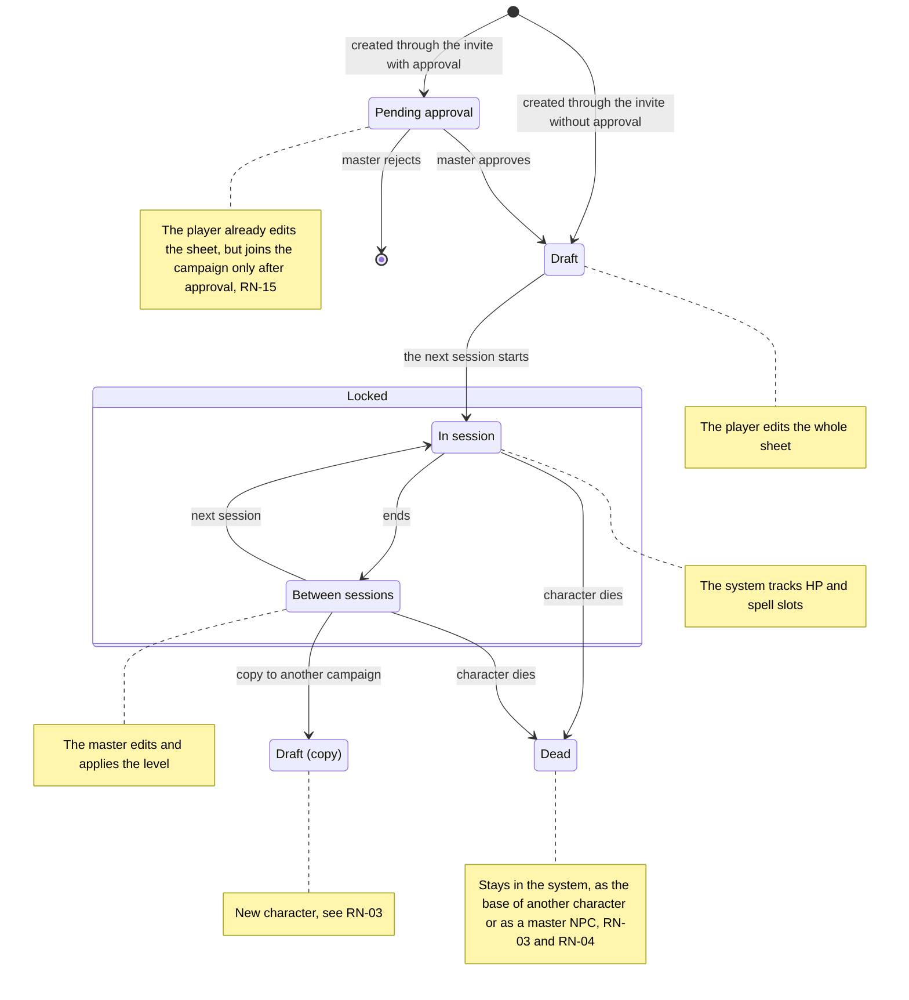
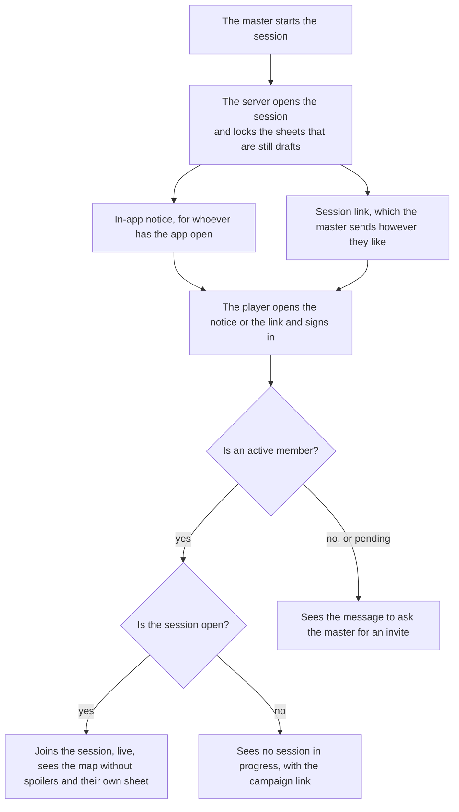

[Português (Brasil)](../pt-BR/produto/regras.md)

# Business rules

Each rule has an ID (RN-xx) so that the stories, the tests and the code can point to it.
The table states each rule in one sentence.
The section below it says what the product enforces, who it protects and how the user notices it.
How the code does it lives in the [architecture docs](../architecture/README.md); the tests that prove it are listed in [Testing](../testing.md).

| ID | Rule | Detail |
| --- | --- | --- |
| RN-01 | **Sheet lock.** The player edits their own sheet until the first session of the campaign starts. After that, only the master and the system change it. A character created later stays editable until the next session starts. | [Detail](#rn-01-sheet-lock) |
| RN-02 | **Hit points and spell slots.** During the session, the system tracks hit points and spell slots from the actions: damage, healing, a spell cast, a rest. The master can correct them by hand at any time in the session and has the final word. | [Detail](#rn-02-hit-points-and-spell-slots) |
| RN-03 | **One character, one campaign.** A player's character stays in one campaign. Within the campaign, the player has one living character at a time. A dead character is not deleted: it stays in the system, as the base for another character of the player, or as a master's NPC in another campaign (RN-04). | [Detail](#rn-03-one-character-one-campaign) |
| RN-04 | **Reusable NPCs.** The master uses their own characters in as many campaigns as they want, including a dead player character (RN-03). | [Detail](#rn-04-reusable-npcs) |
| RN-05 | **Roles per campaign.** A user can be master in one campaign and player in another. | [Detail](#rn-05-roles-per-campaign) |
| RN-06 | **Session start notice.** When the master starts the session, the members get a notice in the app, for whoever has the app open. The session link requires the person to be signed in and opens the session only for members. | [Detail](#rn-06-session-start-notice) |
| RN-07 | **An invite is not the session link.** The invite adds someone to the campaign; the session link only takes a member to it. The master chooses how many uses an invite has and how long it lasts, and can revoke it at any time. | [Detail](#rn-07-an-invite-is-not-the-session-link) |
| RN-08 | **Import format.** The player or the master chooses the format: the D&D Beyond sheet or the Portuguese-language sheet, both as fillable PDF. There is no DOCX import. | [Detail](#rn-08-import-format) |
| RN-09 | **XP mode.** Each campaign gives XP for defeated enemies, for gold or for milestones. In the first two modes, the master also gives XP whenever they want. | [Detail](#rn-09-xp-mode) |
| RN-10 | **Map without spoilers.** A player receives only what their character can know: the points of interest the group discovered, and nothing the master hid. | [Detail](#rn-10-map-without-spoilers) |
| RN-11 | **Master notes.** Only the master reads and edits the master notes. | [Detail](#rn-11-master-notes) |
| RN-12 | **Level up.** The player levels up through the guided edit of the sheet that RN-01 allows while the character "Pode subir de nível" ([MR-040](stories.md#mr-040-level-up-from-the-sheet)). | [Detail](#rn-12-level-up) |
| RN-13 | **More than one master.** A campaign can have more than one master, and a master can hand the campaign over to another. | [Detail](#rn-13-more-than-one-master) |
| RN-14 | **Creating a campaign needs a full master account.** Any account can play. To create a campaign, the account must be a full master account, which today exists only with Google. | [Detail](#rn-14-creating-a-campaign-needs-a-full-master-account) |
| RN-15 | **Invite with approval.** Through the invite link, the player creates their own character right away. The master approves or rejects that character before it counts for the campaign. | [Detail](#rn-15-invite-with-approval) |
| RN-16 | **Account deletion and inactivity.** When a player deletes their account, their characters stay linked to the campaign's master and are not deleted. | [Detail](#rn-16-account-deletion-and-inactivity) |
| RN-17 | **Player sign-in without Google.** The player signs in with an anonymous login, with no e-mail or real name: the master's nickname together with the player's nickname identifies the account. | [Detail](#rn-17-player-sign-in-without-google) |
| RN-18 | **Physical or app dice.** The master chooses whether the campaign lets players choose the dice. If it does, each player chooses between rolling in the app or rolling the physical die and typing the result. | [Detail](#rn-18-physical-or-app-dice) |
| RN-19 | **Initiative.** In a battle with several identical NPCs, each rolls its own initiative; the group does not roll together. | [Detail](#rn-19-initiative) |
| RN-20 | **What players see of enemies in combat.** Players do not see enemy hit points as a number. They see one word: "Ileso", "Ferido", "Muito ferido" or "Derrotado". | [Detail](#rn-20-what-players-see-of-enemies-in-combat) |
| RN-21 | **Grid movement.** On the map grid, each square is 1.5 m and movement is a **circle**: the distance between two squares is the straight line between their centres, and what a combatant can reach is the circle of its remaining movement. | [Detail](#rn-21-grid-movement) |
| RN-22 | **Conditions and concentration.** The app marks conditions (prone, poisoned...) and concentration, and reminds: when a concentrating character takes damage, the game asks its owner for the concentration save (RN-31). | [Detail](#rn-22-conditions-and-concentration) |
| RN-23 | **Table content.** The master registers classes, subclasses, races, subraces, backgrounds and spells that hold only in their campaign, next to the SRD 5.1. Members read the campaign's content; only the master writes. | [Detail](#rn-23-table-content) |
| RN-24 | **Table rules.** At the top of the "Regras da mesa" page is the **table style**: "Tudo no app" (dice in the app, combat with a map, fog on in new maps), "Mesa física" (physical dice, combat without a map by default, fog off) or "Teatro da mente" (each player picks the dice, combat without a map, no fog), and "Personalizado" when the choices match none. | [Detail](#rn-24-table-rules) |
| RN-25 | **The grid and combat without a grid.** The rules count in 1.5 m squares on every map (RN-21). A map drawn with bigger squares is calibrated: "each square of this drawing is worth 3 m" makes the app count four 1.5 m squares in each one, and a 1.5 m reach stays the neighbour. | [Detail](#rn-25-the-grid-and-combat-without-a-grid) |
| RN-26 | **Doors.** A closed door blocks movement, sight and light, like a wall, and counts as a wall for cover. A character who walks into it opens it, unless it is locked; the master opens, closes and locks any door, in the editor and in the session. | [Detail](#rn-26-doors) |
| RN-27 | **Puzzles.** The player never receives the answer to a puzzle: only the state (the lights, the wheels, the symbols, the ciphered message), the master's clue, the loose hints, who made the last move (the character's name) and, once solved, what happened (the text the master wrote in "Ao resolver" or a generic line). | [Detail](#rn-27-puzzles) |
| RN-28 | **AI-generated images.** Only the master generates and edits, with a limit of images per campaign per month. | [Detail](#rn-28-ai-generated-images) |
| RN-29 | **Monsters in combat.** A monster from the bestiary (MR-042) enters combat as an NPC: the player sees only the state word (RN-20), the master sees the SRD creature sheet, and it counts in the XP by enemies by its challenge rating (CR, ND). | [Detail](#rn-29-monsters-in-combat) |
| RN-30 | **Limits on what an account creates.** An account is master of at most 10 campaigns, the whole server generates at most 100 images per day and keeps at most 5 image requests alive at once (the one being made and four waiting), on top of each campaign's 20 per month (RN-28). | [Detail](#rn-30-limits-on-what-an-account-creates) |
| RN-31 | **Reactions and the reaction window.** One reaction per round; when something a reaction can change happens, the game waits for the reactor, the master answers for every NPC, and a player of an NPC's reaction reads only "Esperando o mestre". The concentration save is a window too. | [Detail](#rn-31-reactions-and-the-reaction-window) |
| RN-32 | **Casting outside combat.** A character casts a spell outside a combat with no turn and no economy: a spell cast in an action takes effect at once, and one that takes minutes or hours (or a ritual) is finished by the master when the game time has passed. A ritual costs no spell slot and 10 more minutes. A cast that is interrupted fails and spends no slot. | [Detail](#rn-32-casting-outside-combat) |
| RN-33 | **Class and race choices.** A class or a race can ask the player to pick something (a Fighting Style, a Draconic Ancestry, Pact Boon and invocations, Metamagic, a Favored Enemy, a terrain, the Half-Elf's +1s...). A character is not created with a choice open; a locked sheet that has one keeps working and completes it later, and a level-up also asks the choices that were left behind. | [Detail](#rn-33-class-and-race-choices) |
| RN-34 | **Contests and special actions.** Grapple, shove and escape are contests of Strength (Athletics) against Strength (Athletics) or Dexterity (Acrobatics); a tie changes nothing. Dragging a grappled creature halves the speed. Hide compares the Stealth total with each creature's passive Perception (a tie keeps the hider noticed); Help gives advantage; a group check passes when at least half pass; a surprised creature does nothing on its first turn. A player never reads an NPC's numbers, the escape DC, who noticed a hider or another player's total. | [Detail](#rn-34-contests-and-special-actions) |
| RN-35 | **Race traits and the monk's Slow Fall in combat.** A half-orc dropped to 0 hit points but not killed outright stays at 1 (Relentless Endurance, once per long rest, used by the app by itself); its critical hit with a melee weapon attack rolls one more weapon die (Savage Attacks); a monk's reaction takes 5 times its level off a pit's fall damage (Slow Fall); a goblin's Fuga Ágil is Disengage or Hide as a bonus action; a halfling whose d20 shows a 1 (an attack, or a check or saving throw the player rolls) is asked "Tirou 1: rolar de novo?" before the result, and the new roll stands; on a saving throw the app rolls for a player's halfling in someone else's action, the app rolls the 1 again by itself (Lucky). | [Detail](#rn-35-race-traits-and-the-monks-slow-fall-in-combat) |
| RN-36 | **Who reads a line of the scene's conversation.** A line is for the whole table or for chosen readers; the master always reads every line, can choose any set of players, and a player chooses everyone or "só o mestre". Whoever is not chosen never receives the line: not its text, its image, its existence, its count or a notice that it was sent, in a read, on the stream, in the summary or in the voice. The master speaks as the narrator or as an NPC of the campaign; a player as their own character (RN-18) or out of character. | [Detail](#rn-36-who-reads-a-line-of-the-scenes-conversation) |
| RN-37 | **Areas that spells keep on the map.** Spirit Guardians, Moonbeam, Cloudkill, Web, Grease and Entangle leave their area on the map while they last. A creature makes the spell's saving throw when the area catches it, at most once on a turn for each area. Spirit Guardians, Moonbeam, Cloudkill and Web ask a creature that comes in and one that begins its turn inside, and the cast hits nobody (Web puts its effect on the creatures inside at the cast). Grease asks the creatures inside at the cast, a creature that comes in and one that ends its turn inside, never at the start of a turn. Entangle asks only the creatures inside at the cast. The area ends with the concentration or its time, and moves where the spell lets it. A hidden caster's area is the master's alone. | [Detail](#rn-37-areas-that-spells-keep-on-the-map) |
| RN-38 | **A creature's save actions.** The master uses an NPC's action that asks a saving throw (a breath weapon, a gaze) from its turn. The app rolls each target's save against the stat block's DC, opens the damage the save governs (half on a success when the action says so) and spends the action. A player reads each target's result and the damage they take, never the DC or the stat block. | [Detail](#rn-38-a-creatures-save-actions) |
| RN-39 | **A condition a failed save gives.** A creature that fails the save of an action gets the condition the action names, unless it is immune or already has it. The duration and the repeated save are notes for the master; the app counts no time. | [Detail](#rn-39-a-condition-a-failed-save-gives) |
| RN-40 | **A rider on a creature's hit.** An NPC attack that asks a save of its target on a hit, or grapples it, offers the master the rider once the damage has landed: "Aplicar" or "Dispensar". A grapple gives the condition and notes the escape DC. A player never receives the offer. | [Detail](#rn-40-a-rider-on-a-creatures-hit) |
| RN-41 | **Actions without a roll.** A creature's action that rolls nothing (a power the text describes) is used as a reminder: it spends the action and writes a log line, and the master reads the SRD text. | [Detail](#rn-41-actions-without-a-roll) |
| RN-42 | **A monster attack with several damage parts.** A hit of a stat block attack deals every damage part of the action (a sword plus fire) as one damage to apply, each part resisted by its own type. | [Detail](#rn-42-a-monster-attack-with-several-damage-parts) |

## RN-01: Sheet lock

The player edits their own sheet until the first session of the campaign starts.
After that, only the master and the system change it.
A character created later (the replacement for a dead one, or one for someone who joined late) stays editable until the next session starts.
The numbers the system calculates are never editable.

- **The story.** The character story (personality, appearance, backstory, allies) has its own lock: after the sheet locks, the player edits it only when the master releases it, character by character, until the next session starts or the master locks it again.
- **What the master sees first.** Before starting a session, the master is told which sheets still have skills or spells to choose, and confirms. The lock does not wait for them.
- **Reserved characters** ([MR-049](stories.md#mr-049-reserved-characters-and-claim-links)) have no player to lock out. They lock with the first session that starts after a player claims them.
- **Refusal.** A locked sheet, a dead character or a locked story refuses the player's edit. The screen shows the sheet read-only.
- **Feats.** Only the master adds or removes a feat in the sheet editor. A player's feats come from the guided level-up, and a player's save that changes them is refused.

**The level-up exception** ([MR-040](stories.md#mr-040-level-up-from-the-sheet)).
While the character "Pode subir de nível" (RN-12), the owner may edit even a locked sheet, but only to add what the next level gives.
The server builds the new sheet from the stored one and checks it with the rules, so nothing else can change.

| The guided level-up may change | It never changes (the server refuses, naming the field) |
| --- | --- |
| One level of a class the character already has | Name, race, background, base scores |
| The ability score improvement, only at a level that has it (+2 to one ability or +1 to two, none above 20) | Armor, shield, weapons |
| The hit points of the level (average, die rolled in the app, or physical die typed in) | The other classes and everything earlier levels already had |
| The cantrips and spells the class table gives, and new prepared spells (none removed) | A sheet that would end up with a problem the old one did not have (a spell outside the class list or above the level, too many prepared) |
| The subclass, at its level, and the options, skills and expertise the new level offers | |

- **The master adds the rest in the editor** ("o mestre acrescenta pelo editor"): multiclassing, a custom subclass, the Warlock's Mystic Arcanum, the Wizard's Spell Mastery and Signature Spells, the Additional Magical Secrets of the College of Lore, the Ranger's favored enemies and terrains, and swapping a known spell for another (the guided level-up only adds spells).
- **A stored sheet that no longer passes today's rules** gets the refusal that asks the master to fix the sheet.
- **A player who cannot level up** (the character is not "Pode subir de nível", is an NPC or is at level 20) is refused too.
- **The hit die** follows the campaign's dice mode (RN-18). The die rolled in the app is rolled by the server and kept for that character and level, so asking again returns the same result. A campaign that forces the physical die refuses the app die, and the reverse.
- **The master reads every level-up** in "O que mudou".

See [Characters](../architecture/characters.md) and [Level up](../architecture/rules-level-up.md).

## RN-02: Hit points and spell slots

During the session, the system tracks hit points and spell slots from the actions: damage, healing, a spell cast, a rest.
The master can also correct hit points, temporary hit points, spell slots (and pact slots), hit dice and the uses of class and race resources by hand at any time in the session: the master has the final word.

- **The correction** needs an open session, keeps each value between 0 and its maximum, and tells the master and the character's owner at once. A retry changes nothing. In Wild Shape it also sets the beast's hit points.
- **Who reads what.** A player reads the numbers of their own character only. The master reads everyone's.
- **Values last** from one session to the next. The maximums come from the sheet, and a character whose hit points were never set is at full hit points whatever the maximum becomes.
- **Damage.** Temporary hit points go first, and hit points stop at 0 (RN-03).
  - On an NPC, a monster or a character's creature the damage lands at once, after resistances, vulnerabilities and immunities of its SRD creature (immunity makes it 0, resistance halves it rounded down, vulnerability doubles it). A resistance or immunity "from nonmagical attacks" applies to an attack that is not magical, and not to a spell, to an attack of a creature whose weapon attacks are magical, or to damage that is no attack (a trap, a zone, a burning effect). A weapon of a character is not magical, and neither is an unarmed strike, except a monk's from level 6 (Ki-Empowered Strikes, also as a multiclass monk): it counts as magical for these resistances and immunities and for nothing else, with no bonus to hit or damage, and not for a monk weapon. An entry that also names a material (silvered, adamantine) is not applied, because an attack carries no material: the master corrects the hit points by hand.
  - On a player character the rolled damage **waits for the master**, who applies it ("Aplicar 5 de dano") or discards it ("Não aplicar"). The master may apply a different amount (a resistance the app does not apply). The log keeps both numbers for the master, and the player sees only what they took.
  - What the character's own sheet protects is applied to the rolled damage as steps the master reads, before the master applies it: a race, feat or feature of the table with resistance, immunity or vulnerability to damage types (or, "from nonmagical attacks", to bludgeoning, piercing and slashing), and the barbarian's rage. Immunity makes it 0, then resistance halves it (rounded down), then vulnerability doubles it; the same protection from two sources counts once. An attack of a sheet or a stat block that is not marked magical counts as nonmagical.
  - A sheet that is immune to a condition takes none of the effects that give it (a spell's, a rider's, a trap's, a grapple or a shove that knocks prone); the master's own change of the conditions is not blocked.
  - A character's creature has its own hit points. Its damage lands at once, and at 0 it is dismissed.
  - A trap's damage follows the same path. Outside a combat, what waits for the master survives until they apply or discard it.
- **Channel Divinity of the cleric.** Preserve Life (Life Domain) restores hit points to the creatures within 30 ft that the cleric names (when the cleric names no one, the app shares the points among the party, the most hurt first), up to five times the cleric's level in all, each to no more than half of its maximum; it cannot restore an undead or a construct. Turn Undead makes each undead within 30 ft that can see or hear the cleric make a Wisdom saving throw against the cleric's DC, and the ones that fail are turned for a minute (the master sees each save and who was turned, in the log and on the response; the turned creature carries the effect "Expulso"). Both spend the action and a use.
- **Spells and resources.** A spell spends its slot (or pact slot) when it is cast, and a resend does not spend twice. A healing spell heals at once, up to the maximum, and raises whoever was at 0. Class and race uses (Second Wind, Action Surge, Rage...) are counted too. A resource without a limit shows "ilimitado".
- **The master's "Desfazer última ação"** undoes the last action; each undo is itself recorded.

**Rests** (SRD 5.1, "Resting").
The master takes a short or a long rest for the table, after a confirmation that lists what comes back for each character.

| Rest | What comes back |
| --- | --- |
| Short | Resources that recharge on a short or a long rest, and the warlock's pact slots. Each player spends hit dice one at a time, rolled in the app or typed from a real die (RN-18), and heals the roll plus the Constitution modifier. |
| Long | Every resource that does not recharge at dawn or never, all spell slots, all hit points, and half of the total hit dice (at least one). Temporary hit points end. A character at 0 hit points gains nothing. |

- The app does not count hours: the master is warned when the session already had a long rest. A rest is refused while a combat runs.
- Hit dice are kept by die size (SRD, "Multiclassing").
- **Arcane Recovery** (Wizard): once per long rest, after a short rest, the player chooses expended slots whose combined level is at most half the wizard level, rounded up, none of the 6th level or higher. Only the wizard level counts, and never pact slots. The short rest sheet has a "Recuperação Arcana" section, and afterwards it reads "Recuperação Arcana: usada; volta no descanso longo." A refusal changes nothing.
- **Lay on Hands, Flexible Casting and Metamagic.** Lay on Hands spends points on a touch, or 5 points to cure a poison or a disease; on an undead or a construct the points are spent and the answer says only that nothing happened, so a player learns nothing about its type (RN-10). Flexible Casting turns points into a slot of level 1 to 5 that a long rest takes away, and a slot back into points. The cast sheet offers only the Metamagic options the character knows, with the cost, and a disabled one says why.
- **Bardic Inspiration.** A bonus action, one die at a time, to another creature within 60 ft that can hear. The die lasts 10 minutes of **game time**, which moves only when the master moves it, a cast takes time or a rest happens. The holder decides after the d20 and before the result: "Usar a Inspiração de Bardo (d8)?". Outside a combat the bard gives it from the session panel ("Inspiração de Bardo", "Dar a …"). When a combat takes the holder in, the die goes with them and comes back when it ends.
- **Aid** raises the maximum and current hit points of each target by 5 (and 5 more per slot level above the 2nd) until the master ends it ("Encerrar Ajuda"). A long rest ends it for a player's character, a short rest does not. Two Aids do not add up. When it ends, hit points lose only what is above the new maximum, so nobody who still had hit points drops to 0 because of it. The sheet's own maximum is shown ("máximo 38 da ficha"), and the log says "A Ajuda de Sálvia acabou".
- **Shield** shows as "CA 18" with the sum "13 + 5" and the label "Escudo Arcano +5 até a sua vez" for the player, and as "CA 13 + 5" on the master's order. It ends when the caster's turn starts. Only the master and the caster read "O Escudo Arcano de X acabou", because the spell may have answered an attack from a hidden creature (RN-10).

See [Attacks and damage](../architecture/play/attacks-and-damage.md), [Rests and resources](../architecture/play/rests-and-resources.md) and [Lasting effects](../architecture/play/lasting-effects.md).

## RN-03: One character, one campaign

A player's character stays in one campaign.
Within the campaign, the player has one living character at a time, and creates a new one only when the current one dies.
A dead character is not deleted: it stays in the system, as the base for another character of the player, or as a master's NPC in another campaign (RN-04).
To play another campaign, at the same time or in a continuation years later, the player makes a copy ([MR-021](stories.md#mr-021-copy-a-character), not built yet).

- **A second living character is refused**, and the refusal names the living one. Claiming a reserved character through a link ([MR-049](stories.md#mr-049-reserved-characters-and-claim-links)) counts too, and a person whose only character is dead may claim. A reserved character has no player, so it counts against nobody.
- **Death saves.** A character at 0 hit points is "Caído". At the start of their turn they roll a death saving throw, in the app or typed (RN-18): 10 or more is a success, less is a failure, a natural 1 is two failures, a natural 20 returns with 1 hit point. Three successes make them stable ("Estável"). Damage while down counts a failure (two on a critical hit). A character at 0 hit points is unconscious for the attacks against it (SRD 5.1): they have advantage, and a hit from within 5 feet is a critical hit, so two failures; this holds for weapon and spell attacks, and the suggested mode the attacker reads ("Como rolar o d20") says so. Any healing resets the counts. The turn does not end until the roll is made, the master's end of turn included: when the player is away the master rolls for the character, in the app or by typing the result, and only then ends the turn. Outside combat the app does not roll death saves.
- **Three failures do not kill by themselves.** The master sees "Morrendo · 3 falhas" and the question "Confirmar a morte" / "Ainda não". The players keep reading "Caída" and the counts, which are public: the app never says someone died before the master does. The confirmation cannot be undone with "Desfazer".
- **A dead character takes no healing** (a healing spell aimed at one is refused before the slot or action is spent), and its player keeps reading the combat.
- **Reviver (the master).** A dead character can live again with 1 hit point and no death save counted, keeping the state it had before (draft or locked). It spends nothing and has no time limit. It is refused while the player has another living character. In a running combat the character keeps its place in the order, and the log says "O mestre reviveu <name>".
- **Revivify** ("Revivificar", SRD 5.1: 3rd level, touch, diamonds worth 300 gp) returns a creature that died in the last minute with 1 hit point, but not one that died of old age or lost a body part. In a combat the app counts the minute as 10 rounds from the round of the death. Out of combat the master answers whether it was less than a minute. A Counterspell answers it like any cast (RN-31), and a countered Revivify still spends the slot and the action. A player's list holds only the creatures the spell reaches now, and no refusal says why another is missing (RN-10). The master's switch "Revivificar não funciona nesta morte" takes a creature off the list.
- **On the screen**, the turn of someone who is down says "Brisa está caída", with the marks and "Rolar teste contra a morte".

See [Death and revival](../architecture/play/death-and-revival.md).

## RN-04: Reusable NPCs

The master uses their own characters in as many campaigns as they want.
That includes a dead player character (RN-03), which the master may reuse as an NPC in another campaign.

An NPC is a template: its hit points and position live on the combatant of each combat, so a combat in one campaign never changes the NPC in the others.
An NPC belongs to the master who created it, and players neither see nor create NPCs.
Using the same NPC in other campaigns is [MR-022](stories.md#mr-022-reuse-npcs).

## RN-05: Roles per campaign

A user can be master in one campaign and player in another.
The role belongs to the membership in a campaign, not to the user.

## RN-06: Session start notice

When the master starts the session, the members get a notice in the app, for whoever has the app open.
The session link requires the person to be signed in (with Google; RN-17 is not built) and opens the session only for members.

- The notice appears under the app bar, with an "Ao vivo" link in the bar. The app looks for open sessions every 30 seconds while the tab is visible. There is no push notification with the app closed.
- On the campaign page there is no notice: the session strip is the announcement. A player's strip shows "Entrar na sessão" when a session starts and drops it when it ends, without a reload.
- A non-member, including a pending member, cannot open the session page. They see "peça um convite ao mestre".

## RN-07: An invite is not the session link

The invite adds someone to the campaign; the session link only takes a member to it.
The master chooses how many uses an invite has and how long it lasts, and can revoke it at any time.

- The defaults are 1 use and 7 days. The master chooses 1 to 20 uses and 5 minutes to 30 days.
- The session link carries no secret. Membership is checked on every call, and on the live stream again every 60 seconds.

## RN-08: Import format

The player or the master chooses the format: the D&D Beyond sheet or the Portuguese-language sheet, both as fillable PDF.
There is no DOCX import.

**Not built** ([MR-007](stories.md#mr-007-import-a-sheet-from-pdf), Later).
The intended behaviour: the importer reads the PDF fields and shows the result for review before saving.

## RN-09: XP mode

Each campaign gives XP for defeated enemies, for gold or for milestones.
In the first two modes, the master also gives XP whenever they want.

| Mode | XP comes from | "Pode subir de nível" (RN-12) when |
| --- | --- | --- |
| By enemies | The challenge rating (ND) of the defeated enemies, or XP the master types | The sheet's XP reaches the next level |
| By gold | 1 XP per gold piece, converted when the group returns to town ("Voltar à cidade") | The sheet's XP reaches the next level |
| By milestones | The master marks a milestone and chooses who levels up. No screen shows an XP number | A milestone mark is above the sheet's level |

- **The split** is the total divided by the number of characters, rounded down. The leftover is lost on purpose, because the SRD does not say what to do with it: the app never invents XP, the master is told how much was lost, and may award it by hand. A creature of CR 0 is worth 10 XP in the table, and the master types 0 for one that does not attack.
- **Who receives.** A living player character of the campaign. At the end of a combat the master sees each defeated enemy's XP, the sum, who receives (by default those who fought and did not die) and the written split ("350 XP ÷ 3 = 116,67, arredondado para baixo. 2 XP se perdem na divisão."). "Dar 116 XP a cada um" gives the combat award, and "Agora não" leaves "XP do combate ainda não dado". "Dar XP" works at any time and asks for a reason (up to 120 characters) and a value (1 to 1,000,000).
- **An NPC's XP** is filled from its challenge rating, and the master may type another value ("Usar 50 XP" goes back to the table's). Only the master reads it (RN-20).
- **Undo.** The master undoes only the last award. It stays in the history as "Desfeito", and the undo takes back what each sheet gained.
- **History.** The whole campaign reads the history (who gave, when, why, how much each received), and players are told live when XP changes.
- **Changing the mode** after the campaign exists is the master's. If XP was already given, the app asks first and says how many awards and how much XP. Nothing is converted: the XP and the history stay, and the new mode applies from then on. The level-up notices change with the mode, because they are read from it.
- **Treasure.** "Voltar à cidade" converts the gold of the treasures the group found and nobody converted yet, 1 XP per gold piece, once each, only in a gold campaign. Undoing the last award frees them. A generated treasure ([MR-044](stories.md#mr-044-generate-treasure)) counts only its gold (coins, gems, art objects); magic items never become XP. In the other modes the treasure only goes into the session summary. See [Treasure](../architecture/maps/treasure.md).
- **Planned milestones.** In a milestones campaign, the master writes the milestones beforehand (texts up to 120 characters, at most 100 per campaign), in any order. When the group reaches one, the master marks it and chooses who levels up. A milestone is reached once, "Dar a mais alguém" gives it to someone left out, and undoing the mark sends it back to planned. "Registrar um marco fora da lista" covers what nobody planned. A reached milestone is never edited or removed. A campaign that counts XP refuses all this.
- **Who sees what (RN-20).** The planned milestones belong to the master. A player receives only the reached ones, with the day, the time and who leveled up.
- **Screens.** The NPC editor has "Nível de desafio (ND)" and "XP ao derrotar". Changing the ND redoes the XP from the table. The campaign page has "Experiência" for every member, and "Desfazer" for the master only, with the question in place and focus on "Voltar".

See [Progression](../architecture/progression.md).

## RN-10: Map without spoilers

A player receives only what their character can know.
What the master hid never reaches the player's device: not in an answer, not in a live event, not in an image.
The server leaves hidden things out of the response, never blank: no ID, no name, no description.
Anything the player asks for that they may not see answers as if it did not exist.
The master sees everything, and can open a map "as" a character to see exactly what that player receives.

**Maps and points.**
A map and a point are born hidden, and the master reveals and hides each one.
An NPC's token is born hidden. A player character's token is visible, and so is a creature's (a creature is on the group's side). Choosing the session's current map reveals it.
The player sees the revealed map and the current map, with the revealed points and visible tokens only; a submap point leads only to a map the player also sees.

**Moving tokens outside combat** ([MR-012](stories.md#mr-012-follow-the-session)).
Outside combat the master moves any character's token; a player moves only their own, alone, and only on a map where the master turned on "Os jogadores movem os próprios personagens" (off by default), and only while they see that token.
A token walks toward the square and stops before a wall, a locked door or a square marked "Não dá para passar", with no limit of movement.
The master is told why it stopped; a player is told why only when the square in the way is one they see or remember: otherwise the answer says only that it stopped, and the player never learns what is there (a hidden NPC, a square in the fog).
The master taking the switch back while a player is moving makes the server refuse that move, and the player's screen says "O mestre voltou a mover os tokens.".

**The scene** ([MR-015](stories.md#mr-015-rp-scene-actions), [MR-031](stories.md#mr-031-npcs-in-the-scene)).
The master may hide an NPC on the stage ("Escondida dos jogadores") and an action of a scene ("Escondida"), when preparing or live.
A hidden NPC counts for the stage's limit of 4, but no player receives it: not its name, portrait or place on the stage, not in the open scene, not in a live hint, not in a cast list or as a target.
A hidden action reaches no player: not its name, DC, attempts or rolls, and a player's roll on it is refused exactly as a roll on an action that does not exist.
Hiding and showing tell the players the same hint as any change of the scene, so what was hidden leaves their screen, or enters it, at once; putting something on the stage hidden, or taking it off, and changing an action that stays hidden, tell only the master.
"Dar a fala" to a hidden NPC shows it: the master's tap means that it speaks now.
A line the master sends in the scene's conversation as a hidden NPC names it for the readers he chose and nothing else of it: not its portrait, not a place on the stage; only "Dar a fala" shows it.

**Who is in the scene** (["Quem está na cena"](stories.md#mr-015-rp-scene-actions), [MR-015](stories.md#mr-015-rp-scene-actions)).
A scene is open to the whole table, a player who joins later included, or to exactly the players the master picks, who he may change while it is open.
A player who is out gets no scene at all, exactly as when none is open: not its name, point, description, actions, rolls, stage or portraits, not the group check asked in it, not a live hint, and a roll of theirs is refused as with no open scene.
A player who comes in reads the scene at once and a player who goes out loses it at once, each told by the same hint as any change of the scene.
With the master's switch "Os jogadores podem entrar" on, a player who is out reads the scene's name and that they may join and nothing else, and joining makes them one of its players for what follows (an image shown to the scene's players reaches them; one shown to chosen players does not).
The master may name any player of the campaign, also the player of a dead character: the audience is about players, not characters.
The checks passed in it count in the summary only for the master and the players who were in, also when the action is hidden afterwards; a scene is "discovered" for the group's notes when it is open to everyone, and, while it is open to only some players, by each of them alone: no other player's notes list its name or accept it as a label.
A clue revealed to a player who is out reaches their notes and nothing else of the scene.

**Who sees the image** (["Quem vê a imagem"](stories.md#mr-028-show-an-image-to-the-players), [MR-028](stories.md#mr-028-show-an-image-to-the-players)).
The image the master shows has one audience: the whole table (the only one when no scene is open or the open scene is open to everyone), the scene's players (the default while a scene is open to only some, following who is in while that scene stays open), or chosen players.
The master changes it while the image is shown: "Mostrar a toda a mesa" widens it, "Mudar quem vê" picks the players.
A player taken out loses the image at once, in the read, on the live stream and on the image route; one brought in gets it at once.
When the scene closes, another opens, or it opens to everyone, an image shown to its players stays with those same players and no one else, and an image left with the players ("Deixar com os jogadores") is left only with the players of its audience.
A player outside the audience never receives the image, its name or its ID, also not in the summary; deleting the image tells only the master and the players who saw it.
An image left with the players again keeps the widest audience; only taking it back narrows it.

**Fog of war** ([MR-036](stories.md#mr-036-fog-of-war-by-sight)).
On a map with fog on, the player receives only what their character sees now or has already seen: the walls and light the master painted, the light points and carried lights, and the sheet's darkvision decide.

- It does not reach them: the map image (they receive only tiles of squares they saw or remember, black elsewhere), a point they neither see nor remember, an NPC token outside their sight, the light layer, or a wall far from what they see.
- A player character's token always arrives. A token the master hid still lights the map, and the player sees the brightness, not who carries it.
- What was seen stays, darkened and without creatures, until the master clears it ("Esquecer o que foi visto") or changes the grid or the image.
- A map in "Claro" (bright base light) shows the whole floor plan to the players, but creatures and points still follow what the characters see, and a secret door reads as a wall. A room that must stay secret uses "Penumbra", which a generated dungeon gets.
- On a fog map the master is warned, and only the master, of each player character that sees nothing where it stands: its square is dark (the base light is "Escuro" and no painted light or light source reaches it, counting the lights of NPCs the players cannot see) and it has no darkvision, blindsight or truesight. In "Penumbra" and "Claro", and on a map without fog, nobody is in the dark. A carried light that goes out brings the warning back at once.
- A fog map's image is the master's alone: showing it in the session, leaving it with the players, or using it as a portrait or as another map's background gives a copy.
- Combat on a fog map is covered in RN-20. The player of a dead character sees what the living party sees. An ended combat has no fog.

See [Fog of war](../architecture/maps/fog.md).

**Images.**
The gallery is the master's. A player downloads an image only while seeing it: the background of a map they see, or the image the master shows in the session.
The master may leave an image with the players ("Deixar com os jogadores") and take it back. A player who may not see the image gets the same answer as for an image that does not exist.
An NPC's portrait is served only while the NPC is on the stage of the open scene.

**Scenes, clues and hooks** (MR-015, MR-029, MR-030, MR-031).
The master may open a hidden scene point; the scene reaches the players and the point stays off their map. A scene counts as discovered once the master reveals the point or opens it, for the whole group, and its name may then label a player's note, but only for a scene of a map the player can open. A scene action's DC and the master's hooks never reach a player (RN-20).

**Traps, treasures, lights and layers** (MR-034 to MR-036, MR-041, MR-044).

- A trap not revealed to the player's character never reaches them: no ID, no position, no event. It arrives when the master reveals it to that character or to everyone, when the character notices or finds it, or when it fired. Then the player reads name, description, position, area and state, never the DCs, the trigger or the effect.
- A trap search reads the same when there is nothing and when the test failed. The player reads "passou" or "falhou", never the DC.
- A hidden treasure carries neither description nor value. Once found, everyone who sees the map reads both and who found it. The XP history a player reads says only how many treasures a "Voltar à cidade" converted and the total gold.
- A light point never goes to a player (they see the light, not the point). Of the painted layers, a player receives only wall, difficult terrain and cover. A carried light goes only to the master and its owner.
- A move cut short by an unknown trap only says that it stopped.

**Generated dungeons.** The room list and the generator's record are the master's. A player reads nothing of them, before or after the map is revealed.

**Reserved characters** ([MR-049](stories.md#mr-049-reserved-characters-and-claim-links)).
No player reads a character the master made for a player to claim until someone claims it: not in lists, by ID, in the party, the combat, the map, the XP or the session summary. The person with the link, once signed in, sees only name, race, class, level, who sent it and the campaign's name.

**Other secrets.**
The reason the master gives when asking for changes to a character (RN-15) reaches only the master and the owner.
A player's notes are private to them. The master does not read them.

**The trap search is the same for every trap.**
The player's menu is Perception, Investigation and "Outra perícia…", with a constant line "Algumas armadilhas só se acham com uma perícia específica", whatever is nearby.
Perception meets a trap's DC to notice it and Investigation its DC to find it. Another skill finds only the traps whose master listed it; for the others the search reads exactly as a search that fell short ("Achou" or "Nada", never "Falhou"), at the same cost.

The tests that prove this are described in [Testing](../testing.md#leak-tests-rn-10): a campaign with one hidden thing of each kind, every read, every live event, every image and every fog tile asked by every kind of person, and a guard that fails when a new procedure is not classified.

## RN-11: Master notes

Only the master reads and edits the master notes.
No other answer carries them, and an automated test proves a player never receives them.

## RN-12: Level up

The player levels up through the guided edit of the sheet that RN-01 allows while the character "Pode subir de nível" ([MR-040](stories.md#mr-040-level-up-from-the-sheet)).
The page has the steps Habilidades, Vida, Escolhas, Magias and Resumo, without the steps that have nothing to choose.
The master can also apply the new level in the sheet editor.
The full level-up screen of [MR-017](stories.md#mr-017-level-up) is for after the MVP.

- **When it holds.** In a campaign by enemies or by gold, when the sheet's XP reaches the next level (300 for level 2, 900 for 3, 2,700 for 4...). In a milestones campaign, when a milestone mark exists whose level the sheet has not yet passed. Nobody levels up from level 20.
- **Who sees the notice.** The master and the owner, of a living player character.
- **The screens.** The label "Pode subir de nível" (arrow and words, never colour alone) appears in "Personagens dos jogadores", in "Experiência" and on the sheet. In an XP campaign the sheet shows the XP bar and "Chegou aos 2.700 XP do nível 4.", followed by "Suba o nível pelo botão abaixo." for the owner or "Suba o nível na ficha." for the master. The button "Subir para o nível N" is the owner's only, on the locked sheet. Without the mark, the route says leveling up is not possible yet, and the master is told the level-up is the player's.
- **After the level-up** the label goes away by itself, and open sessions are told that XP changed.
- **Multiclassing** (SRD 5.1). The first step, "Subir em qual classe?", offers each class the character has and "Uma classe nova". A new class asks for 13 in the main ability of every class the character has and of the new one (the Fighter: Strength or Dexterity; the Monk, the Paladin and the Ranger: both abilities). A player is refused at the level-up and at creation, and the master's editor may go past it with a warning. The new class enters at its level 1, with the proficiencies of the multiclass table only and never equipment. Extra Attack, Channel Divinity uses and Unarmored Defense do not add up. Spells known and prepared are each class's own, and the slots follow the multiclass spellcaster table (Pact Magic apart). The SRD is silent on a second Pact Magic class and on Magical Secrets across classes, so the app treats each class alone.
- **Current hit points follow the maximum.** When a save changes the sheet's maximum, a character whose current hit points are set gains what the maximum gained, so a wound stays a wound; a maximum that falls never leaves the current above it.

See [Level up](../architecture/rules-level-up.md).

## RN-13: More than one master

A campaign can have more than one master, and a master can hand the campaign over to another.

**Not built** ([MR-023](stories.md#mr-023-hand-over-or-share-the-campaign), after the MVP).
A campaign has one master, its creator.
Once built, the campaign is deleted only when the last master leaves (see [Privacy](../privacy.md#delete-the-account)).
See [ADR-0011](../adr/0011-authorization-roles-per-campaign-checked-per-request.md).

## RN-14: Creating a campaign needs a full master account

Any account can play.
To create a campaign, the account must be a full master account, which today exists only with Google.

Every account comes from the OIDC sign-in (Google in production), so every account is a full master account.
The only gate is the optional list of e-mails allowed to create campaigns (RN-30).
When another way to sign in arrives (RN-17), creating a campaign must refuse accounts without a Google identity, as [ADR-0009](../adr/0009-table-accounts-for-players-without-google.md) proposed.

## RN-15: Invite with approval

Through the invite link, the player creates their own character right away.
The master approves or rejects that character before it counts for the campaign.

- **The invite.** The master ticks "Exigir aprovação do mestre" on an invite. Whoever accepts it becomes a pending member and goes straight to create a character, which is born pending and editable.
- **What a pending member can do.** See the campaign name and XP mode, create, read and edit their own character, read the table rules (RN-24) and make abilities with the 4d6 the server keeps. Everything else answers as if they were not in the campaign. A session does not lock a pending character, and it cannot die. Its sheet shows "Aparece quando o mestre aprovar o personagem." in place of the player notes and the creatures panel.
- **The master decides.** Approving makes the character a draft and the player a member. "Recusar personagem" deletes the character and the pending membership, and the player needs a new invite; its confirmation is drawn as an action with no way back.
- **Pending without a character.** The master sees who is pending without a character, with when they joined and when it expires, and can remove them. Such a membership is deleted on its own 30 days after joining, and from that moment the person no longer counts as a member.
- **An ordinary invite** (without approval, still valid) accepted by a pending player makes them a member at once, spends one use and approves their waiting character. An invite with approval changes nothing for them.
- **Asking for changes ("Pedir ajustes").** The master can send the character back with a reason (1 to 500 characters, required). The character stays pending, and the player reads the reason, edits and taps "Enviar de novo". Editing never sends by itself. The master can approve or reject at any point, and asking again replaces the reason. Only the master and the owner read the reason. It is deleted when the character is approved or rejected, when the character, the campaign or the account is deleted, and when an ordinary invite approves the player.

See [Campaigns](../architecture/campaigns.md#pending-member).

## RN-16: Account deletion and inactivity

**Not built.**
There is no screen to delete an account and no inactivity setting.
This is the intended behaviour:

- When a player deletes their account, their characters stay linked to the campaign's master and are not deleted, or are deleted along with the account if the person prefers.
- When a master deletes their account, they have 30 days to come back by signing in again with the same account; after that, everything is deleted. In any deletion, everything is gone for good 30 days later.
- Each person chooses in their profile how much inactivity leads to deleting the account; the default is 1 year.

A character a player claimed through a link ([MR-049](stories.md#mr-049-reserved-characters-and-claim-links)) whose player then deleted the account stays with the master like any other, not reserved; the master may give it back to the reserve and send it to someone else.
See [Privacy](../privacy.md#delete-the-account) for the full flow, including the caveat about personal data in the character's free text.

## RN-17: Player sign-in without Google

**Not built.**
Every account signs in through the OIDC provider (RN-14).
This is the intended behaviour: the player signs in with an anonymous login, with no e-mail or real name.
The master's nickname together with the player's nickname identifies the account uniquely (the nickname is per table, not per campaign, as [ADR-0009](../adr/0009-table-accounts-for-players-without-google.md) proposed).
The player signs in without a password; when the first 30-day session expires, they must set a password or link Google to continue.

## RN-18: Physical or app dice

The master chooses whether the campaign lets players choose the dice.
If it does, each player chooses between rolling in the app or rolling the physical die and typing the result.
If it does not, everyone uses the type the master picks.

| Campaign setting | The player's roll |
| --- | --- |
| "Cada jogador escolhe" (the default) | Chosen at each roll: "Rolar no app" or "Digitar o resultado". The stored preference only sets which one the screen highlights |
| Everyone rolls in the app | A typed value is refused |
| Everyone rolls their own dice | The app roll is refused |

- A change applies from the next roll. NPCs always roll in the app, and the master can type a value.
- With a physical die the player types the sum of the dice without the modifier (the d20 face, 1 to 20), and the app adds the modifier. The sum must fit between the minimum and the maximum of the dice.
- The rule covers initiative, attack and damage rolls, spell attacks, spell damage and healing, Second Wind, death saves, the d20 of an RP scene action, puzzle hints and the 4d6 ability scores of a new sheet. A mode the master forced refuses the other way with "A campanha mudou a forma de rolar os dados. Recarregue a página.".
- A spell target's saving throw is always rolled by the app with the sheet's bonus.
- The hit points rolled when a character is created are not part of this rule.
- Screens: the master's "Dados" panel, the player's "Como você rola os dados", and the roll sheets, which show "Rolar no app" and "Digitar o resultado" in the order of the preference, or only the way a forced mode allows.

## RN-19: Initiative

In a battle with several identical NPCs, each rolls its own initiative; the group does not roll together.

- The app rolls every NPC copy at once, one roll each (d20 plus the sheet's bonus). The player rolls their own, in the app or typing the physical d20 (RN-18). The one exception is the creatures of a single summon of a player character, which share one roll.
- The order is the highest total, then the highest bonus, and when both tie the master decides. Combat starts only with all initiatives in.
- A reserved character (not claimed by a player yet) does not fight.
- **Shared turn.** Combatants side by side in the order with the same total, players and NPCs, play a single turn: everyone's turn starts together, each with their own economy, each player ends their own part, and the turn passes when the last one ends. Someone alone on a total is a group of one. A reinforcement with the same total acts from the group's next turn. Whoever leaves, dies or is defeated no longer holds the turn.

See [Combat](../architecture/play/combat.md).

## RN-20: What players see of enemies in combat

Players do not see enemy hit points as a number.
They see one word: "Ileso" (unhurt), "Ferido" (hurt), "Muito ferido" (badly hurt, half the hit points or less) or "Derrotado" (defeated).
They do not see enemy armor class or the rolls the master makes for NPCs either.
They see whether they hit or missed ("Acertou", "Errou", "Crítico") and the damage they take.
The same holds outside combat: a scene action's DC, other players' rolls, hooks, unrevealed clues, other players' notes, an action of a scene the master hid, an NPC on the stage the master hid and a scene open to players other than them never reach a player.
The master sees everything.

**Combatants and the log.**

- A hidden NPC does not come at all: not in the order, not on the map, and its turn shows as "Vez do mestre".
- The combat log omits any line involving a hidden combatant, an NPC's dice and its hit points.
- A creature's resistances, vulnerabilities and immunities (the nonmagical ones too, listed as "Resistência a perfurante de ataque não mágico") are the master's. The damage a player reads on an NPC is the damage as rolled, so neither a halved total nor a missing line tells what the target resists.
- The same holds for damage on a character after the master applies it (a spell's, a creature action's or a rider's): the target's owner and the master read the amount taken, every other player reads the amount as rolled, so the line never tells what the target resists.
- The player's screen lists only the reasons for advantage or disadvantage it can see. Divine Smite's extra die against an undead or fiend appears as "+1d8" with no reason.
- Cover reaches the player only as a degree and an origin ("Meia cobertura, do mapa"), never as an armor class or "+2 sobre 14". A target the player cannot see is not in the list.
- **What the design accepts.** Splitting a turn with a visible NPC shows that the two tied. Copies of an NPC are numbered together, so revealing Goblin 2 and hiding Goblin 1 shows another exists. The master avoids the hint by hiding the last copies.

**Joint turns.**
A player sees a group only if it has a player character.
A group of NPCs belongs to the master: the player sees the NPCs by name, with no box and no total, and on their turn reads "Vez dos Goblins".
A hidden member is never named: the turn waits for the master's part as "Falta o mestre".

**Spells and reactions.**

- A target's saving throw goes to the player as a word (passed or failed). The dice go to the master and the owner of a target character, never an NPC's. The DC goes to the master and the caster, and to the owner of the target that rolls the save when the table rule "Os jogadores veem a CD dos testes de resistência" is on (RN-24).
- A cast that touches a hidden combatant leaves no line for the player. The reaction prompt carries neither the attacker nor the hit's total. The player cannot aim at a hidden target.
- **Spells that read HP** (Sleep, Color Spray, Power Word Stun, Power Word Kill, Spare the Dying, Heal; "Sono", "Leque Cromático", "Palavra de Poder Atordoar", "Palavra de Poder Matar", "Estabilizar", "Cura Completa") are resolved with the real hit points, and the player still sees only words. The caster sees their own total (`5d8 (2, 4, 1, 5, 3) = 15`) and who was affected ("adormeceu", "não foi afetado"), never a target's hit points or the reason. The master sees the total, each creature's hit points, what remained and the reason. Other players see only who was affected and the condition. Targets are listed in the caster's order, not the order of the total, which would reveal who has the least hit points. Power Word Kill on a player character takes them to 0 with three failures, and the master confirms the death (RN-03).

**RP scenes** (MR-015).
An action's DC belongs to the master. A player never receives another player's roll.

- The scene point has the switch "Mostrar a CD aos jogadores", off by default. Off, the player gets no DC and is not told whether a roll passed. On, the player sees the DC of each action that has one and whether their own rolls passed ("Passou · CD 12", "Não passou · CD 10"), only for rolls made while the DC showed. Turning it on later does not reveal old rolls.
- Each action has an attempt limit per player (1 by default, 1 to 5, or 0 for no limit, which still stops at 200 rolls per character each time the scene is opened). A spent character is refused. The player reads only their own attempts ("Restam 2 de 3 tentativas"). The master can "Dar mais uma tentativa". Closing and reopening the scene resets the counts.
- The master's screen shows each action's DC and, on each roll, "Passou · CD 12" or "Não passou · CD 13", with "Só você vê a CD" (or "Os jogadores veem a CD"). The player screen with the switch off has no DC, no "CD" and no "passou" anywhere.

**Hooks, clues and notes** (MR-029, MR-030).
A player never receives the master's hooks, a clue not revealed to them, another player's note or the name of an undiscovered scene.
The master chooses whom to reveal each clue to; the button says who receives it and is disabled with nobody selected. Each player receives a clue once, and there is no "hide again".
Notes belong to whoever wrote them. The "Anotações" button and sheet panel exist only for the player.

**NPCs on stage** (MR-031).
The player receives from an NPC on stage only the name, the portrait and whether it speaks.
When the NPC leaves, its image stops loading and the screen falls back to initials.

**Combat highlights and the session summary** (MR-032).
Highlights never name an NPC, and damage to a hidden NPC enters only as a number.
Every member receives the categories with the winners' numbers; the master receives the table with each player's numbers, and a player only their own line.
The "Resumo da sessão" adds "Mais testes passados fora do combate", counting only rolls made while the scene showed the DC.
The text of a planned milestone that was reached and then undone stays in the XP history, because the players had already seen it. A milestone never reached never reaches a player.

**The character's creatures** (MR-037).
A creature's hit points are a number only for the owner and the master. Other players receive the state word in the order, the log and the live events, and never the AC, actions or movement. A creature's initiative, owner, type and name are public. Another player's creature panel does not exist.
A druid in Wild Shape has a separate pool of beast hit points, a number only for the master and the druid's player. Everyone who sees the combatant learns which beast it is. The familiar's eyes are the master's and the owner's only, although the conditions they give are public labels.

**Bestiary monsters** (RN-29).
The app never tells the player which creature a monster is, beyond the name the master gave it. The creature, the CR and the rolled hit points are the master's.
The same holds for its actions (RN-38 to RN-42): the stat block, the DCs, the escape DC, the saves the NPC's targets roll for the master and the action key never reach a player. The player reads the action's name, whether each target they see passed or failed and the damage they take; a rider offer is the master's alone.

**Combat on a map with fog** ([MR-036](stories.md#mr-036-fog-of-war-by-sight), RN-10).
Each player sees only the NPCs their character sees now (with "Visão do grupo", the ones the group sees). An NPC they do not see is like a hidden one: out of the order, with no name, state or square, its turn is "Vez do mestre", and naming it is answered as if it did not exist. Player characters and their creatures never disappear. Attacking an enemy the character cannot see is not possible in the app: the player tells the master.

- The log keeps who could see each line when it happened, so a line stays the player's after the NPC vanishes into the dark, and one they did not see never appears later. The line of a spell the player's own character cast is always theirs.
- A hidden NPC's moves and what the master does to hidden combatants tell the players nothing.
- The cover the player reads counts only the terrain they know and the creatures they see. The opportunity attack requires the reactor to see the mover with its own senses.
- Once the master fires a trap, every player reads its name in the combat log, even if its square is in the dark. What it did to an NPC the player did not see does not appear in their line.
- **What remains visible:** the player knows that something happened when a combat notice arrives for an NPC they saw leave.

See [Combat under fog](../architecture/play/fog.md#combat-under-fog) and [Testing](../testing.md#leak-tests-rn-10).

## RN-21: Grid movement

On the map grid, each square is 1.5 m and movement is a **circle**.
The distance between two squares is the straight line between their centres (a diagonal step costs about 2.1 m, not 1.5 m), and what a combatant can reach is the circle of its remaining movement.
The app stops a player from moving farther than the turn's movement: it warns and refuses.
The master moves anyone anywhere, but not into a wall. The one exception is an NPC he drags on its own turn: that move is a player's (the exact line, rubble and creatures counted, the NPC's movement spent, stopped by walls and squares marked "Não dá para passar"), and a drag past the movement left is refused until the master confirms "Mover mesmo assim", which moves it for free, with no limit and no opportunity attacks, like "Movimento forçado". Out of its turn, and for a player's character, the master's drag stays a free placement.

| Rule | What the player gets |
| --- | --- |
| Speed | The speed is cut by 10 ft in heavy armor whose Strength requirement is not met (dwarves are not slowed). A condition that sets the speed to 0 or stops movement leaves none. A fly speed is used when it is the better one |
| Difficult terrain | Each difficult square entered costs 1.5 m more, once per square. A flyer ignores it |
| Walls, columns, squeezed corners | Refuse the move. Half-cover squares (a low wall, crates) cost nothing |
| Other creatures | Passing through a non-hostile creature's square costs as difficult terrain. A hostile creature's square can be crossed only if it is two sizes larger or smaller. Nobody ends a move in another creature's square (a Tiny creature may share with Tiny creatures) |
| Range | Attack and spell range counts squares between centres, rounded down, so a 1.5 m reach holds on all eight sides. A weapon with the reach property reaches 3 m, also for the opportunity attack |
| Jump | Long jump equals the Strength score in feet with a running start (at least 3 m on foot just before, in this turn) and half standing. High jump is 3 ft plus the Strength modifier with a running start and half standing. A long jump costs only its length and does not cross a wall |
| Placement | A creature that comes to the map without a square is placed on free floor at least 3 squares from every player character, as near as possible to the encounter's battle point (or the middle of the map) |
| Teleport and forced moves | The master's forced move never provokes. A teleport cast (Misty Step) moves the caster to the square the player picked, and provokes nothing either |

- **The browser does no movement maths.** The server sends the reach (each square and its cost) and the screen draws it: a dashed circle of the remaining movement, each reachable square tinted, the cost in metres beside the chosen square. A square refused inside the circle says why (wall, enemy, occupied, extra cost) without naming what is in the way, and one outside says only "Longe demais". The remaining movement carries over to the next part ("Você já andou 3,0 m").
- **Unseen obstacles.** The server stops a move before a wall, before a creature that cannot be crossed, before the first square the remaining movement cannot pay, or at the first square of a trap's area. If the cause is something the player does not know, the screen says only "Você parou antes: algo bloqueou o caminho." (RN-10).
- **Cover** (SRD 5.1): half +2, three-quarters +5 to AC and Dexterity saves, worked out for each attack from the line between the two squares. Degrees do not add up, and a wall on the line is total cover. Spells the SRD says ignore cover (Sacred Flame) get none. The master may mark cover on a combatant. When a player attacks, creatures hidden from the players do not count as cover. A target in total cover cannot be targeted by the player.
- **Sides.** Player characters and their creatures are the party, NPCs are enemies, and the master can mark an NPC as "Aliado".

**Opportunity attacks.**
Leaving an enemy's reach provokes an opportunity attack, which the app offers to whoever can make it, except after Disengage ("Desengajar").

- The reactor must be hostile, see the mover, have its reaction free, be able to act (not incapacitated, prone or defeated) and have a melee attack. The reach is its longest melee reach, at least 1.5 m. A high jump moves nobody and does not provoke.
- The reactor's controller (the player, or the master for an NPC) attacks, declines ("Não atacar") or, for an absent player, the master follows without waiting ("Seguir sem esperar"). The attack is read from the square the mover left, and cover counts from there.
- **The mover's turn waits** ("Esperando a reação do mestre") until the offer and the damage of its attack are settled: the player cannot end the turn, act, attack, cast or move. The master is never held. An offer nobody can answer any more is skipped by itself.
- If the attack takes the mover to 0 hit points, they go back to the square where they left the reach.
- A player reads a warning before a move that may provoke ("Sair do alcance do Goblin 2 pode provocar um ataque de oportunidade"), built only from what they see, so it may err on the side of excess. A hidden reactor provokes all the same, and the mover reads only "Esperando o mestre". Other players see nothing.
- A move that enters a trap the character knows asks "Isso entra no Fosso escondido. Mover assim mesmo?".
- "Desfazer última ação" undoes moves, jumps and the Disengage flag. A move whose offer was answered can be undone only after undoing the answer.

**Sculpt Spells** (SRD 5.1, School of Evocation).
An evocation wizard from level 2, casting an evocation spell that affects other creatures it can see, spares up to 1 + the spell's level of them (the level it is cast at). A spared creature succeeds on its saving throw with no roll and takes no damage when the spell would deal half; the save line says "Esculpir Magias".
The caster is never among them, and only creatures the spell reaches and the caster sees can be named.

**Evasion** (SRD 5.1, Monk 7 and Rogue 7; also the ranger's Superior Hunter's Defense choice and a stat block's Evasion trait).
On a Dexterity saving throw that deals half damage on a success, a creature with Evasion takes no damage when it succeeds and half when it fails.
It applies to a spell's save, a trap's save and the aggressor's save against Hellish Rebuke, and not while the creature is incapacitated (Incapacitated, Paralyzed, Petrified, Stunned or Unconscious).
Any other ability, or a save that does not halve, is unchanged.

See [Movement in combat](../architecture/play/movement.md), [Maps and the grid](../architecture/rules-maps.md#grid) and [Combat design](../design/combat.md).

## RN-22: Conditions and concentration

The app marks conditions (prone, poisoned...) and concentration, and reminds the table when a rule applies.
It applies by itself only the speed 0 of the conditions that set it (grappled, restrained, paralyzed, petrified, stunned, unconscious) and the advantage or disadvantage they give to attack rolls and to the Dexterity saves of the restrained.
Every other effect of a condition is the master's to apply; the dialog "Mudar condições" says so.
The racial advantages on saving throws that hold against one kind of source (the halfling's Bravura against being frightened, the elf's Ancestral Feérico against being charmed, the gnome's Esperteza Gnômica on Intelligence, Wisdom and Charisma saves against magic, the dwarf's Resiliência Anã against poison) apply by themselves when the app knows what the save is against: a spell's save (magic, and poison, charm or fear when the spell deals or imposes them), the save of an effect that lasts (magic for a spell's, plus what the effect gives) and a trap's (poison, charm, fear), and the roll card says which trait gives the advantage. A save with no known source (the concentration save, a save the master asks for) keeps the sheet's reminder, and the master decides.
The master sets a combatant's conditions and ends concentration; a player ends only the concentration of their own character.
When a concentrating character takes damage, the game asks its owner for the concentration save: Constitution against DC 10 or half the damage, whichever is higher (RN-31).
A spell that deals two damage types gives one reminder for the cast, from the sum of what landed.
The master's card reads "Teste de Constituição, CD 10"; nobody else reads the DC.
Casting a second concentration spell ends the first, and the log says which one ended.
A spell or the master that ends concentration on a summoning spell (Conjure Animals) dismisses the creatures of that casting.
The master's undo gives the concentration and the same creatures back.
A spell that forces a saving throw later (Flaming Sphere, Sleet Storm, Earthquake) rolls its saves and damage when it is cast; the master calls for the later ones. Spirit Guardians, Moonbeam, Cloudkill, Web, Grease and Entangle are the exception: the app keeps their area and calls for the later saves by itself (RN-37).

Conditions are public or owner-class.
Public conditions are readable by everyone.
Owner-class ones (charmed, deafened, exhaustion, frightened, invisible, poisoned) are readable only by the character's player and the master.
Another player never reads their key or name, in the combat, in a label or in the log; an effect that gives Envenenado and Derrubado reads "Derrubado" to the others.
A hidden combatant's conditions reach no player (RN-10, RN-20).

### Effects that last

A spell or the master puts an effect on a character, an NPC, a creature or a monster: a condition with an end, a bonus or a penalty to rolls, to armor class or to speed, an extra action, a saving throw that repeats (SRD 5.1, "Duration", "Conditions", "Combining Magical Effects").
An effect is one record that belongs to its target, in a combat and outside it.
A character that enters or leaves a combat takes its effects along, with no copy and no loss.
A monster's effects end with the combat.

- **One game time.** A round is 6 seconds, in a combat and outside it: 1 minute is 10 rounds, 1 hour is 600. Outside a combat there is no running clock. Game time moves only when the master moves it ("Passar o tempo"), when a cast takes time, or on a rest (a short rest is 1 hour, a long rest 8 hours). The card says "Dura 1 minuto", never a time of the day. Entering a combat converts the remaining seconds to whole rounds, rounded down. Leaving it gives the rounds left back to game time. An effect bound to a turn that never comes after the combat ends with the combat. A long rest ends the effects that last until one.
- **The clock in a combat.** An effect ends at the start or the end of the turn it names, and its card says "Restam N rodadas". At the end of a turn, the effects that ask a saving throw open one reaction window each (RN-31), the turn waits for them, then what ends at that turn ends. At the start of a turn, what ends at the start ends, an effect that deals damage rolls it once for each creature, and the start-of-turn saves open. A window closes by itself when its effect ends first.
- **Concentration.** A concentration spell holds its effects as one casting: the caster stopping (incapacitated, at 0 hit points, or casting another concentration spell) ends all of them together. The same spell on the same target does not stack: the new one replaces the old. The master's "Desfazer" of what ended them brings them back.
- **Rolls.** The effects on a character count in every roll it makes: attacks, saving throws and checks in combat, and outside it the checks of a scene, a puzzle hint, a trap search and the saves a scene asks. The sources of a roll list each effect ("Bênção +1d4: 3"). A player on physical dice types the extra die's faces.
- **Examples the app applies.** Bless and Bane (a d4 on attack rolls and saving throws, also on trap saves and concentration saves), Haste (advantage on Dexterity saves, +2 armor class, double speed, one extra action, and a turn of lethargy at the end), Hold Person and Hideous Laughter (paralysis or prone, with a repeated save), Faerie Fire, Web, Pass without Trace, Longstrider, Shield of Faith, Guidance and Resistance (spent by the first roll they add to), Enhance Ability, Heroism, and Vicious Mockery (disadvantage on the target's next attack roll; the roll spends it, and its sources read "Zombaria Viciosa: desvantagem neste ataque"). Mage Armor (base armor class 13 + Dexterity) follows the armor the character wears now and ends with a long rest, its time, or armor put on. It takes no hold of a creature that wears armor, whichever way it is cast: outside a combat the cast is refused with the reason, in a combat the hit reads no effect for the master, and an effect the master adds is refused when no target can have it.
- **Saves an effect asks again.** The target's owner gets a reaction window. A save for an NPC, or for a player who chose "Deixar o mestre rolar por mim", is a card on the master's side: the master rolls it in the app, types a physical die, or, as a table option after a confirmation, skips it. A defeated creature owes no save.
- **Armor without proficiency** (SRD 5.1, "Armor"). A character that wears armor, or carries a shield, it is not proficient with has disadvantage on every ability check, saving throw and attack roll that uses Strength or Dexterity, and cannot cast spells. The sheet warns about it ("Armadura sem proficiência", "Escudo sem proficiência"); in a combat the roll lists "Armadura sem proficiência" among its sources, and the spells and the cantrips with an attack roll show "Armadura ou escudo sem proficiência" as the reason they are off. A spell attack is made with the casting ability, so the disadvantage does not touch it, but the spell is refused anyway. It reaches only a player's character: an NPC or a creature with a stat block is proficient with whatever it wears, so nothing of this ever comes from a stat block (nor from a druid in a beast form). Only Strength and Dexterity rolls get the disadvantage: a Constitution save (concentration included) and any Wisdom, Intelligence or Charisma check or save never do. A shield beside a two-handed weapon is not in use and counts for nothing. Taking the piece off lifts both.
- **Exhaustion** (SRD 5.1, Conditions), levels 1 to 6 on every creature: disadvantage on ability checks (1), speed halved (2), disadvantage on attack rolls and saving throws (3), hit point maximum halved (4), speed 0 (5), death (6). Lowering a level never heals. At level 6 the master confirms the death. A long rest with food and drink lowers each rested character's level by 1; the master turns that off with "Sem comida ou bebida".
- **What the players read (RN-10, RN-20).** The master chooses, per effect, whether players see it ("Os jogadores veem este efeito"), who reads it ("Todos os jogadores" or "Só o dono do alvo") and a label of at most 30 characters. An effect the master hides is theirs alone through every channel: the card, the labels of the order, the log, the turn options, and on a roll the source reads "Outra fonte". The DC of an NPC's effect reaches no player, except the one whose creature rolls its save when the table shows the DC of a save (RN-24).
- **The master.** "Adicionar um efeito" (spell, effect or condition; targets; caster; duration), "Mudar a duração" and "Encerrar" work in a combat ("Encerrar" also outside it, for one effect or a whole concentration). Outside a combat an effect comes from a spell cast there (RN-32), or from the master giving it to a character. A spell that asks a saving throw (Bane, Hold Person) has no effect outside a combat.

A player's live sheet shows "Seus efeitos" (name, caster, what it does, "Restam N rodadas" or "Dura 1 minuto", and the saving throw it asks, and its DC only when the table shows the DC of a save, RN-24) and an "Exaustão N" label, for the player's own characters only.
The master's combat has "Efeitos em jogo".
How it is built: [Architecture](../architecture/play/lasting-effects.md) and [rules and combat](../architecture/rules-combat.md).

## RN-23: Table content

The master registers classes, subclasses, races, subraces, backgrounds and spells that hold only in their campaign, next to the SRD 5.1.
Members read the campaign's content; only the master writes.

- **A change takes effect at once, locked sheets included.** The sheet recalculates, and whatever fell outside the rules shows on it as a notice ("A classe mudou") with the exact sentences, without blocking other edits. Only the owner and the master read it. It disappears by itself when what it says is fixed. Only the owners of the sheets that use the changed entry are notified.
- **Nothing is deleted.** The master archives and unarchives; there is no "Apagar". An archived entry keeps working on the sheets that already use it, and is no longer offered as a new choice. The master is never given an archived entry as a new choice either: the screen names the refusal.
- **Table content never runs code.** Effects come from a closed menu (modifier, proficiency, resource, sense, roll mode, action, extra attack, ranged attack, choice, note, granted spell, maneuver die). A feature with only text always holds. The server returns every violation of an entry at once, each pointing at the editor field it belongs to, and a refused save changes nothing.
- **What players see.** Every enabled playable option, whole (numbers and effects). They look up every enabled spell under "Magias" ([MR-045](stories.md#mr-045-look-up-spells)) and pick on the sheet only from their class's list (each class's list by the level in it, with multiclass).
- **The switches.** On "Opções para os jogadores" the master turns each class, subclass, race, subrace, background and spell on or off, SRD and table alike (one switch per option, how many sheets use it, "Ligar todas" and "Desligar todas" per kind, saved at once). Everything is on by default. What is off never reaches a player in any read; sheets that already use it keep working; a switched-off class hides its subclasses and a switched-off race its subraces, except on a sheet that already has the parent. A player's new choice of a switched-off option is refused (on create, edit and level up), an unrelated edit never is, and the master is never refused. A player's sheet keeps, when edited or leveled up, what the master archived or switched off afterwards.
- **Open screens follow.** When the master changes content or a switch, the players' open screens read the lists again, each with the role of its reader.
- **A sheet that uses table content does not move to another campaign.** That check waits for copy character and reuse NPCs ([MR-021](stories.md#mr-021-copy-a-character), [MR-022](stories.md#mr-022-reuse-npcs)). Copying content to another campaign is [MR-026](stories.md#mr-026-propose-a-new-race-or-class), after the MVP.
- **The target of a spell.** One creature, several (one more per level above, if the master wants), an area (cone, cube, cylinder, line or sphere, in steps of 1.5 m) or only the caster. The mechanics are optional: an attack or a saving throw, damage (more dice per level above or per cantrip tier) and healing. In combat a table spell goes through the same casting as an SRD spell.
- **An area the spell keeps on the map.** A leveled table spell may keep its area while it lasts, as Moonbeam and Spirit Guardians do (RN-37): the master picks when it catches a creature (at the start of its turn, on its first entry, or both) and whether it follows the caster. The area is the spell's own target (a sphere, a cylinder or a cube), the damage and the saving throw are the spell's (a spell with no saving throw just deals the damage, to be rolled), and the time is its duration. It needs exactly one damage type, no attack and no healing, a timed duration or concentration, a distance (or the range Self if it follows the caster). Each field that is wrong is refused at its own field, one sentence each.
- **Classes.** A table class brings the 20-level table (proficiency bonus, features, cantrips and spells known, slots or pact slots), hit die, saving throws, skills, proficiencies, the ability score improvement levels (4, 8, 12, 16 and 19 by default) and spellcasting (none, full, half or pact). The one-third caster is a subclass that casts. The class editor starts from the server's numbers. Multiclass at creation and level up work with table classes, with the SRD prerequisites as a sheet notice.
- **Maneuvers.** A maneuver is a die from a resource. After a weapon hit the damage step offers each damage maneuver the character knows, one per attack; it adds the die to the damage (doubled on a critical hit), spends a use, and the master reads its rider on the roll. The die can also start a grapple or reduce a melee hit's damage as a reaction. The die on an attack roll can be registered but is not rolled yet.
- **The background "Outro"** follows the SRD 5.1 rule "Customizing a Background".
- **Limits:** 1,000 entries per campaign, 64 KiB per entry, 60 features per class, 60 traits per race and subrace, 6,000 effects and 500 distinct formulas (100 KiB of text) in all, each formula of at most 1,024 bytes.

On screen: "Conteúdo da mesa" (the list by kind with counts and each entry's state, editors for each kind, "Esta entrada mudou enquanto você editava" with "Recarregar", "N fichas ficaram com aviso" after an edit). On a phone the master only reads and archives. Details: [Design](../design/sheet.md#editors), [Architecture](../architecture/rules-table-content.md), [characters](../architecture/characters-table-content.md) and [web](../architecture/characters-web.md#table-content-screens). Stories: [MR-025](stories.md#mr-025-register-table-content), [MR-045](stories.md#mr-045-look-up-spells).

### Area spells on the grid

On a map with a grid the caster does not list who an area spell touches: they place it, and the server works out who is inside (SRD 5.1, "Areas of Effect", "Spell Range", "Targets", "Cover").

- **Placement.** A sphere or a cylinder is centred on a point within range (a Self one, such as Spirit Guardians, on the caster). A cone, a line and a cube that come out of the caster take one of eight directions, every 45 degrees, and leave the caster's own square out. A square is inside when its centre is. The SRD does not say how a shape lies on squares: the eight directions and the centre rule are the table's. Spells with another reach (a wall at a distance, Touch, sight) keep the list of targets.
- **Walls.** A location is outside the area when no unblocked straight line runs from the point of origin to it. Only total cover blocks (a wall, a closed door; crates, a column or other creatures do not). A spell that "spreads around corners" (Fireball and the other spheres) reaches the part of its shape connected to the origin, but never between two walls that touch at a corner. If a player places the point behind a wall, it lands on the near side. The master's point stays, and the master is not held to the range.
- **Who is hit.** Everyone inside: allies, the caster when inside, hidden creatures. The damage is one roll for all. Cover is measured from the point of origin, and adds +2 (half) or +5 (three-quarters) only to a Dexterity saving throw. A creature reached only around a corner gets no automatic cover; the master marks it by hand.
- **An empty area** is still cast and spends the slot and the action. The app asks first: "Ninguém que você vê está na área".
- **Without a grid** (combat without a map, RN-25) none of this exists: the caster lists who is hit, and the master judges who is inside and the cover.

### Teleport spells on the grid

Misty Step is a bonus action that takes the caster up to 30 ft to a free space the caster can see (SRD 5.1, Misty Step).
On a map with a grid the player must pick the square in the cast itself (the cast button stays off until a square is picked, by pointer or by keyboard), and the server checks it before the slot or the bonus action is spent. A cast from a player's character without a square is refused.

- **Reach.** Up to 6 squares by the table's range rule (squares between centres, rounded down). A farther square is refused with "Longe demais".
- **Free and seen.** A wall, a creature or a square the caster does not see cannot be picked. A player is told only "Esse espaço não está disponível", whatever the reason, so the answer never reveals a hidden creature (RN-10). The master is told which, and is not held to sight, and may pick for an NPC or for a player.
- **Traps.** A trap on the landing square fires for the caster, as a move into its area does. Undoing goes one step at a time: the firing first, then the cast, which puts the caster back.
- **No walking.** The teleport spends no movement and provokes no opportunity attack. It clears the master's cover mark, shows the new square to the players who see it, and undoing the cast puts the caster back.
- **Without a square** the master may leave it out (and for an NPC caster usually does): the cast only spends the slot and the bonus action, and the master moves the token. A combat without a map (RN-25) has no square to pick, and the cast works the same way.

### Hidden creatures an area hits

The SRD gives the effect to "each creature" in the area and says nothing about hiding, so the table decides with the rule "Criaturas escondidas atingidas por uma área" (RN-10, RN-24).
The effect always applies.
Until a reveal, nothing a player receives names or counts the creature: the preview, the cast's answer, the combat, the log and the stream.

| Choice | What happens |
| --- | --- |
| Revelar (default) | The creature appears to the players, with the line "foi revelado". |
| Manter escondidas | It takes the effect and stays hidden. |
| Perguntar a cada vez | Every area spell a player casts opens a question for the master. |

With "Perguntar a cada vez", the question appears whether or not a hidden creature is in the area, so a wait never tells the player that one was there; with none, the master answers with one tap, "Sem escondidas".
The question holds the turn: moving, attacking, acting, casting and ending the turn are refused until the master answers; reactions and the master's other changes are not held.
Questions are answered oldest first and survive a reload.
Undoing the cast takes the question and the reveal back; ending the combat drops them.
The players read only "Esperando o mestre", the same wait as an opportunity attack.
The master's own cast asks them nothing and carries their choice.
A damage on a creature the player does not see is the master's to roll and does not hold the player's turn.

## RN-24: Table rules

The master sets the rules of the table per campaign on the "Regras da mesa" page.
Only the master writes them; every member reads them, a pending member included, to choose the way to make a sheet (RN-15).
A change holds from the next roll, never rewriting what was already rolled.

- **Table style.** At the top: "Tudo no app" (dice in the app, combat with a map, fog on in new maps), "Mesa física" (physical dice, combat without a map by default, fog off) or "Teatro da mente" (each player picks the dice, combat without a map, no fog), and "Personalizado" when the choices match none. A style only fills in these defaults, which stay editable one by one. More ideas: [MR-046](stories.md#mr-046-table-style-feature-by-feature).
- **Hit points on level up:** roll, the average, or the player chooses between the two. The server refuses the method the rule does not allow, and a player's sheet above level 1 must follow it at creation ("roll": every level after the first is a roll; "average": none).
- **Abilities of a new sheet.** The master ticks the ways that hold: the standard array (15, 14, 13, 12, 10, 8), point buy with 27 points, 4d6 dropping the lowest, or typing from 3 to 18 before the race bonus. The 4d6 are rolled and stored by the server, once (a physical-dice player types them, once). A player's sheet is checked against the way they used, for as long as it is a draft; the master's edits are free. Manual ability bonuses cannot get around the way: for a player they may not exceed what the race lets them place plus 2 for each Ability Score Improvement reached. The three ways come from SRD 5.2.1 (the 2024 rules, CC BY 4.0), credited on "Créditos" and labelled "SRD 5.2.1 (regras de 2024)".
- **The critical hit:** doubled dice (the SRD's) or the maximum of the dice plus a roll. It holds on every critical hit in combat (weapon, spell attack, creature, NPC, monster, trap), with a map or in theatre. The damage step states it ("role os dados duas vezes" or "o máximo mais uma rolagem") and a physical-dice player types only the dice rolled. A weapon attack is a critical hit on a natural 20; a Champion fighter also on 19 from level 3 and on 18 from level 15; a spell attack always needs the 20. A barbarian's critical melee hit rolls extra weapon dice at levels 9, 13 and 17 (Brutal Critical), always rolled, named in the damage line ("Crítico Brutal"). The damage of features the app does not roll (Sneak Attack, Divine Smite) is added by hand.
- **Reliable Talent** (rogue 11): on an ability check that adds the proficiency bonus, a d20 of 9 or lower counts as 10. It does not apply to attacks, saving throws, initiative or checks without proficiency. The roll keeps the face that came up and says it was treated as 10. It applies to scene checks, trap searches, puzzle hints, group checks, either side of a contest and a Hide.
- **Death saves:** seen by everyone, or only by the owner and the master. When hidden, every other player reads only "Caído" on the combatant, in the order, in the log, in the stream, in the summary and in the highlights. Everyone keeps the result: "Estável" and "Morto". Each roll stores whether it was hidden, so changing the rule never reveals or hides what was already written.
- **Area spells and hidden creatures** (RN-23): reveal, keep hidden, or ask each time.
- **Enemy reactions** (RN-31): "Só quando um inimigo pode reagir" or "Sempre".
- **Save DC** ("Os jogadores veem a CD dos testes de resistência", off by default): by default only the master reads the DC of a saving throw, and the caster's player the DC of their own spell, which is on their sheet. With the rule on, the player whose creature rolls a save the app asks of them reads its DC too: a zone's, a lasting effect's at the start or end of a turn, a spell cast by an NPC or by another character, a trap's, a rider's (Stunning Strike, Open Hand), the Constitution save to keep a concentration (the DC is also on the damage that threatens it) and the Dexterity save against a Hellish Rebuke an NPC casts on their character (in the log line). Only Turn Undead, rolled by undead creatures alone, has no player's save to show. Nobody who does not roll the save gains it, and what the DC belongs to (a hidden caster, a hidden trap) stays hidden (RN-10, RN-20).
- **Combat with a map or without** (RN-25): "Combate com mapa" is the default of the "Iniciar combate" dialog, unless the table starts without a map.
- **Fog in new maps** turns on with the map's first grid, not at creation.
- **Feats.** "Talentos" is "permitidos" or "não usados" (default "não usados"). Only when allowed does the Ability Score Improvement step of the level up offer "Aumentar habilidades" or "Um talento", with the feats the character qualifies for. The server checks the prerequisite at the new level, applies the feat's own ability increase (none above 20) and refuses a feat the master retired or switched off.
- **Swapping a pick.** "Trocar uma escolha no aumento de atributo" is "ligada" or "desligada" (default "desligada"). Only when on does the Ability Score Improvement step of the level up also offer to give up one earlier pick of one group (a cantrip of the class, a fighting style, a metamagic option, an invocation, a pact boon) for another of the same pool, one swap for each such level. The pool is the SRD's options and the table's, minus the picks the character has, and the new pick has the prerequisites of any pick (the invocations' own, a table option's); the server refuses a swap where the rule is off, at a level without an improvement, or for a pick or a pool option the level does not offer. The warlock's own swap of an invocation at every level is another rule and stays as it is.
- **A feat a feature grants to choose** (a race, background, class or another feat with a feat choice) is a choice like the others (RN-33), asked in "Escolhas": the feats of the table, or only the list the grant names. A feat the character has, a retired one and one switched off are not offered; one the character does not yet qualify for is shown with what it asks and cannot be picked. The rule "Talentos" does not gate it. It is listed as "Talento · <source>" and never appears twice on a sheet.
- **XP mode** (RN-09) can change after the campaign is created, with a confirmation if anyone has already earned XP.
- **House rules** are only a reminder on the page (for example, drinking a potion is a bonus action); the app does not enforce them. Flanking is out of scope.

How it is built: [Architecture](../architecture/play/table-rules.md#table-rules-in-combat). The bestiary and monsters in combat are in [MR-042](stories.md#mr-042-bestiary).

## RN-25: The grid and combat without a grid

The rules count in 1.5 m squares on every map (RN-21).
A map drawn with bigger squares is calibrated: "each square of this drawing is worth 3 m" makes the app count four 1.5 m squares in each one, and a 1.5 m reach stays the neighbour.
The master calibrates in the map editor, in "Grade", with "Calibrar o quadrado" (1 to 20 squares of 1.5 m per drawn square).
A 1 m square does not exist.

- **Limit.** The rules grid has at most 200 × 400 squares. A calibration that would pass it is refused with the limit in the text, and so is replacing the image of a calibrated map when the new proportion would pass it.
- **Keeping what was painted.** When the drawing's columns stay and the new number is a multiple of the old one, everything painted (walls, difficult terrain, cover, light, doors) and everything a player remembers having seen is scaled up, and nothing is lost. A door becomes a passage as wide as the drawing's square: painting or opening it affects the whole block. When the rules' columns and rows do not change (24 squares of 1.5 m to 12 of 3 m), nothing is erased.
- **Anything else erases.** Another number of columns, a smaller number or one that is not a multiple erases the layers and the memory, and the app asks first: "Mudar a grade?".
- **Not during a combat on the map,** unless the calibration gives the same rules grid.
- Players who see the map receive the new grid with fog recalculated, and still receive only what they see or remember (RN-10). Points and tokens do not move. A trap's size stays in 1.5 m squares.

**Combat without a grid** is "teatro da mente".
The master starts combat as "Com mapa" or "Sem mapa (teatro da mente)"; the default comes from the table rule (RN-24), and a map without a grid counts as without a map.
In it there is no position and no map.
The master judges reach, distance and spell range, and the lists of targets hold every combatant the rules allow (a hidden NPC never enters, RN-10).
The player spends movement by number ("Gastar movimento"), never more than the turn has, and reads what remains ("Restam 6 m"); the master spends for anyone.
The opportunity attack is an offer from the master, who sees who left whose reach and may withdraw it or go on without waiting.
Cover is what the master marks; total cover puts the target out of reach.
Moving, jumping, putting on the map, the reach preview, traps, fog, doors, summoned creatures' places and the familiar's eyes do not exist in this mode, and ask for a map.
Everything else (initiative, turns, actions, attacks, spells, damage, reactions, conditions, death saves, highlights, log, undo, XP) is the same.
See ADR-0017, [Architecture](../architecture/play/theatre.md) and [Design](../design/README.md).

## RN-26: Doors

A closed door blocks movement, sight and light, like a wall, and counts as a wall for cover.
A character who walks into it opens it, unless it is locked.
The master opens, closes and locks any door, in the editor and in the session, and unlocks by painting.
A portcullis blocks passage, not sight or light.
A secret door is a wall for the players until the master reveals it; after that it is a closed door.

- **Walking opens.** Any combatant opens the closed doors its path crosses, the NPCs the master moves included. The log says "Toren abriu a porta" to whoever saw or remembers the door, and to the player of whoever walked. A forced move, such as a teleport, does not walk.
- **Stopping.** A move stops before a locked door, a portcullis or a secret door, and charges only what was walked. Only the locked door says so: "A porta está trancada." A portcullis or a secret door stops the player with "Você parou antes: algo bloqueou o caminho.", and after the master drags a token, "Uma grade levadiça ou uma porta secreta parou o movimento. Abra a porta (toque nela no mapa) e mova de novo."
- **Undo** of a move puts the character back and leaves the door open.
- **What the player knows.** A locked door looks closed ("Porta fechada"; the caption never says "trancada" or "secreta"): the player finds out by trying, and the app does not remember it. A secret door is a wall in everything the player receives, never a door (RN-10). Painting a change no player sees changes nothing for them.
- **The generated dungeon** (MR-010) fills the doors. A trapped door stays the same door and gets a notice for the master in the room list; the map gets no trap point.
- **A door painted over a creature** is allowed. On a fog map the creature stays hidden until the door opens, and the editor warns the master before painting a door on an occupied square or putting a closed, locked or secret door on a square with a token.

On screen: the editor's "Porta" tool (one tap per drawing square: opens a gap in a wall with floor on both sides, switches the type, "Tirar a porta" puts the wall back); the master opens, closes and locks in the session from the door sheet and reveals the secret one after a question.
Tests: `e2e/tests/doors.spec.ts` (`@RN-26 @RN-10`).
How it is built: [Architecture](../architecture/maps/doors.md).

## RN-27: Puzzles

The player never receives the answer to a puzzle.
They receive only the state (the lights, the wheels, the symbols, the ciphered message), the master's clue, the loose hints, who made the last move (the character's name) and, once solved, what happened.
In the rotating symbols they also read the mural to copy and the rule of how the pillars turn together: the challenge is the moves, not guessing the target.
The lock's solution is never sent, and the goal of the lights (all off) is implicit.
Every move goes to the server, which checks whether it solved the puzzle.
Once solved, the puzzle stops, the master is told, and what the master chose in "Ao resolver" happens: just the notice, open a door, reveal a map point, or reveal a clue to whoever solved it.

| Type | What the players do |
| --- | --- |
| "Apagar as luzes" | A grid 3 to 7 on a side; each tap toggles the tapped light and its four neighbours. |
| Combination lock | 2 to 6 wheels of digits, letters or our own runes, with the master's clue. The master picks the start. |
| Rotating symbols | 3 to 6 pillars with 3 to 6 symbols of our own, which can turn together with their neighbours. |
| Riddle | Type the answer. The master writes up to 500 characters and 1 to 10 accepted answers. |
| Sequence | The master plays 3 to 8 bells in 3 to 12 steps (at least two different bells); the players repeat it. |
| Cipher | A message ciphered by a shift of 1 to 25 letters or a keyword; the players type the plain text. The key is a clue of the adventure. |

- **Starts.** The start of "Apagar as luzes" and of the symbols is generated and never already solved. "Recomeçar" goes back to the same start; "Gerar outro começo" is a separate action. The lock has no generated start.
- **Typed answers** are compared without capitals, accents, punctuation or extra spaces ("  A Sombra! " is "a sombra"). A player never receives the accepted answers, nor what another player typed; only the master reads it.
- **The sequence** is shown by "Tocar a sequência" (master only), step by step, and never sent again after it ends; to see it again the master plays it again. Players play only after it was played. A wrong bell zeroes the attempt, and any player can ring with their own character.
- **The cipher key** is a scene clue the master links to the puzzle. A player reads only that the key exists and, once their character found the clue, can read it in the notes.
- **Hints.** The master writes them and releases them one by one ("Mostrar a próxima dica"), or a player earns the next one by passing a skill check against the master's DC (1 to 30, never shown to the player), in the app or with the physical die (RN-18). On a pass only that player gets the hint. On a fail they cannot try the same hint again until the master releases it. The master reads every attempt.
- **Split information.** Up to 8 parts of 300 characters, each for a living, active player character. Each player reads only their part and the name of whoever has the others. The master sees a dead character's part marked "Parte de um personagem morto".
- **Moves are safe to repeat.** Taps and turns are relative, so two at the same time both count. A repeated tap, or one whose answer was lost, does not release a second hint nor wipe the moves made since.
- **"Ao resolver":** the master's text (up to 200 characters) or a generic line: "Uma porta se abriu.", "<point name> apareceu no mapa." ("Algo apareceu no mapa." when the players cannot see that map) or "Você ganhou uma pista." The clue goes only to whoever solved it. Opening a door opens it in any state.
- **Consequences ("Ao errar"), optional and combinable.** A wrong move can trigger a map trap point once (nobody is caught; the master decides the effect and arms it again to repeat), spend one of the player's attempts (1 to 10 per round), and count toward a move limit (1 to 200) and a time limit (10 s to 4 h; in the sequence, from the round's first ring). Reaching a limit stops the puzzle without solving it; the master reads why and the player reads a neutral line. A round begins when the puzzle is shown and at each "Recomeçar". The player reads the trap only by the point's name, after it triggers and only if they see the point. In a combat without a map (RN-25) nothing triggers, and the wrong move counts all the same. In a combat on the trap's map the trigger belongs to the combat and its log.
- The session log keeps only when a puzzle was shown, solved, reset and closed.

More ideas: [MR-047](stories.md#mr-047-more-puzzles). How it is built: [Architecture](../architecture/play/puzzles.md).

## RN-28: AI-generated images

Only the master generates and edits images, with a limit of images per campaign per month (default 20).
The images go into the campaign gallery, hidden from the players like any image (RN-10).
A refusal from the service appears in Portuguese.

- **What goes to the AI service.** The map drawing, the room list of a generated dungeon (in the textured map), the text the master writes, and the reference images the master picks from the gallery. Never personal data: a person's name, e-mail or a player's sheet.
- **Three modes.** Scene art, the isometric view of a map, and the textured map, which matches the grid.
- **Only what the players see.** The scene art and the isometric view show only what the players see now: the squares some character sees, the creatures the players see, and an unrevealed secret door as a wall. The master picks which NPCs and enemies appear, from those the players see now; an NPC with a token the players do not see does not enter, not even by its portrait. On a map without fog, the whole map goes except what is hidden from the players. The other rooms and hidden enemies stay out, so the image adds immersion instead of spoiling the discovery.
- **The textured map** starts from the whole map, because the fog already hides it from each player. It carries no creature, because it can become the map the players read. "Usar como imagem do mapa" swaps it in without erasing the layers or what the players saw. It is refused, with a reason, if the map changed since (the image, the grid, the calibration, or the walls the drawing showed). On a fog map the map's image stays only the map's. A map image over 16 megapixels does not become a textured map.
- **During a combat on the map** no NPC is offered as a character image.
- **Cancelling.** "Cancelar" before the request leaves the server gives the slot back. After, it only stops the wait: the slot stays spent and the image, if it arrives, goes to the gallery. A refusal, an empty answer or a key the service rejected give the slot back; a timeout or a cut connection keep it spent. Repeating a request never spends twice.
- **Editing** a generated image sends the previous image, the original request and the new one, and the service stores nothing.

The numbers (monthly and daily limits, the cost) are in [Operations](../operations/reference.md#generated-images-the-gemini-api).
Limits that protect the server are in RN-30.
See ADR-0019, [MR-039](stories.md#mr-039-ai-generated-images-for-dungeons-and-scenes) and [Architecture](../architecture/maps/image-generation.md).

## RN-29: Monsters in combat

A monster from the bestiary ([MR-042](stories.md#mr-042-bestiary)) enters combat as an NPC.
The master puts it in with "Pôr no combate", with its average hit points or rolled ones, and each one's initiative.
The player reads only the state word (RN-20), never hit points, armor class or initiative, and a hidden monster does not reach them.
The master reads the SRD creature sheet ("Ficha da criatura"), its challenge rating (CR, ND) and the rolled hit points; the log line about them is the master's alone.
The creature's attacks follow the table's critical rule (RN-24), and Multiattack follows SRD 5.1: the master plays the creature's routine, one attack after another, each with its own target; the server counts the attacks and refuses the one after the last, and the action counts as used when the routine is done or the master ends it.
The XP by enemies adds each monster's CR: 3 Bandits, CR 1/8, give 3 × 25 = 75 XP, 18 to each of four players and 3 left over.
"Criar NPC" in the bestiary makes a named NPC sheet from a creature.
The encounter builder ([MR-043](stories.md#mr-043-generate-encounters)) puts its saved monsters in through the same path with "Começar este combate", and a player never receives the saved encounter.
In theatre of the mind (RN-25) monsters have no square.
How it is built: [Architecture](../architecture/play/creatures.md) and [encounters](../architecture/play/encounters.md).

## RN-30: Limits on what an account creates

These limits stop one account from filling the server. The numbers are defaults chosen by engineering and configurable ([Operations](../operations/reference.md#abuse-limits)).

| Limit | Value |
| --- | --- |
| Campaigns one account is master of | 10 |
| Invites that still work in a campaign (not revoked, not expired, with uses left) | 50 |
| Characters and NPCs in a campaign, living or dead, pending included | 1,000 |
| AI images per campaign per month (RN-28) | 20 |
| AI images for the whole server per Brasília day | 100 |
| AI image requests alive at once on the server | 5 (one being made, four waiting) |

Optionally only a list of verified e-mails can create campaigns; whoever joins by invite plays without being on it. Empty, anyone can create.
Two creations at the same time never exceed a limit: the last place goes to one of them.
Revoking an invite, letting it expire or using its last use frees a place.
Repeating a creation that already went through is answered even in a full campaign.
The screen says the reason in place, where the person tried, with no generic error.
Rate limits per IP and per user stop scripts ([Architecture](../architecture/api.md#abuse-limits)).

## RN-31: Reactions and the reaction window

A creature has one reaction per round, which comes back at the start of its turn.
A creature that is incapacitated, unconscious or at 0 HP does not react (SRD 5.1, "Reactions").
When something happens that a reaction can change, the game waits for the one who may react.
Nobody learns more than the rules let them.
The player of an NPC's reaction reads "Esperando o mestre".
The master answers for every NPC, and may answer for a player (the prompt says so).
There is no "Pular": every window is answered with "Usar" or "Deixar passar", or it closes by itself and says why, only to its own reactor (the reactor spent its reaction, can no longer act, or what it would react to is gone).

| Reaction | What it does (SRD 5.1) |
| --- | --- |
| Shield | A hit on the caster, or Magic Missile: +5 AC until the start of its next turn; the missiles do no damage. |
| Uncanny Dodge (rogue 5) | Halves the damage of an attack the rogue sees, rounded down. |
| Deflect Missiles (monk 3) | Reduces a ranged weapon hit by 1d10 + Dexterity + monk level; at 0 the monk catches the missile and, for 1 ki, throws it back. |
| Hellish Rebuke | 2d10 fire (+1d10 per slot level above 1st), Dexterity save for half; the tiefling's Infernal Legacy casts it once per long rest. The aggressor's save is the master's and cannot be passed. |
| Counterspell | A spell of the slot's level or lower fails; a higher one asks a spellcasting ability check against 10 + the spell's level. The slot is spent. The prompt to a player never names the spell or its level. |
| Cutting Words (Lore bard 3) | Spends a Bardic Inspiration and takes the die off an attack roll (weapon or spell), ability check or damage roll of a creature of the other side that the bard sees within 60 feet. In a combat the checks it asks are the roll of a contest (grapple, shove, escape), the answer to a contest and a Hide; the roll waits for the bard before it is made. A check outside a combat has no window. A creature that cannot hear the bard or is immune to being charmed opens no window, nor does one the bard's player cannot see. The sheet setting "Perguntar: todos / só em ataques (padrão) / nunca" chooses what it asks: the checks only in "todos". |
| Protection (Fighting Style) | A creature the reactor sees attacks someone on the reactor's side within 5 ft of it (not the reactor): the attack roll has disadvantage. Only while the reactor wields a shield, has its reaction and sees the attacker. A combat without a map does not offer it. |
| Feather Fall | Up to five falling creatures within 60 ft take no falling damage. |
| Opportunity attack | See RN-21. |
| Concentration save | Damage to a concentrating creature asks Constitution against DC 10 or half the damage; 0 HP ends the concentration with no save (RN-22). |

The reactor rolls in the app, types a physical die, or leaves the roll to the master.
The held action waits until the window is answered, and is dropped if it can no longer happen; only the master reads that.
The turn waits for open windows.
A player reads only their own windows, and the numbers of the trigger (an attack total, an armor class, a damage) are the master's.

- **An optional reaction a player does not answer passes after 30 seconds** (Shield, Uncanny Dodge, Hellish Rebuke's cast, Counterspell, Cutting Words, Deflect Missiles, Protection, Feather Fall and an opportunity attack offered to a player). The master's screen counts it ("Passa sozinho em N s"), the player's prompt reads "Se você não responder, passa sozinho em N s.". Never a saving throw, a contest or the master's check.
- **A player who is rolling gets longer.** While the player rolls a physical die, the window waits up to 2 minutes: "Você está rolando: a mesa espera 2 min", and the master reads "Rolando… passa sozinho em N s". The master can pass it sooner.
- **Table rule "Reações dos inimigos"** (RN-24): "Só quando um inimigo pode reagir" (default) opens a window only when an enemy can react; "Sempre" opens the master's one-tap check on every attack, cast and damage of a player against an enemy, so the pause tells the players nothing.

How it is built: [Architecture](../architecture/play/reactions.md).

## RN-32: Casting outside combat

A character casts a spell outside a combat with no turn and no economy.
A spell cast in an action takes effect at once.
One that takes minutes or hours is finished by the master when the game time has passed ("Concluir conjuração").
A cast that is interrupted fails and spends no slot.
In a combat the spells are cast there.

- **Ritual.** A ritual spell can be cast as a ritual without a slot, taking its casting time plus 10 minutes, and not at a higher level (SRD 5.1, "Rituals"). Only a class with Ritual Casting does it: the bard from the spells known, the cleric and the druid from the prepared ones, the wizard from the spellbook. The warlock of the Pact of the Chain does it only with Find Familiar.
- **A cast that takes time has two steps.** Starting it spends nothing, and the caster concentrates on the casting from the start. When the master concludes it, the slot is spent and the spell takes effect. If the concentration breaks, the cast fails. A combat that starts does not cancel it: the caster spends the action each turn, and the cast can be concluded only outside the combat. The app keeps no clock.
- **Duration** is game time, never the wall clock. A lasting spell ends when the master ends it, when the caster stops concentrating or casts another concentration spell, or when a rest covers the whole duration (a short rest is 1 hour, a long rest 8). After damage outside a combat, the master's hit point correction returns the concentration DC (RN-22), and 0 hit points ends the concentration.
- **What the app applies:** healing with one roll for the whole cast (app dice or the typed sum, RN-18), plus the Life Domain features; the temporary hit points of False Life, which do not stack; Mage Armor; and summons, as in a combat. Every other effect is recorded and the master narrates it. Known gap: the maximum hit points of Aid are not raised outside a combat.
- **NPCs** have no hit points or slots outside a combat, so a cast on an NPC changes nothing about it and an NPC caster spends no slot.
- **Reach** is measured on the session's current map: touch is 5 ft, ranged is the spell's distance. Without a map, a grid or a token, the master judges and nothing is refused. The master is never held to the reach.
- **What each person sees (RN-10, RN-20).** A player names an NPC on the stage by its place on the stage. A cast by an NPC that is not on the stage, and any target that is not shown, never reaches a player. What a cast did to a target (the effect, the healing, hit points, armor class) goes only to the master and the target's player; everyone else reads the spell, who cast it, on whom, and the dice.
- **Refusals** say why: in combat, a cast already in progress, no slot, a target in armor (Mage Armor), out of reach, a class that cannot cast rituals.

See [MR-048](stories.md#mr-048-cast-spells-outside-combat) and [Architecture](../architecture/play/casting.md#casting-outside-combat).

## RN-33: Class and race choices

Every pick a class, subclass or race asks is a choice of the rules engine, with its options, how many picks it takes and what each option asks (a level, a spell, a feature).
The screen draws what the server lists; nothing on the screen knows what a Fighting Style is.
The choices cover the SRD 5.1 sections Fighting Style, Draconic Ancestry and Breath Weapon, Dragon Ancestor, Elemental Affinity, Metamagic, Pact Boon, Eldritch Invocations, Mystic Arcanum, Favored Enemy, Natural Explorer, Hunter, Circle of the Land, Ability Score Increase (Half-Elf), the High Elf cantrip, the Fiend's Expanded Spell List, Magical Secrets, the College of Lore, Spell Mastery and Signature Spells.

- **Warnings.** The sheet also warns, on the field the player fills and in the master's list of open choices, when an Expertise pick is still open. These are warnings; they do not stop the sheet.
- **Languages and tools.** The languages a race, a trait or a background lets the player pick (the Half-Elf's extra language, the Acolyte's two) and the tools a trait, background or feature lets the player pick (the Dwarf's artisan's tools, a table background's "one type of artisan's tools") are choices in the step "Escolhas", from the catalog's languages and tools: one each, never a repeat, never one the character already has (it stays in the list, dotted, "Você já fala este idioma." or "Você já tem esta proficiência."). Neither can be taken twice in one round: what one choice took (the race's language, the background's) is not offered to the other the moment it is picked, from the page's own state and before the server answers, with "Você já escolheu esta opção."; a checked option is never disabled, so it can always be unticked; a repeat that exists anyway is shown in its group ("Abissal já foi escolhido em Idioma (raça).") and counts neither in the group nor in "Escolhas feitas", which the server also leaves out. The picks show on the sheet's languages and proficiencies. The free fields "Idiomas" and "Proficiências em ferramentas" stay for what the master adds; what is written there also shows on the sheet, and it still answers the picks the character is owed, so a sheet from before the picks stays complete. While one of these picks is open the step is marked and the sheet says "Falta escolher N idiomas: faça a escolha no passo “Escolhas”"; it is a warning: it does not stop the save, the level-up or the session.
- **Creation.** A player's sheet with an open choice is refused ("Criar personagem" explains what is missing), and the editor has a step "Escolhas". The master's NPCs and the table sheets are not held to it.
- **Options that cannot be taken yet** (an invocation that asks level 5, or a spell the sheet lacks) are listed, dotted, with the reason. Two options that give the same thing (the same resistance twice) are refused.
- **A locked sheet** whose class gained a choice stays playable. The owner and the master read "N escolhas pendentes", and the player completes only the missing picks, changing nothing else on the sheet (RN-01). The master also reads "N escolhas em aberto" on the campaign page; a player never sees another's.
- **Level up** also asks the choices left behind ("Escolhas que ficaram para trás") and the new ones of the level, and refuses an invocation whose prerequisite is unmet.
- **What a pick gives** (breath weapon, resistance, Fiend spells, the +1s) appears on the sheet.
- **A shield and a two-handed weapon.** A shield adds +2 to the armor class only while a hand is free for it. The sheet lists the weapons carried and has no hands, so a two-handed weapon on the sheet takes the shield's bonus away, in the sheet and in the combat; the sheet says why ("O escudo não soma na CA…") and the player gets the bonus back by taking one of the two off the sheet. A versatile weapon counts as one-handed, since the sheet does not say how it is gripped. The Protection fighting style (RN-31) needs the shield to count.

How it is built: [Architecture](../architecture/rules-level-up.md) and [characters](../architecture/characters.md).

## RN-34: Contests and special actions

These are the actions of a combat decided by a contest or by a state only some creatures know (SRD 5.1, "Contests", "Grappling", "Shoving a Creature", "Moving a Grappled Creature", "Hide", "Help", "Group Checks", "Surprise", "Unseen Attackers and Targets").
The defender's player or the master answers a contest; everyone else reads "Esperando o mestre" or the waiting name.
A player never reads an NPC's total, skill or modifier, the escape DC, who could see a hider, or another player's total.

- **Grapple and shove** are special melee attacks of the Attack action: each replaces one attack, so Extra Attack gives more than one. The target is at most one size larger and within 5 ft; a grapple needs a free hand (a reminder; the app does not track hands). The attacker rolls Strength (Athletics) against the target's Strength (Athletics) or Dexterity (Acrobatics), the target's choice. The higher total wins; a tie changes nothing. A won grapple makes the target Grappled (speed 0). A won shove lets the winner knock the target prone or push it 5 ft away (no free square, no push). A grapple or shove counts as the Attack action for what follows it: a monk may spend ki on Flurry of Blows right after, but the Martial Arts bonus strike does not follow a grapple alone. Against a hostile creature it counts as an attack: it keeps a rage going and gives a hider's position away.
- **Escape** is the grappled creature's action: Strength (Athletics) or Dexterity (Acrobatics) against the grappler's Strength (Athletics), or against a fixed DC when the grapple comes from a monster's attack (the master sets it; a player never reads it). A grapple ends when the grappler is incapacitated or out of the fight, when the grappled creature leaves its reach, or when the master releases it.
- **Dragging.** A grappler that moves drags the creature, at half speed, unless the grappled creature is two or more sizes smaller. The dragged creature ends on the square behind the grappler; if that square is taken, the move is refused. It gets no opportunity attack against its grappler.
- **Hide** is a Dexterity (Stealth) check as an action. The master says whether there is a place to hide. The Stealth total is compared with each creature's passive Perception (10 plus the bonus, +5 with advantage, -5 with disadvantage); a tie keeps the hider noticed. The master can say a creature sees the hider clearly. A hidden attacker has advantage against a creature that has not noticed it ("Atacante não visto"), and the attack gives its position away, hit or miss, for every creature. A spell with a verbal component ends hiding too; one with only somatic or material components does not. Armor that gives disadvantage on Stealth gives it on the Hide roll and on Stealth group checks. A player reads only "Escondida", never from whom nor who noticed.
- **The master reveals a hider** with "Revelar", ending the hiding for every creature. The log line ("Brisa não está mais escondida") is the master's and the hider's player's. The master can undo it.
- **Prone.** Standing up costs half the speed of the turn without the Dash (SRD 5.1, "Being Prone"): "Levantar-se" spends it from the movement of the turn and takes the condition off, on a map or in theatre alike. It is refused when the speed is 0 or the movement left is less than the cost. A prone creature that moves crawls: every foot costs 1 extra foot. Fly speed does not crawl. The log line ("Brisa se levantou") is for everyone who sees the combatant, and the master can undo it.
- **Help** is for an ability check (the ally has advantage on the next check for that task) or an attack (the ally's next attack roll against a creature within 5 ft of the helper has advantage). It lasts until used or until the start of the helper's next turn. It counts for every ability check of the ally for that task: scene checks, group checks, trap search and puzzle hints. A player's creature hides, helps and is helped like a character, but a familiar cannot attack (SRD 5.1, Find Familiar). A Help names its helper and ally combatants, so a Help for Pensantus is never one for his familiar.
- **Asking for a roll, and the group check.** Outside a combat the master asks living player characters for a skill check, an ability check or a saving throw: everyone ("Todos") or only those they pick. Each asked player rolls their own, with the usual advantage, disadvantage, Bardic Inspiration die and physical dice (RN-18). A **group check** (SRD 5.1, "Working Together"), the default when they ask two characters or more, passes when at least half of those asked pass; a character that did not roll when the master closes it counts as failed. Without it each roll is judged alone, and a group check of one character is refused. One request is open at a time. Only the characters asked read it; no player reads another's roll. A player reads their own roll and, only when the master shows the DC, passed or failed and the group verdict.
- **Surprise.** The master marks, one by one, who is surprised (the app suggests it from the hiders' Stealth and the creatures' passive Perception). A surprised creature cannot move, act or react until its first turn ends; the app also takes its bonus action away.
- **Frenzy** (Berserker, level 3). When a Berserker rages, the player chooses: "Entrar em frenesi?" with "Fúria com frenesi" and "Só fúria". While a frenzied rage lasts, on each of the barbarian's later turns one melee weapon attack is a bonus action ("Frenesi"): it needs no Attack action before it and keeps the ability modifier in its damage. The chip says "Em frenesi". When the rage ends by any path, the barbarian gains one level of exhaustion (RN-22; the log line "Frenesi: +1 nível de exaustão" is the owner's and the master's). A rage without frenzy never adds exhaustion.

How it is built: [Architecture](../architecture/play/contests.md).

## RN-35: Race traits and the monk's Slow Fall in combat

These SRD 5.1 traits change the numbers of a combat (Half-Orc, Halfling, Monk, Rogue).

- **Relentless Endurance (half-orc).** When damage reduces the character to 0 hit points and the damage left over is less than its hit point maximum, it drops to 1 hit point instead and spends the use; the use comes back with a long rest. The app uses it by itself, on damage from an attack, a spell or a trap. The log reads "Resistência Implacável: fica com 1 PV". Undoing the damage gives the use back.
- **Savage Attacks (half-orc).** A critical hit with a melee weapon attack rolls one of the weapon's damage dice one more time, always rolled whatever the table's critical rule is. An unarmed strike, a ranged weapon (a dart, a bow) and a spell get none; a melee weapon keeps its class when thrown, so a javelin or handaxe thrown at any distance gets the die. It stacks with Brutal Critical. The damage sheet names it "Ataques Selvagens" ("Crítico Brutal e Ataques Selvagens" when both apply).
- **Slow Fall (monk 4).** The reaction button takes 5 times the monk level off the fall damage waiting to be applied, and spends the reaction. It is refused, and the reaction kept, when no fall damage waits. Undoing the action puts the points back. A fall already applied cannot be reduced.
- **Fuga Ágil (the table's goblin).** A bonus action to Disengage or Hide. The sheet offers "Desengajar" (ends opportunity attacks for the turn) and "Esconder" (the Hide check, RN-34).
- **Open Hand technique (monk 3).** When the monk hits with an attack that Flurry of Blows grants, the player may impose one effect, once per hit, optional: a Dexterity save or be knocked prone; a Strength save or be pushed up to 15 ft (4,5 m); or no reactions until the end of the monk's next turn (no save). The save is against the ki save DC (8 + proficiency bonus + Wisdom modifier), rolled by the app. A push moves the target's token: see Forced movement below.
- **Forced movement.** A creature that fails the save of Thunderwave (pushed 10 ft away from the caster) or of the Open Hand push (up to 15 ft away from the monk, always the whole distance the map allows) is moved by the app, in a straight line away from the source, in whole squares (5 ft each; a diagonal square counts as in a walk). It stops in the last free square before a wall, a column, a shut or locked door, the edge of the map or another creature, and a creature that cannot move at all stays. The move costs no movement, provokes no opportunity attack, does no damage by itself and clears the master's cover mark; the fog and the cover follow the new square. The log line says how many feet it went. With no map (theatre of the mind) nobody moves and the line says the push is the table's to imagine. The master's undo of the Thunderwave cast puts the creatures back; the Open Hand answer cannot be undone, as no rider can.
- **Stunning Strike (monk 5).** On a melee weapon hit (an unarmed strike counts, an opportunity attack too), the player may spend 1 ki: the target makes a Constitution save against the ki save DC or is stunned until the end of the monk's next turn.
- The Open Hand and Stunning Strike effects are offers open in the round of the hit. A creature with no reactions is never offered an opportunity attack or a reaction window. What the target rolled and the DC show only in the master's and the monk's player's log (RN-20).
- **Lucky (halfling).** A halfling who rolls a 1 on the d20 of an attack roll, an ability check or a saving throw may roll that die again and must use the new roll (SRD 5.1).
  - **The app asks** "Tirou 1: rolar de novo?" after the d20 and before it says whether the roll succeeds. "Rolar de novo" rolls in the app or takes a real die (RN-18); "Ficar com o 1" keeps it. The new roll stands, even another 1, and is never asked about again. The result and the log say "Sortudo: 1 → 14".
  - **With advantage or disadvantage** the question comes when either d20 shows a 1, only that die is rolled again (the first when both show a 1), and the die that counts is picked again. A halfling who also holds a Bardic Inspiration die answers Lucky first. Reliable Talent counts the new d20.
  - **Privacy.** Only the roller's player and the master see the question; another player reads nothing of it, not even that a roll waits. Nothing is resolved while it waits, and the character makes no other roll that could ask until it is answered.
  - **Who answers.** The roller's player answers the question, and so does the master, for every roll that waits, in a combat or out of one (it unblocks a player who left the table). The master's controls wait 10 seconds after the question is asked, so that a player who is present gets the first chance: the server refuses the master's answer before then ("PLAYER_FIRST", with the seconds left); the player's own answer never waits, nor does the master's for a roll no player rolls (an NPC's, or a player who left). After the 10 seconds both may try at once: the first answer wins and the other is told the roll was answered already, the die spent once. Another player cannot answer and is told the roll does not exist. The master's own roll for a player's character (a saving throw, a spell attack, a group check rolled for the player) asks like the player's own: the master is asked in his own sheet, the player reads the same question, and the first answer after the 10 seconds wins. The master reads every pending question of the table in one list; a player reads their own.
  - **Where it asks:** the ability check of a Counterspell above the slot's level, the Stealth check of a Hide, either side's roll of a contest (a grapple, a shove, an escape; a Bardic Inspiration die moves the total), an initiative (a player's character, before the combat begins; the die adds to the total), a death save (a halfling's 1, and a Bardic Inspiration die the character holds, which moves the total across 10 but never a natural 1 or 20), weapon attacks and attack cantrips (the master rolling for the character gets the question too), a scene check, a group check, a trap search (out of a combat, or the Search action of a combat, which spends the action only once the question is answered), a puzzle hint try, and in a combat a spell attack against one target, an effect's saving throw and a concentration save. A roll the master makes for a player's character asks too (the question goes to the player and to the master, and the master's answer waits for the player's first 10 s).
  - **Where nobody can be asked** (a spell's save, a trap's save, the Dexterity save against Hellish Rebuke, rolled by the app inside someone else's action), the app rolls the 1 again by itself, since a reroll of a 1 never lowers the result. The line says "Sortudo: 1 → 14" to whoever sees that save's dice.
  - **Not covered:** an NPC never gets it, even with a halfling's sheet.

How it is built: [Architecture](../architecture/play/held-rolls.md) and [attacks and damage](../architecture/play/attacks-and-damage.md).
Tests: `combat-rolls.spec.ts` and `scenes.spec.ts` (`@RN-35`).

## RN-36: Who reads a line of the scene's conversation

The conversation of a game session (MR-051) is a text feed. Each line has an author, a speaker and its readers, and the server decides all three.

- **Who speaks as whom.** The master speaks as the narrator, or as any NPC of the campaign (the line shows the NPC's name and its stage portrait when it has one). A player speaks as their own living character, never another's (RN-18), or out of character, which shows the player's display name. A line is 1 to 2,000 characters.
- **Who reads.** A line is for the whole table or for chosen readers. The master always reads every line. The master can choose any set of players. A player can choose everyone or "só o mestre". The author always sees their own line.
- **What a non-reader never gets** (RN-10): the text, the image, the line's existence, the count of lines, a notice that it was sent, and its audio. This holds for the session's read, the live stream, the session summary and the voice route; a non-reader asking for the line's audio or image gets `404`, as for something that does not exist.
- **An image** (master only, from the campaign's gallery) lets the line's readers open that image, as "mostrar imagem" does (MR-028), and nothing more: an image that is a fog map's background is shown as its copy (RN-10).
- **The voice.** Narration and NPC lines can be heard; players' lines are text only. The audio is made the first time a reader asks, kept with the line, and served only to the line's readers.
- **The master's typing** is a content-free hint to the players ("O mestre está escrevendo…"); players' typing is not shown.
- **When an account is erased,** its lines stay and the author reads "Jogador removido".

How it is built: [Architecture](../architecture/play/live-session.md#the-conversation-of-the-scene).
Tests: `conversa.spec.ts` (`@RN-36`) and `internal/leaktest`.

## RN-37: Areas that spells keep on the map

Some spells leave an area on the map that goes on working after the cast: Spirit Guardians, Moonbeam, Cloudkill, Web, Grease and Entangle (SRD 5.1).
On a map with a grid the caster places the area as for any area spell ([Area spells on the grid](#area-spells-on-the-grid)) by choosing a point (`origin`), and the server keeps it as a **zone**. A cast without a point lays no zone: it is the spell with its targets and its effects (Moonbeam and Cloudkill are placed at a point, so without one they are refused). A zone keeps the squares it covers, the spell, its caster and how long it lasts.
A spell the master wrote for the table can keep its area the same way ([RN-23](#rn-23-table-content)). Without a grid (RN-25) there are no zones: the caster lists who is hit and the master judges.

- **What a zone does.** A creature the area catches makes the spell's saving throw: Wisdom for Spirit Guardians, Constitution for Moonbeam and Cloudkill, Dexterity for Web and Grease, Strength for Entangle. The first three deal their damage on a failure and half of it on a pass; the damage has the dice of the slot the spell was cast with. The save, the damage and its landing are the ones a cast uses: an NPC takes the damage at once, a player's character waits for the master (RN-02), and the concentration save of the damaged creature follows (RN-31).
- **Once on a turn.** A zone hits a creature at most once for each turn, whether the creature walked in or began the turn inside. Going out and in again, or moving about inside, hits it no more that turn; its next turn starts a new count. The cast, the entry and the end of a turn of Grease each ask once on a turn. A "turn" is the turn that is running, whoever's it is: a creature pushed into the area on someone else's turn is hit then, and hit again when its own turn starts there.
- **When a zone catches.** Spirit Guardians, Moonbeam and Cloudkill catch a creature that comes in and one that begins its turn inside; the cast hits nobody, and a creature standing in the area at the cast is caught when it begins its turn there or comes back in. Web catches the same two, and its effect goes on the creatures inside at the cast. Grease catches the creatures inside at the cast, a creature that comes in and one that ends its turn inside. Entangle catches only the creatures inside at the cast.
- **When a zone looks.** At every change of square: a walk, a jump, a creature pushed (Thunderwave, the monk's push), shoved, dragged along, or teleported (Misty Step lands in the area as a step would), or put somewhere by the master (a forced move), and at the start of every turn. Undoing a move re-evaluates nothing; the damage a zone dealt is a pending damage of its own, which the master discards or undoes like any other.
- **The question of the save.** When a zone catches a player's character the player is asked, as for the save an effect asks (RN-22): "Rolar no app", or a typed d20 on physical dice (RN-18), the app adds the bonus; the turn waits for the answer. An NPC's save is rolled by the app at once. A creature in two zones is asked one question at a time, in the order the spells were cast: the next opens when the one before is answered. After the save the damage lands as the damage of an effect does (halved on a pass): an NPC takes it, a player's character waits for the master to apply it. A zone whose spell asks no saving throw has the damage wait to be rolled, by whoever rolls the caster's damage.
- **Speed and terrain.** A creature Spirit Guardians catches moves at half speed for that turn. Web, Grease and Entangle are difficult terrain: a square of them costs double to walk.
- **How a zone ends, and its line.** The log has a line for each way: the caster lost the concentration, began another concentration spell (the line says the zone ended with the old spell), the time passed, or the master ended it. The master ends a zone with "Encerrar zona"; he alone may, for a concentration that ended outside the app. A hidden caster's lines are the master's. The master's undo of the cast takes the zone away with the concentration; what a zone did afterwards is not undone as an action. What a zone did at the cast (Grease, Entangle) is undone with it, including the fall or the restraint a player's answer gave afterwards; the log keeps the lines of the saves.
- **What a player reads of a zone.** A player reads the name, the shape, the squares, "Concentração de <caster>" and who stands in it (of those they see) for any zone whose caster they see. The save, the DC, the dice, the damage, the notes and the time are the master's and the caster's own player's: another player reads none of them. The question of the save is the one exception: the player whose creature rolls it reads its DC when the table shows the DC of a save (RN-24).
- **Who is spared.** Spirit Guardians leaves the caster and the caster's allies alone: the spell lets the caster name creatures it does not affect, and the table uses the usual choice. Moonbeam, Cloudkill, Web, Grease and Entangle catch everyone, the caster and the caster's allies included.
- **How it ends.** With the concentration (another concentration spell, 0 hit points, the master ending it) and with its time, counted to the start of the caster's turn: 1 minute is 10 rounds (Moonbeam), 10 minutes 100 (Spirit Guardians, Cloudkill), 1 hour 600 (Web). Grease has no concentration and ends only with its time, 1 minute (10 rounds); Entangle holds 1 minute of concentration. The master's undo of the cast takes the zone away with the concentration.
- **How it moves.** Spirit Guardians is centred on the caster and goes where the caster goes; the creatures the new area reaches count as having come in. Moonbeam stays where it was put, and on each later turn its caster may use an action to move it up to 60 feet ("Mover o raio"); the master moves any zone without the action or the distance. Cloudkill goes 10 feet (two squares) away from the caster at the start of each of the caster's turns, as far as the walls let it; the creatures it reaches count as having come in. Web stays.
- **Web.** The cast puts the web's effect on the creatures inside, with its Dexterity save at the start of their turns. A creature that comes in later makes the Dexterity save at once, and a failure restrains it with the same effect; a creature the web already holds, or already asks a save of, is not asked twice.
- **Grease.** A 10-foot square at a point, difficult terrain. Each creature in it when it appears makes a Dexterity save or falls prone; a creature that comes in, and a creature that ends its turn there, makes the same save (once for the entry and once for the end of a turn). It does not ask at the start of a turn. The question at the end of a turn opens together with the saves the creature's effects ask then. Prone lasts until the creature stands up, so it does not end with the zone. The undo of the cast stands the creatures it knocked down up again.
- **Entangle.** A 20-foot square at a point, difficult terrain, concentration up to 1 minute. Only the creatures in the area when it is cast make a Strength save; a failure restrains the creature until the spell ends, and it can use its action for a Strength check against the spell's DC to free itself, as with the web. A creature that comes in later is not asked. The restraint ends with the concentration, and the undo of the cast takes it away.
- **What players read (RN-10).** The map shows a zone to everyone who sees its caster. The zone of a hidden caster is the master's alone, in the combat, the log and the stream hints: the master's copy marks it, a player's has no trace of it. The line that a creature was caught names the creature only to those who see it and the caster; the DC is the master's, and the target's player's when the table shows the DC of a save (RN-24). A creature the players do not see is not named by a zone that hits it.

The zones are in `Encounter.zones` for the map to draw; `MoveSpellZone` moves one.
How it is built: [Architecture](../architecture/play/spell-zones.md).
Tests: `zones_test.go`, `zones_grease_test.go` and `zones_hidden_test.go` in `internal/play`, and `internal/leaktest`.

## RN-38: A creature's save actions

An NPC that comes from the bestiary (RN-29) has the actions of its SRD 5.1 stat block, and the app reads from their text what it can compute.
An action that asks a saving throw instead of rolling to hit (a dragon's breath, a gaze, a frightful presence) is used by the master from the NPC's card, in "Outras ações", on that NPC's turn; only the master may, and the action must be unused.
The card shows what the app read of the action: the ability and the DC of the save, the area, the damage with what a success does ("metade se passar" or "nada se passar") and the condition a failure gives (RN-39).

- **How far the app reads an action.** Each action is *structured* (every damage part, save and condition of the text is in the plan), *partial* (the plan has the save or the damage, but the text says something more, a number or a condition the app does not compute) or *text-only* (nothing to roll). For a partial or text-only action the card shows the SRD text, in English, as a reminder, and a note ("O texto diz algo que o app não calcula: leia o lembrete."). What the plan cannot read stays in the text for the master to rule on.
- **Who is hit.** On a map an action with a shape asks where it goes, with the same map as the spells' area: a cone, a line or a cube from a direction, a sphere or a cylinder at a point (up to 120 feet away, the stat block words the distance in text), and a radius around the creature with no choice. The server takes who is inside, with cover, and the master names nobody. An action with no shape, and every action in a combat without a grid (RN-25), asks the master to name the targets; the enemies of the creature start chosen.
- **The save.** The app rolls a d20 for every target against the action's DC (a player's character too, as for a spell's save with the app's dice), with the target's own modifiers, advantages and conditions.
- **The damage.** The damage the save governs opens as pending damage for each target that takes it, in the stat block's parts (RN-42): in full for a target that fails, half for one that passes when the action says "half", nothing for one that passes when it says "none". An NPC's target takes it at once and a player's character waits for the master, as for any damage (RN-02); the damage shows under the result and is applied or discarded there. The concentration save of a damaged creature follows (RN-31).
- **What the use costs.** The action of the NPC's turn. There is no slot, no concentration and no reaction window; a limit such as "Recarga 5–6" or "3/dia" (the SRD says "Recharge 5-6" and "3/day") is read and shown, and the app does not enforce it. The log has one line for the use, and "Desfazer última ação" takes it back with its damage and condition.
- **What players read (RN-20).** A player never sees a stat block, an action's DC or its key (it names the creature's type). The log line says the action's name and, for each target the player sees, whether it passed or failed, with the damage; the save's dice and the DC are the master's, and the owner of a target character reads that character's own dice. A hidden creature's action is masked as a hidden NPC's attack is.

How it is built: [Attacks and damage](../architecture/play/attacks-and-damage.md#a-creatures-actions-and-riders) and [Rules: creatures](../architecture/rules-creatures-items.md#the-actions-of-a-stat-block).
Tests: `combat_creature_action_test.go` in `internal/play`, `creatureaction_test.go` in `internal/leaktest` (`TestACreatureActionShowsThePlayersTheirSaveNeverTheStatBlock`) and `monsterplan_test.go` in `internal/rules`.

## RN-39: A condition a failed save gives

When the save of a creature's action (RN-38) names a condition, a target that fails it gets the condition, like any other condition (RN-22), unless it is immune to it or already has it.
The SRD words the duration ("for 1 minute") and sometimes a new save at the end of each of the target's turns; the app writes both in the log line and in a note under the result and counts no time, so the master ends the condition.
The log line says which targets got it. A player reads the condition for a target they own and for one that wears a sign everyone sees; for any other target, only the pass or fail.

## RN-40: A rider on a creature's hit

Some attacks of a stat block add to a hit: the ghoul's claws and the giant spider's bite ask a save of the target (a condition, or extra damage with half on a success), and a constrictor's attack grapples with no save (the SRD gives an escape DC).
The attack itself is made as before, with the NPC's attack card.
Once its damage has landed on a target from the other side, and the hit did not down the target, the master gets an offer beside the damage cards: "Pedir teste de resistência de Brisa (CD 10, Constituição). Se falhar: Paralisado" or "Agarrar (CD de fuga 12)", with "Aplicar" and "Dispensar".

- **Apply.** For a save, the app rolls the target's save, opens the extra damage as pending damage (half on a success when the action says so) and gives the condition to a target that fails (RN-39). For a grapple, the app gives the condition and writes the escape DC in the line; the escape follows RN-34.
- **Decline.** Nothing happens and the log says the master set the effect aside.
- **Once.** An attack offers its rider once for each damage; a downed target has none, and the master's undo of that damage takes the offer back. An answered offer cannot be undone, like the monk's riders (RN-35).
- **What players read (RN-20).** A player never receives the offer, so the creature rider is the master's alone. The line of the answer names the attack and the target; the save roll (d20 and total) is the master's and the target owner's, the DC is the master's alone (as in RN-20), and a player who answers an offer is refused whether it exists or not.
- **Limits the master judges.** The offer shows the action's SRD text ("Texto do SRD") and, when the stat block sets one, the size limit ("Só criaturas até grande"). The app does not check the target's size or type: exceptions like the ghoul's paralysis ignoring elves and undead, or a grapple that holds only creatures up to a size, are the master's call when applying. An action whose save has its own effect on a success ("other") is marked partial, because the plan reads it as none. The escape DC is written in the line and is not carried into the grappled creature's escape contest (RN-34): the master sets it there.

How it is built: [Attacks and damage](../architecture/play/attacks-and-damage.md#a-creatures-actions-and-riders).
Tests: `TestACreatureRiderShowsThePlayersTheirSaveNeverTheStatBlock` in `internal/leaktest`.

## RN-41: Actions without a roll

A creature has actions that roll nothing: Change Shape, Invisibility, a teleport, a healing touch (SRD 5.1).
The app does not play them.
The master uses the action from the NPC's card like any other: it spends the NPC's action, the log gets "usou <action>: lembrete, a ação foi gasta" and the card shows the SRD text, in English, with "Lembrete registrado no registro do combate. A ação foi gasta."
The master does the rest by hand (the creature's position, hit points and conditions) with the tools of the order.
A player reads the log line with the action's name only.

## RN-42: A monster attack with several damage parts

A stat block attack can deal more than one kind of damage (a flaming sword: slashing plus fire; a bite: piercing plus poison).
The first part is the attack's own damage and the others come from the stat block's plan, so a hit opens one pending damage with all the parts as automatic parts: one "Aplicar", one concentration check, and each part is resisted, made vulnerable or made immune by its own damage type (RN-20, RN-22).
A critical hit follows the table's rule (RN-24) for every part.
A player's character attack is unchanged.
A player reads the damage as rolled, with the type of each part, and never what the target resists.

## Flows and states

Two flows hold the lifecycle rules: who can touch the sheet at each moment (RN-01, RN-03 and RN-15) and how the player reaches the session (RN-06 and RN-07).

### Character lifecycle

| State | Meaning |
| --- | --- |
| Pending approval | Created by a pending member through the invite with approval (RN-15, MR-024). Approved, it becomes a draft; rejected, it is deleted. It does not lock while it waits and cannot die. |
| Draft (also a copy) | The player edits the whole sheet. |
| Locked | In session or between sessions: the two differ only in whether a session is open. |
| Dead | Never deleted (RN-03); it only changes state. |

NPCs are always drafts: they never lock or die, and the master always edits them.
The lock is per campaign: a copy starts as a draft and locks only at the first session of the new campaign.
A character created after the first session stays a draft until the next session starts.
After the lock, the character's story changes only when the master unlocks it (RN-01), and the player levels up through the guided level up (RN-01, MR-040).
The API names and columns are in the [Data model](../data/README.md#modules-and-tables).

### Joining the session

The notice and the link only lead to the door.
The server decides whether the person gets in, by checking that they are an active member of the campaign.
A pending member (RN-15) is not a member yet, and sees the same message as someone from outside.

## See also

- [Stories and acceptance criteria](stories.md): the stories that implement each rule.
- [Architecture](../architecture/README.md): modules and error codes that apply these rules.
- [Data model](../data/README.md): where the sheet lock and the other state cited here live.
- [Glossary](glossary.md)
