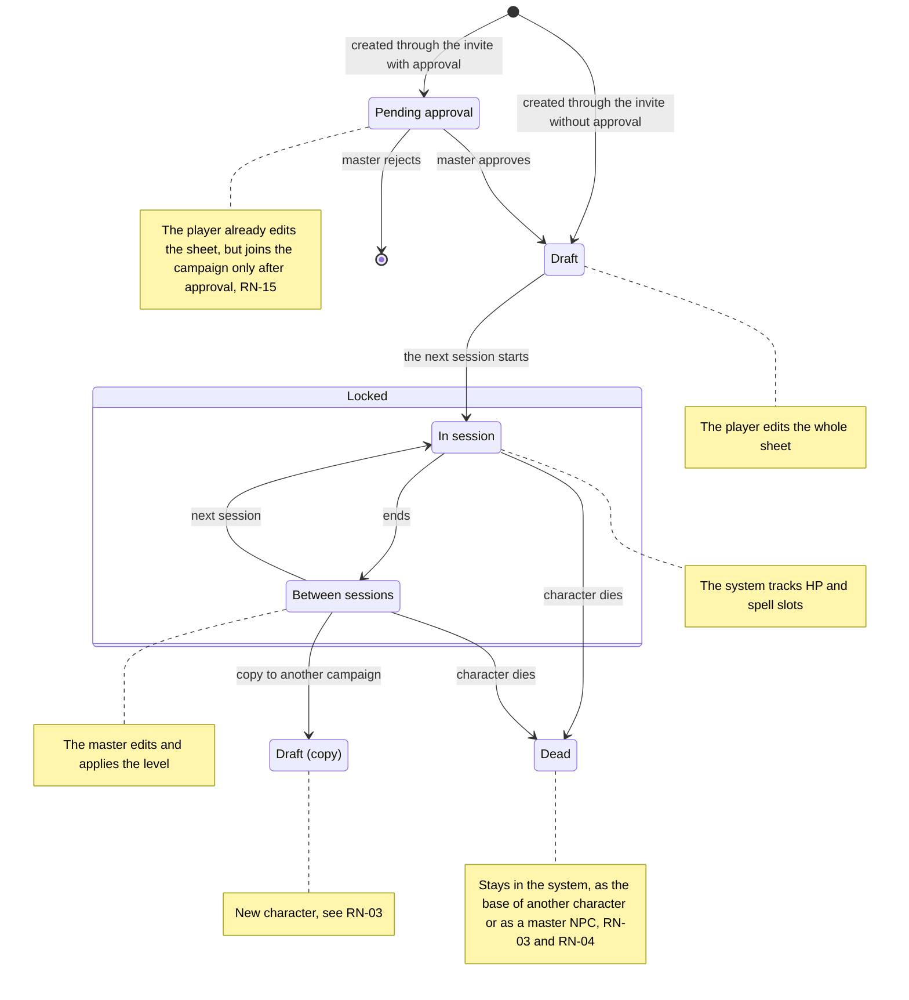
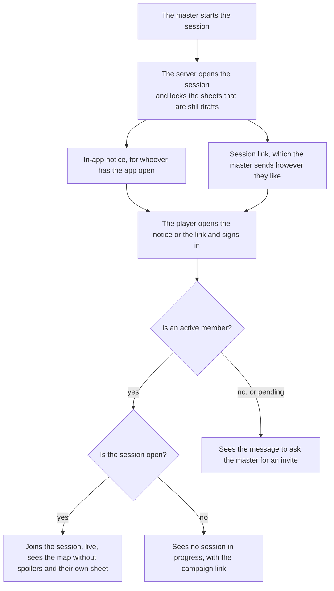

[Português (Brasil)](../pt-BR/produto/regras.md)

# Business rules

Each rule has an ID (RN-xx) so that the stories, the tests and the code can point to it. The table gives the statement of each rule; the section of each rule below it says how the system meets it, naming the behaviour and the tests.

| ID | Rule | Detail |
| --- | --- | --- |
| RN-01 | **Sheet lock.** The player edits their own sheet until the first session of the campaign starts. After that, only the master and the system change it. A character created later (the replacement for a dead one, or one for someone who joined late) stays editable until the next session starts. | [Detail](#rn-01-sheet-lock) |
| RN-02 | **Hit points and spell slots.** During the session, the system tracks hit points and spell slots from the actions: damage, healing, a spell cast, a rest. The master can also correct hit points and spell slots by hand at any time in the session: the master has the final word. | [Detail](#rn-02-hit-points-and-spell-slots) |
| RN-03 | **One character, one campaign.** A player's character stays in one campaign. Within the campaign, the player creates a new character only when the current one dies. A dead character is not deleted: it stays in the system, as the base for another character of the player, or as a master's NPC in another campaign (RN-04). | [Detail](#rn-03-one-character-one-campaign) |
| RN-04 | **Reusable NPCs.** The master uses their own characters in as many campaigns as they want. That includes a dead player character (RN-03), which the master may reuse as an NPC in another campaign. | [Detail](#rn-04-reusable-npcs) |
| RN-05 | **Roles per campaign.** A user can be master in one campaign and player in another. | [Detail](#rn-05-roles-per-campaign) |
| RN-06 | **Session start notice.** When the master starts the session, the members get a notification in the app, for whoever has the app open. The session link requires the person to be signed in (with Google; the sign-in without Google of RN-17 is not built yet) and opens the session only for members. | [Detail](#rn-06-session-start-notice) |
| RN-07 | **An invite is not the session link.** The invite adds someone to the campaign; the session link only takes a member to it. When generating the invite, the master chooses how many uses it has and how long it lasts, and can revoke it at any time. | [Detail](#rn-07-an-invite-is-not-the-session-link) |
| RN-08 | **Import format.** The player or the master chooses the format: the D&D Beyond sheet or the Portuguese-language sheet, both as fillable PDF. There is no DOCX import. | [Detail](#rn-08-import-format) |
| RN-09 | **XP mode.** Each campaign gives XP for defeated enemies, for gold or for milestones. In the first two modes, the master also gives XP whenever they want. | [Detail](#rn-09-xp-mode) |
| RN-10 | **Map without spoilers.** The player sees only the points of interest the group has already discovered. | [Detail](#rn-10-map-without-spoilers) |
| RN-11 | **Master notes.** Only the master reads and edits the master notes. | [Detail](#rn-11-master-notes) |
| RN-12 | **Level up.** The player levels up through the guided edit of the sheet that RN-01 allows while they "Pode subir de nível" ([MR-040](stories.md#mr-040-level-up-from-the-sheet): the "Pode subir de nível" block of the sheet and the page of steps Habilidades, Vida, Escolhas, Magias and Resumo, without the steps that have nothing to choose). | [Detail](#rn-12-level-up) |
| RN-13 | **More than one master.** A campaign can have more than one master, and a master can hand the campaign over to another. | [Detail](#rn-13-more-than-one-master) |
| RN-14 | **Creating a campaign needs a full master account.** Any account can play. To create a campaign, the account must be a full master account, which in the MVP exists only with Google. Other ways to sign in become a full master account after the MVP. | [Detail](#rn-14-creating-a-campaign-needs-a-full-master-account) |
| RN-15 | **Invite with approval.** Through the invite link, the player creates their own character right away. The master approves or rejects that character before it counts for the campaign. | [Detail](#rn-15-invite-with-approval) |
| RN-16 | **Account deletion and inactivity.** When a player deletes their account, their characters stay linked to the campaign's master and are not deleted. | [Detail](#rn-16-account-deletion-and-inactivity) |
| RN-17 | **Player sign-in without Google.** The player signs in with an anonymous login, with no e-mail or real name: the master's nickname together with the player's nickname identifies the account uniquely (the handle is per table, not per campaign, as [ADR-0009](../adr/0009-login-do-jogador-sem-google.md) proposed). | [Detail](#rn-17-player-sign-in-without-google) |
| RN-18 | **Physical or app dice.** The master chooses whether the campaign lets players choose the dice. If it does, each player chooses between rolling in the app or rolling the physical die and typing the result. | [Detail](#rn-18-physical-or-app-dice) |
| RN-19 | **Initiative.** In a battle with several identical NPCs, each rolls its own initiative; the group does not roll together. | [Detail](#rn-19-initiative) |
| RN-20 | **What players see of enemies in combat.** Players do not see enemy hit points (HP) as a number. They see one word: "Ileso" (unhurt), "Ferido" (hurt), "Muito ferido" (badly hurt, half the HP or less) or "Derrotado" (defeated). | [Detail](#rn-20-what-players-see-of-enemies-in-combat) |
| RN-21 | **Grid movement.** On the map grid, each square is 1.5 m and movement is a **circle**: the distance between two squares is the straight line between their centres (a diagonal step costs about 2.1 m, not 1.5 m), and what a combatant can reach is the circle of its remaining movement. | [Detail](#rn-21-grid-movement) |
| RN-22 | **Conditions and concentration.** The app marks conditions (prone, poisoned...) and concentration, and reminds: when a concentrating character takes damage, the game asks its owner for the concentration save (RN-31). | [Detail](#rn-22-conditions-and-concentration) |
| RN-23 | **Table content.** The master registers classes, subclasses, races, subraces, backgrounds and spells that hold only in their campaign, next to the SRD 5.1. Members read the campaign's content; only the master writes. | [Detail](#rn-23-table-content) |
| RN-24 | **Table rules.** At the top of the "Regras da mesa" page is the **table style**: "Tudo no app" (dice in the app, combat with a map, fog on in new maps), "Mesa física" (physical dice, combat without a map by default, fog off) or "Teatro da mente" (each player picks the dice, combat without a map, no fog), and "Personalizado" when the choices match none. | [Detail](#rn-24-table-rules) |
| RN-25 | **The grid and combat without a grid.** The rules count in 1.5 m squares on every map (RN-21). A map drawn with bigger squares is calibrated: "each square of this drawing is worth 3 m" makes the app count four 1.5 m squares in each one, and a 1.5 m reach stays the neighbour. | [Detail](#rn-25-the-grid-and-combat-without-a-grid) |
| RN-26 | **Doors.** A closed door blocks movement, sight and light, like a wall, and counts as a wall for cover. A character who walks into it opens it, unless it is locked; the master opens, closes and locks any door, in the editor and in the session. | [Detail](#rn-26-doors) |
| RN-27 | **Puzzles.** The player never receives the answer to a puzzle: only the state (the lights, the wheels, the symbols, the ciphered message), the master's clue, the loose hints, who made the last move (the character's name) and, once solved, what happened (the text the master wrote in "Ao resolver" or a generic line). | [Detail](#rn-27-puzzles) |
| RN-28 | **AI-generated images.** Only the master generates and edits, with a limit of images per campaign per month. | [Detail](#rn-28-ai-generated-images) |
| RN-29 | **Monsters in combat.** A monster from the bestiary (MR-042) enters combat as an NPC: the player sees only the state word (RN-20), the master sees the SRD creature sheet, and it counts in the XP by enemies by its challenge rating (CR, ND). | [Detail](#rn-29-monsters-in-combat) |
| RN-30 | **Limits on what an account creates.** An account is master of at most 10 campaigns (`MAX_CAMPAIGNS_PER_USER`), and the whole server generates at most 100 images per day (`IMAGE_DAILY_LIMIT`) and keeps at most 5 image requests alive at once (the one being made and four waiting), on top of each campaign's 20 per month (RN-28). | [Detail](#rn-30-limits-on-what-an-account-creates) |
| RN-31 | **Reactions and the reaction window.** One reaction per round; when something a reaction can change happens, the game waits for the reactor, the master answers for every NPC, and a player of an NPC's reaction reads only "Esperando o mestre". The concentration save is a window too. | [Detail](#rn-31-reactions-and-the-reaction-window) |
| RN-32 | **Casting outside combat.** A character casts a spell outside a combat with no turn and no economy: a spell cast in an action takes effect at once, and one that takes minutes or hours (or a ritual) is finished by the master when the game time has passed. A ritual costs no spell slot and 10 more minutes. A cast that is interrupted fails and spends no slot. | [Detail](#rn-32-casting-outside-combat) |
| RN-33 | **Class and race choices.** A class or a race can ask the player to pick something (a Fighting Style, a Draconic Ancestry, Pact Boon and invocations, Metamagic, a Favored Enemy, a terrain, the Half-Elf's +1s...). A character is not created with a choice open; a locked sheet that has one keeps working and completes it later, and a level-up also asks the choices that were left behind. | [Detail](#rn-33-class-and-race-choices) |
| RN-34 | **Contests and special actions.** Grapple, shove and escape are contests of Strength (Athletics) against Strength (Athletics) or Dexterity (Acrobatics); a tie changes nothing. Dragging a grappled creature halves the speed. Hide compares the Stealth total with each creature's passive Perception (a tie keeps the hider noticed); Help gives advantage; a group check passes when at least half pass; a surprised creature does nothing on its first turn. A player never reads an NPC's numbers, the escape DC, who noticed a hider or another player's total. | [Detail](#rn-34-contests-and-special-actions) |
| RN-35 | **Race traits and the monk's Slow Fall in combat.** A half-orc dropped to 0 hit points but not killed outright stays at 1 (Relentless Endurance, once per long rest, used by the app by itself); its critical hit with a melee weapon attack rolls one more weapon die (Savage Attacks); a monk's reaction takes 5 times its level off a pit's fall damage (Slow Fall); a goblin's Fuga Ágil is Disengage or Hide as a bonus action; a halfling whose d20 shows a 1 (an attack, or a check or saving throw the player rolls) is asked "Tirou 1: rolar de novo?" before the result, and the new roll stands; on a saving throw the app rolls for a player's halfling in someone else's action, the app rolls the 1 again by itself (Lucky). | [Detail](#rn-35-race-traits-and-the-monks-slow-fall-in-combat) |

## RN-01: Sheet lock

The player edits their own sheet until the first session of the campaign starts. After that, only the master and the system change it. A character created later (the replacement for a dead one, or one for someone who joined late) stays editable until the next session starts. The character story (personality, appearance, backstory, allies) has its own lock: after the lock, the player edits it only when the master releases it, character by character, until the next session starts or until the master locks it again. The numbers the system calculates are never editable. **Exception ([MR-040](stories.md#mr-040-level-up-from-the-sheet)):** while the character "Pode subir de nível" (can level up, RN-12), the player may edit the sheet, but only to add what the next level gives: one class level and its choices. Everything else stays locked, and the server checks it with the rules engine.

**How the system meets it**

The server refuses player edits when `sheet_locked_at` is set. The story release is `story_editing_allowed`, which only the master changes and which the start of every session switches off. The screen shows the sheet read-only. `PlayService.StartGameSession` locks, in the same transaction, every living player character that is still a draft, so a character created later locks at the next session. The master is told first which of those sheets still have skills or spells to choose (`CharacterSummary.open_choices` in `ListCharacters`, master only) and confirms before starting; the lock itself does not wait for them. A reserved character ([MR-049](stories.md#mr-049-reserved-characters-and-claim-links)) has no player to lock out and is not locked: it locks with the first session that starts after a player claims it. The refusal is `failed_precondition` with the `CharacterBlocked` detail (`SHEET_LOCKED`, `CHARACTER_DEAD` or `STORY_LOCKED`); the master releases the story with `SetStoryEditing`. **The level-up exception:** the guided edit is `CharacterService.LevelUpCharacter`, owner only (the master keeps the sheet editor, `UpdateCharacter`), and only while `can_level_up` is true, also on a locked sheet. The client never sends the whole sheet: it sends the choices (`LevelUpChoices`), and the server builds the new sheet from the stored one, runs `rules.Validate` and `rules.CheckLevelUp`, and saves with the revision check (`aborted` if the sheet changed). **What the edit may change, and only this:** one level of a class the character already has (joining a new class is multiclassing and stays with the master); the ability score improvement, only at a level that has "Incremento no Valor de Habilidade" (+2 to one ability or +1 to two, none above 20; SRD 5.1 has no feats), which goes to `extra_ability_bonuses`; the hit points of the level (the average, the die rolled in the app, or the physical die typed in, from 1 up to the class die; average and rolled can be mixed, and the first rolled die on a fixed-HP sheet fills the earlier levels with their averages, so nothing else changes); exactly the cantrips and the known or spellbook spells (two per level for the Wizard) that the class table gives, and new prepared spells, none removed, up to the new maximum; the subclass, if this is its level; and the options the features of the new level offer (a fighting style, a metamagic), the skills and the expertise it gives. **What stays locked, refused by the server with the field and a reason (`LevelUpRefusal`):** name, race, background, base scores, armor, shield, weapons, the other classes, and everything the earlier levels already had; the new sheet also cannot end up with a problem the old one did not have (a spell outside the class list, above the level, or too many prepared). What the list does not cover stays with the master in the editor ("o mestre acrescenta pelo editor"; the server options list what belongs to the level in `master_adds`): multiclassing; a custom subclass (free name); the Warlock's Mystic Arcanum (levels 11, 13, 15 and 17), the Wizard's Spell Mastery and Signature Spells (18 and 20), the Additional Magical Secrets of the College of Lore (6) and the Ranger's favored enemies and terrains; and **swapping a known spell for another**, which the SRD allows Bards, Rangers, Sorcerers and Warlocks on level-up: the guided level-up only adds spells, never takes one away. Inside the list, the level-up covers the Warlock's new invocations (by the class table), the Bard's Magical Secrets (levels 10, 14 and 18: two of the new spells may be from any class), the extra cantrip of the Circle of the Land and the skills of the College of Lore. A stored sheet that no longer passes today's rules (a key the content lost) gets the refusal `SHEET_NEEDS_MASTER`: the app says to ask the master to fix the sheet. The player's refusal by lock stays `failed_precondition` with `CharacterBlocked`, with three more reasons: `CANNOT_LEVEL_UP` (not "Pode subir de nível", is an NPC or is at level 20), `DICE_FORCED_PHYSICAL` and `DICE_FORCED_IN_APP` (RN-18). **The hit die (RN-18):** the die rolled in the app is rolled **by the server** (`RollLevelUpHitPoints`) and kept for that character and level (one roll per level, even with two classes, and it only counts for the class that rolled): asking again returns the same result, never another, so the result "stays on the record". A campaign that forces the physical die refuses the app die; one that forces the app refuses the typed number; with "each player chooses", each roll follows its own choice. Every level-up is recorded for the master (`ListLevelUps`, "O que mudou"). Tests: `TestLevelUpPensantus`, `TestLevelUpToren`, `TestLevelUpRefusals` (in `rules`) and `TestMR040_ThePlayerLevelsUpALockedSheet`, `TestMR040_TheRestStaysLocked`, `TestMR040_TheRulesRefuseWhatTheLevelDoesNotGive` and `TestMR040_TheHitPointRollIsKept` (in `characters`). **Feats ([MR-025](stories.md#mr-025-register-table-content)):** only the master adds or removes a feat in the sheet editor; a player's save or new sheet whose `feat_keys` differ from the stored ones is refused with `permission_denied`, because a player's feats come from the guided level-up.

## RN-02: Hit points and spell slots

During the session, the system tracks hit points and spell slots from the actions: damage, healing, a spell cast, a rest. The master can also correct hit points and spell slots by hand at any time in the session: the master has the final word.

**How the system meets it**

Each action becomes an event on the server, which recalculates and tells the live table. The master's correction is also an event, and it skips the automatic calculations. **The master's correction:** current HP, temporary HP, spell slots (and pact slots) used and hit dice used live in `character_vitals` and last from one session to the next; the maximums come from the sheet (`rules.Derive`), and the stored value is clamped to the maximum on every read. A character whose current HP was never set has full HP whatever the maximum becomes (a level-up, a changed sheet), even after another value, such as a spent slot, was stored; once the HP is set it stays what it is, and the stored value is only cut when the maximum falls below it. The master corrects with `PlayService.AdjustCharacterVitals`, only with an open session (without one, `failed_precondition` with `NO_OPEN_SESSION`), each value from 0 up to the maximum (the "Ajustar" sheet also gives back spent uses of class and race resources, such as Wild Shape or Rage, and sets the beast's hit points while a druid is in Wild Shape); the correction and a `session_events` row are written in the same transaction, and the stream tells the master and the character's owner at once. A retry with the same `idempotency_key` changes nothing. A player sees only the numbers of their own character (never the others'); the master sees everyone's. **The calculations** are pure, in `rules/combat`: `ApplyDamage` (temporary HP first, floor at 0), `ApplyHeal` (up to the maximum) and `SpendSlot`, `SpendPactSlot` and `SpendResource`. **Combat damage:** an attack that hits opens a pending damage (`pending_damages`). On an NPC the damage is applied at once (temporary HP first; at 0 HP it is defeated and leaves the order), after the resistances, vulnerabilities and immunities of its SRD creature (the NPC made from a creature, the monster of RN-29 and a character's creature): immunity to the damage type makes it 0, resistance halves it (rounded down), vulnerability doubles it, after the bonuses and the half of a saving throw. Only the entries of the stat block that carry no condition count; one with a condition in the SRD's words ("from nonmagical weapons") is not applied, and the master corrects the HP by hand. A player character's resistances (Rage and others) are notes the master applies when he sets the amount; the app does not apply them. On a player character the rolled damage **waits for the master**, who applies it ("Aplicar 5 de dano") or discards it ("Não aplicar"), and only then do the `character_vitals` change, through the same path as the correction, with the same limits (0 to the maximum). At 0 HP the character is down (everyone sees the word "Caído", never the numbers) and makes death saving throws (RN-03). The master changes an NPC's HP by hand with `AdjustCombatantHitPoints` (damage, healing or a value, and temporary HP) and undoes the last action with `UndoLastAction`: each becomes an event, and the undo is a compensating event. **Spells, resources and healing:** `CastSpell` spends the spell slot (or pact slot) **at casting**, together with the action or bonus action, through the same `character_vitals` and in the same transaction (a resend with the same key does not spend again; an NPC's slots are not counted). A spell's damage follows the attack damage path (an NPC applies at once, a character waits for the master); a **heal** rolls the die with the spellcasting modifier and heals **at once**, up to the maximum, on an NPC and on a character, and whoever was at 0 HP gets up (RN-03). Class and race uses (Second Wind, Action Surge, Rage...) also live in `character_vitals` (`resources_used`, clamped to the sheet's maximum) and the master's correction gives them back (`AdjustCharacterVitals.resources_used`) and the master's rests give them back (see **Rests and hit dice** below); Second Wind heals 1d10 + the fighter level. A resource with unlimited uses (Rage at barbarian 20, Wild Shape at druid 20) is stored as 99 uses and shown as "ilimitado" on the live screens. The master applies **a different amount** than the rolled one (`ApplyPendingDamage.amount`, 0 to 9,999: a resistance, a resistance he does not accept): the log keeps both for him, and the player sees only what they took. Tests: `TestMonsterTakesDoubleDamageOfATypeItIsVulnerableTo`, `TestMonsterTakesNoDamageOfATypeItIsImmuneTo`, `TestAdjustForType`, `TestMR014_CastingSpendsTheSlot`, `TestTimelineRound3MagicMissile`, `TestSaveSpellRollsOnceForTheCast`, `TestHealingSpellRevivesAndResetsDeathSaves`, `TestSecondWindAndActionSurge`, `TestMasterAppliesADifferentAmount`, `TestCombatUndoTakesBackEveryNewAction`, `TestMR012_DamageToAnNPCIsAppliedAndDefeatsIt`, `TestRN02_DamageToAPlayerWaitsForTheMaster`, `TestCombatUndoRestoresTheLastAction`. **Rests and hit dice (SRD 5.1, "Resting"):** the master takes a short or a long rest for the table (`ResourceService.TakeRest`), after a confirmation (`GetRestPreview`) that lists, per character, what comes back. A **short rest** gives back the resources that recharge on a short or a long rest (Ki, Channel Divinity, Second Wind, Action Surge, Wild Shape...) and the warlock's pact slots; a **long rest** gives back every resource except those that recharge at dawn or never, all the spell slots (the slots Flexible Casting created vanish), all the hit points, ends the temporary hit points, and returns **half of the total hit dice, at least one**, as the player chooses. A character at 0 hit points gains nothing from a long rest. The app does not count hours: the master is warned when the session already had a long rest ("one long rest in 24 hours" is his call), and a rest is refused while a combat runs. Exhaustion and the death saving throws are not tracked, and Arcane and Natural Recovery are uses the rest gives back (the master adjusts the slots). **Hit dice by die size** (SRD "Multiclassing"): the character keeps the dice used per size (`hit_dice_used_by_die`); a character stored before that is read as having spent the largest dice first. On a short rest the player spends **one die at a time** (`SpendHitDice`): it is rolled in the app or typed from a real die (RN-18), and heals the roll plus the Constitution modifier (never below 0), up to the maximum. **Class resources with their own flow:** **Lay on Hands** (a touch, an amount from 1 to the pool, or 5 points to cure a poison or a disease; on an undead or a construct the points are spent and the answer says only that nothing happened, so a player learns nothing about its type, RN-10); **Flexible Casting** (2, 3, 5, 6 or 7 points make a slot of level 1 to 5 that a long rest takes away; a slot becomes as many points as its level, never past the maximum, which is the sorcerer level); **Metamagic** (the cast sheet offers only the options the character knows, with the cost, and a disabled one says why; Twinned Spell costs the spell level, 1 for a cantrip); **Bardic Inspiration** (a bonus action, one die at a time, to another creature within 60 ft that can hear; the die lasts 10 minutes, and its holder decides to use it after the d20 and before the result). **Outside a combat** the bard gives the die from the session panel ("Inspiração de Bardo": the uses left and the party, "Dar a …"; `GiveBardicInspirationOutside`): the same use is spent, the target is another player character of the table that holds no die, and a combat in progress sends the bard to the combat's own sheet. The die lasts 10 minutes of **game time** (the app has no clock of hours: the target reads "por mais N min de jogo", and the time moves only when the master moves game time, a cast that takes time or a rest, so a short or a long rest always ends it). The target decides after the d20: a scene check or a group check of a character that holds a die rolls (or takes) the d20 and keeps it, shows "Usar a Inspiração de Bardo (d8)?" and writes nothing until the answer (`AnswerOutsideInspiration`); using the die rolls it in the app or takes the face of a real die, adds it to the total (the pass or fail follows the total) and the die is gone; keeping it leaves the die for the next roll. A second roll while the question waits is refused. When a combat takes the character in, the die moves onto its combatant with the whole rounds it has left, and moves back when the combat ends or the character leaves it, so there is never a second copy. The trap search out of a combat and the puzzle hint try ask the same way; the saving throws a trap asks do not (the app rolls them). Tests: `TestBardicInspirationOutsideSpendsAUseAndStoresTheDie`, `TestBardicInspirationOutsideUsedOnASceneCheckAddsTheFaceAndIsGone`, `TestBardicInspirationOutsideKeptThenUsedWithTypedFace`, `TestBardicInspirationOutsideUsedOnAGroupCheck`, `TestBardicInspirationOutsideCarriesIntoACombatAndBackWithoutDuplicating`, `TestBardicInspirationOutsideExpiresAfterTenMinutesAndUsesComeBackOnALongRest`. Tests: `TestAShortRestGivesBackWhatRechargesOnIt`, `TestALongRestGivesBackEverythingAndHalfTheHitDice`, `TestALongRestGivesNothingToACharacterAtZeroHitPoints`, `TestARestIsRefusedWhileACombatRuns`, `TestHitDiceAreSpentBySize`, `TestHitDiceStoredBeforeTheSizesWereKeptAreDerivedFromTheClasses`, `TestLayOnHandsOnAnUndeadOrAConstructDoesNothingAndNeverSaysWhy`, `TestFlexibleCastingConvertsASlotIntoPointsUpToTheMaximum`, `TestTwinnedSpellReachesASecondTargetForTheSpellLevel`, `TestABardicInspirationDieIsUsedAfterTheRollAndBeforeTheResult`. **A trap's damage (MR-035):** the server rolls the damage when the trap fires, and it follows the attack damage path: on an NPC or a creature it lands at once; on a player character it **waits for the master**, who applies it (changing the amount first, if he wants) or discards it. In combat it is a `pending_damages` row with no attacker (`trap_point_id`), applied with `ApplyPendingDamage`; outside combat, a `trap_damages` row, applied to the vitals with `ApplyTrapDamage`. An NPC outside combat has no stored HP: the damage is only a history row. When the combat ends, whatever still waits becomes `trap_damages`, which outlives the session until the master applies or discards it. Tests: `TestMR035_AMoveStopsAtTheFirstSquareOfTheArea`, `TestMR035_TheMasterFiresATrapByHand`, `TestMR035_OutsideACombat`, `TestMR035_AnEndedCombatKeepsTheTrapDamageForTheMaster`. **The character's creatures (MR-037):** a creature's HP is its own, not the character's; the master corrects it outside combat with `AdjustCreatureHitPoints` and, in combat, with the combatant's "Dano/Cura" (`AdjustCombatantHitPoints`); an attack's damage lands on the creature at once, as on an NPC, without waiting for the master (the wait in RN-02 is for character HP), and at 0 HP it is dismissed. Test: `TestMR037_ACreatureAtZeroLeavesAndTheHitPointsGoBack`.

**Aid and the hit point maximum.** Aid raises the maximum and the current hit points of each target by 5, and by 5 more for each level of the slot above the 2nd (SRD 5.1, Aid). The bonus is kept on the target until the master ends it ("Encerrar Ajuda", `EndCombatEffect`); the app does not count the spell's 8 hours, but a long rest ends it for a player's character (SRD, Long Rest: at least 8 hours, as long as the spell): the maximum goes back to the sheet's and the hit points that come back fill it; a short rest keeps it. An NPC or a creature loses it only through "Encerrar Ajuda". It is `character_vitals.hit_points_max_bonus` for a player's character and `combatants.hp_max_bonus` for an NPC or a creature, and `hit_points_max` is always the effective maximum, bonus included (the sheet's own is `hit_points_max - hit_points_max_bonus`, "máximo 38 da ficha"). Aid gives no temporary hit points. Two Aids do not add up: the stronger bonus stands and the current HP rise only by what the maximum rose (SRD, Combining Magical Effects: the most potent effect of the same spell applies); a weaker Aid over a stronger one changes nothing. A player's character at 0 HP gets up with the new current HP and its death saves reset (SRD, Dropping to 0 Hit Points: the unconsciousness ends if the character regains any hit points; the app counts Aid's rise as that); an NPC or a creature at 0 stays down, and the master decides whether it is dead. When the master ends Aid, the maximum falls back and the current HP lose only what is above the new maximum (SRD, Healing: HP never exceed the maximum), and nobody who still had HP drops to 0 because of it; the SRD says nothing else about the end of the spell, so this is the app's rule. Damage and healing work against the effective maximum. The end is a line of the combat log ("A Ajuda de Sálvia acabou"; the HP before and after are the master's alone). Tests: `TestAidRaisesTheMaximumHitPoints`, `TestAidDoesNotStack`, `TestEndingAidTakesOffOnlyTheExcess`, `TestAidWakesACharacterAtZero`, `TestALongRestEndsAidAndAShortRestDoesNot`.

**Arcane Recovery (SRD 5.1, Wizard).** Once per day, when the wizard finishes a short rest, they choose expended spell slots to recover: the slots have a combined spell level equal to or less than half the wizard's level, rounded up, and none of them is of the 6th level or higher. A level 3 wizard recovers 2 levels (two 1st-level slots, or one 2nd-level slot). In a multiclass character only the wizard level counts, and the slots are the spellcasting slots, never the pact slots. The app reads "once per day" as once per long rest, like the other daily features: the use is the resource `arcane_recovery`, which a long rest gives back and a short rest does not. `ResourceService.UseArcaneRecovery(character, slots)` spends the use and recovers the slots in one transaction; the character's player or the master may call it, and only while the latest rest of the open session is a short rest (the master takes it with `TakeRest`), so the use is not available before any rest or after a long one. The table asks the player what the rules let them choose: how many slots of each level, from the expended ones. It refuses, with a `ResourceBlocked` reason and never a message to parse, a character that is not a wizard (`NOT_AVAILABLE`), a use already spent (`NO_USES_LEFT`), no short rest yet (`NO_SHORT_REST`), a slot of the 6th level or higher (`SLOT_LEVEL_TOO_HIGH`), more slots of a level than are expended (`SLOT_NOT_EXPENDED`) and a combined level above the allowance (`OVER_ALLOWANCE`, with the level asked and the allowance). A refusal changes nothing. The vitals carry `arcane_recovery_allowance` (0 without a wizard level). **Screen:** the short rest sheet ("Gastar dados de vida") has a "Recuperação Arcana" section for a wizard with the use left, with the allowance, a stepper for each level with expended slots and "Recuperar"; afterwards it says "Recuperação Arcana: usada; volta no descanso longo." Tests: `TestArcaneRecoveryRecoversHalfTheWizardLevelOnceUntilALongRest`, `TestArcaneRecoveryRefusesAnOverAllowanceTotal`, `TestArcaneRecoveryRefusesASixthLevelSlot`, `TestArcaneRecoveryCountsOnlyTheWizardLevel`.

**Shield on screen.** The +5 AC of Shield (`Combatant.armor_class_bonus`, to the master and the owner; SRD 5.1, Shield: until the start of the caster's next turn, against the attack that triggered it too) shows as "CA 18" with the sum "13 + 5" and the label "Escudo Arcano +5 até a sua vez" for the player, and as "CA 13 + 5" on the master's order. The server clears it when the caster's turn starts and writes the line "O Escudo Arcano de X acabou" for the master and the caster; another player does not read it, because the Escudo may have answered an attack from a hidden creature (RN-10). Test: `TestShieldTurnsAHitIntoAMiss`.

## RN-03: One character, one campaign

A player's character stays in one campaign. Within the campaign, the player creates a new character only when the current one dies. A dead character is not deleted: it stays in the system, as the base for another character of the player, or as a master's NPC in another campaign (RN-04). To play another campaign, at the same time or in a continuation years later, the player makes a copy.

**A dead character takes no healing and keeps watching.** A creature with three failed death saves is dead, and a dead creature regains no hit points (SRD 5.1, "Dropping to 0 Hit Points"): a healing spell aimed at one is refused with `TARGET_DEAD` before the slot or the action is spent (`TestAHealingSpellRefusesADeadTargetBeforeSpendingAnything`). The dead character's player keeps reading the combat: its page gets the turn options (all disabled), the log and its sheet without errors.

**How the system meets it**

The copy ([MR-021](stories.md#mr-021-copy-a-character), not built yet) will be a new character with `copied_from_id` pointing to the original; it starts editable and locks at the first session of the new campaign. A dead character changes state, never row: there is no character deletion in the normal flow. `characters.campaign_id` is the character's campaign, the master marks the death with `MarkCharacterDead` (`status = 'dead'` and `died_at`), and the partial unique index `characters_one_living_player_character` allows only one living character per player in each campaign, even with two simultaneous calls. The second creation gets `failed_precondition` with `LIVING_CHARACTER_EXISTS` and the ID of the living one (the copy is the later [MR-021](stories.md#mr-021-copy-a-character)). **A claim counts too ([MR-049](stories.md#mr-049-reserved-characters-and-claim-links)):** taking a reserved character through a link is how a player gets a living character, so `ClaimCharacter` refuses a person who already has one in the campaign with the same `LIVING_CHARACTER_EXISTS` (naming the living one) and takes nothing; a person whose only character is dead may claim. A reserved character has no player, so it never counts against anybody: the index only holds characters with an owner, and the master may make as many as they want. In combat, the third failed death saving throw does not kill by itself: the character dies only when the master confirms, and the confirmation is the same `MarkCharacterDead`; from then on everything above holds. The death save calculations are in `rules/combat` (`DeathSave`, `DamageWhileDown`): three failures give the result `dying`, never death. **How the system meets it:** a character at 0 HP is "Caído" and, at the start of their turn, owes a death saving throw (`death_save_due`; the player's `EndTurn` waits, with `DEATH_SAVE_DUE`, and the master passes the turn anyway). `RollDeathSave` (app d20 or typed, on every roll, RN-18): 10 or more is a success, less is a failure, a natural 1 is two failures, a natural 20 returns with 1 HP (through the `character_vitals`, the counts reset and the character can act); three successes make the character "Estável"; three failures make it "Morrendo" for the master (for the players the word stays "Caído", with the counts, which are public: the app never says someone died before the master does). Damage that hits someone at 0 HP does not lower HP: it counts a failure (two on a critical hit); on a stable character, the successes reset first. Any healing above 0 resets the counts (a spell, Second Wind, the master's correction, an undo). `ConfirmDeath` (master only, only with three failures) triggers the effect of `MarkCharacterDead` in the same transaction, removes the combatant from the order (the turn passes if it was theirs) and goes to the log; it **cannot be undone**, because the character is already dead in `characters` (the master brings them back with Reviver or the spell Revivify, below). The counts live on the combatant row: an ended combat keeps them for the summary ("Caída: 1 sucesso, 1 falha"), and a new combat starts at 0 and 0. Whoever drops to 0 HP on their own turn rolls the first save on the next turn. Outside combat the app does not roll death saves. Tests: `TestRN03_DeathSavesAndTheMasterConfirms`, `TestRN03_NaturalOneTwentyAndStable`. **Reviver (the master).** A dead character can live again: `ReviveCharacter` gives it 1 HP with no death save counted, no unconsciousness and the state it had before it died (a draft or locked) (SRD 5.1, "Dropping to 0 Hit Points": the unconsciousness ends when you regain any hit points, and the death saves start again); spell slots, class uses and hit dice stay as they were. It is not a spell: it spends nothing and has no time limit. `died_at` stays as the master's history, `revived_at` is set, and a new death sets `died_at` again. In a combat that is not ended, the combatant keeps its place in the initiative order and acts on its next turn (the SRD has no "no turn this round" rule), and the log says "O mestre reviveu <name>". Because a player has at most one living character per campaign, it is refused with `LIVING_CHARACTER_EXISTS` (the error names the living one) while the player has another: the master archives it or marks it dead first. **Revivify.** The SRD 5.1 spell Revivify ("Revivificar", `spell:revivify`: 3rd level, 1 action, touch, diamonds worth 300 gp that the spell consumes) touches a creature that died in the last minute, and it returns with 1 HP; it cannot bring back a creature that died of old age nor restore a missing body part. The cleric and the paladin have it in their lists (SRD 5.1 spell lists) and the Life domain always has it prepared from level 5. Dead, for the spell, is what the master confirmed (a character at 0 HP is "Caído" until then). In a combat the app counts the minute: a round is about 6 seconds (SRD 5.1, "The Order of Combat"), so it is 10 rounds from the round of the death, and in the tenth only up to the place in the order where it died (the app's reading of "in the last minute"); the target must be within touch. The cast spends the slot, the action and, as a reminder the caster ticks (the app keeps no inventory), the diamonds. A Counterspell answers a Revivify like any other cast (PM-04): the cast waits for the window, nothing is spent or brought back meanwhile, and a countered Revivify still expends the slot and the action and leaves the creature dead. Test: `TestRevivify_AnEnemyWizardsCounterspellCountersItOrLetsItThrough`. A player's list holds only the creatures the spell reaches now, and no refusal says why another is missing: the reasons (far, too long ago, hidden, not seen, marked) are the master's. The death of old age or with a missing body part is the master's decision: the switch "Revivificar não funciona nesta morte" takes the creature off the player's list. Out of combat the app does not count time: the master answers whether it was less than a minute, and nothing is spent until he says it was; "Já passou" ends it at no cost and the caster only reads that the master said no. RN-03 holds for the spell too. Neither Reviver nor Revivify is undone by the master's "Desfazer". Tests: `TestRN03_ReviveBringsTheCharacterBackWithOneHitPoint`, `TestRN03_ReviveIsRefusedWhileThePlayerHasAnotherLivingCharacter`, `TestRN03_ReviveKeepsThePlaceInTheOrderAndTheCombatantActsOnItsNextTurn`, `TestRevivify_BringsTheDeadBackWithOneHitPointAndSpendsSlotActionAndDiamonds`, `TestRevivify_TheMinuteIsTenRounds`, `TestRevivify_OutsideACombatTheMasterConfirmsTheMinute`, `TestRN10_APlayerNeverLearnsWhyACreatureCannotBeRevived`, `TestRN03_RevivifyIsRefusedWhileThePlayerHasAnotherLivingCharacter`. **On the screens:** on the turn of someone who is down, the hero says "Brisa está caída", with the marks (success ✓, failure ✕) and "Rolar teste contra a morte" (in the app or typed, on every roll); after the roll the result appears in a live region with "Encerrar turno". Only the master sees "Morrendo · 3 falhas" and the question "Confirmar a morte" / "Ainda não" (focus on "Ainda não"); the players see "Caída" and the counts. Test: `combat.spec.ts` ("caído: o teste contra a morte").

## RN-04: Reusable NPCs

The master uses their own characters in as many campaigns as they want. That includes a dead player character (RN-03), which the master may reuse as an NPC in another campaign.

**How the system meets it**

The NPC is a template. HP and position in each combat live on the combatant, so a combat in one campaign does not change the NPC in the others. An NPC has an owner, the master who created it (`characters.master_user_id`), and stays in the campaign where it was created; using the same NPC in other campaigns is [MR-022](stories.md#mr-022-reuse-npcs), and nothing in the model prevents it. Players neither see nor create NPCs.

## RN-05: Roles per campaign

A user can be master in one campaign and player in another.

**How the system meets it**

The role lives in `campaign_members`, not on the user.

## RN-06: Session start notice

When the master starts the session, the members get a notification in the app, for whoever has the app open. The session link requires the person to be signed in (with Google; the sign-in without Google of RN-17 is not built yet) and opens the session only for members.

**How the system meets it**

The app shows the notification on screen; there is no browser push notification (with the app closed) in the MVP. A non-member sees "peça um convite ao mestre". While the tab is visible, the app asks every 30 seconds which sessions are open in the person's campaigns (`PlayService.ListOpenGameSessions`, only for active members), without keeping a connection open; the session page opens only for members (`GetLiveSession` and `WatchGameSession` answer `not_found` to a non-member, including a pending member, and `failed_precondition` with `NO_OPEN_SESSION` when there is no session). On screen: the notice under the app bar, the "Ao vivo" link in the bar and the session page (`/campaigns/<id>/session`). The notice is not shown on the campaign page itself: there, the "Sessão" card is the announcement, and a player's card follows the same poll ("Entrar na sessão" appears when a session starts and goes away when it ends, without reloading the page).

## RN-07: An invite is not the session link

The invite adds someone to the campaign; the session link only takes a member to it. When generating the invite, the master chooses how many uses it has and how long it lasts, and can revoke it at any time.

**How the system meets it**

The invite expires and is stored only as a hash. Default: 1 use, 7 days. The master chooses 1 to 20 uses and 5 minutes to 30 days. The session link carries no secret: it is `/campaigns/<id>/session`, and the server decides whether the person gets in, checking membership on every call and, on the stream, again every 60 seconds.

## RN-08: Import format

The player or the master chooses the format: the D&D Beyond sheet or the Portuguese-language sheet, both as fillable PDF. There is no DOCX import.

**How the system meets it**

**Not built yet** ([MR-007](stories.md#mr-007-import-a-sheet-from-pdf), Later): there is no importer today. The design is: the importer reads the PDF fields and shows the result for review before saving.

## RN-09: XP mode

Each campaign gives XP for defeated enemies, for gold or for milestones. In the first two modes, the master also gives XP whenever they want.

**How the system meets it**

By enemies: sums the XP of the defeated enemies and splits it among the group, as in the Dungeon Master's Guide (a bestiary monster counts by the creature's challenge rating, RN-29). By gold: 1 XP per gold piece (GP), as in the old editions. By milestones: the master raises the group's level. By enemies, the master chooses whether to use the challenge rating (CR) or to type the XP, and decides at the end of the combat who receives it. By milestones, the master defines beforehand the moments when a whole level is given (the planned milestones, below); "Registrar um marco fora da lista" remains for what nobody planned. **The mode changes after the campaign is created (RN-24):** `SetCampaignXpMode`, master only; if XP was already given (an award that was not undone, a milestone included), it refuses with the `XpModeChangeBlocked` detail (how many awards and how much XP) until `confirm` comes. Nothing is converted: the XP already given and the history stay, and the new mode applies from then on. **The mode also decides "Pode subir de nível" (RN-12):** by enemies or gold, the sheet's XP reaching the next level; by milestones, the mark. Changing the mode therefore changes the level-up notices that are waiting: whoever was ready by XP is not ready by milestones until the master marks, and whoever had the mark is not ready by XP until the XP reaches the level (nothing is written to the sheets: the notice is read from the mode on every read). An award and a mode change take turns (the award re-reads the mode inside its own transaction), so no award escapes the confirmation. The mode otherwise only decides which awards fit the campaign; going back to the earlier mode asks the same way. Tests: `TestRN09_TheXPModeChangesAfterCreation`, `TestRN09_ChangingTheXPModeAsksOnceXPWasAwarded`, `TestRN09_AnUndoneAwardDoesNotCount`. By gold, the GP come from treasures placed beforehand on the map and are converted, 1 XP per GP, when the group returns to town ([MR-041](stories.md#mr-041-treasure-and-xp-by-gold): "Voltar à cidade" in "Experiência" and in "Dar XP"); typing the GP still works. **The generated treasure (MR-044):** the treasure generator puts on the map a hidden point whose value is only the treasure's **gold** (the coins, the gems and the art objects, 10 SP = 1 GP); the magic items stay in the description and **never become XP** (an item is not gold: adding its value would give "free" XP). In a gold campaign the point converts in "Voltar à cidade" like any treasure (`TestMR044_AGoldCampaignConvertsTheGoldOnly`); in the others it only goes into the session summary (see [Architecture](../architecture.md#treasure-generator-mr-044)). **The calculations:** the SRD tables are hand-written content, `effects/advancement.json` (the XP of each level, 1 to 20, and the XP of each challenge rating, "ND", 0 to 30), checked on load. The functions are pure, in `rules`: `XPForChallenge` (CR to XP), `SplitXP` and `LevelForXP`. **The split** is the total divided by the number of characters, rounded down (100 XP for 3 gives 33 each; 25 XP for 2 gives 12 each and the 1 XP left is lost on purpose: neither the Dungeon Master's Guide nor the SRD says what to do with the remainder, so the app never invents XP, and the master is told how much was lost and may award it by hand); CR 0 is worth 10 in the table, and the master types 0 for a creature that does not attack. Tests: `TestXPForChallenge`, `TestSplitXP`, `TestLoadAdvancementRefusesBrokenTables`. **XP given (module `progression`).** The master gives XP with `AwardXP`: by enemies (the sum of the XP of the defeated NPCs of an ended combat, one award per combat, unless undone), by gold (1 XP per GP) or loose (the number typed), and each chosen character receives their share on the sheet, in the same transaction. The mode must fit the campaign (by enemies: enemies and loose; by gold: gold and loose; by milestones: only the milestone) and whoever receives must be a living player character of the campaign. An NPC's XP is the `xp_value` of its sheet (the challenge rating fills it in, and the master may type another), copied to the combatant when it enters the combat; only the master receives it (RN-20). The master undoes only the last award, which stays in the history as "Desfeito" (nothing is erased, ADR-0007). The undo takes back the XP each sheet gained, which is less than the share when the sheet hit its limit of 1,000,000 XP. The whole campaign reads the history (who gave, when, why, how much each received), and the players get the live `xp_changed` notice. **How it works:** the CR is optional and the XP field accepts any number, so both ways count equally; the one who splits is the list of characters the master sends, which the screen proposes with those who fought and did not die (by enemies); a split that does not close rounds down and the server says how much was lost; the milestone marks the characters the master chooses, without XP, and the mark lasts until the sheet's level goes up (the level-up notice); everyone in the campaign sees the history. **XP from treasure.** "Voltar à cidade" is an `AwardXP` of mode `GOLD` with `treasure_point_ids`: the server sums the GP of the found treasures that no award converted, 1 XP per GP, and splits among the characters the master chooses as in any award (equal, rounded down; "found by" does not weigh on the split). Each treasure is converted once (two awards at the same time: one wins), and only in a gold campaign (in the others the treasure stays on the map and in the session summary). Undoing the award, if it is the last, returns the treasures to "found, not converted"; after a newer award they stay converted until that one is undone, and the master corrects by hand. Tests: `TestMR041_VoltarACidadeConvertsTreasuresIntoOneGoldAward`, `TestMR041_ATreasureIsConvertedOnce`, `TestMR041_UndoFreesTheTreasures`, `TestMR041_VoltarACidadeRefusesWhatDoesNotFit`. **The planned milestones.** In a milestones campaign, the master writes the milestones beforehand, a list of texts of up to 120 characters (at most 100 per campaign, counting the reached ones), in any order (`AddMilestone`, `UpdateMilestone`, `MoveMilestone`, `RemoveMilestone`, one change per call; the table is `planned_milestones`). When the group reaches a milestone, the master marks it and chooses who levels up (`MarkMilestoneReached`): it is the earlier `MarkMilestone`, with the milestone's text as the reason and linked to the milestone, so "Pode subir de nível" (RN-12), the history, the session event and `xp_changed` are the same. The order is never enforced: a milestone can be marked out of order. A milestone is reached only once; "Dar a mais alguém" (`GiveMilestoneTo`) gives the same milestone to someone who was left out, as a new award for that character in the history, without a second milestone. "Reached" is not a column: it holds while some award of the milestone has not been undone. Undo is still the last award's (`UndoLastXPAward`): undoing the only mark makes the milestone go back to planned, in the same place of the list; undoing a mark from "Dar a mais alguém" removes the milestone only from that character, and it stays reached for the others. A reached milestone is never edited, moved or removed, only undone. **Who sees what (RN-20):** the planned ones belong to the master alone; the player receives only the reached ones, with the day, the time and who leveled up, as in the history, and never the name of a milestone that did not happen (a milestone marked and then undone is planned again, so the history a player reads leaves out the text of its undone awards until it is reached again). A milestone registered off the list appears among the reached ones, but cannot receive "Dar a mais alguém". A campaign that counts XP refuses all this with `MODE_NOT_ALLOWED`. Tests: `TestMR016_PlannedMilestones`, `TestMR016_ReachingAPlannedMilestoneLetsTheChosenLevelUp`, `TestMR016_GiveAReachedMilestoneToSomeoneElse`, `TestMR016_UndoOfAPlannedMilestone`, `TestMR016_AMilestoneMarkedOffTheListIsReachedToo`, `TestRN20_PlayersSeeOnlyReachedMilestones`, `TestMR016_PlannedMilestonesNeedAMilestonesCampaign` and the `TestAuthorizationMatrix` matrix; on screen, the `@MR-016`, `@RN-12` and `@RN-20` tests of `e2e/tests/milestones.spec.ts`. **The screens.** The NPC has "Nível de desafio (ND)" and "XP ao derrotar" in the editor (minion: section "Ao ser derrotado"; enemy and boss: in the Básico step): changing the CR always redoes the XP from the table, a typed value stays while the CR does not change, and "Usar 50 XP" goes back to the table's. At the end of the combat, the master sees each defeated one's XP, the sum, who receives (by default those who fought and did not die; the dead cannot be ticked) and the written split ("350 XP ÷ 3 = 116,67, arredondado para baixo. 2 XP se perdem na divisão."); "Dar 116 XP a cada um" gives the combat award, and "Agora não" leaves the line "XP do combate ainda não dado", which opens "Dar XP" with the reason and the total filled in. "Dar XP" at any time (campaign and session) asks for the reason (up to 120 characters) and the value (1 to 1,000,000), or the gold pieces in gold mode; errors appear when leaving the field. The campaign page has "Experiência" for all members: each character's XP, what is missing, the history and, for the master only, "Desfazer" on the last award, with the question in place and focus on "Voltar". In a milestones campaign no screen shows an XP number: the label and the milestone lists ("Registrar marco" became "Registrar um marco fora da lista"). The sheet shows the XP as a read-only block, and the player no longer types the XP once the sheet locks. Tests: `e2e/tests/xp.spec.ts` (`@MR-016`) and the Vitest ones for `core/progression`, `shared/xp`, `campaign-detail/experience`, `combat-xp` and `defeat-xp`.

## RN-10: Map without spoilers

The player sees only the points of interest the group has already discovered.

**A dead character's player and an ended combat.** While the session goes on, the player of a dead character sees what the living party sees (the union of their views), never a creature nobody sees and never one the master hides (`TestRN10_FogCombatADeadCharactersPlayerSeesWhatTheLivingPartySees`). A combat that ended has no fog: its summary is the same for every member, still without what the master hides (`TestRN10_FogCombatAnEndedCombatHasNoFog`).

**How the system meets it**

The server filters the response. The map and the point are born hidden, and the master reveals and hides each one (`SetMapRevealed`, `SetMapPointRevealed`); an NPC's token is born hidden and a player character's, visible (`SetMapTokenHidden`); a creature's token is a party token, like a character's, and is never hidden: only an NPC's token hides. The player sees the revealed map and the session's current map (choosing the current map reveals it); on it, only the revealed points and the visible tokens; a submap point only leads to a map the player also sees. Any other map is `not_found`, the same as a map that does not exist. **In combat on a fog map**, the player also receives only the NPCs their character sees (RN-20). **A fog map in "Claro" (base light bright)** shows the players the whole floor plan, the image and the walls on every square; creatures (NPC tokens) and points still follow what the characters see, so nothing hidden, no creature out of sight and no secret door's nature reaches them (the secret door reads as a wall). For a room that must stay secret, the map uses "Penumbra", which is what a generated dungeon gets. What the player does not see is left out of the response, never blank: no ID, no name, no description. **Converted treasure:** the XP history the player reads carries, for a "Voltar à cidade", only how many treasures there were and the total in GP (`treasure_count`, `gold`), never which ones nor each one's value; the list (`treasures`) is the master's. A hidden point never reaches the player's phone. **A generated treasure (MR-044):** the four `TreasureService` calls are master only (the player, a pending member and a non-member get `not_found`), and the point `PlaceTreasure` makes is born hidden: neither it, nor the description, nor the gold reach the player on the map, in the live session or on the stream while it is hidden; **once revealed, the player sees only the point and the name; once found by the group, also the description and the gold** (MR-041) (`TestRN10_APlayerNeverSeesAPlacedTreasureUntilRevealed`, `TestTreasureAuthorizationMatrix`). **A generated dungeon:** the room list, the record (the seed, the options, the generator version) and the `DungeonService` calls are master only, and the player gets `not_found` from all of them, before and after the map is revealed (`TestRN10_PlayersReadNothingOfADungeon`). The stream follows the same rule: a change only in hidden things reaches only the master (`TestMR009_PlayersNeverReceiveHiddenPoints`, `TestRN10_PlayersCannotOpenHiddenMaps`; see [Architecture](../architecture.md#who-sees-what-on-the-map)). **Images** follow the same idea, with the gallery (MR-019): the gallery, with all the campaign's images, is master only (`TestMR019_PlayersCannotListTheGallery`). The player downloads an image (`GET /images/{id}`) only while seeing it: the background of a map they see, or the image the master shows in the session (MR-028), which reveals nothing more. Keeping the ID is not enough: the route checks on every request, and the player's browser asks again on every use (`TestRN10_PlayersOnlyFetchImagesTheyCanSee`). The master may leave an image with the players ("Deixar com os jogadores", MR-028): it goes to the campaign's left-images list (`campaign_left_images`) and the player downloads it until the master takes it back (`TakeBackLeftImage`), also after the session (`TestMR028_MasterLeavesAnImageWithThePlayers`, and the new part of `TestRN10_PlayersOnlyFetchImagesTheyCanSee`: left, served; taken back, `404` again). A non-active member, or a player who does not see the image, gets `404`, the same as an image that does not exist (see [Architecture](../architecture.md#serving-images)). **RP scenes (MR-015):** the master may open a hidden scene point (`OpenScene`); it is not revealed: the open scene reaches the players (`GetOpenScene`, with the name, the description and the actions), and the point stays off their map. The `MapPoint` of a revealed point carries the scene actions, without the DC. Tests: `TestMR015_AHiddenPointCanBeOpenedAndStaysHidden`, `TestMR015_PlayerSeesTheMastersActionsWithTheirBonus`. **The stage and the portraits (MR-031):** an NPC's portrait is a gallery image (field `portrait_image_id` of the NPC sheet), and the player downloads it only while the NPC is on the stage of the open scene: out of the scene, with the scene closed or swapped, or with the session ended, it is `404`, the same as an image the player cannot see, also on `If-None-Match`. Taking the NPC off the scene cuts access at once. Tests: `TestMR031_PortraitsAreVisibleOnlyOnStage`, `TestMR031_DeletingAPortraitClearsIt` (see [Architecture](../architecture.md#npcs-on-stage)). **Discovered scenes, clues and hooks (MR-029, MR-030):** a scene is "discovered" when the master reveals the point on the map or opens it in a session (even hidden); it holds for the whole group and does not go away if the point is hidden again; it is the only rule that lets the player use a scene's name away from the map (the label of a note), and only for a scene of a map the player can open: a scene on a map that is neither revealed nor the session's current one is not listed, however it was discovered. Any scene point opens, even without actions: the scene belongs entirely to the master, and the server does not refuse. The player sees only the scene's NPCs and may tap one to see it larger, with nothing else ([MR-031](stories.md#mr-031-npcs-in-the-scene)). Tests: `TestMR030_TagsOnlyDiscoveredScenes`, `TestScenesWithNoActionsOpen`. **Traps, treasures, lights and layers (MR-034 to MR-036 and MR-041):** a trap that has not been revealed to the player's character never reaches them, neither ID nor position, in any response or stream event; it arrives only when the master revealed it to that character (`RevealTrap`, and when the character notices or finds it in play), when it has already fired (then everyone sees it, even if the master disarms it later) or when the master revealed it to everyone; and then only with name, description, position, area and state, never the DC to notice, the DC to find, the trigger, the effect or the preset, which only the master receives. A reveal to some characters notifies only their players, and the player of another character does not even get a `map_changed` because of it. A treasure follows the hidden-point rule and, once found, everyone who sees the map sees it with the description, the value and who found it (before it is found, even revealed, it carries neither description nor value). A light point never goes to a player (they see the light, not the point), and the painted light layer never either: of what is painted, the player of a map they see, without fog, receives only wall, difficult terrain and cover (things that can be seen), and with fog on, the layers of what the character sees (below). The light a character carries goes only to the master and to its owner. **The fog per player (MR-036):** on a map with fog on, the player receives only what their character **sees now or has already seen**, and the server decides with the `rules/vision` calculation (the walls and the light the master painted, the light points and the lights characters carry, the sheet's darkvision). It does not reach them: the ID, the URL or the thumbnail of the map image (the route refuses the file), a point whose squares they neither see nor remember, the token of an NPC outside what they see now, the light layer, or a wall far from what they see. A player character's token always arrives (the group knows where its people are). A token the master hid still lights the map (the carried light holds, and the player sees the brightness, not who carries it), as at a table. While a combat runs on the map, the NPC tokens are left out of the player's reads (the combatants are covered by the combat rule above). Memory is written only while the players see the map, and every clear invalidates it (an epoch, no race with an update in progress). A fog map's image is the master's alone: showing it in the session, leaving it with the players, or using it as a portrait or as the background of a map without fog gives a copy. What was already seen stays, darkened and without creatures, until the master clears it ("Esquecer o que foi visto") or changes the grid or the image. The counts are those of what the player receives; asking for what they do not see gives the same `not_found` as asking for what does not exist. The stream follows the rule: an NPC's movement arrives only as `vision_changed`, and only to whoever sees it. The master sees everything, and can open the map "as" a character (`as_character_id`) to see exactly what that player receives. **The image, in tiles:** the player never receives the whole image of a fog map, only tiles of 16 × 16 squares, assembled on the server with the pixels of the squares they saw or remember and opaque black elsewhere (two images that differ only in squares they do not know give them identical tiles; the fog edge is darkened 1 pixel in a PNG and up to 16 pixels in a JPEG), from a route that checks the map on every request (`404` for whoever does not see the map, is not a member or is pending; the master reads the whole image as always); a tile with no known square does not exist. Tests: `TestRN10_TileOracle` (the guarantee test), `TestRN10_TilesCarryOnlyWhatThePlayerSaw` (decodes the tile and checks each pixel), `TestRN10_TileAuthorization`, `TestRN10_TilesAreInvalidated` (see [Architecture](../architecture.md#per-player-image-tiles)); `TestRN10_FogPlayersReceiveOnlyWhatTheirCharacterSees` (reads each response of four players in the drawings' cave as the app's JSON), `TestMR036_FogViewsMatchTheCaveOracle`, `TestMR036_SeeAsAPlayersCharacter`, `TestMR036_WhatWasSeenStays`, `TestMR036_VisionChangedReachesTheRightPlayers`, `TestRN10_FogMapImageIsCopiedWhenShared`; `TestRN10_PlayersNeverReceiveTrapsLightsOrHiddenTreasure`, which reads as the app's JSON each response (`ListMaps`, `GetMap`, `GetMapLayers`, the session photo) and the stream of two players, `TestMR034_PlayersReadOnlyWhatTheyMay`, `TestMR036_CarriedLight`. **Traps in play (MR-035):** a trap that no player character knows (neither revealed to all nor fired) never reaches the player, neither its existence, position, name nor DCs, in any response, stream event or log row: noticing and searching are decided on the server, from what the character can see, and reveal only to that character; the result of a search reads the same when there is nothing and when the test failed; `GetMoveOptions` marks only the trap the character knows; a move cut short by an unknown trap only says that it stopped, and the trap becomes public because it fired. The player reads "passou" or "falhou", never the DC, and a character's owner sees their own d20. Tests: `TestRN10_NoPlayerResponseNamesAnUnrevealedTrap` (reads as the app's JSON the map, the combat, the move options, the log, the live session and the stream of two players, before and after a third one learns of the trap), `TestRN10_AMoveStoppedByAnUnknownTrapReadsAsTheTrapFiring`, `TestMR035_Searching`. **Reserved characters (MR-049):** a character the master made for a player to claim has no owner, and **no player reads it until one claims it**: not in the characters list or by ID (`not_found`), not in the party's vitals, the combat roster and order, the map's tokens, the fog's vision, the XP or the session summary, and the claim card shows only its public part (name, race, class and level, who sent it and the campaign's name) to the person who holds the link and is signed in. The calls that make, revoke or delete a link are the master's. A character given back to the reserve leaves the former owner's reads at once and the old sessions' summary and puzzle names the players read. Tests: `TestMR049_TheMasterMakesAReservedCharacterAndNoPlayerSeesIt`, `TestMR049_AReservedCharacterIsNotInThePartyAndDoesNotLockWithTheSessions`, `TestMR049_TheMastersActionsOnTheRow`, and in the leak matrix the reserved character's name, its story and its link's token as canaries, with `TestReservedCharacterIsOnNoLiveSurface`, `TestClaimedCharacterIsReadByItsNewOwnerAndNoOneElse` and `TestGivingACharacterBackToTheReserveHidesItFromItsFormerOwner` as the positive controls. **The systematic test:** `TestLeakMatrix` (`backend/internal/leaktest`) builds a campaign with one hidden thing of each kind, marked with texts and numbers that do not appear by chance, and requests every read, every stream event, every image and every fog tile as each person (two players, a pending member, a stranger and someone without a session); the completeness guard fails for a new procedure that is not classified (see [Architecture](../architecture.md#leak-tests-rn-10)).

**The trap search is the same for every trap.** The player's menu is Perception, Investigation and "Outra perícia…" with every other skill, whatever is nearby, and the line under it ("Algumas armadilhas só se acham com uma perícia específica") is constant. Perception meets a trap's DC to notice it and Investigation its DC to find it (SRD 5.1, Traps in Play: a character actively looking may make a Wisdom (Perception) check; Investigation deduces what needs doing); another skill meets the DC to find it only for the traps whose master listed it (`TrapSpec.also_find_skill_keys`, none by default: the SRD lets any character try an Intelligence (Arcana) check against a magic trap, and the app leaves it to the master to say which trap, trap by trap). For a trap that does not list the skill the search sees nothing, which reads exactly as a search that fell short: the same answer, the same cost (the action, in a combat), the same text, and the pill says "Achou" or "Nada", never "Falhou". The light's penalty is Perception's alone, and Reliable Talent counts. The list is the master's: a player never receives it, on the map or in any answer. Tests: `TestAnotherSkillFindsOnlyTheTrapsThatAllowIt`, `TestTheTrapsOtherSkillsAreTheMastersAlone` and, in `leaktest`, `TestASearchWithAnySkillReadsTheSameWhateverTheTrapsNearby` (all 18 skills, a trap and an empty place) with `TestOnlyTheAllowedSkillFindsTheTrap` as its positive control.

## RN-11: Master notes

Only the master reads and edits the master notes.

**How the system meets it**

The notes live in a separate table, `character_master_notes`, and come out only through `GetMasterNotes` and `UpdateMasterNotes`, which only the master calls. No other response carries them. In the old app, the player could read and edit them: it is a known bug, never fixed there; the new system proves it does not exist with an automated test (`TestRN11_PlayersNeverReceiveMasterNotes`).

## RN-12: Level up

The player levels up through the guided edit of the sheet that RN-01 allows while they "Pode subir de nível" ([MR-040](stories.md#mr-040-level-up-from-the-sheet): the "Pode subir de nível" block of the sheet and the page of steps Habilidades, Vida, Escolhas, Magias and Resumo, without the steps that have nothing to choose). The master can also apply the new level on the sheet. **Multiclassing** (SRD 5.1, "Multiclassing"): the first step, "Subir em qual classe?", offers each class the character has and "Uma classe nova". A new class asks for the main ability of **every** class the character has and of the new one, 13 in each (the Fighter: Strength or Dexterity; the Monk, the Paladin and the Ranger: both abilities); a player is refused, at the level-up and at creation, and the master's editor may go past it with a warning. The new class enters at its level 1: experience, proficiency bonus and hit points follow the total level, its die gives the average and never the maximum (only the first level of the character takes the maximum), it gives only the proficiencies of the multiclass table (the Bard's, Ranger's and Rogue's skill pick and the Bard's instrument included) and never equipment, Extra Attack, Channel Divinity uses and Unarmored Defense do not add up, spells known and prepared are each class's own, and the spell slots come from the multiclass spellcaster table (Pact Magic apart). The SRD is silent on a second class with Pact Magic and on how a Bard's Magical Secrets or other spell picks interact across classes; the app treats each class alone. **Current hit points follow the maximum.** When a save (the guided level-up or the master's edit) changes the sheet's maximum hit points, a character whose current hit points are set gains what the maximum gained, so a wound stays a wound and a character at the maximum stays at the maximum; a maximum that falls never leaves the current above it, and a wound below the new maximum is not charged for the fall. A character whose current hit points were never set is full whatever the maximum is, and no number is written for it. It happens in the transaction that saves the sheet (`CarryHitPoints`). The full level-up screen of [MR-017](stories.md#mr-017-level-up) is for after the MVP.

**How the system meets it**

The system tells the master when a character reaches the XP of the next level. `DerivedSheet.next_level_xp` carries the XP of the next level (0 at level 20), calculated by `rules` from the total level (`NextLevelXP`: 300 for level 2, 900 for 3, 2,700 for 4...). `GetCharacter` carries `can_level_up` and `level_up_reason` (`XP` or `MILESTONE`) for the master and the owner, of a living player character, and `GetCampaignExperience` carries the same for the whole group. In a campaign by enemies or by gold, it holds when the sheet's `experience_points` reach the XP of the next level; in a milestones campaign, it holds with a milestone mark (planned or not) whose level the sheet's level has not yet passed (the mark goes away by itself when the level goes up). Nobody levels up from level 20. Who sees the notice: the master and the player. **The screens:** the label "Pode subir de nível" (arrow and words, never color alone) appears in the campaign's "Personagens dos jogadores" list, in "Experiência" and on the sheet. In a campaign by enemies or by gold, the sheet shows the "2.716 XP" block with the bar and the sentence "Chegou aos 2.700 XP do nível 4." followed by "Suba o nível pelo botão abaixo." for the owner (the button of MR-040) or "Suba o nível na ficha." for the master; in a milestones campaign, only the label. The sheet listens to the session's `xp_changed` and updates by itself, and the mark goes away when the master raises the level in the editor. **The guided level-up:** when the player levels up through `LevelUpCharacter`, "Pode subir de nível" goes away by itself, as when the master raises the level in the editor: in an XP campaign because the sheet's XP no longer reaches the next level, in a milestones campaign because the sheet's level passed the mark's (`TestMR040_CanLevelUpClearsAfterwards`). The level-up sends the open sessions the same content-free notice as for XP, `xp_changed`, and the master reads what changed in `ListLevelUps`. **The level-up screen:** the button "Subir para o nível N" is the owner's only, on the locked sheet; the route without the mark answers that leveling up is not possible yet (the refusal `CANNOT_LEVEL_UP`), and the master, that the level-up is the player's. Tests: `TestDerivedNextLevelXP`, `TestLevelUpReason`, `TestXPCanLevelUpInAnXPCampaign`, `TestMR016_MilestoneMarksWithoutXP` and, on screen, the `@RN-12` tests of `e2e/tests/xp.spec.ts` and `e2e/tests/levelup.spec.ts`.

## RN-13: More than one master

A campaign can have more than one master, and a master can hand the campaign over to another.

**How the system meets it**

**After the MVP ([MR-023](stories.md#mr-023-hand-over-or-share-the-campaign)).** Today a campaign has one master, its creator, and no call hands it over or adds a second one. The schema already allows more than one `role = master` row in `campaign_members` for the same campaign; the campaign will be deleted only when the last master leaves (see [Privacy](../privacy.md#delete-the-account)). See [ADR-0011](../adr/0011-autorizacao-papeis-por-campanha.md).

## RN-14: Creating a campaign needs a full master account

Any account can play. To create a campaign, the account must be a full master account, which in the MVP exists only with Google. Other ways to sign in become a full master account after the MVP.

**How the system meets it**

In the MVP every account comes from the OIDC sign-in (Google in production), so every account is a full master account and `CreateCampaign` has no check of its own for it. The only gate is the optional `CAMPAIGN_CREATORS` list (RN-30). When another way to sign in arrives (RN-17), `CreateCampaign` must start refusing accounts without a Google identity, as [ADR-0009](../adr/0009-login-do-jogador-sem-google.md) proposed.

## RN-15: Invite with approval

Through the invite link, the player creates their own character right away. The master approves or rejects that character before it counts for the campaign.

**How the system meets it**

The character is born in a "pending approval" state, editable by the player; it becomes part of the campaign only when the master approves it (see [Character lifecycle](#character-lifecycle), RN-01). On each invite the master can tick "Exigir aprovação do mestre" (`requires_approval`; unticked, the invite works as usual). Whoever accepts such an invite becomes a pending member (`campaign_members.status = 'pending'`) and goes straight to create the character, which is born `CHARACTER_STATE_PENDING`. A pending member is not a member: apart from seeing the campaign name and its XP mode, creating, reading and editing their own character, and (RN-24) reading the table rules (`GetTableRules`) and making abilities with the 4d6 the server keeps (`GetAbilityRolls`, `RollAbilityScores`), the server answers `not_found`, like for someone who is not in the campaign (see [Architecture](../architecture.md#pending-member)). A session does not lock the pending character, and it cannot die. Its sheet shows no player notes and no creatures panel, whose calls a pending member does not get: each says "Aparece quando o mestre aprovar o personagem." in its place. The master approves it (`ApproveCharacter`: the character becomes a draft and the player a member) or rejects it (`RejectCharacter`: the character and the pending membership are deleted, and the player needs a new invite), in a single transaction. The master sees who is pending without a character (`ListPendingMembers`, with when they joined and when it expires on its own) and can remove them (`RemovePendingMember`; it refuses someone who is already a member or already has a character, who is refused through `RejectCharacter`). A pending membership without a character is deleted on its own 30 days after joining, by the database TTL on `campaign_members.pending_expires_at`. The deadline binds from the moment it passes, before the TTL job runs: that person no longer counts as a member, and creating a character does not bring the membership back. An ordinary invite (without approval, and valid now) accepted by a pending player makes them a member at once, spends one use and approves their character, if one was waiting, because it counts as the master's approval. An invite with approval accepted by a pending player changes nothing. **Asking for changes ("Pedir ajustes"):** besides approving or rejecting, the master can send the character back with a reason (`RequestCharacterChanges`, 1 to 500 characters, required). The character stays pending, with a review (`Character.review`: `REVIEW_AWAITING`, `REVIEW_CHANGES_REQUESTED`, `REVIEW_RESUBMITTED`); the invite and the pending membership stay. The player reads the reason, edits the sheet and taps "Enviar de novo" (`ResubmitCharacter`: only the owner, only while a request is open; a non-owner and a non-member get the same `not_found`); editing never sends by itself. The master can approve or reject at any review state, and asking again replaces the reason. The reason is the master's text about a player: only the master and the owner read it (a list carries the status, never the reason), no log carries it (only its length), and it is deleted when the character is approved or rejected, when the character, the campaign or the player's account is deleted, and when an ordinary invite approves the player; after the resubmission it stays for the master's history until one of those. "Recusar personagem" still deletes, and its confirmation is drawn as an action with no way back. Both calls carry an idempotency key scoped to the caller. Tests: `TestRN15_MasterAsksForChangesAndTheCharacterStaysPending`, `TestRN15_TheReasonIsRequiredAndAtMost500Characters`, `TestRN15_OwnerResubmitsAndTheMasterCanAskAgain`, `TestRN15_TheReasonIsDeletedInEveryWayTheCharacterLeavesThePendingState`, `TestRN10_TheReasonReachesOnlyTheMasterAndTheOwner`.

## RN-16: Account deletion and inactivity

**Not built yet:** only the database cascades exist today; there is no call or screen to delete an account, and no inactivity setting. The rule below is the design. When a player deletes their account, their characters stay linked to the campaign's master and are not deleted. When a master deletes their account, they have 30 days to come back by signing in again with the same account (the same `issuer`/`subject`, see [Privacy](../privacy.md#delete-the-account)); after that period, everything is deleted. In any deletion, everything is gone for good 30 days later. Each person chooses in their own profile how much inactivity leads to deleting the account; the default is 1 year.

**How the system meets it**

The player's character becomes the master's, with no link to the deleted account, or is deleted along with it if the person prefers. The master's 30-day wait is a "delete at" mark on the account, checked at sign-in. See [Privacy](../privacy.md#delete-the-account) for the full flow, including the caveat about personal data in the character's free text. The character side already holds in the database: `player_user_id` uses `ON DELETE SET NULL` (the character stays in the campaign, with the master) and the NPC goes with the master's account (`CASCADE`). A player character left with no player and no campaign is deleted by the database TTL. A character that a player claimed through a link ([MR-049](stories.md#mr-049-reserved-characters-and-claim-links)) and whose player then deleted the account stays with the master like any other, not reserved; the master may give it back to the reserve and send it to someone else. Choosing to delete one's own characters, the 30-day wait and inactivity come with account deletion.

## RN-17: Player sign-in without Google

The player signs in with an anonymous login, with no e-mail or real name: the master's nickname together with the player's nickname identifies the account uniquely (the handle is per table, not per campaign, as [ADR-0009](../adr/0009-login-do-jogador-sem-google.md) proposed). The player signs in without a password; when the first 30-day session expires, they must set a password or link Google to continue.

**How the system meets it**

**Not built yet:** there is no player sign-in without Google in the MVP, and no `table_handles` table; every account signs in through the OIDC provider (RN-14). The design is: the handle lives in `table_handles`, unique within the master's table (`dm_user_id`), and the password follows option 3 of ADR-0009.

## RN-18: Physical or app dice

The master chooses whether the campaign lets players choose the dice. If it does, each player chooses between rolling in the app or rolling the physical die and typing the result. If it does not, everyone uses the type the master picks.

**How the system meets it**

A campaign setting and a per-player preference in it. The rules engine accepts both (ADR-0008). The setting is `campaigns.dice_mode` (`players_choose`, the default, `app` or `physical`) and the preference is `campaign_members.dice_preference` (`app`, the default, or `physical`), with `SetCampaignDiceMode` (master only) and `SetMyDicePreference` (any active member, the master too). The preference only counts with `players_choose`; with the other modes it is kept but ignored, and `EffectiveDiceMode` says where the player rolls. A change applies from the next roll. NPCs always roll in the app. The `platform/dice` package reads expressions (`1d20+6`), rolls with `crypto/rand` and checks the sum typed from a physical die: the player types the sum of the dice, without the modifier, and the app adds the modifier; the sum must fit between the minimum and the maximum of the dice. The screens are the master's "Dados" panel and the player's "Como você rola os dados", on the campaign page. Combat rolls follow the rule. **With "each player chooses", the player chooses at each roll ("Rolar no app" or typing the result); the stored preference is only the default the screen highlights. Only a mode the master forced bars the other:** with "everyone rolls in the app" a typed value is refused, and with "everyone rolls their own dice" the app roll is refused (`WRONG_DICE_MODE`), for initiative, attack and damage. In detail: the attack d20 and the player's damage come from the app (`roll_in_app`) or are typed (`d20_face` from 1 to 20; `typed_sum`, the sum of the damage dice, from N to N × faces, where N is double the dice on a doubled-dice critical and the usual dice on "maximum plus a roll", RN-24), as the player chooses, unless a mode is forced (above); the NPC rolls in the app, and the master can type the value. Test: `TestRN18_PhysicalRollsAreTypedSums`. The attack screens (the "Atacar" sheet, "Digite o resultado do dado", the master's card) are covered by `combat.spec.ts` (`@RN-18`). **Spells and the rest:** the d20 of a spell attack (`roll_in_app` or `d20_face`, the latter only for one target), spell damage and healing, the Second Wind d10 ("Retomar o Fôlego") and the death saving throw follow the rule at each roll, with the same `WRONG_DICE_MODE` when the master forced a mode. A spell target's saving throw is always rolled by the server with the sheet's bonus (an NPC's, like theirs: in the app); the master has the last word, through the amount they apply. The hit points rolled when a character is created (see [MR-004](stories.md#mr-004-character-sheet-in-the-pdf-format)) are not part of this rule: they roll in the browser and are not recorded. **The 4d6 abilities of a new sheet are part of it** (RN-24): the server rolls and keeps them, and with physical dice the player types the four dice of each set, once; a table that forces the app refuses typed dice, and one that forces physical dice refuses the server's roll. **RP scenes:** the d20 of a scene action (`RollSceneCheck`) follows the rule at each roll, like the attack: in the app (`roll_in_app`) or typed (`d20_face`, 1 to 20; the server adds the sheet's bonus), with `WRONG_DICE_MODE` when the master forced the other mode. Test: `TestRN18_SceneRollsFollowTheDiceMode`. **On screen:** the scene's "Rolar" sheet uses the same `roll-picker` as combat: "Rolar no app" and "Digitar o resultado" (the field accepts 1 to 20 and shows the total live), in the order of the "Como você rola os dados" preference, and only the way a forced mode allows when the master forced one; a `WRONG_DICE_MODE` becomes "A campanha mudou a forma de rolar os dados. Recarregue a página.". The idempotency key is made once per roll and resent on retry. Test: `scenes.spec.ts` (`@RN-18`).

## RN-19: Initiative

In a battle with several identical NPCs, each rolls its own initiative; the group does not roll together.

**How the system meets it**

Each combatant (`combatants`) has its own initiative, identical NPCs too, and the turn order comes from them. The one exception is the creatures of a single summon of a player character (Conjure Animals, Animate Dead; [MR-037](stories.md#mr-037-creatures-of-the-character)), which share one initiative roll (`summon_group_id`). It holds with app dice or physical dice (RN-18). When combat starts (`CombatService.StartEncounter`), a **reserved** character (imported, not claimed by a player yet) does not fight: the default party leaves it out, and naming it is `failed_precondition` `CHARACTER_RESERVED`, never `not_found`. The server rolls the initiative of every NPC copy at once (d20 + the sheet's bonus, with `crypto/rand`), one roll each; the player rolls their own (`SubmitInitiative`, in the app or typing the physical d20, per RN-18). The order is highest total, then highest bonus, and when both tie the master decides (`SetInitiativeOrder`). Combat starts only with all initiatives in (`BeginCombat`). **Shared turn:** combatants side by side in the order with the same total, players and NPCs, form a group that plays a single turn: everyone's turn starts together, each with their own economy, each one's player ends their own part (`EndTurn`) and the master can end anyone's, and the turn passes when the last one ends. Someone alone on a total is a group of one and everything works as before. The group comes from the order and the totals, not from a field; it holds for whoever the turn started for and does not change midway: reordering a tie (`SetInitiativeOrder`) keeps the group; a reinforcement with the same total enters the box but acts only on the group's next turn; whoever leaves, dies or is defeated leaves the turn and, if nobody else acts, the turn passes; hiding a member changes nothing. `tie_unresolved` remains only for the order in which the group is listed. Tests: `TestMR013_PlayersWithTheSameInitiativeShareATurn`, `TestMR013_TheTurnPassesWhenTheLastMemberEnds`, `TestMR013_EachMemberHasItsOwnEconomy`, `TestRN19_EachNPCRollsItsOwnInitiative`, `TestMR013_TurnOrderAndMovementLeft`, `TestRN19_OrderByInitiativeThenBonusThenTheMastersPlaces`.

## RN-20: What players see of enemies in combat

Players do not see enemy hit points (HP) as a number. They see one word: "Ileso" (unhurt), "Ferido" (hurt), "Muito ferido" (badly hurt, half the HP or less) or "Derrotado" (defeated). They do not see enemy armor class (AC) or the rolls the master makes for NPCs either. They see whether they hit or missed and the damage they take. The same holds outside combat: a scene action's DC, other players' rolls, hooks, unrevealed clues and other players' notes never reach a player.

**How the system meets it**

Same idea as RN-10 and RN-02: the server filters the response, and the number, the AC and the NPC's roll never reach the player's phone. What goes out is the state word and the result (hit, miss, damage). The master sees everything.

**Combatants.** The player's `GetEncounter` carries only the word for an NPC (`CombatantState`: `UNHURT`, `HURT`, `BADLY_HURT` at half the HP or less, `DEFEATED`), never the HP, the rolled initiative or the bonus. A hidden NPC does not come at all: not in the order, not on the map, and its turn shows as "Vez do mestre". Stream events follow the same filter. Tests: `TestRN20_PlayersNeverReceiveHiddenCombatantsOrNPCNumbers`.

**Rolls, extras and resistances.** The player's screen lists only the reasons for advantage or disadvantage it can see; an unseen attacker or target changes the roll without being named when the player cannot see it, and Divine Smite's extra die against an undead or fiend appears as "+1d8" with no reason. A creature's resistances, vulnerabilities and immunities are the master's alone: the damage steps go to the master and to the player whose character takes the damage, never for an NPC, and the damage a player reads on an NPC is the damage as rolled, with every die the roll made (also the extra die of Divine Smite that does not count against that target), so neither a halved total nor a missing line tells what the target is or resists. A player never reads another player's request for a mode, nor the reason behind a mode they did not ask for. Tests: `TestPM06a_ABetterModeNeedsTheMastersApproval`, `TestPM06b_TheMasterTakesAnExtraOutWithAReason`, `TestPM07b_RageHalvesPhysicalDamageAndShowsTheStep`.

**Joint turn.** A player sees a group only if it has a player character. The box, the total and each part's state ("Ainda age" / "Encerrou") reach everyone, and a player's economy reaches only that player, the master and the players of the same group. A group of NPCs only belongs to the master: the player sees the NPCs by name in the order, with no box and no total, and on their turn reads "Vez dos Goblins" (never one picked at random; the server sends only the ids the player sees, and the NPC groups, to get the plural in "Depois de você: os Goblins", with no total). A hidden member never goes to the player: Toren's group with a hidden Goblin is Toren alone, and the turn waits for the master's part without naming it ("Falta o mestre"). The finished part of an NPC-only group, or of a hidden member, is a master-only line in the log. A member that leaves the turn without ending its part (removed, a confirmed death, an NPC taken to 0 HP) no longer holds the group: the turn passes when the last living member ends theirs. In a joint turn that holds a player, the master's action card is for the NPC whose part has not ended (never the player, who is the first of the group); the NPC's "Levantar-se" is offered when it is prone and has the movement, but not when it is incapacitated (Riso Histérico keeps it prone). Tests: `TestRN20_NPCOnlyGroupsStayTheMasters`, `TestRN20_AHiddenMemberIsNeverNamed`, `TestAConfirmedDeathInAJointTurnDoesNotHoldThePass`, `TestADefeatedNPCInAJointTurnDoesNotHoldThePass`.

**What this does not hide.** The player never receives an NPC's number. But in a group with a player character and a visible NPC (Brisa's allied NPC, for example), splitting the turn with the player shows that the two tied, and so the NPC's total. The design accepts this. Two small signals also remain, accepted for now: copies of an NPC are numbered together ("Goblin 1" to "Goblin 3"), so if the master reveals Goblin 2 and hides 1, the player can deduce that another exists; and the combat revision number also rises when something hidden changes. To avoid the hint, the master hides the last copies, as in the reference combat (Goblin 3).

**Actions.** `RollAttack` compares the d20 with the AC on the server and returns only "Acertou", "Errou" or "Crítico", with the player's own roll. No player response carries anyone's AC. The master's does, in `Combatant.armor_class` and `AttackRoll.target_armor_class`, for the order line "CA 15" and for "Acertou contra CA 18 do Toren". The combat log (`ListCombatLog`) omits any line involving a hidden combatant (not even "waits hidden"; when the master reveals it, only the new lines appear). It also omits an NPC's dice and HP, and carries only the result and the damage the player takes or deals. Tests: `TestRN20_PlayersNeverReceiveCAOrHiddenLogEntries`, which reads the player's responses (`RollAttack`, `RollDamage`, `GetTurnOptions`, `ListCombatLog`, `GetEncounter`) as the JSON the app receives and looks in them for the AC, NPC HP and the hidden combatant; and `TestTimelineRound1And2Log`, which replays rounds 1 and 2 of the reference combat and checks the master's log and a player's.

**Spells and reactions.** A target's saving throw goes to the player as a word (passed or failed). Its dice go only to the master and the owner of the target character (never an NPC's), and the DC goes to the master and the caster. Whether an NPC's save bonus is known is the master's business. A cast that touches a hidden combatant, and a hidden creature's hit on the Shield spell, leave no line for the player. The reaction prompt of the hit character (`reaction_prompts`) carries neither the attacker nor the hit's total. The player does not see hidden targets in the target list and cannot aim at them (`not_found`). Conditions are those of the combatants the player sees. The Shield spell's +5 holds until the character's next turn for every hit on it: the other hits already waiting for the reaction or for their damage are compared again with the new AC, the ones under it are discarded, and an undo of the spell brings them back. Tests: `TestRN20_PlayersNeverReceiveSpellAndReactionSecrets`, `TestShieldAlsoStopsTheOtherHitsAwaitingTheReaction`.

**Spells that read HP.** Sleep, Color Spray, Power Word Stun, Power Word Kill, Spare the Dying and Heal (Sono, Leque Cromático, Palavra de Poder Atordoar, Palavra de Poder Matar, Estabilizar, Cura Completa) are resolved by the server with the real HP (an NPC's comes from the combat, a player character's from the live sheet), in the same transaction as the cast, and the player still sees only the word. The caster sees the roll of their own total, `5d8 (2, 4, 1, 5, 3) = 15` (with a physical die, only the typed total), and which targets were affected and which not, as a word ("adormeceu", "não foi afetado"), never a target's HP, what remained of the total, or the reason. The master sees the total, each creature's HP before, the order in which the total passed through them, what remained after each and the reason a target was not affected (more than the total, above the limit, already unconscious, not at 0 HP). The other players see in the log only who was affected and the condition as a label. The order of targets the player receives is the order the caster listed, not the order of the total, because the total's order would reveal who has the least HP. A player character's HP is already public at the table, but the response does not repeat it. Power Word Kill on an NPC defeats it (0 HP). On a player character it takes them to 0 HP with three death-save failures, and the master confirms the death with `ConfirmDeath` (the server never kills a character on its own, RN-03). "Desfazer última ação" restores everything (HP, failures, conditions, slot). On screen, the sheet of the player who cast Sleep shows only who fell asleep and who was unaffected, in word and icon, and their own total roll. The player log has the sentence without a number. Only the master's log has the card with the total, each creature's HP, what remains and the reason. The screen computes nothing: it writes the fields the server sent, and what did not come (HP, order, amount healed on an NPC) does not appear. Tests: `TestMR014_SleepUsesTheRealHitPoints` (the E8-03 numbers: a total of 15 puts the 7-HP Goblin to sleep and leaves the 27-HP Captain awake; it reads the player's and the master's responses and log as JSON and proves the player never receives HP), `TestMR014_SleepSkipsTheUnconsciousAndTheOneAtZero`, `TestMR014_ColorSprayBlindsByThePool`, `TestMR014_PowerWordStunAndKillOnNPCs`, `TestMR014_PowerWordKillOnAPlayerCharacterWaitsForTheMaster`, `TestMR014_SpareTheDyingWorksOnlyAtZero`, `TestMR014_CompleteHealHealsAndEndsBlindnessAndDeafness`, `TestRN18_PoolSpellsFollowTheDiceMode`, and the e2e `hp-spells-log.spec.ts`, `cast-flow.spec.ts`, `cast-result.spec.ts`, `pool-card.spec.ts` and `combat.spec.ts` (`@RN-20`: "Sono em dois goblins e no Capitão").

**RP scenes (MR-015).** An action's DC belongs to the master, like AC in combat. A player never receives another player's roll (their log has only their own rolls, and the stream notifies them only of their own). The master sees the DCs and all the rolls, with the result.

- *DC per scene.* The scene's point has the switch "Mostrar a CD aos jogadores" (`map_points.show_dc`, off by default, changed with `UpdateMapPoint` like the hooks). Off, the player receives no DC (the scene, the map and the roll response carry none) and is not told whether a roll passed. On, the player receives the DC of each action that has one (`SceneActionView.dc`, `SceneAction.dc`) and whether their own rolls passed, only those made while the scene showed the DC (`SceneRoll.passed`). Turning the switch on later does not reveal old rolls, and these are exactly the rolls the session summary counts. An action with no DC shows nothing more, on or off. The master always sees the DC. Each roll records whether the scene showed the DC when it was made (`dc_shown`, in the `scene_check_rolled` event), and only that mark is counted by the session summary.

- *Attempts.* Each action has an attempt limit per player (`scene_actions.max_attempts`: 1 by default, 1 to 5, or 0 for no limit), which the master changes with `UpdateSceneAction`. An action with no limit still stops at 200 rolls per character each time the scene is opened, so no one can fill the session log. `RollSceneCheck` refuses a character who spent theirs with `ALREADY_ROLLED` (meaning "no attempt left"). Closing and reopening the scene resets every count. Lowering the limit below what someone already spent leaves them without attempts and erases nothing. The player receives the limit and how many attempts remain on each action (`SceneActionView.max_attempts` and `attempts_left`), only their own. "Dar mais uma tentativa" (`GrantSceneAttempt`, master only, one character and one action of the open scene) adds one attempt in this opening of the scene and is a `scene_attempt_granted` event (ids only). The player learns of it from the `scene_changed` hint, which carries no content.

- *On screen.* With the switch off (the default), the player screen has no DC, no word "CD" and no "passou" anywhere (not even in the result sheet, which has only the total and the math). The master's screen shows each action's DC and, on each roll of an action with a DC, "Passou · CD 12" or "Não passou · CD 13", and says at the top of "Ações" "Só você vê a CD". With the switch on, the player sees the label "CD 12" on the action and, after rolling, "Passou · CD 12" or "Não passou · CD 10" (icon and words, never colour alone; also in the result sheet), only on actions that have a DC and only on their own rolls made with the switch on. The master sees "Os jogadores veem a CD". The player reads the attempts they have left ("Restam 2 de 3 tentativas") and never another player's. The master sees "Tentativa 1 de 3" on each roll and can grant one more. The session summary on screen counts only rolls made with the DC showing, and the player's card shows the winners without the "de N" and no table.

Tests: `TestMR015_ShowTheDCToPlayers`, `TestMR015_AttemptsPerAction`, `TestMR015_OneMoreAttempt` and `TestRN20_APlayerNeverGetsADCOrAnotherPlayersRoll`, which reads the player's responses and events as the JSON the app receives (with the switch off); `scenes.spec.ts` (`@RN-20`, both screens, switch on and off) and `session-summary.spec.ts` (`@RN-20`: a roll with the DC hidden does not count and the player receives no table).

**Hooks, clues and notes (MR-029, MR-030).** A player never receives the master's hooks, a clue not revealed to them, another player's note or the name of a scene the group has not discovered, in any response or stream event. The master chooses whom to reveal each clue to (the screen pre-selects nobody: the button says who receives it, and is dashed and disabled with nobody selected; players agree at the table what to share). Each player receives a clue once, and there is no "hide again". Only the recipients hear `notes_changed`. Notes belong only to whoever wrote them: the master does not read them (`not_found`). Hooks and stored clues appear only to the master, on the map and in the open scene. On screen, the player screen has no hooks, no clue not revealed to them and no undiscovered scene's name (the notes' scene picker lists only discovered scenes). The "Anotações" button and the sheet panel exist only for the player; the master never receives them. Tests: `TestRN20_PlayersNeverGetHooksOrUnrevealedClues`, which reads as the JSON the app receives the map and its points, `GetOpenScene`, `ListNotes`, `ListNoteScenes`, the session snapshot and each player's stream; `TestMR029_ARevealedClueReachesOnlyTheChosenPlayers`, `TestMR030_PlayerNotesArePrivate`; and `notes.spec.ts` (`@RN-20`), which reads the player's page and looks in it for the hooks, the unrevealed clue and the hidden scene's name.

**NPCs on stage (MR-031).** The player receives from an NPC on stage only the name, the portrait (the URL) and whether it speaks. Never the type, HP, AC, XP, sheet, notes or the character id (the stage entry carries its own id, which names nobody). On screen, the player's stage shows only image and name (each figure's button is called "Ver Mira maior"), and the "see bigger" sheet only the name and portrait. When the NPC leaves, its image returns `404` to the player and the screen falls back to initials, with no broken icon. Tests: `TestMR031_APlayerSeesOnlyNameAndPortrait`, which reads every player response and event as the app's JSON; `stage.spec.ts` (`@RN-20`).

**Combat highlights (MR-032).** Highlights never name an NPC, and damage to a hidden NPC enters only as a number. Every member receives the categories with the winners' numbers. The master receives the table with each player's numbers, and the player receives from it only their own character's line. The HP that really changed count (damage beyond 0 does not count; neither does undone or unapplied damage). The text of a planned milestone that was reached and then undone stays in the XP history that the whole campaign reads: the players had already seen it when the milestone was reached, and the history is never rewritten (ADR-0007). A milestone that was never reached never reaches a player. Tests: `TestMR032_HighlightsOfTheAmbush`, `TestMR032_HighlightsSkipTheUndoneAndCountWhatHappened`.

**Session summary (MR-032).** The "Resumo da sessão" (`GetSessionSummary`, of a finished session) sums the highlights of all the session's combats and adds "Mais testes passados fora do combate". That number counts only rolls made while the scene showed the DC, and only for actions that have one. A roll in a scene that hid the DC counts nowhere, for anyone, because the scene never told the player whether it passed, and the summary does not either. The master receives all the numbers and the per-player table ("Pensantus: 3 de 4"). The player receives the winners of each category with their number (without the "de N"), their own result, and never another player's attempts. Tests: `TestRN20_SessionSummaryHidesWhatTheSceneHid`, which reads every player response as JSON, and `TestMR032_SessionSummary`.

**Cover never leaks the AC (MR-034).** The cover the target has against the attacker (the target list, `AttackRoll`, the spell result, the log) goes to the player only as the degree and the origin ("Meia cobertura, do mapa"), never as an AC or as "+2 sobre 14". The AC with cover ("CA 17: 15 + 2 de meia cobertura") is the master's only, in the log and in `AttackRoll.target_armor_class` (and it is what Shield uses to re-evaluate the hit: the pending damage's `attack_armor_class`). A target the player cannot see does not appear in the list at all (not even as "behind the wall"). The master's mark (`Combatant.cover_mark`) is a degree that everyone who sees the combatant reads, with no number. Test: `TestMR034_CoverRaisesTheArmorClassOfTheTarget`, which reads the player's responses and log as the app's JSON and looks in them for the AC.

**The character's creatures (MR-037).** The creature is on the group's side, and its HP is a number only for the owner player and the master. Other players receive the state word (`UNHURT`, `HURT`, `BADLY_HURT`, `DEFEATED`) in the order, the log and the stream, never `hit_points_*` or `hit_points_after`. For another player's creature, `ListCharacterCreatures` and `GetTurnOptions` are `not_found` and `permission_denied`. The creature's initiative, owner (`owner_character_id`), type and Portuguese name are public (the group knows whose it is). The cast's group and what it can attack go only to the owner and the master. `Combatant.mine` stays true only for the player's own character; `controlled_by_me` covers creatures. Test: `TestRN20_CreatureHitPointsOnlyToOwnerAndMaster`, which reads as the app's JSON the order, the log and the stream of other players and proves no creature HP goes out.

**The beast's HP.** A druid in Wild Shape has a separate pool of beast HP, and it is a number only for the master and the druid's player, like the character's HP (`Combatant.wild_shape_hit_points_*`, `CharacterVitals.wild_shape`, and the `vitals_changed` stream, which goes only to them). Everyone who sees the combatant receives *which* beast it is (`wild_shape_beast_key`; the group sees the wolf) and never its HP. The beast's AC is the master's only, like any combatant's. The familiar's eyes (`familiar_sight_creature_id`) are also only the master's and the owner's, although the blinded and deafened conditions they give are public labels, like every condition. Tests: `TestMR037_WildShapeInCombat` (the copy of the master, the owner and two other players) and `TestMR036_FamiliarSightInCombat`.

**The creatures on the sheet and on screen.** The list and the HP of a creature reach only the owner player and the master. For another player `ListCharacterCreatures` answers `not_found`, and the owner's sheet is also `not_found` for them, so the screen never has to hide a number: the "Criaturas" panel simply does not exist. The owner and the master read a creature's HP (and, in Wild Shape, the beast's). Other players read only the state word ("Ileso", "Ferido", "Muito ferido") and never the AC, the actions, the cast group or the movement. The AC the owner reads on a creature is the SRD book's (the creature sheet), not one the combat sends. Tests: `creatures-panel.spec.ts` (the panel does not exist when the server answers `not_found`), `creatures.spec.ts` (`@RN-20`, the owner and the master read the number) and `creatures-combat.spec.ts` (`@RN-20`), with the third player (Toren, the "E-mail Não Verificado" account): he reads the state of someone else's creatures, and the test checks that his JSON carries no `hitPointsCurrent`, `hitPointsMax`, `armorClass`, `creatureAttack`, `summonGroupId`, `movementLeftDft`, `creatureId`, `initiativeFace` or `initiativeBonus`, and that his screen shows no HP, AC or their actions.

**Bestiary monsters (RN-29).** The bestiary is the public SRD, so a player who knows the creature can look up its numbers. The app never tells the player which creature a monster is, beyond the name the master gave it (the default is the creature's Portuguese name; whoever wants secrecy gives another base name). The creature, the CR and the rolled HP are the master's only. Tests: `TestRN20_PlayersNeverReceiveAMonstersNumbers`, `TestMR042_OnlyTheMasterReadsTheCreatureAndItsHitDice`.

**Combat on a map with fog (MR-036, RN-10).** On a map with fog on, each player sees only the NPCs their character sees now (with "Visão do grupo", the ones the group sees). For that player, an NPC they do not see is like a hidden one: out of the order, with no name, state or square; its turn is "Vez do mestre"; and naming it (attack or spell target, opportunity attack, movement) is `not_found`. Target lists, NPC groups, reaction and opportunity prompts and the squares movement refuses neither count nor name it, and the cover the player sees counts only the creatures they see. Player characters and their creatures never disappear. The line of a spell the player's own character cast is always theirs, even when they do not see every creature it hit: only the creatures they do not see are left out of that line (`TestRN10_FogCombatThePlayerOfACasterKeepsTheLineOfTheirAreaSpell`). Attacking an enemy the character cannot see is not possible in the app: the player tells the master, who resolves it.

- *The log keeps who could see the line when it happened* (`seen_by`, user ids only). The line is the player's if they saw all its NPCs at that moment, and stays theirs after the NPC vanishes into the dark. One they did not see never appears later.

- *The stream follows the same filter.* `combatant_moved` of an NPC goes only to whoever sees the new square. `turn_changed` goes to each player as they see the turn. Whoever saw only the square the NPC left receives `encounter_changed` with no content (and nobody else receives anything). `combat_log_changed` of a line goes only to whoever can read it. What a hidden NPC does (a move, a Shield cast against its attack) counts for no player and is told to none, even to one who sees its squares; undoing an action is told to the players who were told of it, and to no one else.

- *Channels that remain, said plainly.* The player knows that *something* happened in the combat when they receive an `encounter_changed` for an NPC they saw leave. An edit the master makes only to hidden combatants (hit points, conditions, side, cover, new hidden monsters) sends the players no notice at all. And the combat `revision`, for the player of a fog map, counts only the events they could see (the `revision` of the players' `encounter_changed` notices says 0), so it does not count the steps in the dark.

- *The cover the player reads* is that of the terrain they know and of the creatures they see. A pillar on a square in the dark, or an Ogre they do not see, does not become "cobertura do mapa" (the real AC, only the master reads). The opportunity attack requires the reactor to see who moves, with their own senses (in Wild Shape, the beast's).

- *Traps.* The trigger is public: once the master fires a trap, every player reads its name in the combat log, even if its square is in the dark (the map still hides the square). What it did to an NPC the player did not see, or to one the master had hidden when it fired, does not appear in their line, not even after the NPC is revealed; and the line never carries an NPC's character id.

Tests: `TestRN10_FogCombatEachPlayerSeesOnlyTheirNPCs`, `TestRN10_FogCombatGroupVisionAndTheStream`, `TestRN10_FogCombatMovesPlanOnWhatThePlayerKnows`, `TestRN10_FogCombatTheLogKeepsWhoSawIt`, `TestRN10_FogCombatReactorsMustSeeTheMover`, `TestRN10_FogCombatEveryReactorSeesWithItsOwnEyes`, `TestRN10_FogCombatCoverIsToldOnWhatThePlayerKnows`, `TestRN10_FogCombatAnOpportunityAttackOnANPCThatRetreatsIntoTheDark`, `TestRN10_FogCombatANewSightIsReadWhenTheCombatChangedMeanwhile`, `TestRN10_FogCombatNamingAnUnseenNPCIsNotFoundOnEveryCall`, `TestRN10_FogCombatAReplayKeepsTheFilter`, `TestRN10_FogCombatTheMapOfARunningCombatCannotBeDeleted`, `TestRN10_FogCombatATrapThatCaughtAnNPCOutOfSightIsNotItsLineToThePlayer`, `TestRN10_FogCombatAWolfFormReactorSeesWithTheBeastsEyes` (see [Architecture](../architecture.md#per-player-combat-under-fog)).

## RN-21: Grid movement

On the map grid, each square is 1.5 m and movement is a **circle**: the distance between two squares is the straight line between their centres (a diagonal step costs about 2.1 m, not 1.5 m), and what a combatant can reach is the circle of its remaining movement. The app stops a player from moving farther than the turn's movement: it warns and refuses. The master moves anyone anywhere. Official rules apply: each difficult-terrain square entered costs 1.5 m more; walls the master paints block movement (and sight); moving through the space of a creature that is not an enemy costs as difficult terrain, moving through an enemy's space is not allowed (unless sizes differ by two), and nobody ends a move in another creature's space; leaving an enemy's reach provokes an opportunity attack, which the app offers to whoever can make it (except after Disengage); and cover is marked on the map (half +2, three-quarters +5 to AC and Dexterity checks), worked out for each attack from the line between the two.

**How the system meets it**

The turn's speed comes from the rules engine (MR-013), which cuts it by 10 ft when the character wears heavy armor whose Strength requirement they do not meet (dwarves are not slowed). A condition that sets the speed to 0 (grappled, restrained) or that stops the creature from moving (paralyzed, petrified, stunned, unconscious) leaves no movement: the combatant's view and the turn options (`GetTurnOptions`, for characters and for creatures) both say 0 left, from `speedDFt`, the one place that works the speed out. The server checks the player's path and refuses what exceeds the movement. For the master the check does not apply. The grid belongs to the map (`MapService.SetMapGrid`) and combat does not start without it. The maths lives in `rules/grid`, and `play` calls it without redoing the geometry (see [Architecture](../architecture.md#grid-vision-and-presets) and [Movement in combat](../architecture.md#movement-in-combat)).

**Distance.** Movement distance is the straight line between centres (5 ft per square, exact to a tenth of a foot: a square's diagonal is 7.1 ft). A move is one straight line. To go around something, the player moves in parts, and the remaining movement still counts. What can be reached in one move is the circle of the remaining movement.

**Difficult terrain.** Each difficult-terrain square the line enters (the arrival square included, the departure square not) costs 5 ft more, once per square, even when the square is difficult for more than one reason (rubble with a creature on it, SRD). A straight step into rubble costs 10 ft, double. A flyer ignores the map's difficult terrain but still pays to pass through a creature's space.

**Other creatures (SRD).** Passing through the square of a creature that is not hostile to the character costs 5 ft more, as difficult terrain. The square of a hostile creature can be crossed only if the creature is at least two sizes larger or smaller, and costs the same. No move ends in another creature's square, except a Tiny creature in a square that holds only Tiny creatures (four fit). A square holding a creature the character cannot see does not count in what the character plans (fog of war). The server runs the plan with what is really there and stops the character before the obstacle.

**Walls and cover squares.** Walls (they block movement, sight and light) and **three-quarters-cover squares** (a column, an arrow slit; they block movement like a wall but not sight or light) refuse a move through them, and also a move that squeezes through the corner between two of them. Half-cover squares (a low wall, crates) are crossed at no cost.

**Attack and spell range** counts the squares between centres **rounded down**: a diagonal neighbour is at 5 ft, so a 5 ft reach holds on all eight sides, and 4 squares on the diagonal are 25 ft. Only movement uses the exact line. A weapon with the reach property (glaive, halberd, lance, pike, whip) reaches 10 ft, for the attack and for the opportunity attack alike (`TestAReachWeaponHitsAtTenFeet`).

**Jump** (`rules/combat.JumpLimits`): long jump distance equals Strength in feet with a running start (movement just before, in this turn, of at least 3 m on foot) and half standing; high jump height is 3 feet plus the Strength modifier (never below 0) with a running start and half standing. A long jump costs only its length (it passes over difficult terrain and creatures), does not cross a wall and does not end in another creature's square.

**Cover** between two squares is the best among the squares the line crosses, not counting the attacker's or the target's. A wall on the line is total cover, a square with another creature gives half cover, and degrees do not add up (the most protective applies).

**Opportunity attack.** For a straight move from one square to another and a hostile reactor with reach R ft, `LeavesReach` walks the whole line, the departure square included, and says whether the character was within reach and ends outside it (including one who crosses the reach from side to side), and which was the last square within it (where the server leaves the character if the attack drops them to 0 HP). Whoever never touches the reach, or ends inside it, does not trigger.

**Fog and traps.** The server runs the plan with what is really there (`MoveUntil`) and stops before a wall, before a creature that cannot be crossed, before the first square the remaining movement cannot pay (hidden rubble made the path costlier; refusing with `TOO_FAR` would reveal the rubble), or at the first square of a trap's area, which triggers right there even when a creature occupies the square and the character ends one square earlier. The player **does no movement maths in the browser**: the server sends the reach (each square and its cost) and the browser only draws it.

**How the server enforces it.** `MoveCombatant` refuses the player who moves out of their turn (`NOT_YOUR_TURN`), before combat starts (`NOT_ACTIVE`), without a square (`NOT_PLACED`) or with the character at 0 HP (`COMBATANT_DOWN`, as every action does; `GetMoveOptions` only reads and still answers). A character the master marked dead in the middle of the combat is out of the fight: it never makes the master's moves of the NPCs fail. It charges the exact length of the line **in tenths of a foot** (`movement_used_dft`: a straight square is 50, a diagonal step 71; the fields in feet stay filled, rounded down, for the already-published app), with terrain and creatures in the count: a wall, column or squeezed corner is `MOVE_BLOCKED`; an enemy that cannot be crossed is `ENEMY_IN_THE_WAY`; ending on another creature's square is `SQUARE_OCCUPIED`; and exceeding the remaining movement (speed, doubled after Dash, minus what was already walked) is `TOO_FAR`, with what is missing in feet and tenths of a foot (`missing_dft`). The master puts anyone on any grid square that is not a wall (`WALL_ON_SQUARE`), without spending movement: nobody stands in a wall, and a creature in one is seen by no player. **Placement.** A creature that comes to the map without a square ("Colocar no mapa", which is `MoveCombatant` with `place`, and every NPC without a square when "Começar o combate" runs) gets one from a single server rule: free floor that a creature can stand in (no wall, no column, no shut door, nobody else on it), at least 3 squares (more than 10 ft by the distance of an attack) from every player's character, as near as possible to the encounter's battle point (when the combat came from one on the same map) or else to the middle of the map; when no square keeps that distance, the allowed square farthest from the players. Tests: `TestPlacementTakesFreeFloorNearTheMiddleAwayFromThePlayers`, `TestBeginCombatPlacesEveryUnplacedNPCOnFloorAwayFromTheParty`, `TestBeginCombatPlacesNPCsAroundTheBattlePoint`, `TestPlacingOnTheMapUsesTheSamePlacementRule`, `TestTheMastersMoveIntoAWallIsRefused`. Whoever has a fly speed (`speed_fly_ft`, copied from the sheet like the speed) uses the better of the two, and moves as a flyer (ignores difficult terrain) only when the better one is the fly speed (a creature that walks 60 ft and flies 10 ft walks); swimming and climbing are left out.

**Sides and size.** Each combatant has a **side** (`side`: `party` for player characters and their creatures (MR-037), `enemy` for NPCs) and a **size** (`size`, from the character's race or the optional `BasicSheet.size`, which defaults to Medium); both follow the creature rules above. The master marks an NPC as "Aliado" with `SetCombatantSide` (event `side_set`). The player plans with the combatants they can see (those not hidden; with fog, those the character sees), and the server runs the real move with all of them: it stops before a hidden creature, charges only the real cost up to there and answers only `stopped_early` ("Algo bloqueia o caminho"), without saying what it was (RN-10, D1).

**`GetMoveOptions`** (`IDEMPOTENT`) returns, for the player's own combatant on their turn (or any combatant, for the master), every square reachable in a straight move with its cost and, for squares inside the circle that it refuses, the reason (`WALL`, `ENEMY`, `OCCUPIED`, `TOO_COSTLY`), so the screen can explain without calculating. A player whose character is down (0 hit points) gets `COMBATANT_DOWN`, as `MoveCombatant` does; the master still plans for anyone.

**Jump** (`MoveCombatant` with `jump`): the limits come from the sheet when the combatant enters (`jump_long_dft`, `jump_high_dft`) and are the only source. `GetTurnOptions` returns exactly what the server charges (`options.jumps`, with `running_start`). A combat that started before migration `00098` has no jump until the combatants enter again. The running start is the **on-foot** moves in a row, in this turn, that add up to at least 3 m (`last_move_dft`; two 1.5 m stretches count as 3 m): an action, an attack, a spell, a jump or a flight in between breaks it (and undo gives it back). A high jump spends the feet without moving anyone. The `combatant_moved` event keeps the jump's kind and height, and the **master's** log (and only theirs) reminds, when a jump lands on difficult terrain, "Acrobacia CD 10 ou cai Derrubado" (the app does not roll).

**Cover in play** (for weapon attacks, spell attacks and Dexterity-save spells, except spells the SRD says ignore cover, like Sacred Flame: the content marks them with the `ignores_cover` type in `effects/spells.json`, and refusal by total cover still holds). When a player attacks, creatures hidden from the players do not count as cover (RN-10); when the master attacks, all count. The server adds to AC or to the save the larger of the map's cover (the line between the attacker's square and the target's, `CoverBetween`, with creatures in the way) and the master's mark on the target (`SetCombatantCover`, event `cover_set`, which disappears when the combatant moves). Degrees do not add up. Total cover (a wall on the line, or the mark) takes the target out of attacks and single-target spells (`TARGET_COVER_TOTAL` for the player; the master decides), and the target list shows the cover and its origin ("do mapa", "marcada pelo mestre"). For an area spell the line starts at the **point of origin**, not at the caster (see below).

**Disengage** (`standard:disengage`) sets the `disengaged` flag for the turn, like Dash (cleared at the start of the turn, given back by undo); the opportunity attack reads it. The master's "Desfazer última ação" undoes moves, jumps (and the running start), the cover a move erased and the Disengage flag.

**Opportunity attack on the server.** A move on foot or a long jump (which spends movement; a high jump moves nobody and does not provoke) that is neither the master's placement outside the mover's turn nor a **forced** move (`forced`, master only: a Misty Step, a token set in the right place; a player who sends it gets `permission_denied`), and that leaves the reach of a **hostile** combatant (the other `side`) who **sees** the mover (sees means the mover is not hidden), **has the reaction** free, is not **incapacitated** (the conditions Incapacitado, Paralisado, Petrificado, Atordoado, Inconsciente, and Cego, which removes sight), is not prone or defeated, can attack with the reaction (a creature with `summon_attack` `none` cannot) and has a melee attack, **lands at once** and gives that combatant an **offer** (`opportunity_offers`, the `opportunity_offered` event, only ids and the square). Whoever is in the same turn group as the mover also reacts (the SRD allows reactions on any turn). The reach is the **longest melee reach on the sheet**, at least **5 ft** (a constrictor snake from Conjure Animals reaches 10 ft; the range of a thrown weapon, which has long range, does not count), computed by `LeavesReach`: crossing the reach from side to side also provokes. Whoever used Disengage this turn does not provoke. There is one offer per reactor per move, with the square on the line where the mover **left** the reach.

**The mover's turn waits.** While an offer on them is pending, **or the damage of the attack that answered it is still to be rolled, applied or discarded**, the player cannot end the turn, act, attack, cast or move (`OPPORTUNITY_PENDING`, "Esperando a reação do mestre"), and the same holds for the same player's creatures in the same turn group ("o jogador não age"). The master is never held. An offer nobody can answer any more (the mover was defeated or left, the reactor was defeated, fell, became incapacitated or spent the reaction on something else) becomes `skipped` by itself and stops holding the turn.

**Who answers.** The reactor's controller (the player of a character or of one of their creatures; the master, for an NPC) attacks (`RollAttack` with `opportunity_offer_id`: a reaction attack **without the reach check**, read as a melee attack from the square the mover left (its advantage, disadvantage, distance and range, so a prone mover that was adjacent gives advantage, and a thrown-capable melee weapon is never "beyond normal range"; `TestR210_AnOpportunityAttackIsReadFromTheSquareTheMoverLeft`), which spends the reactor's reaction and follows the usual damage and Shield path), declines (`DeclineOpportunity`), or the master "follows without waiting" (`SkipOpportunity`, for the player who is away). Answering twice, or an offer of an undone move or of a turn that has passed, is `aborted`; the wrong person gets `permission_denied`. The attack counts **cover** with the mover on the square where they left the reach, not the one they arrived at (the wall of a door they passed through is not cover). If the attack's damage takes the mover to **0 HP**, they go back to the square where they left the reach (undoing the damage puts them where they were); if another combatant is on that square, they stay where they are and the master's log says so (`return_blocked`). A master who ends the mover's turn passes over pending offers.

**Who sees what (RN-10, RN-20).** The master sees all, with names. The reactor's controller sees the offer (with their melee attacks). The mover's player sees that the turn waits and, when they see the reactor, its name (a hidden reactor provokes all the same, and the player reads only "Esperando o mestre": no name, no id). The other players see nothing. `GetMoveOptions` marks each square that would provoke with the reactors **the asker can see**. For the player it is a **warning** built only from what they see (hostile, visible, not defeated, visible conditions, reach 5 ft), independent of the reaction, the sheet and an NPC's health, so it may err on the side of excess ("pode provocar"); for the master it is exact. The server's decision when moving is always the exact one. A **normal** move by the master with the combatant whose turn it is provokes like any other; `forced` is what they use to position without provoking.

**Undo.** Declining and "follow without waiting" also have a log line (tied to the move's line), for the master's "Desfazer". Undoing the move takes the pending offers with it. A move whose offer was already answered can be undone only after undoing the answer (only the last action undoes), and undoing the answer returns the offer to the queue.

**On screen.** The browser does no rule maths: the "Mover" page reads `GetMoveOptions` and draws what it sends, the circle of the remaining movement (dashed) with each reachable square tinted and the cost in metres, one decimal, beside the chosen square. A square the server refuses inside the circle says the reason (wall, enemy, occupied, extra cost) without naming what is in the way, and one outside the circle says only "Longe demais", without inventing a number the server did not send. What is left of the movement counts in the next part ("Você já andou 3,0 m"). A move that may provoke warns before confirming ("Sair do alcance do Goblin 2 pode provocar um ataque de oportunidade", and the text action "Desengajar"), and one that enters a trap the character knows asks ("Isso entra no Fosso escondido. Mover assim mesmo?"). "Saltar" swaps walking for a long jump (a square within the circle of the limit) or a high jump (in steps of 0.3 m, rounded down, never above the limit), with the limits and the running start as the server says. A move the server cuts ("Você parou antes: algo bloqueou o caminho.") never says what cut it. The opportunity attack is an `alertdialog` for whoever controls the reactor ("O Goblin 2 está saindo do seu alcance. Ataque de oportunidade?", "Não atacar" with focus), a master card for an NPC ("Não atacar" with focus, "Atacar com Cimitarra", and "Seguir sem esperar" for the player who does not answer), and, for the mover, "Esperando a reação do mestre" (or "Esperando o mestre", with no name, if they cannot see the reactor) with actions disabled and the reason written. See [Design](../design.md#combat). Fog of war on screen is not part of this rule's screens yet.

**Tests:** `TestRN21_TheCircleCostsTheExactLine`, `TestRN21_WallsColumnsAndSqueezesBlockAMove`, `TestRN21_DifficultTerrainAndOtherCreaturesCostMore`, `TestRN21_GetMoveOptionsDrawsTheCircle`, `TestMR034_JumpsAndTheRunningStart`, `TestMR034_ReachIsCountedInSquaresBetweenCentresRoundedDown`, `TestMR034_SidesAndTheMastersMarks`, `TestRN21_DisengageSetsAFlagForTheTurn`, `TestRN21_TheFeetFieldsAreTheTenthsRoundedDown`, `TestRN10_ACreatureThePlayerDoesNotSeeCutsTheMoveShort`, `TestMR034_TheRunningStartAddsUpOnFootAndAnythingBreaksIt`, `TestMR034_NothingMovedKeepsTheMarkAndTheRun`, `TestMR034_TheJumpLimitsShownAreTheOnesEnforced`, `TestMR034_AMoveBeforeTheUndoKnewMovesCannotBeUndone`, `TestMR034_SacredFlameGetsNoCover`, `TestMR014_EscudoJudgesTheHitByTheArmorClassCoverRaised`, `TestRN20_AHiddenCreatureOnTheLineIsNoCoverForAPlayer`, `TestRN21_PlayerMovementIsLimitedTheMasterIsNot`, `TestMR013_TurnOrderAndMovementLeft`; for opportunity attacks `TestRN21_LeavingAnEnemysReachOffersAnAttack`, `TestRN21_WhoProvokesAnOpportunityAttack`, `TestMR034_GetMoveOptionsWarnsWhichSquaresProvoke`, `TestMR034_TheAnswersToAnOffer`, `TestMR034_TheMoversTurnWaits`, `TestMR034_ZeroHitPointsSendsTheMoverBack`, `TestMR034_AMissLeavesTheMoverWhereItWent`, `TestRN20_AHiddenReactorIsNeverNamedToAPlayer`, `TestMR034_OpportunityAuthorizationMatrix`, `TestMR034_TheCoverOfAnOpportunityAttackIsFromWhereTheMoverLeft`, `TestMR034_TheWaitLastsUntilTheDamageSettles`, `TestMR034_ZeroHitPointsStaysWhereTheLeftSquareIsTaken`, `TestMR034_AForcedMoveIsTheMastersAndNeverProvokes`, `TestRN20_ThePlayersWarningDoesNotDependOnAnNPCsReaction`, `TestMR034_DecliningAndSkippingLeaveAnUndoableEntry`, `TestMR034_OffersNobodyCanAnswerStopHoldingTheTurn`, `TestRN21_AReactorsReachIsItsLongestMeleeReach`, `TestMR013_AJointTurnsReactorsAndCreaturesFollowTheWait`, `TestMR034_TheWaitHoldsTheSamePlayersCreaturesInTheTurn`.

**The jump warning.** `GetMoveOptions` with `jump = LONG` lists the squares a long jump can land on (up to the jump's distance with the running start the combatant really has, nothing in the way, within the movement left; SRD 5.1, Jumping: each foot cleared costs a foot of movement) and, as for a walk, names in `provokes_reactor_ids` the visible enemies whose reach the jump leaves (never a hidden one, none after Disengage). A high jump has no preview: it moves nobody and provokes nothing. The offer a jump makes says `jump`, so the master's panel reads "saltou" and the log line "saltou 4,5 m, com corrida". The preview names a trap (`known_trap_*`) only on the square where the jump lands, since a jump fires a trap only there, and only if the character knows it; the jump's text, the map and the players' log never name an unrevealed trap (RN-10). Tests: `TestGetMoveOptionsOfALongJumpWarnsAboutOpportunityAttacks`, `TestAJumpOverAnUnknownTrapNamesNothing` (`leaktest`, with the revealed trap as the positive control).

**Sculpt Spells (SRD 5.1, School of Evocation).** A wizard of the School of Evocation, from level 2, casting an evocation spell that affects other creatures it can see, spares up to 1 + the spell's level of them (the level it is cast at: a spell cast with a higher slot spares more, a cantrip spares 1). A spared creature succeeds on its saving throw by itself, with no d20, and takes no damage when the spell would deal half on a success; a spell that deals nothing on a success just fails to hurt it. The caster is never among them (the SRD says "other creatures"), and only creatures the spell reaches and the caster sees can be named (RN-10). The cast sheet offers it after the area is placed (and on a list of targets) with nothing marked: the player chooses. The server refuses a cast whose list is longer than the limit, repeats a creature, names the caster or a creature the spell does not reach, comes from a caster without the feature or from a spell that is not of evocation. The save line of the spared creature says "Esculpir Magias" and no roll, in the log and on the cast sheet. Tests: `TestSculptSpellsSparesTheAllyInTheCone`, `TestSculptSpellsCountsOneMorePerSpellLevel`, `TestSculptSpellsRefusals`, `TestSculptSpellsNeedsTheFeature`, `TestSculptSpellsIsOfferedOnlyForEvocationSpells`.

## RN-22: Conditions and concentration

The app marks conditions (prone, poisoned...) and concentration, and reminds: when a concentrating character takes damage, the game asks its owner for the concentration save (RN-31). It applies by itself only the speed 0 of the conditions that set it (grappled, restrained, paralyzed, petrified, stunned, unconscious) and the advantage or disadvantage they give to attack rolls and to the Dexterity saves of the restrained; every other effect is the master's to apply (the dialog "Mudar condições" says so). Applying the rest automatically automatically is left for after the MVP. That includes the saving throws a spell forces later, when a creature enters its area or ends its turn there (Flaming Sphere, Web, Sleet Storm, Earthquake): a casting rolls the saves and the damage the spell asks for when it is cast, and the master calls for the later ones.

**How the system meets it**

Conditions and concentration live on the combatant (ADR-0007, ADR-0008). The reminder number is `rules/combat.ConcentrationDC`: the larger of 10 and half the damage. A spell is one source of damage: when it deals two damage types (Flame Strike, Ice Storm), the target gets one reminder for the cast, after the last of them settles (applied or discarded), from the sum of what landed.

**Server.** `SetCombatantConditions` replaces a combatant's set of conditions (SRD keys such as `condition:poisoned`; master only; the player only ends the concentration of their own character). A concentration spell cast puts its name in `concentration_spell`, and a second one replaces it (the log says which ended). When the master applies damage to someone concentrating, the response and the log carry `concentration_dc` ("Teste de concentração: CD 10"), only for the master and the target's player. Players see the conditions (with Portuguese names) of the combatants they see, never those of a hidden one. No effect is applied. Test: `TestRN22_ConditionsAndTheConcentrationReminder`.

**Screens.** "Condições..." in the ⋮ of each row of the master's order opens the 15 SRD conditions as checkboxes (`condition:prone` is called "Derrubado") and "Encerrar concentração". Conditions appear as labels under the name (master's order, player's strip) and as a dot on the token. The player sees their own concentration and ends it. After damage is applied to someone concentrating, the master's card shows "Teste de Constituição, CD 10". Tests: `combat.spec.ts` ("condições e concentração", "outro valor").

**Concentration that summons (MR-037).** Losing concentration on Conjure Animals **dismisses the animals**. `EndConcentration` (the caster's player or the master) ends the concentration and dismisses the creatures of that casting (those with `concentration_cast_id`), each leaving combat and its owner's list with a `creature_dismissed` event. `SetCombatantConditions` with `end_concentration` and casting another concentration spell do the same. The app still only reminds the check when the caster takes damage (above), and the master decides whether concentration dropped. The master's undo gives back the concentration and the same creatures (same id, HP and conditions). Test: `TestMR037_ConcentrationEndingDismissesTheCastingsCreatures`.

**Effects that last (SRD 5.1, "Duration", "Conditions", "Combining Magical Effects").** A spell or the master can put an effect on a character, an NPC, a creature or a monster: a condition with an end, a bonus or a penalty to rolls, to the armor class or to the speed, an extra action, a saving throw that repeats. The effect is one record that belongs to what it is on. In a running combat the record is a row of `combatant_states` (kind `effect`) and the clock counts rounds; outside a combat it is a row of `character_effects` and the clock counts game time. A combat that takes a character in, or lets it go, moves the same record, with the same id, in one transaction: there is never a copy. A monster's effects live in the combat alone and end with it.

- **One game time.** A round is 6 seconds, in a combat and outside it (SRD, "The Order of Combat"): 1 minute is 10 rounds, 1 hour 600. Outside a combat there are no turns and no running clock: game time moves only when the master moves it (`AdvanceGameTime`, a cast that took time, a rest: a short rest is 1 hour and a long rest 8 hours) or ends the effect. The card says "Dura 1 minuto", never a time of the day. A character entering a combat brings each effect with its remaining seconds divided by 6, rounded down (a partial round does not count: 59 seconds are 9 rounds), counted from the start of the first round; a character leaving it (or the combat ending) gives the rounds left back to game time, 6 seconds each. An effect bound to a turn that never comes after the combat ("until the end of the next turn", "until the start of the next turn") ends with the combat instead of becoming game time; one that lasts until a long rest keeps no clock and is taken whole in and out of a combat. A long rest ends the effects that last until one (SRD 5.1, "Resting"), and a short rest or any rest only counts its hour or eight hours against the effects with a clock. The master can also give an effect to player characters outside a combat (`AddCharacterEffect`: a potion, a blessing between fights), with the duration in game time and the same visibility rules; a character in an open combat takes it there. Guidance and Resistance are spent by the first ability check or saving throw they add their d4 to, and the spell ends with them (SRD 5.1: "the spell then ends"); Enhance Ability gives advantage on the checks of the ability chosen when casting (`ability_key`), and the Bear's temporary hit points and the Bull's carrying capacity are the master's to narrate; Heroism makes the target immune to being frightened and gives it temporary hit points equal to the caster's spellcasting modifier at the start of each of its turns, which go when the spell ends. Bless and Bane also count in the saving throws of a trap in a combat and in the concentration save, and a player on physical dice types the faces of those dice (`extra_die_faces`) in a scene check, a hint, a trap search and a concentration save; Mage Armor's base armor class follows the armor and the shield the character carries now. An effect that was to end at a turn that never comes ("until the end of your next turn") ends with the combat; with no game time passed in between, the remaining time is exactly continuous. Concentration goes on unbroken: the caster still concentrates when the initiative is rolled.
- **The clock in a combat.** An effect ends at the start or the end of the turn it names, with "Restam N rodadas" on its card (the rounds left to the start of the caster's turn, N rounds later). At the end of a turn the effects that ask a saving throw open one reaction window each (kind `EFFECT_SAVE`, by effect id), the turn waits for them, then what ends at the end of that turn ends, then the turn passes; at the start of a turn what ends at the start ends, the damage of an effect that deals it is rolled once for each creature (it waits for the master on a character, as a trap's does), and the start-of-turn saving throws open. The window closes by itself (`EFFECT_ENDED`, `CASTER_LOST_CONCENTRATION`) when the effect goes first, and an answer cannot repeat: the same key returns the first result.
- **Concentration.** A concentration spell holds its effects as one casting: the caster stopping (or being incapacitated, or at 0 hit points, or casting another concentration spell) ends all of them together, in combat and outside. The same spell on the same target does not stack (the new one replaces the old). The master's "Desfazer" of what ended them (the end of the concentration, his taking off a condition an effect gave, a damage at 0 hit points, a new concentration spell) brings the effects back, and their "ended" line leaves every log; what their end left behind (Haste's lethargy) goes with its line, and the Hunter's Mark a new cast took off (Hunter's Mark on another target, or another concentration spell) is back on its target; the action before it can then be undone too.
- **Rolls.** The effects on a character count in every roll it makes: attacks, saving throws and checks in combat, and outside it the checks of an RP scene, a puzzle's hint, the search for traps and the saves a scene asks. Bless and Bane add or take a d4 on attack rolls and saving throws (the app rolls it; with physical dice the player types it), Haste gives advantage on Dexterity saves, +2 armor class, double speed and one extra action (one weapon attack, Dash, Disengage, Hide or Use an Object) and ends with a turn of lethargy, Hold Person (a humanoid; a Wisdom save at the end of each turn) and Hideous Laughter paralyze or knock down, Faerie Fire outlines (advantage against the target that the attacker sees, no benefit from invisibility), Web restrains with a Dexterity save at the start of the turn and burns once, Pass without Trace adds +10 to Stealth checks, Longstrider 10 feet of speed and Shield of Faith +2 armor class while the caster concentrates (a bonus action, one creature within 60 feet, up to 10 minutes). Vicious Mockery gives a creature that fails its Wisdom save disadvantage on the next attack roll it makes before the end of its next turn (a weapon, NPC, creature, opportunity or spell attack): that roll spends it, hit or miss and whatever mode it ended with, the card stays marked "Já usada em um ataque" until the end of that turn, and the master's undo of the roll gives the disadvantage back; the roll's sources name it ("Zombaria Viciosa: desvantagem neste ataque"). Cast outside a combat it leaves no effect: its clock is a turn. A paralyzed or restrained creature gets what the Conditions say (RN-22 above). The sources of a roll list each effect ("Bênção +1d4: 3"). The saving throw an effect asks again at a turn (Hold Person, Hideous Laughter) opens a reaction window for the target's owner; an NPC's, and a player's that the player left to the master ("Deixar o mestre rolar por mim"), is a card on the master's side ("Teste de resistência de Sabedoria do Goblin 1 · Riso Histérico · CD 13"): the master rolls it in the app, types the d20 of a physical die or, as a table option after a confirmation, skips the save (`RollEffectSave`). A creature or NPC that is defeated owes no save: its open window closes by itself and none opens for it. A character at 0 hit points off its turn reads that the death save is rolled at the start of its own turn (SRD 5.1).
- **Mage Armor** (SRD 5.1: base armor class 13 + Dexterity for a creature that wears no armor, 8 hours, ends if the target dons armor) is an effect on the character like the others (`base_ac`): the session's panels read its armor class from the vitals (`armor_class_base`, worked out again in the transaction of every change to the effects), the combat reads it from the combatant, it moves into and out of a combat with its time, and it ends with its cast, a long rest, its time or armor put on (`TestMageArmorCastOutsideCombatIsAnEffectThePanelsRead`, `TestMageArmorGoesIntoACombatAndBackOutWithItsTime`, `TestMageArmorEndsWithALongRestAndAShortOneOnlyCountsTheHour`, `TestMageArmorEndsWhenTheTargetDonsArmor`).
- **Exhaustion** (SRD, Conditions), levels 1 to 6 on every creature: disadvantage on ability checks (1), speed halved (2), disadvantage on attack rolls and saving throws (3), hit point maximum halved (4), speed 0 (5), death (6). Lowering a level never heals. At level 6 a player's character in a combat goes to the death confirmation and an NPC is defeated; the master confirms it. Outside a combat there is no confirmation to wait for, so the master's `confirm_death` is it and the character dies at once. A concentration save counts the exhaustion like every saving throw (disadvantage from level 3). A long rest with food and drink lowers each rested character's level by 1 (`TakeRest.without_food_or_drink` turns it off).
- **What the players read (RN-10, RN-20).** Public conditions are readable by everyone; owner-class ones (charmed, deafened, exhaustion, frightened, invisible, poisoned) only by the character's player and the master; no other player reads their key or their name in the combat, in a label (an effect that gives Envenenado and Derrubado reads "Derrubado" to the others) or in the log (a change of owner-class conditions alone is no line for them). The master can turn off "Os jogadores veem este efeito" for any effect, set who reads it ("Todos os jogadores" or "Só o dono do alvo") and put a label of at most 30 characters; an effect he hides is his alone through every channel: the card, the labels of the order, the log and its count, the waiting line, the turn options and, on a roll, the source reads "Outra fonte". The DC of an NPC's effect never reaches a player.
- **The master.** "Adicionar efeito" (the catalog: spell, effect or condition; targets; caster; duration) and "Mudar a duração" work in a combat; "Encerrar" (one effect, or the whole casting when it holds a concentration) works in a combat and outside it, and is idempotent. Outside a combat an effect comes from a spell cast there (RN-32) and ends with the cast, with its time or when the master ends it. A spell that asks a saving throw (Bane, Hold Person) has no effect outside a combat: the app rolls no save there.

**Server.** `LastingEffectService` (`ListLastingEffects`, `ListCharacterEffects`, `AddLastingEffect`, `ChangeLastingEffectDuration`, `SetLastingEffectVisibility`, `EndLastingEffect`, `RemoveEffectTarget`, `RollEffectSave`, `SetExhaustion`, `LowerExhaustion`, `AdvanceGameTime`); each write is one transaction with an idempotency key and an event in the session log. The rules are pure: `rules/combat/effects.go` (the clock, exhaustion, the dice and bonuses) and `rules/combateffects.go` (the catalog in `effects/combat_effects.json`, content revision `fx.37`). Tests: `TestAnEffectWithARoundsDurationCountsDownAndEndsAtTheStartOfTheNamedTurn`, `TestHoldPersonParalyzesAndTheEndOfTurnSaveFreesTheTarget`, `TestABuffCastBeforeTheFightEntersItWithTheTimeItHasLeft`, `TestAnOutsideSavingThrowTakesTheDiceOfItsEffects`, `TestAHiddenEffectIsAnotherSourceInAScenesRoll`, `TestAnEffectTheMasterHidesReachesNoPlayer`, `TestSecondsBecomeWholeRounds`.

**Screens.** The player's live sheet has "Seus efeitos" (one card for each effect: name, who cast it, what it does, "Restam N rodadas" or "Dura 1 minuto", and the saving throw it asks, never its DC; only the effects on the player's own characters, never another player's) and an "Exaustão N" label; the turn lines say what an effect or a condition takes away ("Você está Paralisado. Não age nem se move neste turno.") and offer Haste's extra action; the end-of-turn saving throw opens by itself ("Rolar no app", the physical d20, "Deixar o mestre rolar por mim") with the d4 of Bless or Bane as a field of its own. The master's running combat has "Efeitos em jogo" (the effects, the clock of the next turns, the concentrations) with "Adicionar um efeito" (the caster starts as whoever is on turn unless that is the target; "Alguém fora do combate" puts the effect with no caster, so no combatant concentrates on it), "Mudar a duração", "Encerrar" (a danger-outline question when it ends a whole concentration), "Os jogadores veem este efeito" with who reads it and a label of at most 30 characters, the exhaustion control (levels 0 to 6, "Baixar 1 nível", the death question at level 6) and, outside a combat, "Passar o tempo" and the list of the effects on the characters. The long rest asks "Sem comida ou bebida". Tests: `effects.spec.ts`, `effects-panel.spec.ts`, `effect-save-sheet.spec.ts`, `own-effects.spec.ts` and the e2e `effects-player.spec.ts`, `effects-master.spec.ts` (with the add-only entries of `a11y.spec.ts`).

## RN-23: Table content

The master registers classes, subclasses, races, subraces, backgrounds and spells that hold only in their campaign, next to the SRD 5.1. Members read the campaign's content; only the master writes. A change takes effect at once, locked sheets included: the sheet recalculates, and whatever fell outside the rules shows on it as a notice ("A classe mudou"), without blocking other edits. Nothing is deleted: the master archives, and an archived entry keeps working on the sheets that already use it but no longer appears as a new choice; the master can unarchive. **What players see:** every playable option, whole (numbers and effects). On the "Opções para os jogadores" screen (one switch per option, with how many sheets use it, "Ligar todas" and "Desligar todas" per kind, saved at once) the master turns each class, subclass, race, subrace, background and spell on or off, SRD and table alike. What is off never appears to players; sheets that already use the option keep working. With the session open, the players' open screens read the lists again (the hint goes to everyone, carries no content, and each screen reads with the role of whoever opened it; a session that opens with the screen already up takes up to 30 s to connect). Players look up every enabled spell under "Magias" ([MR-045](stories.md#mr-045-look-up-spells)) and pick on the sheet only from their class's list (with multiclass, each class's list by the level in it). When the master changes an entry, only the owners of the sheets that use it are notified. A sheet that uses table content does not move to another campaign (once copy character and reuse NPCs exist, MR-021 and MR-022). **The target of a table spell:** one creature, several (with one more per level above, if the master wants), an **area** (cone, cube, cylinder, line or sphere, sized in meters in steps of 1.5 m) or only the caster; the mechanics, if the master wants, are an attack or a saving throw, the damage (with more dice per level above or per cantrip tier) and healing. In combat, a table area spell works like the SRD's: the caster picks the creatures it catches, with no area drawn on the map. **Option switches in detail:** a switched-off option is treated as archived for players in every read: the catalog, the table entries, the spell list and details, the level-up options and references inside other entries. A switched-off parent hides its children (a class hides its subclasses; a race, its subraces). The master sees everything, marked `off`. A new choice of a switched-off option is refused for a player (`SWITCHED_OFF_CONTENT` on create and edit, `SWITCHED_OFF_CHOICE` on level up, and the preview of a level up that picks one carries no `after` sheet for the player, whatever else the choices get wrong); an unrelated edit is never refused. The master is not refused for switched-off options, and a player's sheet that the master edits keeps them. A switched-off parent hides its children only from sheets that do not have the parent, so a sheet that already has a switched-off class still reaches its subclass level (the subclass follows its own switch); the same holds for subraces. The master is never given an archived entry as a new choice (`ARCHIVED_CONTENT`, which the screen names). A player's sheet keeps, when edited or leveled up, what the master archived or switched off afterward (`ListContent` with `character_id`, only for the player's own sheet).

**How the system meets it**

Each entry is a database row of the campaign, with a key that never changes, even when the name does (`<kind>:<name>@mesa`, such as `class:cavaleiro-runico@mesa`), validated by the same code that loads the SRD (ADR-0008); kind and key do not change after creation. The campaign's content revision (a `characters` table, `campaign_content_state`) rises with every change, and the sheet's content version becomes `srd51@…+fx.N+mesa.<revision>`. **Table content never runs code:** effects come from a closed menu (modifier, proficiency, resource with uses and recharge, sense, roll mode, action (which may spend a resource the entry defines), extra attack, ranged attack (for the spells that need an attack roll or for ranged weapons: past half and three-quarters cover, a spell's range doubled or tripled, a weapon's long range without disadvantage), choice among SRD options or among the feature's own **option list** (options the player picks, each with its own effects, such as a table's maneuvers; a later level can ask for more from the same list, never repeating one), note and granted spell, such as "knows the cantrip Light" or a spell once a day), with no `handler`, and a text-only feature always holds. **A maneuver is a die from a resource** (the `superiority_die` effect, "Dado de manobra"): an option names the resource it spends (one use each), the sides of the die (a formula, such as one that grows with the level), where it goes (`applies`) and the rider the master reads (`text_pt`). Today the damage die works in play: after a **hit** with a weapon attack (never after a miss) the damage step offers each damage maneuver the character picked, only while the resource has a use, **one maneuver per attack**; choosing it adds the die to the damage (it doubles on a critical hit like the other dice), spends the use, and the master (not the other players) reads the rider on the roll's line; an undo gives the use back. The die can also start a **grapple** after a melee hit this turn (a bonus action and a use instead of an attack, the die added to the Athletics check; the master's undo of that hit takes the chance away again, unless another hit of the turn stands) and **reduce a melee hit's damage** as a reaction (the die plus an ability modifier, offered in a window like Deflect Missiles'); at most one maneuver for each attack on the damage step, which turns the others off. The die on an attack roll is on the menu, and the server checks and keeps it, but play does not roll it yet. An action that only spends the resource (`grant_action`) keeps working as before. Budgets for the whole set: 2,000 effects, 500 distinct formulas and 60 traits per race and subrace, besides the 60 per class. A table class brings the 20-level table (proficiency bonus, features, cantrips and spells known, slots or pact slots), the hit die, saving throws, skills, proficiencies, the ability score improvement levels (4, 8, 12, 16 and 19 by default) and spellcasting (none, full, half or pact). The one-third caster is a subclass that casts, as in the 2014 SRD, and the subclass can have always-prepared spells. A table spell has the spell level, school, casting time, range, components, duration, concentration and ritual, the classes that learn it, the text and **the target** (with its text in Portuguese and in meters: "Uma criatura", "Várias criaturas", "Só quem conjura", "Cone de 4,5 m"). The target of every spell, SRD or table, is computed on the server: for the SRD, the structured area of the 5e-database (`area_of_effect`) and, only for spells without it, the text; for the table, what the master wrote. Table spells never read HP or summon (that is hand-written content, SRD only). Limits: 300 entries per campaign, 64 KiB per entry, 60 features per class. Copying content to another campaign is [MR-026](stories.md#mr-026-propose-a-new-race-or-class), after the MVP. See ADR-0018 and [MR-025](stories.md#mr-025-register-table-content). The engine is `Content.With` (keys `@mesa`, the closed effect menu, the 20-level class, the one-third caster, spells with a target; a sheet does not break on a missing key; see [Architecture](../architecture.md#table-content-contentwith)). Master writes (create, edit, archive, unarchive) each check the campaign's **whole** content before taking effect, and a refused check changes nothing; the revision rises by one in the same transaction as each write. `ListTableEntries` and the per-campaign catalog never give a player an archived entry, and only the master sees how many sheets use each. The live source reads the revision in the caller's transaction and caches contents by (campaign, revision). The "A classe mudou" notice on the sheet (locked too) shows only while the sheet has a new notice tied to an entry that changed, with the date and the exact sentences, which only the owner and the master read. For each changed entry it shows only the new notices that depend on it, it disappears by itself when what it says is fixed (saving the sheet does not clear it), and archiving or unarchiving does not trigger it. An archived entry is refused as a new choice on create, edit and level up. The check that a sheet with an `@mesa` key does not move to another campaign is ready (`CheckSheetCanMove`), waiting for MR-021 and MR-022 (see [Architecture](../architecture.md#live-table-content)). The spell **target** and the "Magias" page (`ContentService.ListSpells`, [MR-045](stories.md#mr-045-look-up-spells)) offer search by name in Portuguese or English, filters by class (a table class's list and the one-third caster's included), level and school, and "only those I can learn" by class and level in it (multiclass included); a player never reads an archived spell. A table spell in combat goes through the same `CombatSpell` as the SRD's (attack, half-damage save, healing, area against several targets, "several creatures" with one more per level, cantrip tier, concentration, slots and log), with range Self and Touch (see [Architecture](../architecture.md#spell-targets-and-the-magias-page)). The background **"Outro"** follows the SRD 5.1 rule "Customizing a Background" (two skills, two tools or languages, one feature and the equipment; the sheet calculates with it). The class editor starts from the **server's numbers** (`GetClassTableDefaults`: proficiency bonus, ability score improvement levels and the 20-row table of each way of casting, the subclass's one-third table included) and from the **closed menu as data** (`GetEffectMenu`: the twelve effect kinds, lists with Portuguese names, lists of SRD options, formula functions and limits), so the browser neither calculates nor writes any list. Every refusal of a class or subclass points to the **exact editor field** with a stable reason (`table_class.levels[4].slots[2]`, `table_class.casting.list_from`, `table_subclass.always_prepared[1].spell_key`, the `value`, `when` or `max` of a formula; a field the effect kind does not read is also refused). The same holds for spells, races, subraces and backgrounds (`table_spell.range.distance_ft`, `table_race.ability_bonuses.wisdom`...), and the server returns **all** violations of an entry at once. `ListContent` names languages, proficiencies and damage types, and writes return `characters_using`. Multiclass at creation (Maga 3 and Clériga 1, each class with a table subclass; a table class with an SRD one; the one-third caster with a Wizard) is accepted, with the SRD prerequisites as a sheet notice, hit points by the table rule summing the classes, and the multiclass slots. Level up with a table class covers hit points, fighting style, the subclass with always-prepared spells, the ability score improvement and the table's slots; with a casting subclass it says how many spells the subclass adds and from which list (`LevelUpSubclass.spells`). In combat, a table spell from a one-third caster's list works with the subclass's Intelligence and DC (the Lâmina de Nanquim). The "A classe mudou" sentences cover common changes (skills, cantrips, spells known and prepared, the subclass level, multiclass, and an option the class no longer offers). The subclass lists its always-prepared spells (`Subclass.always_prepared`) and a proficiency says what it is (`NamedKey.kind`). **Option switches:** `SetOptionSwitches` (up to 700 per call; everything on by default; table `campaign_content_off`) and `ListOptionSwitches` (the state of each option and how many player sheets use it). Every write to table content and every switch notifies the live session (`content_changed`, no content, RN-10: each reader reads with their own role and open sheets read "A classe mudou" again; at most one hint per campaign every 250 ms). In the app: the "Conteúdo da mesa" page (`/campaigns/:id/content`: the list by kind with each count, each entry's state in words, "Mostrar" and search; on a phone the master only reads and archives), editors for class, subclass (the 20-level table from the server's defaults, features with the effect menu, the one-third subclass, always-prepared spells, refusals on the cell or feature), spell (the "Alvo" group, area with shape and size in steps of 1.5 m, range with "Pessoal" and "Toque", optional mechanics), race, subrace and background, each server refusal back on its field, "Esta entrada mudou enquanto você editava" with "Recarregar", archive and unarchive (no "Apagar"), "N fichas ficaram com aviso" after an edit, and the player's whole reading of every enabled entry (see [Design](../design.md#table-content-the-list-the-editors-and-the-effect-picker-mr-025) and [Architecture](../architecture.md#table-content-in-the-browser)). The character editor and level up work with table content (the "Da mesa" tag, the "Outro" background, multiclass at creation with one block per class, the spells of each list, the one-third caster at level up) and the "A classe mudou" notice on the sheet (see [Design](../design.md#the-character-editor-and-level-up-with-table-content-mr-025-mr-040)).

**Area spells on the grid (SRD 5.1, "Areas of Effect", "Spell Range", "Targets", "Cover").** On a map with a grid the caster does not list who an area spell touches: they place it, and the server works out who is inside. A sphere or a cylinder is centred on a point within range (a Self one, such as Spirit Guardians, on the caster), and the point of origin is inside the area; a cone, a line and a cube that come out of the caster (range Self, as the SRD says of the ones that "originate from you") take one of the **eight directions**, every 45 degrees, and leave the caster's own square out. A square is inside when its **centre** is: a sphere of radius 4 squares has the squares whose centre is at most 4 squares from the point (exact, not rounded down like the range, so a 20-foot ball does not grow a square), a cone is as wide as it is far (its edge is inside), a line is 1 square wide unless its text says otherwise (Gust of Wind: 10 ft), a cube touches the caster by a face or, on a diagonal, by a corner. Spells with another reach (a wall at a distance, a cube at a distance, Touch or sight) keep the list. The SRD does not say how a shape lies on squares: the eight directions and the centre rule are the table's.

A location is outside the area when no unblocked straight line runs from the point of origin to it, and **only total cover blocks** (a wall, a closed door; crates, a column or other creatures do not). A spell whose text says it "spreads around corners" (Fireball and the other spheres) reaches instead the part of its shape connected to the origin, but never between two walls that touch at a corner. A creature reached only around a corner gets **no automatic cover**: the master marks it by hand (`SetCombatantCover`). If a player places the point where a wall is between it and them, the point of origin comes into being on the near side of the wall; the master's point stays, and the master is not held to the range either. A player's range is measured, as every range, in squares between centres rounded down (RN-21), to the point they chose.

**Everyone inside is affected**: the caster's allies, the caster when inside, hidden creatures too. The damage is one roll for all of them (SRD, "Damage Rolls"). **Cover is measured from the point of origin, not from the caster**, and it adds +2 (half) or +5 (three-quarters) **only to a Dexterity saving throw** (SRD, "Cover"): Thunderwave's Constitution save gets none, and Sacred Flame, which ignores cover, none either. A creature with total cover from the origin is not inside. Without a grid (combat without a map, RN-25) none of this exists: the caster lists who is hit, and the master judges who is inside and the cover.

**How the server meets it.** `PreviewSpellArea` (read-only) answers the point of origin it really has, the squares, who is inside with state word and cover (never hit points or armor class, RN-20) and whether the spell's save counts cover; it lists only what the caller sees, with a player's squares drawn on the map they know. `CastSpell` takes the same point or direction (`area`), ignores any `targets`, and works everything out again in its transaction. An area with nobody in it is still cast and spends the slot and the action: the app asks for confirmation first ("Ninguém que você vê está na área"), the server does not refuse. The geometry is `rules/grid/area.go`; the placement of each spell comes from its shape and range (`placementOf`, `GetTurnOptions.spell_targets[].placement`). Tests: `TestSphereIsCenteredOnItsOriginWithTheExactRadius`, `TestConeFromTheCasterIsAsWideAsItIsFarFromTheCaster`, `TestLineAndCubeFromTheCaster`, `TestOnlyTotalCoverBlocksTheLineOfEffect`, `TestASphereStopsAtAWallUnlessItSpreadsAroundCorners`, `TestFireDoesNotSqueezeBetweenTwoWallsThatTouchAtACorner`, `TestAPointBehindAWallComesIntoBeingOnTheNearSide` (`rules/grid`); `TestAFireballPlacedOnTheMapReachesEveryoneInsideAndMeasuresCoverFromItsOrigin`, `TestACastWorksOutWhoIsInsideItselfAndGivesTheSaveItsCover`, `TestOnlyADexteritySaveGetsTheCover`, `TestAConeLeavesTheCasterOutAndSpellsNeedTheirOwnPlacement`, `TestALineStopsAtAWallButNotAtCover`, `TestAFireballSpreadsAroundCornersWithNoCoverBonusButASleepDoesNot`, `TestAPointBehindAWallComesIntoBeingOnTheNearSide`, `TestAPlayersPointBeyondTheRangeIsRefusedAndTheMastersIsNot` (`play`).

**Hidden creatures an area hits (RN-10, RN-24).** The SRD gives the effect to "each creature" in the area and says nothing about what that does to hiding (its text on unseen creatures is about attacks), so the table decides, with the rule "Criaturas escondidas atingidas por uma área" (`TableRules.hidden_area_hits`): **Revelar** (the default: the creature appears to the players, with the line "foi revelado"), **Manter escondidas** (it takes the effect and stays hidden) or **Perguntar a cada vez**. The effect always applies. Until a reveal, nothing a player receives names or counts the creature: the preview, the cast's answer, the combat, the log (the line of the cast lists only what the players saw, and never adds the creature later: after a reveal the log says it appeared, not that the spell hit it), the stream. A damage on a creature the player does not see is the master's to roll and does not hold the player's turn. When the master casts, the cast carries his choice (`reveal_hidden`; a player who sends it gets `permission_denied`, checked before anything else); without it the rule decides.

With "Perguntar a cada vez", **every area spell a player casts** in combat opens a question for the master, whether or not a hidden creature is in the area (a wait only when one was there would tell the player that one was, RN-10; with none, the question lists no creature and the master answers with one tap, "Sem escondidas"). "Revelar" and "Manter escondidas" never hold. The master's own cast asks him nothing. The question (`Encounter.pending_hidden_reveals`, master only; stream event `hidden_hit_pending`, master only) and **holds the turn**: the server refuses `MoveCombatant`, `RollAttack`, `TakeAction`, `CastSpell`, `EndTurn` and the master's own turn passing with `HIDDEN_REVEAL_PENDING`, until the master answers with `ResolveHiddenReveal` ("Revelar" or "Manter escondidas"). Reactions and the master's other changes (damage, cover, scenes) are not held. Questions are answered oldest first (`failed_precondition` otherwise); the same answer twice is not an error, the other one is `failed_precondition`; the question survives a reload (it is in the combat, `hidden_reveals`), the undo of the cast takes it (and the reveal, with the "foi revelado" lines of the master's log) back, and "Encerrar combate" drops it. Every player reads only `turn_held`, "Esperando o mestre", the same wait as an opportunity attack. `ResolveHiddenReveal` answers a player `permission_denied` for any id, valid or not, checked before the id is read. Tests: `TestTheTableRuleDecidesWhatAHitDoesToAHiddenCreature`, `TestAPlayersSpellThatHitsHiddenCreaturesHoldsTheTurnUntilTheMasterAnswers`, `TestAPlayersAreaSpellHoldsTheTurnUnderAskWhetherOrNotAHiddenCreatureWasHit`, `TestTheMasterRevealsWhatTheCastHit`, `TestQuestionsAreAnsweredInOrderAndTheTurnWaitsForAllOfThem`, `TestEndingTheCombatDropsTheQuestions`, `TestUndoingTheCastTakesTheQuestionAndTheRevealBack`, `TestTheMastersCastChoosesWhatItRevealsHimself`, `TestAPlayerWhoSendsTheMastersChoiceIsRefusedBeforeAnythingElse` (`play`), and `TestAnAreaSpellThatHitsAHiddenCreatureNamesItToNoPlayerBeforeTheReveal` (`leaktest`, with the master's copies as the positive control).

## RN-24: Table rules

At the top of the "Regras da mesa" page is the **table style**: "Tudo no app" (dice in the app, combat with a map, fog on in new maps), "Mesa física" (physical dice, combat without a map by default, fog off) or "Teatro da mente" (each player picks the dice, combat without a map, no fog), and "Personalizado" when the choices match none. A style only fills in these defaults, which stay editable one by one (the remaining ideas are [MR-046](stories.md#mr-046-table-style-feature-by-feature), after the MVP). Then the master chooses, per campaign: how hit points are gained on level up (roll, the average, or the player chooses between the two); how the abilities of a new sheet are made (the master ticks the ways that hold: the standard array 15, 14, 13, 12, 10 and 8, point buy with 27 points, 4d6 dropping the lowest, or typing, from 3 to 18 before the race bonus); the critical hit (doubled dice, as in the SRD, or the maximum of the dice plus a roll); whether a character's death saves are seen by everyone or only by the owner and the master; and what an area spell does to the hiding of a hidden creature it hits (reveal it, the default; keep it hidden; or ask the master each time, which holds the turn of a player's spell until he answers). The XP mode (RN-09) can change after the campaign is created, with a confirmation if anyone has already earned XP (`SetCampaignXpMode` records the time of the change). A house rule is only a reminder on the "Regras da mesa" page, which the app does not enforce: drinking a potion is a bonus action. Out of scope: flanking, which asks for advantage on attacks (the app does not apply it yet), and "a natural 1 always misses", which is already SRD. **Feats** are an optional rule of the game: the setting "Talentos" is "permitidos" or "não usados" (default "não usados"); only when allowed does the level-up's Ability Score Improvement step offer "Aumentar habilidades" or "Um talento", with the feats the character qualifies for. **A feat the table grants to choose** (a race, subrace, background, class or subclass feature, or another feat, with a `choice` effect of kind "Talentos") is a choice like the others, asked in the sheet's "Escolhas" step and on the pending-choices page: the options are the feats of the table (the SRD's and the master's own), or only the list the effect names; a feat the character already has, a retired one and one switched off for players are not offered, and one the character does not yet qualify for is shown with what it asks and cannot be picked. The table rule "Talentos" does not gate it, because the table wrote the grant itself. The feat applies like any other for as long as the granting trait is on the sheet, is listed as "Talento · <source>", and the same feat is never on a sheet twice (the level-up's feat list leaves out one already picked this way). A feat's ability increase is not applied by a choice: the player notes it in the extra ability bonuses.

**How the system meets it**

The server checks each choice. The level's hit points follow the rule (the rolled value stays recorded, MR-040). A new sheet only accepts abilities made a permitted way. The 4d6 are rolled and stored by the server, once, and in a physical-dice campaign (RN-18) the player types the dice, also once. The critical hit holds on combat attacks and spells. Hidden death saves leave the combat and the log of anyone who is not the owner or the master. The three dice ways (standard array, point buy and 4d6) come from the SRD 5.2.1 (the 2024 rules, CC BY 4.0, p. 20), with credit in the `NOTICE` and on the "Créditos" page and the label "SRD 5.2.1 (regras de 2024)" on screen; they equal the 2014 ones, and the SRD 5.1 has no way of making abilities. The "Regras da mesa" page (master only; the reminder is a line of text, with no switch) gathers this with the dice (RN-18), the grid (RN-25) and table content (RN-23). Rules are stored per campaign (`campaign_table_rules`; without a row the defaults hold), read by `GetTableRules` (every member, a pending member included, to choose the way, RN-15) and written by `SetTableRules` (master only, all at once, together with the dice mode). The table style is computed, never stored, and the reply carries the three ready styles for the screen to fill in. The numbers of the ways (the standard array, the point-buy costs, the budget and the typing range) come in the `GetTableRules` reply, so the app does no math. **Level-up hit points** are enforced: `LevelUpCharacter` and `RollLevelUpHitPoints` refuse the method the rule does not allow, and `GetLevelUpOptions` says which holds. **Abilities of a new sheet** are checked only when a **player** creates the sheet, against the way they say they used (`ability_method`); an app that does not send the way is accepted only while the table allows every way. The 4d6 are rolled and stored by the server (`RollAbilityScores`, `GetAbilityRolls`; with physical dice the player types the dice, once). The server records how the base values were made on the sheet (`ability_origin`: the way and, for 4d6, the six stored results; the client never sets it). While the sheet is the player's draft, the **player's** edit that changes the base values is checked against that way (the standard array stays a permutation, point buy stays within 27 points, the 4d6 stay the six results, typing stays 3 to 18); the master's edits are free, and a sheet without a record is not checked. Test: `TestRN24_ADraftEditFollowsTheRecordedMethod`. **Manual bonuses:** the manual ability bonuses (`extra_ability_bonuses`) cannot get around the way. On creation and on editing **the player's** draft (with a stored way) the sum of positive bonuses does not exceed what the race lets the player place (the half-elf's "+1 in two of your choice", or the choice of a table race), plus 2 for each Ability Score Improvement the classes have already reached (level up and the editor write them in the same field); another race gives 0. Negatives are free, and so is the master. The refusal is `AbilityScoresRefusal` with the reason `EXTRA_BONUSES`. **Creation hit points:** a player's sheet above level 1 stores hit points per level (`hit_points`); at creation the server checks that the table's rule holds (with "roll", every level after the first is a roll; with "average", none), with the refusal `HIT_POINTS_RULE`; later edits of the draft are not checked. **Fog in new maps** turns on with the map's first grid (fog is made of squares), not at creation. The "combat with a map" rule holds: `StartEncounter` with no mode reads it, in its own transaction, and a table that starts without a map has combat without a grid (RN-25). **The critical hit and death saves in combat:** the server reads the table rules at each roll, in its own transaction (changing the rule mid-combat holds from the next roll; a damage already open stays as opened). The **critical hit** holds on every critical hit in combat: the weapon attack, the spell attack (cantrip and attacking spell), a creature's and an NPC's (and a monster's, once it enters combat), in map mode and in theatre. With "doubled dice" (default) the damage rolls twice the dice; with "maximum plus a roll" it rolls the dice once and adds their maximum; the bonus enters once in both. A weapon attack is a critical hit on a natural 20, or on a 19 or 20 for a Champion from fighter level 3 (Improved Critical) and on 18 to 20 from fighter level 15 (Superior Critical); the sheet carries the range (`critical_range`) and a spell attack always needs the 20. A barbarian's critical hit with a melee weapon rolls one, two or three more weapon damage dice at levels 9, 13 and 17 (Brutal Critical, SRD 5.1): `PendingDamage.extra_dice_count` and `extra_dice_name_pt`. They are the weapon's die, always rolled whatever the critical rule is (`critical_max` never counts them), and come after the critical's own dice in the roll; the damage line and the log name the feature ("2d12 (7, 11) + 1d12 Crítico Brutal (4) + 3 = 25"), and a physical-dice player types the sum of `dice_count + extra_dice_count` dice. A ranged attack, a spell, a creature and an NPC never have them (tests: `TestBrutalCriticalAddsWeaponDiceToAMeleeCritical`, `TestBrutalCriticalIsOnlyForAMeleeCritical`, `TestBrutalCriticalCountsInThePhysicalDiceSum`). **Reliable Talent** (rogue 11, SRD 5.1): on an ability check that adds the proficiency bonus (a skill the character is proficient in, expertise included), a d20 of 9 or lower counts as 10. The server applies it wherever it rolls or takes the d20 of a skill check (a scene's action, a puzzle's hint, the trap search, each die of a search with disadvantage before the lower is chosen); never to an attack, a saving throw, the initiative or a check with no proficiency in it. `DiceRoll.faces` keeps what came up, `total` uses the 10, and `treated_as` says so only when the rule changed the number (a typed die is treated the same). Tests: `TestReliableTalentOnASceneCheck`, `TestReliableTalentOnATrapSearch`, `TestReliableTalentCountsOnlyForChecksThatAddProficiency`. The pending damage states the rule (`critical_rule`) and what comes unrolled (`critical_max`), so the app shows the hint ("role os dados duas vezes" or "o máximo mais uma rolagem") without doing math, and a physical-dice player types only the sum of the dice rolled. A trap's critical attack (in and out of combat) follows the same table rule. The damage of a feature the app does not roll (Sneak Attack, Divine Smite) is what the master or the player adds when applying the amount: the table decides it by hand (the app neither doubles nor maximizes it). **Hidden death saves:** only the owner and the master receive the counts, each d20, the failures a hit at 0 HP adds and the natural 20; every other player receives the word "Caído" on the combatant, in the order, in the log, in the stream, in the session summary and in the highlights (neither of those two carries death saves). Everyone keeps the **result**: "Estável" (and the log line saying the character stabilized, with no d20 or counts) and "Morto" (the death the master confirms). With "visible to everyone" nothing changes. Changing who sees death saves also holds from the next roll: each roll and each failure added by a hit at 0 HP stores in its own event whether it was hidden, and the log filters by that mark, so changing the rule never reveals or hides what was already written (the combatant's counts, which are the state of now, follow the rule of now). Tests: `TestRN24_TheCriticalFollowsTheTablesRule`, `TestRN24_HiddenDeathSavesAreTheOwnersAndTheMasters` and the other `TestRN24_` of `play` (see [Architecture](../architecture.md#table-rules-in-combat)). In the app: the "Regras da mesa" page, the player's "Habilidades" step with the ways the table allows, the 4d6 asked of the server and level-up hit points that follow the rule (see [MR-025](stories.md#mr-025-register-table-content)). The damage step states the critical rule ("role os dados duas vezes" or "o máximo mais uma rolagem", with the maximum as the fixed part) when the player rolls physical dice, on attack, spell and the master's card, with no math in the browser. Hidden death saves show to the other player only as "Caído" (and "Estável", "Morto"), with the notice in the log, and to the owner and the master with the marks and who else sees them. "Combate com mapa" is the default of the "Iniciar combate" dialog. Test: `e2e/tests/theatre.spec.ts` (`@RN-24`). The bestiary and the monsters in combat are in [MR-042](stories.md#mr-042-bestiary). A feat is taken only where the table allows feats, at an Ability Score Improvement level, in place of the increase; the server checks its prerequisite on the sheet at the new level, applies exactly the feat's own ability increase (each ability raised by 1 or 2, none above 20, SRD 5.1 "Ability Score Improvement") and refuses a feat the master retired or switched off for a player (`FEATS_NOT_ALLOWED`, `FEAT_PREREQUISITE`, `FEAT`, `ABILITY_SHAPE`, `ABILITY_ABOVE_20`).

## RN-25: The grid and combat without a grid

The rules count in 1.5 m squares on every map (RN-21). A map drawn with bigger squares is calibrated: "each square of this drawing is worth 3 m" makes the app count four 1.5 m squares in each one, and a 1.5 m reach stays the neighbour. Without a grid, combat is "theatre of the mind" ("teatro da mente"): the master starts combat with no map, judges reach and distance, and the player spends movement by number ("Restam 6 m").

**How the system meets it**

Calibration belongs to the map, in `SetMapGrid`: the master says how many 1.5 m squares each square of the drawing is worth (`square_factor`: 1 is 1.5 m, 2 is 3 m, 3 is 4.5 m, up to 20), and the rules grid (`grid_columns`, `grid_rows`) is the drawing's times that number; `Map` also returns the drawing's columns and rows (`drawn_columns`, `drawn_rows`). A 1 m square does not exist: the rules are in 5 feet. The rules grid stays at most 200 × 400 squares, and a calibration that would pass that is refused with the limit in the text. **Changing the calibration keeps what was painted, scaled, when nothing is lost:** with the same drawing columns and a number that is a multiple of the old one (from 1 to 2, from 2 to 6...), each painted square (walls, difficult terrain, cover, light, **doors**) and each square a player remembers having seen becomes a block of (new ÷ old) × (new ÷ old) squares. A door becomes a passage as wide as the drawing's square (every square of the block carries the same door, and the door rule never required floor beside it). On a calibrated map, the door is the drawing's square: painting a door square paints the whole block, and opening by walking opens the whole block, with one log entry. If the rules' columns and rows do not change (24 of 1.5 m to 12 of 3 m), nothing is erased. Replacing the image of a calibrated map is refused if the new one's proportion would take the grid past 400 rows. Any other change (other columns, a smaller number, one that is not a multiple) erases the layers and the memory, as changing the grid always did, and the app asks first ("Mudar a grade?"). Points and tokens are in base points of the image and do not move; a trap's `area_size` stays in 1.5 m squares. Calibration that changes the rules grid is refused while a combat is on the map (the combatants stand on squares of the old grid); a calibration that gives the same rules grid (24 columns of 1.5 m to 12 of 3 m) is allowed. The layers revision rises, players who see the map receive `map_changed` and the fog recalculates (RN-10: the player still receives only what they see or remember, on the new grid). **Combat without a grid** (`encounters.mode`: `grid` or `theatre`, from `StartEncounter(mode)`; without it the table rule "combat with a map", RN-24, holds, so an app that does not send the field keeps combat on the map when the table wants a map): there is no position and no map, no combatant has a square, and the server checks neither reach, distance nor spell range. The target list of an attack, a spell or anything else has every combatant the rules allow (a hidden NPC never enters, RN-10). `SpendMovement` spends movement in whole feet in the same `movement_used_dft`, never more than the turn has (the speed, doubled after Dash), and answers what remains; the master spends for any combatant the same way. The opportunity attack is an offer from the master (`OfferOpportunity`: who left whose reach), with the usual question and reaction rules, and the master withdraws it (`WithdrawOpportunity`) or goes on without waiting. Cover is what the master marks (`SetCombatantCover`). Move, jump, put on the map, `GetMoveOptions` (empty and valid), traps, fog, doors, summoned creatures' places and the familiar's eyes do not exist in this mode and answer a typed refusal (`NEEDS_A_MAP`) or an empty reply. The rest (initiative, turns, actions, attacks, spells, damage, reactions, conditions, death saves, highlights, log, undo, XP) is the same. Tests: `TestRN25_*` (combat without a grid), `TestMR025_*` (calibration). In the app: "Calibrar o quadrado" in the map editor's "Grade" panel, which asks only when the change erases what was painted or seen. The start dialog offers "Com mapa" or "Sem mapa (teatro da mente)" (the default comes from the table rule, and a map without a grid counts as without a map). Combat shows the order as a list, "Gastar movimento" with what remains stated by the server, the opportunity-attack offer open on the NPC card and the player's answer, and cover marked by the master (total cover puts the target out of reach). See ADR-0017, [Architecture](../architecture.md#combat-without-a-grid-theatre-of-the-mind) and [Design](../design.md).

## RN-26: Doors

A closed door blocks movement, sight and light, like a wall, and counts as a wall for cover. A character who walks into it opens it, unless it is locked; the master opens, closes and locks any door, in the editor and in the session. A portcullis (grade) blocks passage, not sight or light. A secret door is a wall for the players until the master reveals it; after that it is a closed door.

**How the system meets it**

Doors are a map layer, per square: none, open, closed, locked, portcullis or secret (`map_layers.doors`, 4 bits per square: 0 none, 1 open, 2 closed, 3 locked, 4 portcullis, 5 secret). Closed, locked and secret doors block sight and light (vision adds them to the walls) and count as wall for cover; the portcullis blocks only movement. The real move (`MoveUntil`) opens the closed doors the line crosses: `play` writes the layer through `maps` **in the move's own transaction**, bumps the layers revision, writes one `door_opened` event per door, and the log says "Toren abriu a porta" to whoever saw the character walk. The move stops **before** a locked door, a portcullis or a secret door and charges only what was walked; only the locked door answers `locked_door` (a portcullis or a secret door stops it like a wall, with `stopped_early`, which the app words as "Você parou antes: algo bloqueou o caminho." (and, after the master drags a token, "Uma grade levadiça ou uma porta secreta parou o movimento. Abra a porta (toque nela no mapa) e mova de novo."); when the first step is already the locked door, it is refused with `DOOR_LOCKED`; a player who cannot see the door, under fog, gets only `stopped_early`). **Any combatant opens closed doors by walking**, including the NPCs the master moves (the master's move is free and no wall stops it, but doors count for everyone: a locked door, a portcullis or a secret door stop it, and the master unlocks by painting; a forced move, such as a teleport, does not walk). "Undo" of a move puts the character back and **leaves the door open** (an open door stays open; the log line stays too). The "opened the door" line goes only to whoever saw or remembers the door at that moment (fog map) and to the player of whoever walked. The player plans with doors as they know them: a locked door looks closed (they find out by trying) and a secret door is wall, in the walls layer, never in the doors layer. The master plans with everything. **Locked:** after trying, the app does not remember that it is locked, and `GetMoveOptions` keeps offering the squares behind it (the real move stops again). **A door painted over a creature:** the server does not check; on a fog map the creature stays hidden until the door opens, and the app warns the master before painting a door on an occupied square. Painting a change no player sees (locking a closed door, a secret door over a wall) changes neither the number nor the notices the players get. The player receives the unrevealed secret door as a wall, in the walls layer, and never the doors layer with it (RN-10, with a test that proves it). The dungeon generator (MR-010) fills the layer; a trapped door from the generator stays the same door (closed stays closed, locked stays locked, secret stays secret) and gets a notice to the master in the room list (`DungeonExit.trapped`; the map gets no trap point). **On screen:** the editor has the "Porta" tool (one tap per drawing square: it opens a gap in a wall with floor on both sides, switches the type of a door, "Tirar a porta" puts the wall back; on a calibrated map the tap is judged and painted over the whole block, as the server does) and asks before putting a closed, locked or secret door on a square with a token; the master opens, closes and locks a door in the session from the door sheet and reveals the secret one after a question; the player sees only "Porta fechada" (the caption never says "trancada" or "secreta" to them) and, when a locked door stops them, the "Mover" page says "A porta está trancada.". Tests: `TestRN10_PlayersNeverSeeASecretDoor`, `TestRN10_FogFiltersTheDoors`, `TestMR010_AMoveOpensAClosedDoor`, `TestMR010_ALockedDoorStopsTheMove`, and those in `e2e/tests/doors.spec.ts` (`@RN-26 @RN-10`).

## RN-27: Puzzles

The player never receives the answer to a puzzle: only the state (the lights, the wheels, the symbols, the ciphered message), the master's clue, the loose hints, who made the last move (the character's name) and, once solved, what happened (the text the master wrote in "Ao resolver" or a generic line). In the rotating symbols they also read the mural to copy and the rule of how the pillars turn together (the approved design, E10-06): the challenge is the moves, not guessing the target; the lock's solution is never sent, and the goal of the lights (all off) is implicit. Every move goes to the server, which checks whether it solved the puzzle; once solved, the puzzle stops, the master is told, and what they chose in "Ao resolver" happens (just the notice, open a door, reveal a map point, or reveal a clue to whoever solved it).

**How the system meets it**

Six types: "Apagar as luzes" (a grid 3 to 7 on a side; each tap toggles the tapped light and its four neighbours), the combination lock (2 to 6 wheels of digits, letters or our own runes, with the solution and the master's clue), the rotating symbols (3 to 6 pillars with 3 to 6 symbols of our own, which can turn together with their neighbours), the riddle (the typed answer, compared without capitals or accents with the answers the master accepts), the sequence to repeat (the master plays it, the players repeat it) and the cipher (a message ciphered by substitution; the key is a clue of the adventure). The start of "Apagar as luzes" and of the symbols is generated by the server and is never already solved; "Recomeçar" goes back to the same start, and "Gerar outro começo" is a separate action. The lock's start is chosen by the master ("Gerar outro começo" does not apply to it). Hints: the master writes them and releases them one by one, or a player gets the next one by passing a skill check against the master's DC (RN-18). Split information: each player sees only the part of the clue the master gave them. Consequences, if the master wants them: a wrong move triggers a map trap, spends one of the player's attempts, or counts toward a move or time limit, which stops the puzzle. The tap and turn moves are relative, so two at the same time both count; every move has an idempotency key, which stands for that move (the same key with another move is refused). The master's "Recomeçar", "Gerar outro começo", "Mostrar a próxima dica" and "Tocar a sequência" carry the version of the puzzle the master saw, so a repeated tap (or one whose answer was lost) does not release a second hint nor wipe the moves made since: the app reads the puzzle again. The session log keeps only when the puzzle was shown, solved, reset and closed (ADR-0007); the moves live in their own table. The rest of the ideas is [MR-047](stories.md#mr-047-more-puzzles), after the MVP.

**What is hidden and what is stored.** The lock's solution, the minimum moves, the path, the hints not yet released and the "Ao resolver" (the action and the target; only the text, after it is solved) never go to a player. The player receives the mural and the pillar links (`PuzzleRun.mural` and `config.pillars.links`) and, once solved, `solved_message`: the master's text (up to 200 characters, `PuzzleOnSolve.message`) or "Uma porta se abriu.", "<point name> apareceu no mapa." ("Algo apareceu no mapa." when the players do not see the point, because its map is hidden from them) or "Você ganhou uma pista." (the clue itself goes only to whoever solved it). A builder just for the player, `playerRunProto`, does this, and `TestRN10_PlayersNeverReceiveTheAnswer` checks it by allowlist: for each message, the exact keys of the app's JSON a player can receive (a new key fails until someone decides it may go). Each puzzle is a row of `puzzles` (master only) and, in each session, one of `puzzle_runs` (everyone's state); each move is a row of `puzzle_moves` with the idempotency key. The move that solves freezes the run, tells the master (the stream hint `puzzle_changed` and `outcome` in the master's view) and runs the "Ao resolver" in the same transaction: opening a door opens any door state (the puzzle is the key) and bumps the layers revision, revealing a point shows it to everyone, and revealing a clue gives it only to the player of the character who made the move. The session records only `puzzle_shown`, `puzzle_solved`, `puzzle_reset` and `puzzle_closed`.

**Riddle.** The master writes the riddle (up to 500 characters) and 1 to 10 accepted answers (up to 80 characters each); the player types up to 600 characters, and the server compares without capitals, accents, punctuation or extra spaces ("  A Sombra! " is "a sombra"). The player never receives the answers, nor what another player typed: their move only shows that it was wrong, and the typed text goes only to the master (`MasterPuzzleRun.last_move`).

**Sequence.** 3 to 8 bells and 3 to 12 steps, with at least two different bells. "Tocar a sequência" (master only) shows the steps gradually, one every 1.2 s counted on the server clock: each read carries only the steps already shown (`SequencePlayback.shown`) and the time to the next (`next_in_ms`), the `puzzle_changed` hint goes out on each step, and after the end the sequence is never sent again (to see it again, the master plays it again). The players play only after the sequence has been played and while it is not playing; a wrong bell zeroes the attempt's progress (`last_move.step` says at which step it failed) and any player can ring, each with their own character.

**Cipher.** The master writes the message and the key (a shift of 1 to 25 letters or a keyword of 3 to 26 different letters); the server ciphers (only the letters A to Z, without accents and in capitals) and the player reads the ciphered message, never the key or the plain text. The key is a scene clue that the master links to the puzzle (`key_clue_id`): the player reads only that it exists (`has_key_clue`) and, when their character already found it, its ID, to read the text in the notes; other players do not. The player types the deciphered message, compared like the riddle's.

**Hint by skill check.** The master sets a skill and a DC (1 to 30; the player never receives the DC); the player rolls (in the app or with the physical die, RN-18, in the mode the campaign asked for) and, on a pass, **only they** get the next hint they do not yet read, after the ones the master released and the ones they already earned; on a fail they cannot try the same hint again until the master releases it (another player who passes earns their own). Each attempt is stored (`puzzle_hint_tries`) and the master reads them.

**Split information.** Up to 8 parts of 300 characters, each for a living, active player character (a still-pending member has no character at the table); each player reads only their part and the name of whoever has the others, never their text. A part whose owner died has no reader, and the master sees it marked ("Parte de um personagem morto").

**Consequences ("Ao errar", all optional and combinable).** A wrong move (answer, bell or message) triggers a map trap point in the same transaction as the move, once only (like the trap the master triggers by hand: nobody is caught and the master decides the effect; to trigger it again, the master arms it again), spends one of the player's attempts (1 to 10 per round) and counts toward the move limit (1 to 200, all moves of any kind) and the time limit (10 s to 4 h, since the puzzle is shown or reset; in the sequence, since the round's first ring, so the clock never runs out before anyone can play). On reaching a limit the puzzle **stops** (not solved), the master reads the reason (`stop_reason`: moves or time) and the player a neutral line. A round begins when the puzzle is shown and at each "Recomeçar": it gives back the attempts and the counters. The player reads the trap only by the point's name, after it is triggered and only if they see the point (the map on their screen and, with fog, the square). During a combat without a map (RN-25) nothing triggers, and the wrong move counts all the same; during a combat on the trap's map, the trigger belongs to the combat (it goes into its log), and the master can extend it to whoever the trap caught, as with any trap.

## RN-28: AI-generated images

Only the master generates and edits, with a limit of images per campaign per month. Only these go to the AI service: the map drawing, the room list of a generated dungeon (in the textured map), the text the master writes and the reference images they pick from the gallery (the scene's map, the portraits of the NPCs and enemies in the scene), never personal data (a person's name, e-mail, a player's sheet). **The isometric view and the scene art made from a map show only what the players see now**: the reference drawing carries the squares some character sees, the creatures the players see and the unrevealed secret door as a wall, and the choice of NPCs and enemies offers only those they see; the other rooms and the hidden enemies stay out, so the image adds immersion instead of spoiling the discovery. On a map without fog, the whole map goes, except what is hidden from the players. There are three modes: the scene art, the isometric view of a map and the textured map, which matches the grid. In the scene art and the isometric view, the master picks which NPCs and enemies appear (only those the players see now; the portrait of an NPC that has a token on the map and that they do not see does not enter as a character image either, and a gallery image that is not an NPC portrait remains the master's choice); the textured map carries no creature (neither NPC nor character image), because the image can become the map the players read. The generated image goes into the campaign gallery, hidden from the players like any image (RN-10). The textured map starts from the whole map, because the fog already hides it from each player, and can become the map's own image without erasing the layers or what the players already saw; in its reference drawing, an unrevealed secret door goes as a wall.

**How the system meets it**

The server reserves the month's slot in a short transaction, calls the model outside it and then stores the image by the same path as an upload (re-encoded, no metadata, ADR-0012) or gives the slot back when the call certainly was not billed (a refusal, a response without an image, a key the service refused); a timeout, a connection cut after the request left, an answer that cannot be read and a picture the server cannot store keep the slot spent; every request has an idempotency key. The default is 20 per campaign (`IMAGE_MONTHLY_LIMIT`). An edit sends again the previous image, the original request and the new one, with nothing stored in the service (`store=false`). The scene art and the adjustment of a generated image are covered, with "Cancelar" before the request leaves the server (it gives the slot back) and after (it only stops the wait: the slot stays spent and the image, if it arrives, goes to the gallery). The stored image is hidden in the gallery (RN-10) and a refusal from the service appears in Portuguese. The body that goes to Google is checked by tests (`TestRN28_NothingPersonalGoesToTheModel`, `TestMR039_*`). **From a map:** the players' view of a map (`playersSeenOf`) is the union of what their characters see now, without the memory; on a map without fog, the whole map minus what is hidden. The reference drawing (`maps/refimg`) is floor and walls, black where nobody sees, one disc per creature they see, the secret door as a wall, never a door or a name. The three modes are `GenerateMapImage`. The server accepts only NPCs the players see, in the scene art and the isometric view (the textured map carries no creature), and none during a combat on the map. For the textured map, the server picks the model's aspect ratio closest to the grid, completes the map drawing with rock up to it, crops the map out of the result and fits it to the size of the map image; swapping the image for it keeps the grid, the layers and the players' memory. "Usar como imagem do mapa" (`UseGeneratedImageAsMapImage`) keeps the layers and the memory and is refused with a reason when the map changed (the image, the grid or the calibration, or the walls the drawing showed: a painted wall, a revealed secret door); on a fog map, the map's image stays only the map's (a copy, if the image is also shown or is a portrait, as in `UpdateMap`). A map whose image is over 16 megapixels (4,000 × 4,000 px, any grid) does not become a textured map. The limit number is in [Operations](../operations.md#generated-images-the-gemini-api). See ADR-0019, [MR-039](stories.md#mr-039-ai-generated-images-for-dungeons-and-scenes) and [Architecture](../architecture.md#ai-generated-images-mr-039-rn-28-adr-0019).

## RN-29: Monsters in combat

A monster from the bestiary (MR-042) enters combat as an NPC: the player sees only the state word (RN-20), the master sees the SRD creature sheet, and it counts in the XP by enemies by its challenge rating (CR, ND). The hit points are the creature's average, or rolled by the master.

**How the system meets it**

Each monster put in a combat is an `npc` combatant with the SRD creature key, a copy of a hidden NPC of the campaign, **one per creature** (per campaign and creature, made the first time and reused, never in the master's list nor as a participant), which the app creates by itself; the name and the hit points of each monster live on the combatant; so RN-20, hidden NPCs, XP by enemies and `AddCombatants` hold unchanged. "Criar NPC" makes a basic NPC sheet from the creature, for a named NPC: the server does it (`CreateNpcFromCreature`) and the screen is the master's bestiary. The monster combatants ("Pôr no combate") are done on the server (`AddMonsters`) and on screen (the bestiary sheet, the CR and "Ficha da criatura" for the master, the log line only they read, and the XP by CR): the player reads only the state word and never the hit points, the AC or the initiative, the hidden one does not reach them, the creature's attack follows the table's critical rule, and the XP by enemies adds each one's CR (3 Bandits, CR 1/8, give 3 × 25 = 75 XP: 18 to each of four, 3 left over). Multiattack follows the SRD 5.1 (the snapshot numbers that were wrong are in `effects/corrections.json`): the app stores N attacks, any of the sheet's, and the master plays the mix; the NPCs from "Criar NPC" follow it too. Only the master reads the creature and the monster's CR and the rolled hit points (a log line, also before the combat). The encounter builder (MR-043) uses the same path: `StartEncounter` with `monsters` ("Começar este combate") puts the monsters of the encounter saved at a battle point through the same code, in the same transaction as the start, and the player never receives the saved encounter or the builder (master only; `not_found` for the others). Tests: `TestMR042_ThreeBanditsJoinTheCombat`, `TestMR042_MonstersRollTheirHitPoints`, `TestMR042_AddMonstersRefusals`, `TestMR042_OneNpcPerCreatureIsReused`, `TestMR042_TwoAddsAtOnceKeepOneNpc`, `TestMR042_AMonstersNpcIsNeverAParticipant`, `TestMR042_ARetryIsCheckedAgainstWhatWasAdded`, `TestMR042_AMonstersCriticalFollowsTheTablesRule`, `TestMR042_OnlyTheMasterReadsTheCreatureAndItsHitDice`, `TestMR042_TheStreamCarriesNoMonster`, `TestMR042_MultiattackFollowsTheSRDCount`, `TestMultiattackCountsFollowTheSRDText`, `TestRN20_PlayersNeverReceiveAMonstersNumbers`, `TestMR042_MonstersGiveXPByTheirChallengeRating`, `TestMR042_ThreeBanditsGiveTheirXPToTheParty`, `TestMR042_MonstersInTheatreHaveNoSquare`.

## RN-30: Limits on what an account creates

An account is master of at most 10 campaigns (`MAX_CAMPAIGNS_PER_USER`), and the whole server generates at most 100 images per day (`IMAGE_DAILY_LIMIT`) and keeps at most 5 image requests alive at once (the one being made and four waiting), on top of each campaign's 20 per month (RN-28). A campaign has at most 50 invites that still work (not revoked, not expired, with uses left) and at most 1,000 characters and NPCs together, living or dead. Optionally, only a list of verified e-mails (`CAMPAIGN_CREATORS`) can create campaigns; whoever joins by invite plays without being on it. Empty, anyone can create. The screen says the reason in place, with no generic error. These numbers are defaults chosen by engineering, configurable by the variables above.

**How the system meets it**

The campaign cap is counted in the transaction that inserts the campaign, so two creations at the same time do not exceed it; the refusal is `resource_exhausted` (`LIMIT_REACHED`, with the cap) or, outside the list, `permission_denied` (`NOT_ALLOWED`), in the `CampaignCreationRefused` detail. The day's image cap is read in the transaction that reserves the slot, and the refusal is the reason `DAILY_LIMIT_REACHED` (the day is Brasília's). The invite cap is counted in the transaction that inserts the invite (`CountActiveInvites`): the 51st working invite is `resource_exhausted`, and revoking one, letting it expire or using its last use frees a place; the invite form says so in place. The character cap is counted the same way in every create of a character (`CreateCharacter`, `CreateNpcFromCreature` and the NPC a combat makes for a monster; `CountCampaignCharacters`, dead and pending ones included): the 1,001st is `resource_exhausted`, a retry of a create that already went through is answered even in a full campaign, and the screen says it where the character is made. Two creations racing for the last place do not both pass (`SERIALIZABLE` makes one retry and count again). Tests: `TestRN30_TheActiveInviteCapPerCampaign`, `TestRN30_TheLastInvitePlaceGoesToOneCreation`, `TestRN30_TheCharacterCapPerCampaign`, `TestRN30_TheLastCharacterPlaceGoesToOneCreate`, `TestRN30_TheDefaultCharacterCapIsAThousand`, `TestRN30_TheMonsterNpcOfACombatCountsInTheCap`. Alongside, rate limits per IP and per user stop a script ([Architecture](../architecture.md#abuse-limits)).

## RN-31: Reactions and the reaction window

A creature has one reaction per round (it comes back at the start of its turn), and a creature that is incapacitated, unconscious or at 0 HP does not react (SRD 5.1, "Reactions"). When something happens that a reaction can change, the game **waits** for the one who may react, and nobody learns more than the rules let them: the player of an NPC's reaction reads "Esperando o mestre", the master answers for every NPC, and a player's reaction is the player's (the master may answer for them, and the prompt says so). There is no "Pular": every window is answered with "Usar" or "Deixar passar", or it closes by itself and says why (only to its own reactor): the reactor spent its reaction, can no longer act, or what it would react to is gone.

The reactions, with the SRD 5.1 text each one comes from: **Shield** (a hit on the caster, or Magic Missile; +5 AC until the start of its next turn, so the hit may turn into a miss, and the missiles do no damage); **Uncanny Dodge** (Rogue 5: halves the damage of an attack the rogue sees, rounded down); **Deflect Missiles** (Monk 3: reduces a ranged weapon hit by 1d10 + Dexterity + monk level; at 0 the monk catches the missile and, for 1 ki, throws it back); **Hellish Rebuke** (2d10 fire, +1d10 for each slot level above the 1st, Dexterity save for half; the tiefling's Infernal Legacy casts it once per long rest as a 2nd-level spell; the DC is the caster's, and an NPC aggressor's saving throw is the master's); **Counterspell** (a spell of the slot's level or lower fails; a higher one asks an ability check with the spellcasting ability against 10 + the spell's level; the countered spell's slot is spent; the prompt to a player never names the spell or its level); **Cutting Words** (Lore Bard 3: spends one Bardic Inspiration and takes the die off an attack roll, an ability check or a damage roll; a creature that cannot hear the bard or is immune to being charmed opens no window at all (the question would tell the bard what the creature is; a safety net still answers "sem efeito" if one slips through); the bard's sheet setting "Perguntar: todos / só em ataques (padrão) / nunca" chooses what it asks); **Feather Fall** (up to five falling creatures within 60 ft take no falling damage); and the **opportunity attack** (RN-21). The **concentration save** is a window too: damage to a concentrating creature asks Constitution against DC 10 or half the damage, whichever is higher; one attack, one source; 0 HP ends the concentration with no save. The player rolls in the app, types a physical die or leaves the roll to the master.

The table rule **"Reações dos inimigos"** (RN-24): "Só quando um inimigo pode reagir" (the default) opens a window only when an enemy can react; "Sempre" opens the master's one-tap check on every attack (before the roll, a miss included, unless a bard's window already holds it), hit, cast and damage of a player against an enemy, so the pause tells the players nothing.

**How the system meets it**

One mechanism, `Encounter.reaction_windows[]`, with the server holding the action that triggered a window until it is answered ([architecture](../architecture.md), "The reaction window"). `AnswerReaction` and `ResolveConcentrationSave` answer; the turn waits with `REACTION_PENDING` or `CONCENTRATION_SAVE_PENDING`. The player's response carries only their own windows and `reaction_wait`; the numbers of the trigger (an attack total, an armor class, a damage) are the master's. One log line per reaction, with the text each audience may read; a held action that cannot happen after its answers (its target fell meanwhile) is dropped, and only the master reads that it was. The aggressor's saving throw of a Hellish Rebuke is the master's and has no "Deixar passar": the spell was cast already. **An optional reaction a player does not answer passes after 30 seconds:** the master's screen counts 30 s from when it first saw the window waiting for its player (a reload starts the count again) and then sends the same "Deixar passar" the master could tap, with an idempotency key derived from the window's id (a UUID, as every key: the id with its hex digits flipped, the version and variant kept) so two tabs or a retry never answer twice; a refusal because it was answered meanwhile is ignored. It covers Shield, Uncanny Dodge, Hellish Rebuke (the cast), Counterspell, Cutting Words, Deflect Missiles and Feather Fall, and the **opportunity attack** offered to a player's character (the screen sends the same "Seguir sem esperar" the master could tap, once, with a key derived from the offer's id; the player's prompt shows the same countdown); never a saving throw (concentration, an effect's, the Hellish Rebuke aggressor's), a contest or the master's check. **A player who is rolling gets longer:** when the player taps "Usar" and moves to the die step (a physical die), their screen tells the server (`MarkReactionRolling`, the reactor's own call, idempotent); the window then waits up to 2 minutes from when the master's screen saw the mark, instead of 30 s, and still passes by itself after that (the master can pass it by hand sooner). The player reads "Você está rolando: a mesa espera 2 min" on both steps and the master "Rolando… passa sozinho em N s". The master reads "Passa sozinho em N s" on the card, the player "Se você não responder, passa sozinho em N s." on their prompt (the player's screen never answers by itself). The second step's prompt carries the aggressor's modifier only for the master. **Tests:** `combat_reaction_window_test.go`, `combat_reaction_each_test.go` and `combat_reaction_enemy_test.go` (play), the leak tests `TestAnNPCsReactionIsTheMastersAloneUntilItHappens` and `TestAnNPCsReactionWindowIsHeardByTheMasterAlone` (leaktest), and `reactions.spec.ts` (e2e).

## RN-32: Casting outside combat

A character casts a spell outside a combat with no turn and no economy: a spell cast in an action takes effect at once, and one that takes minutes or hours (or a ritual) is finished by the master when the game time has passed. A ritual costs no spell slot and 10 more minutes. A cast that is interrupted fails and spends no slot. In a combat the spells are cast there.

- **Ritual.** A ritual spell can be cast as a ritual without a slot, taking its casting time plus 10 minutes, and not at a higher level (SRD 5.1, "Rituals"). Only a class with Ritual Casting does it: the bard from the spells known, the cleric and the druid from the prepared ones, the wizard from the spellbook. The warlock of the Pact of the Chain does it only with Find Familiar. The Book of Ancient Secrets invocation is not in the app.
- **A cast that takes time has two steps.** Starting it spends nothing, and the caster concentrates on the casting from the start ("Longer Casting Times"). The master says the time has passed ("Concluir conjuração"): the slot is spent and the spell takes effect. If the concentration breaks, the cast fails and no slot is spent. A combat that starts does not cancel it: the caster spends the action each turn and the cast can be concluded only outside the combat. The app keeps no clock.
- **How long a spell lasts.** Durations are game time, never the wall clock. A lasting spell ends when the master ends it, when the caster stops concentrating or casts another concentration spell ("Duration" > "Concentration"), or when a rest whose length covers the whole duration happens: a short rest is 1 hour, a long rest 8 hours ("Resting"). After damage outside a combat, the master's hit points correction returns the concentration DC (10 or half the damage, the higher; RN-22), and 0 hit points ends the concentration.
- **What the app applies.** Healing, with one roll for the whole cast (app dice or the typed sum, RN-18) plus the Life Domain features Disciple of Life, Blessed Healer and Supreme Healing; the temporary hit points of False Life, which do not stack; Mage Armor, base armor class 13 + Dexterity for a target that wears no armor, copied to the combatant when a combat starts, and read by the player's own sheet card and by the Shield result so that every armor class shown agrees with the combat's; and summons, as in a combat. Every other effect is recorded and the master narrates it. Known gap: the maximum hit points of Aid are not raised yet.
- **NPCs.** An NPC has no hit points or slots outside a combat, so a cast on an NPC changes nothing about it and an NPC caster spends no slot.
- **Reach.** Measured on the session's current map: touch is 5 ft, ranged is the spell's distance, a square is 5 ft. Without a map, a grid or a token, the master judges and nothing is refused. The master is never held to the reach.
- **What each person sees (RN-10, RN-20).** A player names an NPC on the stage by its place on the stage, never by its character ID. A cast by an NPC that is not on the stage, and any target that is not shown, never reaches a player. What a cast did to a target (its effect, the healing amount, the Disciple of Life's extra hit points, the hit points and the armor class) goes only to the master and the target's player; everyone else reads the spell, who cast it, on whom, and the dice.

**How the system meets it**

`CastingService` (`GetCastOptions`, `CastSpellOutsideCombat`, `ConfirmCastTimePassed`, `AbandonCast`, `EndActiveSpell`, `ListSpellCasts`) does it, with one row of `spell_casts` per casting and the stream hint `spell_casts_changed`. The rules (what is a ritual, the minutes, the slots, the healing) come from the rules engine, not from the browser. One cast going and one concentration per caster are held by the table itself. The refusals are typed (`CastingBlocked`: in combat, a cast in progress, no slot, a target in armor, out of reach, a class that cannot cast rituals). See [MR-048](stories.md#mr-048-cast-spells-outside-combat) and [Architecture](../architecture.md#casting-outside-combat-mr-048-rn-31). Tests: `TestCastingOutside_*` and `TestRN10_CastingOutsideHidesWhatThePlayersMaySee`.

## RN-33: Class and race choices

Every pick a class, subclass or race asks is a *choice* of the rules engine, with its options, how many picks it takes and what each option asks (a level, a spell, a feature). The server lists them (`PreviewChoices`) and the screen draws what the list says; nothing on the screen knows what a Fighting Style is. The SRD sections behind the data: Fighting Style (Fighter, Paladin, Ranger), Draconic Ancestry and Breath Weapon (Dragonborn), Dragon Ancestor, Elemental Affinity and Metamagic (Sorcerer), Pact Boon, Eldritch Invocations and Mystic Arcanum (Warlock), Favored Enemy, Natural Explorer and Hunter (Ranger), Circle of the Land (Druid), Ability Score Increase (Half-Elf), High Elf cantrip, the Fiend's Expanded Spell List, Magical Secrets and the College of Lore (Bard), Spell Mastery and Signature Spells (Wizard).

- **Creation.** `CreateCharacter` and `UpdateCharacter` of a player's sheet refuse a sheet with an open choice (`CHOICES_MISSING`, with the labels). The editor has a step "Escolhas" that shows them, and "Criar personagem" explains what is missing. The master's NPCs and the table sheets are not held to it.
- **Options that cannot be taken yet** (an invocation that asks level 5, or a spell the sheet lacks) are listed, dotted, with the reason; they never disappear. Two options that give the same thing (the same resistance twice) are refused.
- **A locked sheet.** A character created before the choices existed, or whose class gained one, has *open choices*. It stays playable; the owner and the master see "N escolhas pendentes" and `CompleteCharacterChoices` stores only the missing picks, never changing anything else on the sheet (RN-01). The master sees "N escolhas em aberto" on the campaign page; a player sees no one else's.
- **Level-up.** The level also asks the choices that were left behind ("Escolhas que ficaram para trás"), the new ones of the level, and refuses an invocation whose prerequisite is unmet.
- **What a pick gives** (breath weapon, resistance, Fiend spells, the +1s) is computed by `Derive` and appears on the sheet.

**How the system meets it**

`rules.Content.Choices` builds the groups from the sheet (data in `effects/choices.json`, each row with its SRD source); `Validate` and `CheckLevelUp` use the same engine, so the screen's list and the server's check cannot disagree. `CompleteCharacterChoices` runs in `db.InTx`, is idempotent by key and writes the session event `character_choices_completed`. Tests: `TestPreviewChoices*`, `TestCompleteCharacterChoices*`, `TestChoicesAreRefusedAtCreation`, `TestLevelUpSweep` (every class, every subclass) and the Playwright tests tagged `@RN-32`.
## RN-34: Contests and special actions

These are the actions of a combat that are decided by a contest or by a state that only some creatures know (SRD 5.1, "Contests", "Grappling", "Shoving a Creature", "Moving a Grappled Creature", "Hide", "Help", "Group Checks", "Surprise", "Unseen Attackers and Targets").

- **Grapple and shove** are special melee attacks of the Attack action: each replaces one attack, so Extra Attack gives more than one. The target is at most one size larger than the attacker and within 5 ft; a grapple needs a free hand (a reminder on the sheet, the app does not track hands); a shove needs none. The attacker rolls Strength (Athletics) against the target's Strength (Athletics) or Dexterity (Acrobatics), the target's choice. The higher total wins; **a tie changes nothing**. A won grapple makes the target Grappled (speed 0) and the attacker holds it; a won shove lets the winner choose between knocking the target prone and pushing it 5 ft away. A push that has no free square away from the shover does not move the target. A grapple or a shove **is the Attack action** for what follows it: a monk may spend ki on Flurry of Blows right after one, but the Martial Arts bonus strike (which needs an unarmed strike or monk weapon attack) does not follow a grapple alone. Against a hostile creature it counts as an attack: it keeps a rage going and gives a hider's position away.
- **Escape** is the grappled creature's action: it rolls Strength (Athletics) or Dexterity (Acrobatics) against the grappler's Strength (Athletics). A grapple that comes from a monster's attack (the stat block gives a **fixed escape DC**) is escaped against that DC instead; the master sets it when he applies the grapple, and a player never reads it. A grapple ends when the grappler is incapacitated or out of the fight, when the grappled creature leaves its reach (a push or a spell), or when the master releases it.
- **Dragging.** A grappler that moves drags the creature it holds: its speed is halved (the move costs twice its length), unless the grappled creature is two or more sizes smaller. The dragged creature ends on the square behind the grappler; with that square taken, the move is refused (`NO_ROOM_TO_DRAG`). The dragged creature gets no opportunity attack against its grappler; other enemies the pair leaves still do.
- **Hide** is a Dexterity (Stealth) check as an action. The master says whether there is a place to hide, and each creature that could see the hider is compared: the Stealth total against its passive Perception (10 plus the Perception bonus, plus 5 with advantage, minus 5 with disadvantage). **A tie keeps the hider noticed** (the app reads the comparison as a contest, SRD 5.1, Contests: a tie leaves the situation as it was). The master can say that a creature sees the hider clearly. A hidden attacker has advantage against a creature that has not noticed it (the roll lists "Atacante não visto"), and the attack gives its position away, hit or miss: the hiding **ends for every creature**; casting a spell ends it too, but only a spell with a verbal component (the noise gives the position away; a spell with only somatic or material components does not). Armor that gives disadvantage on Stealth (heavy armor, some medium) gives it on the Hide roll and on Stealth group checks. A player reads only "Escondida", never from whom, nor who noticed, nor anybody's Perception.
- **The master reveals a hider.** The SRD leaves to the DM what reveals a hidden creature (it makes noise, steps into the open, is searched for). The master's "Revelar" (`RevealHider`) ends the hiding **for every creature**, as an attack does. The log line ("Brisa não está mais escondida") is the master's and the hider's player's; no other player is told that anyone hid, and nobody is told who noticed. The master can undo it.
- **Prone.** Standing up costs **half the speed** (SRD 5.1, "Being Prone"): "Levantar-se" (`StandUp`) spends it from the movement of the turn and takes the condition off, on a map or in theatre of the mind alike. The cost is half the speed of the turn **without the Dash** (the Dash adds movement, not speed), rounded down to a tenth of a foot (30 ft: 4,5 m). It is refused when the speed is 0 (grappled, restrained, a Velocidade that ended: `CANNOT_STAND_UP`) and when the movement left is less than the cost (`TOO_FAR`). While prone, a creature that moves **crawls**: every foot of movement costs 1 extra foot, so a move on foot costs twice (on difficult terrain the app charges 4, the SRD 3: the app's simplification); the preview of the reach (`GetMoveOptions`) shows the squares the crawl pays for. A fly speed does not crawl. The log line ("Brisa se levantou") is every viewer's who sees the combatant, and the master can undo it (the condition and the movement come back).
- **Help** has two forms: for an ability check (the ally has advantage on the next check for that task) and for an attack (the ally's next attack roll against a creature within 5 ft of the helper has advantage). It lasts until it is used or until the start of the helper's next turn (SRD 5.1, Help: "before the start of your next turn"). The Help counts for every ability check of the ally for that task, not only the contests: the scene checks, group checks, the trap search and puzzle hints use it up too. A player's creature hides, helps and is helped like a character: a familiar can't attack, but it can take other actions as normal (SRD 5.1, Find Familiar), and its Help is the classic one. A Help names the helper's and the ally's combatants, so a Help for Pensantus is never one for his familiar or his skeleton.
- **Asking for a roll, and the group check.** At any moment outside a combat the master asks living player characters for a skill check, an ability check or a saving throw (SRD 5.1, "Ability Checks", "Saving Throws"): everyone ("Todos") or only the characters he picks. Each asked player rolls their own, with the usual advantage, disadvantage, Bardic Inspiration die and physical dice rules; a saving throw adds the saving throw bonus, with the proficiency when the character has it. It is a **group check** (SRD 5.1, "Working Together") when he asks two characters or more and chooses it (the default): the group passes when **at least half of the characters asked** pass (a character that did not roll when the master closes it counts as failed). Without it, each roll is judged alone and there is no group verdict; a group check of one character is refused. One request is open at a time. Only the characters asked read the request or may roll it: a player who was not asked reads nothing of it, and no player reads another's roll. A player reads their own roll and, only when the master shows the DC, passed or failed and (for a group check) the verdict; the DC is the master's.
- **Surprise.** The master marks, one by one, who is surprised (the app suggests it from the hiders' Stealth and the creatures' passive Perception, and the master decides). A surprised creature cannot move or take an action, and cannot take a reaction, until its first turn ends; the app also takes its bonus action away (an app reading: the SRD says only that it cannot take an action).
- **Frenzy** (Path of the Berserker, level 3; SRD 5.1, Barbarian). When a Berserker rages, its player chooses whether the rage is a frenzy: Fúria asks "Entrar em frenesi?" in place, with "Fúria com frenesi" and "Só fúria" (`TakeActionRequest.frenzy`; any other combatant is refused with `FRENZY_UNAVAILABLE`). While a frenzied rage lasts, on each of the barbarian's turns after the one the rage began in, one melee weapon attack is a bonus action ("Frenesi", `BONUS_ATTACK_RULE_FRENZY`): it needs no Attack action before it, keeps the ability modifier in its damage, and the bonus action once spent is spent (taking the attack back gives it back). The chip says "Em frenesi". When the rage ends, by any path (the end of the turn's question, "Encerrar fúria", the minute, unconsciousness, or the end of the combat), the barbarian gains one level of exhaustion (RN-22; the log line "Frenesi: +1 nível de exaustão" is the owner's and the master's). A rage without the frenzy works as before and never adds exhaustion.

**How the system meets it**

The contests are `ContestService` (`contests.proto`; code in `play/combat_contests*.go`, `combat_hide.go`, `combat_hide_reveal.go`, `combat_standup.go` (CombatService), `combat_help.go`, `combat_surprise.go`, `combat_groupcheck.go` and `combat_drag.go`; the pure rules in `rules/combat/contest.go`). A contest waits in a reaction window of kind `CONTEST` (RN-31): the defender's player or the master answers with `RespondContest`, the winner of a shove with `ResolveShove`, and the others read "Esperando o mestre" or "Esperando <nome>", with no timeout. Hiding and Help feed the advantage rules (`combat_advantage.go`): the unseen attacker and the Help are sources of the attack roll, shown in the same list as every other. Every write is one transaction with an idempotency key. The player never receives the NPC's total, skill or modifier, the escape DC, the observers of a hide attempt, or another player's total (the leak tests cover each read and write). **Tests:** `combat_contests_test.go`, `combat_hide_test.go`, `combat_help_test.go`, `combat_surprise_test.go`, `combat_groupcheck_test.go` (play), `rules/combat/contest_test.go`, the `leaktest` rows of `ContestService`, and the Playwright specs in `e2e/tests/contests.spec.ts`.

## RN-35: Race traits and the monk's Slow Fall in combat

These are the traits of the SRD 5.1 that change the numbers of a combat and were only a note or a bare button before (SRD 5.1, Half-Orc, Halfling, Monk and Rogue).

- **Relentless Endurance (half-orc).** When damage reduces the character to 0 hit points and the damage left over after reaching 0 is less than its hit point maximum (more kills outright, SRD "Instant Death"), it drops to 1 hit point instead and spends the use; the use comes back with a long rest. **The app uses it by itself**: a player virtually always wants it, and the master applies the damage after the roll. The log line reads "Resistência Implacável: fica com 1 PV". It covers the damage the master applies from an attack or a spell and a trap's damage; an NPC has it only through a sheet that gives it. Undoing the damage gives the use back.
- **Savage Attacks (half-orc).** A critical hit with a melee **weapon** attack rolls one of the weapon's damage dice one more time (always rolled, like Brutal Critical's, whatever the table's rule for the critical's own dice is). An unarmed strike has no weapon die, so it gets none; neither does a ranged attack or a spell, nor a melee weapon thrown at a target beyond 1.5 m (a javelin, a handaxe: thrown, it is a ranged weapon attack, SRD 5.1 "Ranged Attacks"; Brutal Critical follows the same rule). Used within reach, or as an opportunity attack, the thrown weapon is still a melee attack and gets both. It stacks with the barbarian's Brutal Critical (a half-orc barbarian 9 rolls two extra dice). The damage sheet names the extra die "Ataques Selvagens" ("Crítico Brutal e Ataques Selvagens" when both apply), with app dice and with physical dice.
- **Slow Fall (monk, level 4).** The reaction button takes **5 times the monk level** off the fall damage of the pit that is waiting (for the master to apply it, or for a Feather Fall window), and spends the reaction. It is the button, not a window: the monk uses it after the fall happens and before the master applies the damage; without a fall damage waiting the button is refused and the reaction is kept. Undoing the action puts the points back. A fall that was applied already cannot be reduced.
- **Fuga Ágil (goblin of the table's content).** The goblin's trait is a bonus action to Disengage or Hide. The sheet offers the two choices, as the rogue's Cunning Action does: "Desengajar" ends the opportunity attacks for the turn; "Esconder" is the Hide check of RN-34. The server reads which standard actions the trait performs from the words of its text ("Desengajar", "Esconder", "Disparada") when the content is the table's; the SRD's own features say it in the rules data.
- **Open Hand technique (monk, Way of the Open Hand, level 3).** When the monk hits with one of the attacks Flurry of Blows grants, the player may impose one effect on the target, once per hit and optional: a Dexterity save or be knocked prone; a Strength save or be pushed up to 15 ft (4,5 m) away; or no reactions until the end of the monk's next turn (no save). The save is against the ki save DC (8 + proficiency bonus + Wisdom modifier) and the app rolls it for the target, an NPC or a player's character, as it does for a spell. The push is not moved by the app: the line says "o mestre posiciona" and the master places the token (forced move, no opportunity attacks).
- **Stunning Strike (monk, level 5).** When the monk hits with a melee weapon attack (an unarmed strike counts), the player may spend 1 ki point: the target makes a Constitution save against the ki save DC or is stunned until the end of the monk's next turn. It is offered on any melee hit, also an opportunity attack, and not without ki.
- **Lucky (halfling).** A halfling who rolls a 1 on the d20 of an attack roll, an ability check or a saving throw may roll that die again, and must use the new roll (SRD 5.1, Halfling). **The app asks**, "Tirou 1: rolar de novo?", after the d20 and before it says whether the roll succeeds: "Rolar de novo" rolls the d20 in the app or takes the face of a real die (RN-18), "Ficar com o 1" keeps it. The new roll stands, even another 1, and is never asked about again. With advantage or disadvantage a feature like this rerolls only one of the two dice (SRD 5.1, "Advantage and Disadvantage"): the question comes when either d20 shows a 1, even the one that would not count, only that die is rolled again (the first one when both show a 1), and the die that counts is picked again from the new pair. A halfling who also holds a Bardic Inspiration die answers Lucky first, then the die's question, on the new roll. Only the roller's player (and, on an attack, the master) sees the question; the other players never do. Nothing is resolved or spent while the question waits, and the character makes no other roll that could ask until it is answered. The result and the log say "Sortudo: 1 → 14". **Where it asks:** on **weapon attacks and attack cantrips** (the master, rolling for the character, gets the same question); and on the d20 rolls the player makes for their own halfling that can wait for a Bardic Inspiration die: a **scene check**, a **group check**, a **trap search** out of a combat, a **puzzle hint try**, and, in a combat, a **spell attack against one target**, an **effect's saving throw** and a **concentration save**. There Reliable Talent counts the new d20, not the 1: the reroll comes first, then what the feature does to the d20 that stands. A roll the master makes for the character on these (a group check for a player, a save the player left to the master) does not ask. **Where nobody can be asked**, on a saving throw the app rolls for a player's halfling inside someone else's action (a **spell's save**, a **trap's save**, the **Dexterity save against Hellish Rebuke**), the app rolls the 1 again by itself: a reroll of a 1 never lowers the result, so a player always takes it. The new roll stands, even another 1; with advantage or disadvantage the first die that shows a 1 is the one rolled again, and the die that counts is picked again. The result and the log say "Sortudo: 1 → 14" to whoever sees that save's dice: the master, and the halfling's player on a spell's or a trap's save. An NPC never gets it, even with a halfling's sheet. The death save, initiative, contests, Hide, the Counterspell check and the Search action of a combat do not ask yet.
- Both are **offers** (`Encounter.hit_riders`), open in the round of the hit and answered with `UseHitRider`. "No reactions" and the stun are lasting effects (`effect:open-hand-no-reactions`, `effect:stunning-strike`) that end at the end of the monk's next turn; a creature with no reactions is never offered an opportunity attack or a reaction window. What the target rolled and the DC show only in the master's and the monk's player's log line (RN-20).

**How the system meets it**

`rules/derive.go` fills `Derived.SavageAttacks` from the trait; `play/combat_brutal.go` adds the die next to Brutal Critical (`pending_damages.extra_dice` counts both, `savage_dice` says how many are the half-orc's, so the damage sheet names each source). Relentless Endurance is `play/combat_relentless.go`, called where the master applies a character's damage (`ApplyPendingDamage`) and a trap's; it spends the `relentless_endurance` resource and sets `CombatLogDamage.relentless_endurance`. Slow Fall is `play/combat_slowfall.go`, reached by `TakeAction` with `feature:slow-fall`. Fuga Ágil is `rules.standardsNamedIn`, read by the same route table as Cunning Action. Lucky is `link.Traits.Lucky` (`characters/combattraits.go`, from `trait:lucky`); `play/combat_lucky.go` asks it on the held attack roll (`roll_holds.lucky_index`, answered with `ResourceService.AnswerLucky`), and the attack's event keeps the reroll (`DiceRoll.rerolled`, `source_key` `trait:lucky`). The other held rolls read `link.SceneOption.Lucky` (`characters/combatscene.go`: the scene check, the group check, the trap search, the hint try) or the sheet's `Traits.Lucky` (the spell attack and the saves) and ask through `outsideRoll` (`inspiration_holds.lucky_index`, answered with `ResourceService.AnswerOutsideLucky`, `play/inspiration_lucky.go`); each path keeps the reroll where it keeps its d20 (the scene roll's event, the group member's roll, the trap search's and the saves' events, the cast's hit, `puzzle_hint_tries.lucky_index`). The saves the app rolls for a player's halfling in someone else's action (`spellSave`, the trap's save in `resolveTrap`, `resolveRebuke`) go through `autoLucky` (`play/combat_lucky.go`), which rolls the first 1 again by itself, and keep the reroll in `saveRoll.Lucky` (the cast's and the trap's events) or `actionEvent.Lucky` (Hellish Rebuke), shown as `DiceRoll.rerolled` and on the master's Hellish Rebuke log line. Tests: `TestSavageAttacks*`, `TestRelentlessEndurance*`, `TestALongRestGivesBackRelentlessEndurance`, `TestSlowFall*`, `TestNimbleEscape*`, `TestLucky*`, `TestANonHalflingsOneIsNeverHeld`, `TestKeepingTheOneIsAMiss`, `TestTheNewRollIsNeverAskedAgain`, `TestTheLuckyQuestionIsAnsweredByItsPlayerOrTheMaster`, `TestUndoOfARerolledAttack`, `TestLuckyKeepsTheOneAndAnotherFaceGoesOn`, `TestTheMastersSaveForAHalflingNeverAsksLucky`, `TestStaleLuckyHoldOfACombat`, `TestCountedAfterLucky` and `TestAHintTryKeepsTheLuckyReroll` (in `play`, with `TestLuckyAuto_*` for the saves the app rolls again), `cast-flow.spec.ts`, `combat-log.spec.ts`, `trap-log.spec.ts` and `reactions.spec.ts` for the "Sortudo" line of those saves, `combat-rolls.spec.ts` and `scenes.spec.ts` (`@RN-35`), and `TestSavageAttacksAndRelentlessEnduranceAreTheHalfOrcs` and `TestStandardsNamedIn*` (in `rules`).

## Flows and states

Three flows hold the newer rules: who can touch the sheet at each moment (RN-01, RN-03 and RN-15), how the player reaches the session (RN-06 and RN-07) and what happens to the sheet when the character dies (RN-03).

### Character lifecycle

The API shows these states as `CharacterState`, computed from the `status` and `sheet_locked_at` columns (see [Data model](../data.md#tables-by-module)):

| State in the diagram | `CharacterState` | Columns |
| --- | --- | --- |
| Pending approval | `CHARACTER_STATE_PENDING` | `status = 'pending'`: created by a pending member, through the invite with approval (RN-15, MR-024). Approved, it becomes `active` (draft); rejected, the row is deleted |
| Draft, Draft (copy) | `CHARACTER_STATE_DRAFT` | `status = 'active'`, `sheet_locked_at` empty |
| Locked: In session or Between sessions | `CHARACTER_STATE_LOCKED` | `status = 'active'`, `sheet_locked_at` set; the two differ only in whether a session is open |
| Dead | `CHARACTER_STATE_DEAD` | `status = 'dead'`, with `died_at` |

NPCs are always in `CHARACTER_STATE_DRAFT`: they never lock or die, and the master always edits them.

The lock is per campaign: the copy starts as a draft and locks only at the first session of the new campaign. A character pending approval does not lock while it waits, and cannot die; once approved, it becomes a draft and locks at the next session, like any other (RN-15). A character created after the first session stays a draft until the next session starts. After the lock, the character's story changes only when the master unlocks it (RN-01). The full level-up screen comes after the MVP (RN-12); before it, the player levels up through the guided sheet edit (RN-01, MR-040). A dead character is never deleted (RN-03): it only changes state.

### Joining the session

The notice and the link only lead to the door. The server decides whether the person gets in, by checking that they are an active member of the campaign: a pending member (RN-15) is not a member yet, and sees the same message as someone from outside.

## See also

- [Stories and acceptance criteria](stories.md): the stories that implement each rule.
- [Architecture](../architecture.md): modules and error codes that apply these rules.
- [Data model](../data.md): where `sheet_locked_at` and the other columns cited here live (`copied_from_id` is planned).
- [Glossary](glossary.md)
