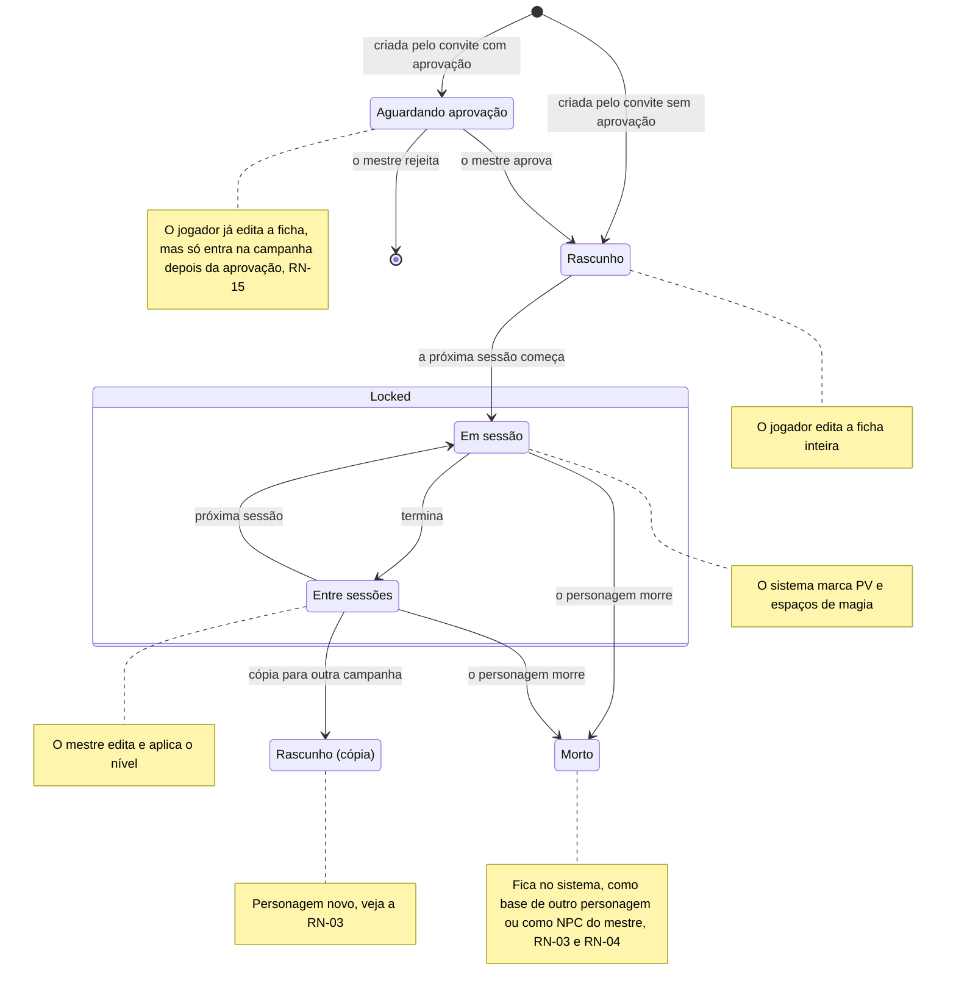
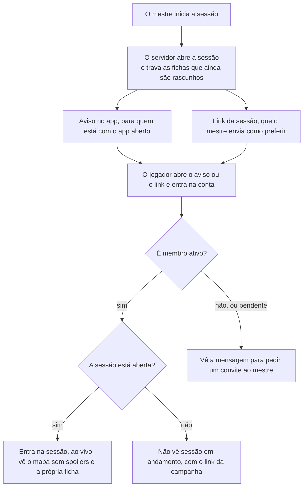

[English](../../product/rules.md)

# Regras de negócio

Cada regra tem um ID (RN-xx) para que as histórias, os testes e o código apontem para ela.
A tabela enuncia cada regra em uma frase.
A seção logo abaixo diz o que o produto garante, quem ele protege e como o usuário percebe.
Como o código faz isso está nos [docs de arquitetura](../../architecture/README.md); os testes que provam estão listados em [Testes](../../testing.md).

| ID | Regra | Detalhes |
| --- | --- | --- |
| RN-01 | **Trava da ficha.** O jogador edita a própria ficha até o início da primeira sessão da campanha. Depois disso, só o mestre e o sistema a alteram. Um personagem criado depois continua editável até o início da próxima sessão. | [Detalhes](#rn-01-trava-da-ficha) |
| RN-02 | **PV e espaços de magia.** Durante a sessão, o sistema controla PV e espaços de magia a partir das ações: dano, cura, magia conjurada, descanso. O mestre pode corrigi-los à mão a qualquer momento da sessão e tem a palavra final. | [Detalhes](#rn-02-pv-e-espaços-de-magia) |
| RN-03 | **Um personagem, uma campanha.** O personagem de um jogador fica em uma campanha. Dentro da campanha, o jogador tem um personagem vivo por vez. Um personagem morto não é apagado: fica no sistema, como base para outro personagem do jogador ou como NPC do mestre em outra campanha (RN-04). | [Detalhes](#rn-03-um-personagem-uma-campanha) |
| RN-04 | **NPCs reutilizáveis.** O mestre usa os próprios personagens em quantas campanhas quiser, inclusive um personagem de jogador morto (RN-03). | [Detalhes](#rn-04-npcs-reutilizáveis) |
| RN-05 | **Papéis por campanha.** Um usuário pode ser mestre em uma campanha e jogador em outra. | [Detalhes](#rn-05-papéis-por-campanha) |
| RN-06 | **Aviso de início da sessão.** Quando o mestre inicia a sessão, os membros recebem um aviso no app, para quem estiver com o app aberto. O link da sessão exige que a pessoa esteja logada e abre a sessão só para membros. | [Detalhes](#rn-06-aviso-de-início-da-sessão) |
| RN-07 | **Convite não é o link da sessão.** O convite adiciona alguém à campanha; o link da sessão só leva um membro até ela. O mestre escolhe quantos usos o convite tem e quanto tempo dura, e pode revogá-lo a qualquer momento. | [Detalhes](#rn-07-convite-não-é-link-da-sessão) |
| RN-08 | **Formato da importação.** O jogador ou o mestre escolhe o formato: a ficha do D&D Beyond ou a ficha em português, ambas em PDF preenchível. Não há importação de DOCX. | [Detalhes](#rn-08-formato-da-importação) |
| RN-09 | **Modo de XP.** Cada campanha dá XP por inimigos derrotados, por ouro ou por marcos. Nos dois primeiros modos, o mestre também dá XP quando quiser. | [Detalhes](#rn-09-modo-de-xp) |
| RN-10 | **Mapa sem spoiler.** O jogador recebe só o que o personagem dele pode saber: os pontos de interesse que o grupo descobriu, e nada do que o mestre escondeu. | [Detalhes](#rn-10-mapa-sem-spoiler) |
| RN-11 | **Notas do mestre.** Só o mestre lê e edita as notas do mestre. | [Detalhes](#rn-11-notas-do-mestre) |
| RN-12 | **Subir de nível.** O jogador sobe de nível pela edição guiada da ficha que a RN-01 permite enquanto o personagem "Pode subir de nível" ([MR-040](historias.md#mr-040-subir-de-nível-pela-ficha)). | [Detalhes](#rn-12-subir-de-nível) |
| RN-13 | **Mais de um mestre.** Uma campanha pode ter mais de um mestre, e um mestre pode passar a campanha para outro. | [Detalhes](#rn-13-mais-de-um-mestre) |
| RN-14 | **Criar campanha exige conta de mestre completa.** Qualquer conta pode jogar. Para criar uma campanha, a conta precisa ser de mestre completa, o que hoje só existe com o Google. | [Detalhes](#rn-14-criar-campanha-exige-conta-de-mestre-completa) |
| RN-15 | **Convite com aprovação.** Pelo link do convite, o jogador cria o próprio personagem na hora. O mestre aprova ou recusa esse personagem antes que ele conte para a campanha. | [Detalhes](#rn-15-convite-com-aprovação) |
| RN-16 | **Exclusão de conta e inatividade.** Quando um jogador exclui a conta, os personagens dele continuam ligados ao mestre da campanha e não são apagados. | [Detalhes](#rn-16-exclusão-de-conta-e-inatividade) |
| RN-17 | **Login do jogador sem Google.** O jogador entra com um login anônimo, sem e-mail nem nome real: o apelido do mestre junto com o apelido do jogador identifica a conta. | [Detalhes](#rn-17-login-do-jogador-sem-google) |
| RN-18 | **Dados físicos ou do app.** O mestre escolhe se a campanha deixa os jogadores escolherem os dados. Se deixa, cada jogador escolhe entre rolar no app ou rolar o dado físico e digitar o resultado. | [Detalhes](#rn-18-dados-físicos-ou-do-app) |
| RN-19 | **Iniciativa.** Numa batalha com vários NPCs iguais, cada um rola a própria iniciativa; o grupo não rola junto. | [Detalhes](#rn-19-iniciativa) |
| RN-20 | **O que o jogador vê dos inimigos no combate.** Os jogadores não veem os PV dos inimigos como número. Veem uma palavra: "Ileso", "Ferido", "Muito ferido" ou "Derrotado". | [Detalhes](#rn-20-o-que-o-jogador-vê-dos-inimigos-no-combate) |
| RN-21 | **Movimento na grade.** Na grade do mapa, cada quadrado tem 1,5 m e o movimento é um **círculo**: a distância entre dois quadrados é a linha reta entre os centros, e o que um combatente alcança é o círculo do movimento que lhe resta. | [Detalhes](#rn-21-movimento-na-grade) |
| RN-22 | **Condições e concentração.** O app marca condições (derrubado, envenenado...) e concentração, e avisa: quando um personagem concentrado sofre dano, o jogo pede ao dono dele o teste de resistência de concentração (RN-31). | [Detalhes](#rn-22-condições-e-concentração) |
| RN-23 | **Conteúdo da mesa.** O mestre cadastra classes, subclasses, raças, sub-raças, antecedentes e magias que valem só na campanha dele, ao lado do SRD 5.1. Os membros leem o conteúdo da campanha; só o mestre escreve. | [Detalhes](#rn-23-conteúdo-da-mesa) |
| RN-24 | **Regras da mesa.** No topo da página "Regras da mesa" fica o **estilo da mesa**: "Tudo no app" (dados no app, combate com mapa, névoa ligada nos mapas novos), "Mesa física" (dados físicos, combate sem mapa por padrão, névoa desligada) ou "Teatro da mente" (cada jogador escolhe os dados, combate sem mapa, sem névoa), e "Personalizado" quando as escolhas não batem com nenhum. | [Detalhes](#rn-24-regras-da-mesa) |
| RN-25 | **A grade e o combate sem grade.** As regras contam em quadrados de 1,5 m em todo mapa (RN-21). Um mapa desenhado com quadrados maiores é calibrado: "cada quadrado deste desenho vale 3 m" faz o app contar quatro quadrados de 1,5 m em cada um, e um alcance de 1,5 m continua sendo o vizinho. | [Detalhes](#rn-25-a-grade-e-o-combate-sem-grade) |
| RN-26 | **Portas.** Uma porta fechada bloqueia movimento, visão e luz, como uma parede, e conta como parede para cobertura. Quem anda até ela a abre, a menos que esteja trancada; o mestre abre, fecha e tranca qualquer porta, no editor e na sessão. | [Detalhes](#rn-26-portas) |
| RN-27 | **Quebra-cabeças.** O jogador nunca recebe a resposta de um quebra-cabeça: só o estado (as luzes, as rodas, os símbolos, a mensagem cifrada), a pista do mestre, as dicas soltas, quem fez a última jogada (o nome do personagem) e, depois de resolvido, o que aconteceu (o texto que o mestre escreveu em "Ao resolver" ou uma frase genérica). | [Detalhes](#rn-27-quebra-cabeças) |
| RN-28 | **Imagens geradas por IA.** Só o mestre gera e edita, com um limite de imagens por campanha por mês. | [Detalhes](#rn-28-imagens-geradas-por-ia) |
| RN-29 | **Monstros no combate.** Um monstro do bestiário (MR-042) entra no combate como NPC: o jogador vê só a palavra de estado (RN-20), o mestre vê a ficha da criatura do SRD, e ele conta no XP por inimigos pelo nível de desafio (ND). | [Detalhes](#rn-29-monstros-no-combate) |
| RN-30 | **Limites do que uma conta cria.** Uma conta é mestre de no máximo 10 campanhas, o servidor inteiro gera no máximo 100 imagens por dia e mantém no máximo 5 pedidos de imagem vivos ao mesmo tempo (o que está sendo feito e quatro esperando), além das 20 por mês de cada campanha (RN-28). | [Detalhes](#rn-30-limites-do-que-uma-conta-cria) |
| RN-31 | **Reações e a janela de reação.** Uma reação por rodada; quando acontece algo que uma reação pode mudar, o jogo espera o reator, o mestre responde por todo NPC, e o jogador de uma reação de NPC lê só "Esperando o mestre". O teste de resistência de concentração também é uma janela. | [Detalhes](#rn-31-reações-e-a-janela-de-reação) |
| RN-32 | **Conjurar fora do combate.** Um personagem conjura uma magia fora de um combate, sem turno e sem economia de ações: uma magia conjurada em uma ação vale na hora, e uma que leva minutos ou horas (ou um ritual) é concluída pelo mestre quando o tempo de jogo passou. Um ritual não gasta espaço de magia e leva 10 minutos a mais. Uma conjuração interrompida falha e não gasta espaço. | [Detalhes](#rn-32-conjurar-fora-do-combate) |
| RN-33 | **Escolhas de classe e raça.** Uma classe ou uma raça pode pedir que o jogador escolha algo (um Estilo de Luta, uma Ancestralidade Dracônica, Pacto e invocações, Metamagia, um Inimigo Favorito, um terreno, os +1 do Meio-elfo...). Um personagem não é criado com uma escolha em aberto; uma ficha travada que tem uma continua funcionando e a completa depois, e a subida de nível também pede as escolhas que ficaram para trás. | [Detalhes](#rn-33-escolhas-de-classe-e-raça) |
| RN-34 | **Testes de disputa e ações especiais.** Agarrar, empurrar e escapar são disputas de Força (Atletismo) contra Força (Atletismo) ou Destreza (Acrobacia); um empate não muda nada. Arrastar uma criatura agarrada reduz o deslocamento à metade. Esconder-se compara o total de Furtividade com a Percepção passiva de cada criatura (um empate mantém o escondido notado); Ajudar dá vantagem; um teste em grupo passa quando pelo menos metade passa; uma criatura surpresa não faz nada no primeiro turno. O jogador nunca lê os números de um NPC, a CD de escapar, quem notou um escondido nem o total de outro jogador. | [Detalhes](#rn-34-testes-de-disputa-e-ações-especiais) |
| RN-35 | **Traços de raça e a Queda Lenta do monge em combate.** Um meio-orc levado a 0 PV mas não morto de vez fica com 1 (Relentless Endurance, uma vez por descanso longo, usado pelo app sozinho); o acerto crítico dele com um ataque de arma corpo a corpo rola mais um dado de arma (Savage Attacks); a reação de um monge tira 5 vezes o nível dele do dano de queda de um fosso (Queda Lenta); a Fuga Ágil do goblin é Desengajar ou Esconder-se como ação bônus; um halfling cujo d20 mostra 1 (um ataque, ou um teste de perícia ou de resistência que o jogador rola) recebe "Tirou 1: rolar de novo?" antes do resultado, e a nova rolagem vale; num teste de resistência em que o app rola pelo halfling de um jogador na ação de outra pessoa, o app rola o 1 de novo sozinho (Sortudo). | [Detalhes](#rn-35-traços-de-raça-e-a-queda-lenta-do-monge-em-combate) |
| RN-36 | **Quem lê uma linha da conversa da cena.** Uma linha é para a mesa toda ou para leitores escolhidos; o mestre sempre lê todas as linhas, pode escolher qualquer conjunto de jogadores, e um jogador escolhe todos ou "só o mestre". Quem não foi escolhido nunca recebe a linha: nem o texto, nem a imagem, nem a existência, nem a contagem, nem um aviso de que foi enviada, numa leitura, no stream, no resumo ou na voz. O mestre fala como narrador ou como um NPC da campanha; um jogador, como o próprio personagem (RN-18) ou fora do personagem. | [Detalhes](#rn-36-quem-lê-uma-linha-da-conversa-da-cena) |
| RN-37 | **Áreas que as magias mantêm no mapa.** Espíritos Guardiões, Raio Lunar, Névoa Mortal, Teia, Área Escorregadia e Constrição deixam a área no mapa enquanto duram. Uma criatura faz o teste de resistência da magia quando a área a pega, no máximo uma vez por turno para cada área. Espíritos Guardiões, Raio Lunar, Névoa Mortal e Teia pedem o teste de quem entra e de quem começa o turno dentro, e a conjuração não atinge ninguém (Teia põe o efeito nas criaturas dentro na conjuração). Área Escorregadia pede o teste das criaturas dentro na conjuração, de quem entra e de quem termina o turno dentro, nunca no começo do turno. Constrição pede o teste só das criaturas dentro na conjuração. A área acaba com a concentração ou com o tempo, e se move onde a magia permite. A área de um conjurador escondido é só do mestre. | [Detalhes](#rn-37-áreas-que-as-magias-mantêm-no-mapa) |
| RN-38 | **Ações de teste de resistência de uma criatura.** O mestre usa, no turno de um NPC, uma ação dele que pede um teste de resistência (um sopro, um olhar). O app rola o teste de cada alvo contra a CD da ficha, abre o dano que o teste governa (metade se passar, quando a ação diz) e gasta a ação. O jogador lê o resultado de cada alvo e o dano que toma, nunca a CD nem a ficha. | [Detalhe](#rn-38-ações-de-teste-de-resistência-de-uma-criatura) |
| RN-39 | **Condição de um teste falho.** Uma criatura que falha no teste de uma ação recebe a condição que a ação nomeia, a menos que seja imune ou já a tenha. A duração e o teste repetido são anotações para o mestre; o app não conta o tempo. | [Detalhe](#rn-39-condição-de-um-teste-falho) |
| RN-40 | **Efeito extra no acerto de uma criatura.** Um ataque de NPC que pede um teste do alvo ao acertar, ou o agarra, oferece o efeito ao mestre depois que o dano caiu: "Aplicar" ou "Dispensar". Agarrar dá a condição e anota a CD de fuga. O jogador nunca recebe a oferta. | [Detalhe](#rn-40-efeito-extra-no-acerto-de-uma-criatura) |
| RN-41 | **Ações sem rolagem.** Uma ação de criatura que não rola nada (um poder que o texto descreve) é usada como lembrete: gasta a ação e escreve uma linha no registro, e o mestre lê o texto do SRD. | [Detalhe](#rn-41-ações-sem-rolagem) |
| RN-42 | **Ataque de monstro com várias partes de dano.** O acerto de um ataque da ficha causa todas as partes de dano da ação (uma espada mais fogo) como um só dano a aplicar, cada parte resistida pelo próprio tipo. | [Detalhe](#rn-42-ataque-de-monstro-com-várias-partes-de-dano) |

## RN-01: Trava da ficha

O jogador edita a própria ficha até o início da primeira sessão da campanha.
Depois disso, só o mestre e o sistema a alteram.
Um personagem criado depois (o substituto de um morto, ou o de quem entrou tarde) continua editável até o início da próxima sessão.
Os números que o sistema calcula nunca são editáveis.

- **A história.** A história do personagem (personalidade, aparência, passado, aliados) tem a própria trava: depois que a ficha trava, o jogador só a edita quando o mestre a libera, personagem por personagem, até o início da próxima sessão ou até o mestre travá-la de novo.
- **O que o mestre vê primeiro.** Antes de iniciar uma sessão, o mestre é avisado de quais fichas ainda têm perícias ou magias a escolher, e confirma. A trava não espera por elas.
- **Personagens reservados** ([MR-049](historias.md#mr-049-personagens-reservados-e-links-para-assumir)) não têm jogador para trancar do lado de fora. Eles travam com a primeira sessão que começa depois que um jogador os assume.
- **Recusa.** Uma ficha travada, um personagem morto ou uma história travada recusa a edição do jogador. A tela mostra a ficha só para leitura.
- **Talentos.** Só o mestre adiciona ou remove um talento no editor da ficha. Os talentos de um jogador vêm da subida de nível guiada, e um salvamento do jogador que os altere é recusado.

**A exceção da subida de nível** ([MR-040](historias.md#mr-040-subir-de-nível-pela-ficha)).
Enquanto o personagem "Pode subir de nível" (RN-12), o dono pode editar até uma ficha travada, mas só para acrescentar o que o próximo nível dá.
O servidor monta a ficha nova a partir da guardada e a confere com as regras, então nada além disso pode mudar.

| A subida de nível guiada pode mudar | Nunca muda (o servidor recusa, dizendo o campo) |
| --- | --- |
| Um nível de uma classe que o personagem já tem | Nome, raça, antecedente, valores-base |
| O aumento de valor de habilidade, só em um nível que o tem (+2 em uma habilidade ou +1 em duas, nenhuma acima de 20) | Armadura, escudo, armas |
| Os PV do nível (média, dado rolado no app ou dado físico digitado) | As outras classes e tudo que os níveis anteriores já tinham |
| Os truques e magias que a tabela da classe dá, e novas magias preparadas (nenhuma removida) | Uma ficha que acabaria com um problema que a antiga não tinha (uma magia fora da lista da classe ou acima do nível, preparadas demais) |
| A subclasse, no nível dela, e as opções, perícias e especialização que o novo nível oferece | |

- **O mestre acrescenta o resto no editor** ("o mestre acrescenta pelo editor"): multiclasse, uma subclasse própria, o Arcanum Místico do Bruxo, a Maestria de Magias e as Magias Assinatura do Mago, os Segredos Mágicos Adicionais do Colégio do Conhecimento, os inimigos e terrenos favoritos do Patrulheiro, e trocar uma magia conhecida por outra (a subida de nível guiada só acrescenta magias).
- **Uma ficha guardada que já não passa nas regras de hoje** recebe a recusa que pede ao mestre que corrija a ficha.
- **Um jogador que não pode subir de nível** (o personagem não "Pode subir de nível", é um NPC ou está no nível 20) também é recusado.
- **O dado de vida** segue o modo de dados da campanha (RN-18). O dado rolado no app é rolado pelo servidor e guardado para aquele personagem e nível, então pedir de novo devolve o mesmo resultado. Uma campanha que obriga o dado físico recusa o dado do app, e o contrário.
- **O mestre lê toda subida de nível** em "O que mudou".

Veja [Personagens](../../architecture/characters.md) e [Subida de nível](../../architecture/rules-level-up.md).

## RN-02: PV e espaços de magia

Durante a sessão, o sistema controla PV e espaços de magia a partir das ações: dano, cura, magia conjurada, descanso.
O mestre também pode corrigir à mão, a qualquer momento da sessão, PV, PV temporários, espaços de magia (e de pacto), dados de vida e os usos dos recursos de classe e raça: o mestre tem a palavra final.

- **A correção** exige uma sessão aberta, mantém cada valor entre 0 e o máximo dele, e avisa na hora o mestre e o dono do personagem. Reenviar não muda nada. Na Forma Selvagem, ela também define os PV da fera.
- **Quem lê o quê.** O jogador lê só os números do próprio personagem. O mestre lê os de todos.
- **Os valores duram** de uma sessão para a outra. Os máximos vêm da ficha, e um personagem cujos PV nunca foram definidos está com PV cheios, qualquer que passe a ser o máximo.
- **Dano.** Os PV temporários vão primeiro, e os PV param em 0 (RN-03).
  - Num NPC, num monstro ou numa criatura de um personagem, o dano vale na hora, depois das resistências, vulnerabilidades e imunidades da criatura do SRD dele (imunidade zera, resistência divide por dois arredondando para baixo, vulnerabilidade dobra). Uma resistência ou imunidade "a ataques não mágicos" vale para um ataque que não é mágico, e não para uma magia, para o ataque de uma criatura cujas armas são mágicas, nem para dano que não é ataque (uma armadilha, uma zona, um efeito de queimadura). Uma arma de personagem não é mágica, nem um golpe desarmado, exceto o do monge a partir do nível 6 (Golpes de Chi, também como monge multiclasse): ele conta como mágico para essas resistências e imunidades e para mais nada, sem bônus de acerto ou de dano, e não vale para uma arma de monge. Uma entrada que cita também um material (prata, adamantina) não é aplicada, porque um ataque não carrega material: o mestre corrige os PV à mão.
  - Num personagem de jogador, o dano rolado **espera o mestre**, que o aplica ("Aplicar 5 de dano") ou o descarta ("Não aplicar"). O mestre pode aplicar um valor diferente (uma resistência que o app não aplica). O registro guarda os dois números para o mestre, e o jogador vê só o que sofreu.
  - O que a própria ficha do personagem protege é aplicado ao dano rolado como passos que o mestre lê, antes de o mestre aplicá-lo: uma raça, um talento ou uma característica da mesa com resistência, imunidade ou vulnerabilidade a tipos de dano (ou, "de ataques não mágicos", a contundente, perfurante e cortante), e a fúria do bárbaro. A imunidade leva a 0, depois a resistência divide por dois (arredondando para baixo), depois a vulnerabilidade dobra; a mesma proteção de duas fontes conta uma vez só. Um ataque de uma ficha ou de um bloco de estatísticas que não é marcado como mágico conta como não mágico.
  - Uma ficha imune a uma condição não recebe nenhum dos efeitos que a dão (de uma magia, de um adicional, de uma armadilha, uma agarrada ou um empurrão que derruba); a mudança das condições feita pelo próprio mestre não é bloqueada.
  - A criatura de um personagem tem PV próprios. O dano dela vale na hora, e em 0 ela é dispensada.
  - O dano de uma armadilha segue o mesmo caminho. Fora de um combate, o que espera o mestre sobrevive até ele aplicar ou descartar.
- **Canalizar Divindade do clérigo.** Preservar a Vida (Domínio da Vida) restaura pontos de vida às criaturas a até 9 m que o clérigo nomear (se o clérigo não nomear ninguém, o app divide os pontos entre o grupo, quem está mais ferido primeiro), até cinco vezes o nível do clérigo no total, cada uma até no máximo metade do seu máximo; não restaura um morto-vivo nem um constructo. Expulsar Mortos-Vivos faz cada morto-vivo a até 9 m que possa ver ou ouvir o clérigo fazer um teste de resistência de Sabedoria contra a CD do clérigo, e os que falham ficam expulsos por um minuto (o mestre vê cada teste e quem foi expulso, no registro e na resposta; a criatura expulsa leva o efeito "Expulso"). As duas gastam a ação e um uso.
- **Magias e recursos.** Uma magia gasta o espaço (ou o espaço de pacto) quando é conjurada, e um reenvio não gasta duas vezes. Uma magia de cura cura na hora, até o máximo, e levanta quem estava em 0. Os usos de classe e raça (Retomar o Fôlego, Surto de Ação, Fúria...) também são contados. Um recurso sem limite mostra "ilimitado".
- **O "Desfazer última ação" do mestre** desfaz a última ação; cada desfazer também fica registrado.

**Descansos** (SRD 5.1, "Resting").
O mestre faz um descanso curto ou longo pela mesa, depois de uma confirmação que lista o que volta para cada personagem.

| Descanso | O que volta |
| --- | --- |
| Curto | Os recursos que recarregam em um descanso curto ou longo, e os espaços de pacto do bruxo. Cada jogador gasta dados de vida um de cada vez, rolados no app ou digitados de um dado real (RN-18), e cura a rolagem mais o modificador de Constituição. |
| Longo | Todo recurso que não recarrega ao amanhecer ou nunca recarrega, todos os espaços de magia, todos os PV e metade do total de dados de vida (pelo menos um). Os PV temporários acabam. Um personagem em 0 PV não ganha nada. |

- O app não conta horas: o mestre é avisado quando a sessão já teve um descanso longo. Um descanso é recusado enquanto um combate está em andamento.
- Os dados de vida são guardados por tamanho de dado (SRD, "Multiclassing").
- **Recuperação Arcana** (Mago): uma vez por descanso longo, depois de um descanso curto, o jogador escolhe espaços gastos cujo nível combinado seja no máximo metade do nível de mago, arredondado para cima, nenhum de nível 6 ou maior. Só conta o nível de mago, e nunca os espaços de pacto. A folha do descanso curto tem uma seção "Recuperação Arcana", e depois ela diz "Recuperação Arcana: usada; volta no descanso longo." Uma recusa não muda nada.
- **Cura pelas Mãos, Conjuração Flexível e Metamagia.** A Cura pelas Mãos gasta pontos num toque, ou 5 pontos para curar um veneno ou uma doença; num morto-vivo ou num construto os pontos são gastos e a resposta diz só que nada aconteceu, então o jogador não aprende nada sobre o tipo dele (RN-10). A Conjuração Flexível transforma pontos em um espaço de nível 1 a 5 que um descanso longo tira, e um espaço de volta em pontos. A folha de conjuração oferece só as opções de Metamagia que o personagem conhece, com o custo, e uma desabilitada diz por quê.
- **Inspiração de Bardo.** Uma ação bônus, um dado de cada vez, para outra criatura a até 18 m que possa ouvir. O dado dura 10 minutos de **tempo de jogo**, que só anda quando o mestre o move, uma conjuração leva tempo ou acontece um descanso. Quem o tem decide depois do d20 e antes do resultado: "Usar a Inspiração de Bardo (d8)?". Fora de um combate o bardo a dá pelo painel da sessão ("Inspiração de Bardo", "Dar a …"). Quando um combate leva quem tem o dado, o dado vai junto e volta quando o combate termina.
- **Ajuda** aumenta o máximo e o atual de PV de cada alvo em 5 (e mais 5 por nível do espaço acima do 2º) até o mestre encerrar ("Encerrar Ajuda"). Um descanso longo a encerra para o personagem de um jogador, um descanso curto não. Duas Ajudas não se somam. Quando acaba, os PV perdem só o que passa do novo máximo, então ninguém que ainda tinha PV cai a 0 por causa disso. O máximo da própria ficha aparece ("máximo 38 da ficha"), e o registro diz "A Ajuda de Sálvia acabou".
- **Escudo Arcano** aparece como "CA 18" com a soma "13 + 5" e o rótulo "Escudo Arcano +5 até a sua vez" para o jogador, e como "CA 13 + 5" na ordem do mestre. Ele acaba quando o turno do conjurador começa. Só o mestre e o conjurador leem "O Escudo Arcano de X acabou", porque a magia pode ter respondido a um ataque de uma criatura escondida (RN-10).

Veja [Ataques e dano](../../architecture/play/attacks-and-damage.md), [Descansos e recursos](../../architecture/play/rests-and-resources.md) e [Efeitos duradouros](../../architecture/play/lasting-effects.md).

## RN-03: Um personagem, uma campanha

O personagem de um jogador fica em uma campanha.
Dentro da campanha, o jogador tem um personagem vivo por vez, e só cria um novo quando o atual morre.
Um personagem morto não é apagado: fica no sistema, como base para outro personagem do jogador ou como NPC do mestre em outra campanha (RN-04).
Para jogar outra campanha, ao mesmo tempo ou numa continuação anos depois, o jogador faz uma cópia ([MR-021](historias.md#mr-021-copiar-personagem), ainda não construída).

- **Um segundo personagem vivo é recusado**, e a recusa diz qual é o vivo. Assumir um personagem reservado por um link ([MR-049](historias.md#mr-049-personagens-reservados-e-links-para-assumir)) também conta, e uma pessoa cujo único personagem está morto pode assumir. Um personagem reservado não tem jogador, então não conta contra ninguém.
- **Testes contra a morte.** Um personagem em 0 PV está "Caído". No começo do turno dele, ele rola um teste de resistência contra a morte, no app ou digitado (RN-18): 10 ou mais é um sucesso, menos é uma falha, um 1 natural são duas falhas, um 20 natural volta com 1 PV. Três sucessos o deixam estável ("Estável"). Dano enquanto caído conta uma falha (duas num acerto crítico). Um personagem em 0 PV está inconsciente para os ataques contra ele (SRD 5.1): eles têm vantagem, e um acerto a até 1,5 m é crítico, ou seja, duas falhas; vale para ataques de arma e de magia, e o modo sugerido que quem ataca lê ("Como rolar o d20") já diz isso. Qualquer cura zera as contagens. O turno não termina até a rolagem ser feita, nem para o mestre: quando o jogador não está, o mestre rola pelo personagem, no app ou digitando o resultado, e só então encerra o turno. Fora do combate o app não rola testes contra a morte.
- **Três falhas não matam sozinhas.** O mestre vê "Morrendo · 3 falhas" e a pergunta "Confirmar a morte" / "Ainda não". Os jogadores continuam lendo "Caída" e as contagens, que são públicas: o app nunca diz que alguém morreu antes do mestre. A confirmação não pode ser desfeita com "Desfazer".
- **Um personagem morto não recebe cura** (uma magia de cura dirigida a um é recusada antes de gastar o espaço ou a ação), e o jogador dele continua lendo o combate.
- **Reviver (o mestre).** Um personagem morto pode voltar a viver com 1 PV e nenhum teste contra a morte contado, mantendo o estado que tinha antes (rascunho ou travado). Não gasta nada e não tem limite de tempo. É recusado enquanto o jogador tem outro personagem vivo. Num combate em andamento o personagem mantém o lugar dele na ordem, e o registro diz "O mestre reviveu <nome>".
- **Revivificar** ("Revivificar", SRD 5.1: 3º nível, toque, diamantes que valem 300 po) devolve com 1 PV uma criatura que morreu no último minuto, mas não uma que morreu de velhice ou perdeu uma parte do corpo. Num combate o app conta o minuto como 10 rodadas a partir da rodada da morte. Fora do combate o mestre responde se foi há menos de um minuto. Uma Contramágica responde a ela como a qualquer conjuração (RN-31), e um Revivificar anulado ainda gasta o espaço e a ação. A lista de um jogador tem só as criaturas que a magia alcança agora, e nenhuma recusa diz por que outra está faltando (RN-10). O interruptor do mestre "Revivificar não funciona nesta morte" tira uma criatura da lista.
- **Na tela**, o turno de quem está caído diz "Brisa está caída", com as marcas e "Rolar teste contra a morte".

Veja [Morte e reviver](../../architecture/play/death-and-revival.md).

## RN-04: NPCs reutilizáveis

O mestre usa os próprios personagens em quantas campanhas quiser.
Isso inclui um personagem de jogador morto (RN-03), que o mestre pode reaproveitar como NPC em outra campanha.

Um NPC é um modelo: os PV e a posição dele vivem no combatente de cada combate, então um combate em uma campanha nunca muda o NPC nas outras.
Um NPC pertence ao mestre que o criou, e os jogadores nem veem nem criam NPCs.
Usar o mesmo NPC em outras campanhas é a [MR-022](historias.md#mr-022-reutilizar-npcs).

## RN-05: Papéis por campanha

Um usuário pode ser mestre em uma campanha e jogador em outra.
O papel pertence à participação em uma campanha, não ao usuário.

## RN-06: Aviso de início da sessão

Quando o mestre inicia a sessão, os membros recebem um aviso no app, para quem estiver com o app aberto.
O link da sessão exige que a pessoa esteja logada (com o Google; a RN-17 não está construída) e abre a sessão só para membros.

- O aviso aparece sob a barra do app, com um link "Ao vivo" na barra. O app procura sessões abertas a cada 30 segundos enquanto a aba está visível. Não há notificação push com o app fechado.
- Na página da campanha não há aviso: a faixa da sessão é o anúncio. A faixa de um jogador mostra "Entrar na sessão" quando uma sessão começa e o tira quando ela termina, sem recarregar.
- Quem não é membro, inclusive um membro pendente, não consegue abrir a página da sessão. Vê "peça um convite ao mestre".

## RN-07: Convite não é link da sessão

O convite adiciona alguém à campanha; o link da sessão só leva um membro até ela.
O mestre escolhe quantos usos o convite tem e quanto tempo dura, e pode revogá-lo a qualquer momento.

- Os padrões são 1 uso e 7 dias. O mestre escolhe de 1 a 20 usos e de 5 minutos a 30 dias.
- O link da sessão não carrega segredo. A participação é conferida a cada chamada, e no stream ao vivo de novo a cada 60 segundos.

## RN-08: Formato da importação

O jogador ou o mestre escolhe o formato: a ficha do D&D Beyond ou a ficha em português, ambas em PDF preenchível.
Não há importação de DOCX.

**Não construída** ([MR-007](historias.md#mr-007-importar-ficha-em-pdf), Depois).
O comportamento pretendido: o importador lê os campos do PDF e mostra o resultado para revisão antes de salvar.

## RN-09: Modo de XP

Cada campanha dá XP por inimigos derrotados, por ouro ou por marcos.
Nos dois primeiros modos, o mestre também dá XP quando quiser.

| Modo | De onde vem o XP | "Pode subir de nível" (RN-12) quando |
| --- | --- | --- |
| Por inimigos | O nível de desafio (ND) dos inimigos derrotados, ou XP que o mestre digita | O XP da ficha alcança o próximo nível |
| Por ouro | 1 XP por peça de ouro, convertido quando o grupo volta à cidade ("Voltar à cidade") | O XP da ficha alcança o próximo nível |
| Por marcos | O mestre marca um marco e escolhe quem sobe de nível. Nenhuma tela mostra um número de XP | Uma marca de marco está acima do nível da ficha |

- **A divisão** é o total dividido pelo número de personagens, arredondado para baixo. O resto se perde de propósito, porque o SRD não diz o que fazer com ele: o app nunca inventa XP, o mestre é avisado de quanto se perdeu, e pode concedê-lo à mão. Uma criatura de ND 0 vale 10 XP na tabela, e o mestre digita 0 para uma que não ataca.
- **Quem recebe.** Um personagem de jogador vivo da campanha. No fim de um combate o mestre vê o XP de cada inimigo derrotado, a soma, quem recebe (por padrão, quem lutou e não morreu) e a divisão escrita ("350 XP ÷ 3 = 116,67, arredondado para baixo. 2 XP se perdem na divisão."). "Dar 116 XP a cada um" dá o prêmio do combate, e "Agora não" deixa "XP do combate ainda não dado". "Dar XP" funciona a qualquer momento e pede um motivo (até 120 caracteres) e um valor (1 a 1.000.000).
- **O XP de um NPC** vem preenchido a partir do nível de desafio dele, e o mestre pode digitar outro valor ("Usar 50 XP" volta ao da tabela). Só o mestre o lê (RN-20).
- **Desfazer.** O mestre desfaz só o último prêmio. Ele fica no histórico como "Desfeito", e o desfazer tira de volta o que cada ficha ganhou.
- **Histórico.** A campanha inteira lê o histórico (quem deu, quando, por quê, quanto cada um recebeu), e os jogadores são avisados ao vivo quando o XP muda.
- **Mudar o modo** depois que a campanha existe é do mestre. Se já foi dado XP, o app pergunta primeiro e diz quantos prêmios e quanto XP. Nada é convertido: o XP e o histórico ficam, e o novo modo vale dali em diante. Os avisos de subida de nível mudam com o modo, porque são lidos dele.
- **Tesouro.** "Voltar à cidade" converte o ouro dos tesouros que o grupo achou e que ninguém converteu ainda, 1 XP por peça de ouro, uma vez cada, só numa campanha por ouro. Desfazer o último prêmio os libera. Um tesouro gerado ([MR-044](historias.md#mr-044-gerar-tesouro)) conta só o ouro dele (moedas, gemas, objetos de arte); itens mágicos nunca viram XP. Nos outros modos o tesouro só vai para o resumo da sessão. Veja [Tesouro](../../architecture/maps/treasure.md).
- **Marcos planejados.** Numa campanha por marcos, o mestre escreve os marcos de antemão (textos de até 120 caracteres, no máximo 100 por campanha), em qualquer ordem. Quando o grupo chega a um, o mestre o marca e escolhe quem sobe de nível. Um marco é alcançado uma vez, "Dar a mais alguém" o dá a quem ficou de fora, e desfazer a marca o devolve a planejado. "Registrar um marco fora da lista" cobre o que ninguém planejou. Um marco alcançado nunca é editado nem removido. Uma campanha que conta XP recusa tudo isso.
- **Quem vê o quê (RN-20).** Os marcos planejados pertencem ao mestre. O jogador recebe só os alcançados, com o dia, a hora e quem subiu de nível.
- **Telas.** O editor de NPC tem "Nível de desafio (ND)" e "XP ao derrotar". Mudar o ND refaz o XP a partir da tabela. A página da campanha tem "Experiência" para todo membro, e "Desfazer" só para o mestre, com a pergunta no lugar e o foco em "Voltar".

Veja [Progressão](../../architecture/progression.md).

## RN-10: Mapa sem spoiler

O jogador recebe só o que o personagem dele pode saber.
O que o mestre escondeu nunca chega ao dispositivo do jogador: nem em uma resposta, nem em um evento ao vivo, nem em uma imagem.
O servidor deixa as coisas escondidas fora da resposta, nunca em branco: nenhum ID, nenhum nome, nenhuma descrição.
Tudo que o jogador pede e não pode ver é respondido como se não existisse.
O mestre vê tudo, e pode abrir um mapa "como" um personagem para ver exatamente o que aquele jogador recebe.

**Mapas e pontos.**
Um mapa e um ponto nascem escondidos, e o mestre revela e esconde cada um.
O token de um NPC nasce escondido. O token de um personagem de jogador é visível, e o de uma criatura também (a criatura está do lado do grupo). Escolher o mapa atual da sessão o revela.
O jogador vê o mapa revelado e o mapa atual, só com os pontos revelados e os tokens visíveis; um ponto de submapa leva só a um mapa que o jogador também vê.

**Mover tokens fora do combate** ([MR-012](historias.md#mr-012-acompanhar-a-sessão)).
Fora do combate o mestre move o token de qualquer personagem; o jogador move só o próprio, sozinho, e só num mapa em que o mestre ligou "Os jogadores movem os próprios personagens" (desligado por padrão), e só enquanto vê esse token.
O token anda em direção ao quadrado e para antes de uma parede, de uma porta trancada ou de um quadrado marcado "Não dá para passar", sem limite de deslocamento.
O mestre é avisado do motivo da parada; o jogador só quando o quadrado no caminho é um que ele vê ou lembra: do contrário a resposta diz apenas que parou, e o jogador nunca descobre o que há ali (um NPC escondido, um quadrado na névoa).
O mestre retirar o interruptor enquanto um jogador se move faz o servidor recusar aquele movimento, e a tela do jogador diz "O mestre voltou a mover os tokens.".

**A cena** ([MR-015](historias.md#mr-015-ações-da-cena-de-rp), [MR-031](historias.md#mr-031-npcs-na-cena)).
O mestre pode esconder um NPC no palco ("Escondida dos jogadores") e uma ação de cena ("Escondida"), ao preparar ou ao vivo.
Um NPC escondido conta para o limite de 4 do palco, mas nenhum jogador o recebe: nem o nome, o retrato ou o lugar no palco, nem na cena aberta, nem em um aviso ao vivo, nem na lista de conjurações ou como alvo.
Uma ação escondida não chega a nenhum jogador: nem o nome, a CD, as tentativas ou as rolagens, e a rolagem de um jogador nela é recusada exatamente como a de uma ação que não existe.
Esconder e mostrar dão aos jogadores o mesmo aviso de qualquer mudança da cena, então o que estava escondido sai da tela deles, ou entra nela, na hora; pôr algo no palco escondido, tirá-lo, ou mudar uma ação que continua escondida avisa só o mestre.
"Dar a fala" a um NPC escondido o mostra: o toque do mestre quer dizer que ele fala agora.
Uma fala que o mestre manda na conversa da cena como um NPC escondido o nomeia para os leitores que ele escolheu e nada mais dele: nem o retrato, nem um lugar no palco; só "Dar a fala" o mostra.

**Quem está na cena** (["Quem está na cena"](historias.md#mr-015-ações-da-cena-de-rp), [MR-015](historias.md#mr-015-ações-da-cena-de-rp)).
Uma cena fica aberta para a mesa toda, inclusive um jogador que entra depois, ou para exatamente os jogadores que o mestre escolhe, e que ele pode mudar enquanto ela está aberta.
Um jogador que está fora não recebe cena nenhuma, exatamente como quando nenhuma está aberta: nem o nome, o ponto, a descrição, as ações, as rolagens, o palco ou os retratos, nem o teste em grupo pedido nela, nem um aviso ao vivo, e uma rolagem dele é recusada como se nenhuma cena estivesse aberta.
Um jogador que entra lê a cena na hora e um jogador que sai a perde na hora, cada um avisado pelo mesmo aviso de qualquer mudança da cena.
Com o interruptor do mestre "Os jogadores podem entrar" ligado, um jogador que está fora lê o nome da cena e que pode entrar, e nada mais, e entrar o faz um dos jogadores dela para o que vem depois (uma imagem mostrada aos jogadores da cena chega a ele; uma mostrada a jogadores escolhidos não).
O mestre pode nomear qualquer jogador da campanha, também o jogador de um personagem morto: a audiência é sobre jogadores, não personagens.
Os testes passados nela contam no resumo só para o mestre e os jogadores que estavam dentro, também quando a ação é escondida depois; uma cena fica "descoberta" para as anotações do grupo quando está aberta para todos e, enquanto está aberta para só alguns jogadores, por cada um deles sozinho: as anotações de nenhum outro jogador listam o nome dela nem a aceitam como rótulo.
Uma pista revelada a um jogador que está fora chega às anotações dele e nada mais da cena.

**Quem vê a imagem** (["Quem vê a imagem"](historias.md#mr-028-mostrar-uma-imagem-aos-jogadores), [MR-028](historias.md#mr-028-mostrar-uma-imagem-aos-jogadores)).
A imagem que o mestre mostra tem uma audiência: a mesa toda (a única quando nenhuma cena está aberta ou a cena aberta está aberta para todos), os jogadores da cena (o padrão enquanto uma cena está aberta para só alguns, acompanhando quem está dentro enquanto essa cena continua aberta) ou jogadores escolhidos.
O mestre a muda enquanto a imagem é mostrada: "Mostrar a toda a mesa" a alarga, "Mudar quem vê" escolhe os jogadores.
Um jogador tirado perde a imagem na hora, na leitura, no fluxo ao vivo e na rota da imagem; um jogador incluído a recebe na hora.
Quando a cena fecha, outra abre, ou ela abre para todos, uma imagem mostrada aos jogadores dela fica com esses mesmos jogadores e com mais ninguém, e uma imagem deixada com os jogadores ("Deixar com os jogadores") fica só com os jogadores da audiência dela.
Um jogador fora da audiência nunca recebe a imagem, o nome ou o ID dela, nem no resumo; apagar a imagem avisa só o mestre e os jogadores que a viram.
Uma imagem deixada de novo com os jogadores guarda a audiência mais ampla; só tirá-la a estreita.

**Névoa de guerra** ([MR-036](historias.md#mr-036-névoa-de-guerra-pela-visão)).
Num mapa com a névoa ligada, o jogador recebe só o que o personagem dele vê agora ou já viu: decidem as paredes e a luz que o mestre pintou, os pontos de luz e as luzes carregadas, e a visão no escuro da ficha.

- Não chegam a ele: a imagem do mapa (ele recebe só ladrilhos dos quadrados que viu ou de que se lembra, preto no resto), um ponto que ele nem vê nem lembra, o token de um NPC fora da visão dele, a camada de luz, ou uma parede longe do que ele vê.
- O token de um personagem de jogador sempre chega. Um token que o mestre escondeu ainda ilumina o mapa, e o jogador vê a claridade, não quem a carrega.
- O que foi visto fica, escurecido e sem criaturas, até o mestre limpar ("Esquecer o que foi visto") ou mudar a grade ou a imagem.
- Um mapa em "Claro" (luz base clara) mostra a planta toda aos jogadores, mas as criaturas e os pontos ainda seguem o que os personagens veem, e uma porta secreta aparece como parede. Uma sala que deve ficar secreta usa "Penumbra", que um calabouço gerado recebe.
- Num mapa com névoa o mestre é avisado, e só o mestre, de cada personagem de jogador que não enxerga onde está: a casa dele está escura (a luz de base é "Escuro" e nenhuma luz pintada ou fonte de luz a alcança, contando as luzes de NPCs que os jogadores não veem) e ele não tem visão no escuro, visão às cegas nem visão verdadeira. Em "Penumbra" e "Claro", e num mapa sem névoa, ninguém está no escuro. Uma luz carregada que se apaga faz o aviso voltar na hora.
- A imagem de um mapa com névoa é só do mestre: mostrá-la na sessão, deixá-la com os jogadores, ou usá-la como retrato ou como fundo de outro mapa gera uma cópia.
- O combate num mapa com névoa está na RN-20. O jogador de um personagem morto vê o que o grupo vivo vê. Um combate encerrado não tem névoa.

Veja [Névoa de guerra](../../architecture/maps/fog.md).

**Imagens.**
A galeria é do mestre. O jogador baixa uma imagem só enquanto a vê: o fundo de um mapa que ele vê, ou a imagem que o mestre mostra na sessão.
O mestre pode deixar uma imagem com os jogadores ("Deixar com os jogadores") e tomá-la de volta. Um jogador que não pode ver a imagem recebe a mesma resposta de uma imagem que não existe.
O retrato de um NPC é servido só enquanto o NPC está no palco da cena aberta.

**Cenas, pistas e ganchos** (MR-015, MR-029, MR-030, MR-031).
O mestre pode abrir um ponto de cena escondido; a cena chega aos jogadores e o ponto continua fora do mapa deles. Uma cena conta como descoberta quando o mestre revela o ponto ou a abre, para o grupo todo, e o nome dela pode então rotular uma nota do jogador, mas só para uma cena de um mapa que o jogador pode abrir. A CD de uma ação de cena e os ganchos do mestre nunca chegam a um jogador (RN-20).

**Armadilhas, tesouros, luzes e camadas** (MR-034 a MR-036, MR-041, MR-044).

- Uma armadilha não revelada ao personagem do jogador nunca chega a ele: nenhum ID, nenhuma posição, nenhum evento. Ela chega quando o mestre a revela a esse personagem ou a todos, quando o personagem a nota ou a encontra, ou quando ela disparou. Então o jogador lê nome, descrição, posição, área e estado, nunca as CDs, o gatilho nem o efeito.
- Uma busca por armadilha lê igual quando não há nada e quando o teste falhou. O jogador lê "passou" ou "falhou", nunca a CD.
- Um tesouro escondido não carrega nem descrição nem valor. Depois de achado, todos que veem o mapa leem os dois e quem o achou. O histórico de XP que um jogador lê diz só quantos tesouros um "Voltar à cidade" converteu e o total de ouro.
- Um ponto de luz nunca vai a um jogador (ele vê a luz, não o ponto). Das camadas pintadas, o jogador recebe só parede, terreno difícil e cobertura. Uma luz carregada vai só ao mestre e ao dono dela.
- Um movimento interrompido por uma armadilha desconhecida diz só que parou.

**Calabouços gerados.** A lista de salas e o registro do gerador são do mestre. Um jogador não lê nada deles, antes ou depois de o mapa ser revelado.

**Personagens reservados** ([MR-049](historias.md#mr-049-personagens-reservados-e-links-para-assumir)).
Nenhum jogador lê um personagem que o mestre fez para um jogador assumir, até alguém assumi-lo: nem em listas, nem por ID, nem no grupo, no combate, no mapa, no XP ou no resumo da sessão. A pessoa com o link, depois de logada, vê só nome, raça, classe, nível, quem o enviou e o nome da campanha.

**Outros segredos.**
O motivo que o mestre dá ao pedir ajustes em um personagem (RN-15) chega só ao mestre e ao dono.
As notas de um jogador são privadas dele. O mestre não as lê.

**A busca por armadilha é igual para toda armadilha.**
O menu do jogador é Percepção, Investigação e "Outra perícia…", com uma linha constante "Algumas armadilhas só se acham com uma perícia específica", seja o que for que esteja por perto.
A Percepção alcança a CD de uma armadilha para notá-la e a Investigação a CD para encontrá-la. Outra perícia encontra só as armadilhas para as quais o mestre a listou; para as demais, a busca lê exatamente como uma busca que ficou aquém ("Achou" ou "Nada", nunca "Falhou"), ao mesmo custo.

Os testes que provam isso estão descritos em [Testes](../../testing.md#leak-tests-rn-10): uma campanha com uma coisa escondida de cada tipo, toda leitura, todo evento ao vivo, toda imagem e todo ladrilho de névoa pedidos por todo tipo de pessoa, e uma guarda que falha quando um procedimento novo não é classificado.

## RN-11: Notas do mestre

Só o mestre lê e edita as notas do mestre.
Nenhuma outra resposta as carrega, e um teste automático prova que um jogador nunca as recebe.

## RN-12: Subir de nível

O jogador sobe de nível pela edição guiada da ficha que a RN-01 permite enquanto o personagem "Pode subir de nível" ([MR-040](historias.md#mr-040-subir-de-nível-pela-ficha)).
A página tem os passos Habilidades, Vida, Escolhas, Magias e Resumo, sem os passos que não têm nada a escolher.
O mestre também pode aplicar o novo nível no editor da ficha.
A tela completa de subida de nível da [MR-017](historias.md#mr-017-subir-de-nível) é para depois do MVP.

- **Quando vale.** Numa campanha por inimigos ou por ouro, quando o XP da ficha alcança o próximo nível (300 para o nível 2, 900 para o 3, 2.700 para o 4...). Numa campanha por marcos, quando existe uma marca de marco cujo nível a ficha ainda não passou. Ninguém sobe de nível a partir do nível 20.
- **Quem vê o aviso.** O mestre e o dono, de um personagem de jogador vivo.
- **As telas.** O rótulo "Pode subir de nível" (seta e palavras, nunca só cor) aparece em "Personagens dos jogadores", em "Experiência" e na ficha. Numa campanha de XP a ficha mostra a barra de XP e "Chegou aos 2.700 XP do nível 4.", seguido de "Suba o nível pelo botão abaixo." para o dono ou "Suba o nível na ficha." para o mestre. O botão "Subir para o nível N" é só do dono, na ficha travada. Sem a marca, a rota diz que ainda não é possível subir de nível, e o mestre é avisado de que a subida de nível é do jogador.
- **Depois da subida de nível** o rótulo some sozinho, e as sessões abertas são avisadas de que o XP mudou.
- **Multiclasse** (SRD 5.1). O primeiro passo, "Subir em qual classe?", oferece cada classe que o personagem tem e "Uma classe nova". Uma classe nova pede 13 na habilidade principal de toda classe que o personagem tem e da nova (o Guerreiro: Força ou Destreza; o Monge, o Paladino e o Patrulheiro: as duas habilidades). Um jogador é recusado na subida de nível e na criação, e o editor do mestre pode passar disso com um aviso. A classe nova entra no nível 1 dela, só com as proficiências da tabela de multiclasse e nunca equipamento. Ataque Extra, os usos de Canalizar Divindade e Defesa sem Armadura não se somam. As magias conhecidas e preparadas são de cada classe, e os espaços seguem a tabela de conjurador multiclasse (Magia de Pacto à parte). O SRD é omisso sobre uma segunda classe com Magia de Pacto e sobre Segredos Mágicos entre classes, então o app trata cada classe sozinha.
- **Os PV atuais acompanham o máximo.** Quando um salvamento muda o máximo da ficha, um personagem cujos PV atuais estão definidos ganha o que o máximo ganhou, então um ferimento continua um ferimento; um máximo que cai nunca deixa o atual acima dele.

Veja [Subida de nível](../../architecture/rules-level-up.md).

## RN-13: Mais de um mestre

Uma campanha pode ter mais de um mestre, e um mestre pode passar a campanha para outro.

**Não construída** ([MR-023](historias.md#mr-023-passar-ou-dividir-a-campanha), depois do MVP).
Uma campanha tem um mestre, o criador dela.
Quando construída, a campanha só é excluída quando o último mestre sai (veja [Privacidade](../privacidade.md#excluir-a-conta)).
Veja a [ADR-0011](../../adr/0011-authorization-roles-per-campaign-checked-per-request.md).

## RN-14: Criar campanha exige conta de mestre completa

Qualquer conta pode jogar.
Para criar uma campanha, a conta precisa ser de mestre completa, o que hoje só existe com o Google.

Toda conta vem do login OIDC (Google em produção), então toda conta é de mestre completa.
O único portão é a lista opcional de e-mails autorizados a criar campanhas (RN-30).
Quando outro jeito de entrar chegar (RN-17), criar uma campanha deverá recusar contas sem identidade Google, como a [ADR-0009](../../adr/0009-table-accounts-for-players-without-google.md) propôs.

## RN-15: Convite com aprovação

Pelo link do convite, o jogador cria o próprio personagem na hora.
O mestre aprova ou recusa esse personagem antes que ele conte para a campanha.

- **O convite.** O mestre marca "Exigir aprovação do mestre" num convite. Quem o aceita vira membro pendente e vai direto criar um personagem, que nasce pendente e editável.
- **O que um membro pendente pode fazer.** Ver o nome da campanha e o modo de XP, criar, ler e editar o próprio personagem, ler as regras da mesa (RN-24) e fazer habilidades com os 4d6 que o servidor guarda. Todo o resto responde como se ele não estivesse na campanha. Uma sessão não trava um personagem pendente, e ele não pode morrer. A ficha dele mostra "Aparece quando o mestre aprovar o personagem." no lugar das notas do jogador e do painel de criaturas.
- **O mestre decide.** Aprovar torna o personagem um rascunho e o jogador um membro. "Recusar personagem" apaga o personagem e a participação pendente, e o jogador precisa de um convite novo; a confirmação dela é desenhada como uma ação sem volta.
- **Pendente sem personagem.** O mestre vê quem está pendente sem personagem, com quando entrou e quando expira, e pode removê-lo. Uma participação assim é apagada sozinha 30 dias depois da entrada, e a partir daí a pessoa deixa de contar como membro.
- **Um convite comum** (sem aprovação, ainda válido) aceito por um jogador pendente o torna membro na hora, gasta um uso e aprova o personagem que estava esperando. Um convite com aprovação não muda nada para ele.
- **Pedir ajustes ("Pedir ajustes").** O mestre pode devolver o personagem com um motivo (1 a 500 caracteres, obrigatório). O personagem continua pendente, e o jogador lê o motivo, edita e toca em "Enviar de novo". Editar nunca envia sozinho. O mestre pode aprovar ou recusar a qualquer momento, e pedir de novo substitui o motivo. Só o mestre e o dono leem o motivo. Ele é apagado quando o personagem é aprovado ou recusado, quando o personagem, a campanha ou a conta é excluída, e quando um convite comum aprova o jogador.

Veja [Campanhas](../../architecture/campaigns.md#pending-member).

## RN-16: Exclusão de conta e inatividade

**Não construída.**
Não há tela para excluir a conta nem configuração de inatividade.
Este é o comportamento pretendido:

- Quando um jogador exclui a conta, os personagens dele continuam ligados ao mestre da campanha e não são apagados, ou são apagados junto com a conta se a pessoa preferir.
- Quando um mestre exclui a conta, ele tem 30 dias para voltar entrando de novo com a mesma conta; depois disso, tudo é apagado. Em qualquer exclusão, tudo some de vez 30 dias depois.
- Cada pessoa escolhe no perfil quanta inatividade leva a excluir a conta; o padrão é 1 ano.

Um personagem que um jogador assumiu por um link ([MR-049](historias.md#mr-049-personagens-reservados-e-links-para-assumir)) e cujo jogador depois excluiu a conta fica com o mestre como qualquer outro, não reservado; o mestre pode devolvê-lo à reserva e enviá-lo a outra pessoa.
Veja [Privacidade](../privacidade.md#excluir-a-conta) para o fluxo completo, inclusive a ressalva sobre dados pessoais no texto livre do personagem.

## RN-17: Login do jogador sem Google

**Não construída.**
Toda conta entra pelo provedor OIDC (RN-14).
Este é o comportamento pretendido: o jogador entra com um login anônimo, sem e-mail nem nome real.
O apelido do mestre junto com o apelido do jogador identifica a conta de forma única (o apelido é por mesa, não por campanha, como a [ADR-0009](../../adr/0009-table-accounts-for-players-without-google.md) propôs).
O jogador entra sem senha; quando a primeira sessão de 30 dias expira, ele precisa definir uma senha ou vincular o Google para continuar.

## RN-18: Dados físicos ou do app

O mestre escolhe se a campanha deixa os jogadores escolherem os dados.
Se deixa, cada jogador escolhe entre rolar no app ou rolar o dado físico e digitar o resultado.
Se não deixa, todos usam o tipo que o mestre define.

| Configuração da campanha | A rolagem do jogador |
| --- | --- |
| "Cada jogador escolhe" (o padrão) | Escolhido a cada rolagem: "Rolar no app" ou "Digitar o resultado". A preferência guardada só define qual a tela destaca |
| Todos rolam no app | Um valor digitado é recusado |
| Todos rolam os próprios dados | A rolagem do app é recusada |

- Uma mudança vale a partir da próxima rolagem. Os NPCs sempre rolam no app, e o mestre pode digitar um valor.
- Com um dado físico o jogador digita a soma dos dados sem o modificador (a face do d20, de 1 a 20), e o app soma o modificador. A soma precisa caber entre o mínimo e o máximo dos dados.
- A regra cobre a iniciativa, as rolagens de ataque e de dano, os ataques de magia, o dano e a cura de magias, o Retomar o Fôlego, os testes contra a morte, o d20 de uma ação de cena de RP, as dicas de quebra-cabeça e os valores de habilidade em 4d6 de uma ficha nova. Um modo que o mestre forçou recusa o outro jeito com "A campanha mudou a forma de rolar os dados. Recarregue a página.".
- O teste de resistência de um alvo de magia é sempre rolado pelo app com o bônus da ficha.
- Os PV rolados quando um personagem é criado não fazem parte desta regra.
- Telas: o painel "Dados" do mestre, o "Como você rola os dados" do jogador, e as folhas de rolagem, que mostram "Rolar no app" e "Digitar o resultado" na ordem da preferência, ou só o jeito que um modo forçado permite.

## RN-19: Iniciativa

Numa batalha com vários NPCs iguais, cada um rola a própria iniciativa; o grupo não rola junto.

- O app rola todas as cópias de NPC de uma vez, uma rolagem cada (d20 mais o bônus da ficha). O jogador rola a própria, no app ou digitando o d20 físico (RN-18). A única exceção são as criaturas de uma mesma invocação de um personagem de jogador, que dividem uma rolagem.
- A ordem é o maior total, depois o maior bônus, e quando os dois empatam o mestre decide. O combate só começa com todas as iniciativas lançadas.
- Um personagem reservado (ainda não assumido por um jogador) não luta.
- **Turno compartilhado.** Combatentes lado a lado na ordem com o mesmo total, jogadores e NPCs, jogam um único turno: o turno de todos começa junto, cada um com a própria economia de ações, cada jogador encerra a própria parte, e o turno passa quando o último termina. Quem está sozinho num total é um grupo de um. Um reforço com o mesmo total age a partir do próximo turno do grupo. Quem sai, morre ou é derrotado deixa de segurar o turno.

Veja [Combate](../../architecture/play/combat.md).

## RN-20: O que o jogador vê dos inimigos no combate

Os jogadores não veem os PV dos inimigos como número.
Veem uma palavra: "Ileso", "Ferido", "Muito ferido" (metade dos PV ou menos) ou "Derrotado".
Também não veem a classe de armadura dos inimigos nem as rolagens que o mestre faz pelos NPCs.
Veem se acertaram ou erraram ("Acertou", "Errou", "Crítico") e o dano que sofrem.
O mesmo vale fora do combate: a CD de uma ação de cena, as rolagens de outros jogadores, os ganchos, as pistas não reveladas, as notas de outros jogadores, uma ação de cena que o mestre escondeu, um NPC do palco que o mestre escondeu e uma cena aberta para outros jogadores que não ele nunca chegam a um jogador.
O mestre vê tudo.

**Combatentes e o registro.**

- Um NPC escondido não vem de jeito nenhum: nem na ordem, nem no mapa, e o turno dele aparece como "Vez do mestre".
- O registro do combate omite toda linha que envolva um combatente escondido, os dados de um NPC e os PV dele.
- As resistências, vulnerabilidades e imunidades de uma criatura (inclusive as a ataques não mágicos, listadas como "Resistência a perfurante de ataque não mágico") são do mestre. O dano que um jogador lê num NPC é o dano como rolado, então nem um total reduzido à metade nem uma linha faltando diz a que o alvo resiste.
- O mesmo vale para o dano num personagem depois que o mestre o aplica (de magia, de ação de criatura ou de efeito): o dono do alvo e o mestre leem o valor sofrido, os demais jogadores leem o valor como rolado, então a linha nunca diz a que o alvo resiste.
- A tela do jogador lista só os motivos de vantagem ou desvantagem que ele pode ver. O dado extra da Destruição Divina contra um morto-vivo ou ínfero aparece como "+1d8" sem motivo.
- A cobertura chega ao jogador só como um grau e uma origem ("Meia cobertura, do mapa"), nunca como uma classe de armadura ou "+2 sobre 14". Um alvo que o jogador não vê não está na lista.
- **O que o desenho aceita.** Dividir um turno com um NPC visível mostra que os dois empataram. As cópias de um NPC são numeradas juntas, então revelar Goblin 2 e esconder Goblin 1 mostra que outro existe. O mestre evita a pista escondendo as últimas cópias.

**Turnos conjuntos.**
Um jogador vê um grupo só se ele tem um personagem de jogador.
Um grupo de NPCs pertence ao mestre: o jogador vê os NPCs pelo nome, sem caixa e sem total, e no turno deles lê "Vez dos Goblins".
Um membro escondido nunca é nomeado: o turno espera a parte do mestre como "Falta o mestre".

**Magias e reações.**

- O teste de resistência de um alvo vai ao jogador como uma palavra (passou ou falhou). Os dados vão ao mestre e ao dono de um personagem alvo, nunca de um NPC. A CD vai ao mestre e ao conjurador, e ao dono do alvo que faz o teste quando a regra da mesa "Os jogadores veem a CD dos testes de resistência" está ligada (RN-24).
- Uma conjuração que toca um combatente escondido não deixa linha para o jogador. O aviso de reação não carrega nem o atacante nem o total do acerto. O jogador não pode mirar em um alvo escondido.
- **Magias que leem PV** (Sono, Leque Cromático, Palavra de Poder Atordoar, Palavra de Poder Matar, Estabilizar, Cura Completa) são resolvidas com os PV reais, e o jogador ainda vê só palavras. O conjurador vê o próprio total (`5d8 (2, 4, 1, 5, 3) = 15`) e quem foi afetado ("adormeceu", "não foi afetado"), nunca os PV de um alvo nem o motivo. O mestre vê o total, os PV de cada criatura, o que sobrou e o motivo. Os outros jogadores veem só quem foi afetado e a condição. Os alvos são listados na ordem do conjurador, não na ordem do total, que revelaria quem tem menos PV. Palavra de Poder Matar num personagem de jogador o leva a 0 com três falhas, e o mestre confirma a morte (RN-03).

**Cenas de RP** (MR-015).
A CD de uma ação pertence ao mestre. Um jogador nunca recebe a rolagem de outro jogador.

- O ponto de cena tem o interruptor "Mostrar a CD aos jogadores", desligado por padrão. Desligado, o jogador não recebe CD e não é avisado se uma rolagem passou. Ligado, o jogador vê a CD de cada ação que tem uma e se as próprias rolagens passaram ("Passou · CD 12", "Não passou · CD 10"), só para rolagens feitas enquanto a CD aparecia. Ligar depois não revela rolagens antigas.
- Cada ação tem um limite de tentativas por jogador (1 por padrão, de 1 a 5, ou 0 para sem limite, que ainda para em 200 rolagens por personagem cada vez que a cena é aberta). Um personagem esgotado é recusado. O jogador lê só as próprias tentativas ("Restam 2 de 3 tentativas"). O mestre pode "Dar mais uma tentativa". Fechar e reabrir a cena zera as contagens.
- A tela do mestre mostra a CD de cada ação e, em cada rolagem, "Passou · CD 12" ou "Não passou · CD 13", com "Só você vê a CD" (ou "Os jogadores veem a CD"). A tela do jogador com o interruptor desligado não tem CD, nem "CD", nem "passou" em lugar nenhum.

**Ganchos, pistas e notas** (MR-029, MR-030).
Um jogador nunca recebe os ganchos do mestre, uma pista não revelada a ele, a nota de outro jogador ou o nome de uma cena não descoberta.
O mestre escolhe a quem revelar cada pista; o botão diz quem recebe e fica desabilitado sem ninguém selecionado. Cada jogador recebe uma pista uma vez, e não existe "esconder de novo".
As notas pertencem a quem as escreveu. O botão "Anotações" e o painel da ficha existem só para o jogador.

**NPCs no palco** (MR-031).
O jogador recebe de um NPC no palco só o nome, o retrato e se ele fala.
Quando o NPC sai, a imagem dele para de carregar e a tela volta às iniciais.

**Destaques do combate e o resumo da sessão** (MR-032).
Os destaques nunca nomeiam um NPC, e o dano a um NPC escondido entra só como número.
Todo membro recebe as categorias com os números dos vencedores; o mestre recebe a tabela com os números de cada jogador, e um jogador só a própria linha.
O "Resumo da sessão" acrescenta "Mais testes passados fora do combate", contando só rolagens feitas enquanto a cena mostrava a CD.
O texto de um marco planejado que foi alcançado e depois desfeito fica no histórico de XP, porque os jogadores já o tinham visto. Um marco nunca alcançado nunca chega a um jogador.

**As criaturas do personagem** (MR-037).
Os PV de uma criatura são um número só para o dono e o mestre. Os outros jogadores recebem a palavra de estado na ordem, no registro e nos eventos ao vivo, e nunca a CA, as ações ou o movimento. A iniciativa, o dono, o tipo e o nome de uma criatura são públicos. O painel de criaturas de outro jogador não existe.
Um druida em Forma Selvagem tem uma reserva separada de PV da fera, um número só para o mestre e o jogador do druida. Todos que veem o combatente sabem qual fera é. Os olhos do familiar são só do mestre e do dono, embora as condições que eles dão sejam rótulos públicos.

**Monstros do bestiário** (RN-29).
O app nunca diz ao jogador qual criatura um monstro é, além do nome que o mestre deu. A criatura, o ND e os PV rolados são do mestre.
O mesmo vale para as ações dele (RN-38 a RN-42): a ficha, as CDs, a CD de fuga, os testes que os alvos do NPC rolam para o mestre e a chave da ação nunca chegam a um jogador. O jogador lê o nome da ação, se cada alvo que ele vê passou ou falhou e o dano que toma; a oferta de efeito extra é só do mestre.

**Combate num mapa com névoa** ([MR-036](historias.md#mr-036-névoa-de-guerra-pela-visão), RN-10).
Cada jogador vê só os NPCs que o personagem dele vê agora (com "Visão do grupo", os que o grupo vê). Um NPC que ele não vê é como um escondido: fora da ordem, sem nome, estado nem quadrado, o turno dele é "Vez do mestre", e nomeá-lo é respondido como se não existisse. Os personagens de jogador e suas criaturas nunca somem. Atacar um inimigo que o personagem não vê não é possível no app: o jogador avisa o mestre.

- O registro guarda quem podia ver cada linha quando ela aconteceu, então uma linha continua do jogador depois que o NPC some no escuro, e uma que ele não viu nunca aparece depois. A linha de uma magia que o próprio personagem do jogador conjurou é sempre dele.
- Os movimentos de um NPC escondido e o que o mestre faz com combatentes escondidos não dizem nada aos jogadores.
- A cobertura que o jogador lê conta só o terreno que ele conhece e as criaturas que ele vê. O ataque de oportunidade exige que o reator veja quem se move com os próprios sentidos.
- Quando o mestre dispara uma armadilha, todo jogador lê o nome dela no registro do combate, mesmo que o quadrado dela esteja no escuro. O que ela fez a um NPC que o jogador não viu não aparece na linha dele.
- **O que continua visível:** o jogador sabe que algo aconteceu quando chega um aviso de combate sobre um NPC que ele viu sair.

Veja [Combate sob névoa](../../architecture/play/fog.md#combat-under-fog) e [Testes](../../testing.md#leak-tests-rn-10).

## RN-21: Movimento na grade

Na grade do mapa, cada quadrado tem 1,5 m e o movimento é um **círculo**.
A distância entre dois quadrados é a linha reta entre os centros (um passo na diagonal custa cerca de 2,1 m, não 1,5 m), e o que um combatente alcança é o círculo do movimento que lhe resta.
O app impede o jogador de se mover além do movimento do turno: avisa e recusa.
O mestre move qualquer um para qualquer lugar, mas não para dentro de uma parede. A única exceção é um NPC que ele arrasta no turno dele: esse movimento é como o de um jogador (a linha exata, entulho e criaturas contados, o movimento do NPC gasto, parando em paredes e em quadrados marcados "Não dá para passar"), e um arrasto além do movimento que resta é recusado até o mestre confirmar "Mover mesmo assim", que o move de graça, sem limite e sem ataques de oportunidade, como o "Movimento forçado". Fora do turno dele, e para o personagem de um jogador, o arrasto do mestre continua sendo uma colocação livre.

| Regra | O que o jogador recebe |
| --- | --- |
| Deslocamento | O deslocamento é reduzido em 3 m com armadura pesada cujo requisito de Força não é atendido (anões não são atrasados). Uma condição que zera o deslocamento ou impede o movimento não deixa nenhum. Um deslocamento de voo é usado quando é o melhor |
| Terreno difícil | Cada quadrado difícil em que se entra custa 1,5 m a mais, uma vez por quadrado. Quem voa o ignora |
| Paredes, colunas, cantos apertados | Recusam o movimento. Quadrados de meia cobertura (um muro baixo, caixotes) não custam nada |
| Outras criaturas | Passar pelo quadrado de uma criatura não hostil custa como terreno difícil. O quadrado de uma criatura hostil só pode ser atravessado se ela for dois tamanhos maior ou menor. Ninguém termina um movimento no quadrado de outra criatura (uma criatura Miúda pode dividir com criaturas Miúdas) |
| Alcance | O alcance de ataques e magias conta quadrados entre os centros, arredondado para baixo, então um alcance de 1,5 m vale nos oito lados. Uma arma com a propriedade alcance chega a 3 m, também para o ataque de oportunidade |
| Salto | O salto em distância é igual ao valor de Força em pés com corrida (pelo menos 3 m a pé logo antes, neste turno) e metade parado. O salto em altura é 3 pés mais o modificador de Força com corrida e metade parado. Um salto em distância custa só o comprimento dele e não atravessa uma parede |
| Colocação | Uma criatura que chega ao mapa sem quadrado é colocada em piso livre a pelo menos 3 quadrados de todo personagem de jogador, o mais perto possível do ponto de batalha do encontro (ou do meio do mapa) |
| Teletransporte e movimentos forçados | O movimento forçado do mestre nunca provoca. Um teletransporte lançado (Passo Nebuloso) leva o conjurador ao espaço que o jogador escolheu, e também não provoca nada |

- **O navegador não faz conta de movimento.** O servidor envia o alcance (cada quadrado e o custo dele) e a tela o desenha: um círculo tracejado do movimento restante, cada quadrado alcançável tingido, o custo em metros ao lado do quadrado escolhido. Um quadrado recusado dentro do círculo diz por quê (parede, inimigo, ocupado, custo extra) sem nomear o que está no caminho, e um fora dele diz só "Longe demais". O movimento restante passa para a parte seguinte ("Você já andou 3,0 m").
- **Obstáculos não vistos.** O servidor para um movimento antes de uma parede, antes de uma criatura que não pode ser atravessada, antes do primeiro quadrado que o movimento restante não paga, ou no primeiro quadrado da área de uma armadilha. Se a causa é algo que o jogador não conhece, a tela diz só "Você parou antes: algo bloqueou o caminho." (RN-10).
- **Cobertura** (SRD 5.1): meia +2, três quartos +5 na CA e nos testes de resistência de Destreza, calculada para cada ataque a partir da linha entre os dois quadrados. Os graus não se somam, e uma parede na linha é cobertura total. As magias que o SRD diz que ignoram cobertura (Chama Sagrada) não recebem nenhuma. O mestre pode marcar cobertura em um combatente. Quando um jogador ataca, criaturas escondidas dos jogadores não contam como cobertura. Um alvo em cobertura total não pode ser alvo do jogador.
- **Lados.** Os personagens de jogador e suas criaturas são o grupo, os NPCs são inimigos, e o mestre pode marcar um NPC como "Aliado".

**Ataques de oportunidade.**
Sair do alcance de um inimigo provoca um ataque de oportunidade, que o app oferece a quem pode fazê-lo, exceto depois de Desengajar ("Desengajar").

- O reator precisa ser hostil, ver quem se move, ter a reação livre, poder agir (não incapacitado, derrubado nem derrotado) e ter um ataque corpo a corpo. O alcance é o maior alcance corpo a corpo dele, pelo menos 1,5 m. Um salto em altura não move ninguém e não provoca.
- Quem controla o reator (o jogador, ou o mestre por um NPC) ataca, recusa ("Não atacar") ou, para um jogador ausente, o mestre segue sem esperar ("Seguir sem esperar"). O ataque é lido a partir do quadrado que quem se move deixou, e a cobertura conta dali.
- **O turno de quem se move espera** ("Esperando a reação do mestre") até a oferta e o dano do ataque dele estarem resolvidos: o jogador não pode encerrar o turno, agir, atacar, conjurar nem se mover. O mestre nunca fica preso. Uma oferta que ninguém pode mais responder é pulada sozinha.
- Se o ataque leva quem se move a 0 PV, ele volta ao quadrado onde saiu do alcance.
- Um jogador lê um aviso antes de um movimento que pode provocar ("Sair do alcance do Goblin 2 pode provocar um ataque de oportunidade"), montado só com o que ele vê, então pode errar para o lado do excesso. Um reator escondido provoca do mesmo jeito, e quem se move lê só "Esperando o mestre". Os outros jogadores não veem nada.
- Um movimento que entra numa armadilha que o personagem conhece pergunta "Isso entra no Fosso escondido. Mover assim mesmo?".
- "Desfazer última ação" desfaz movimentos, saltos e a marca de Desengajar. Um movimento cuja oferta foi respondida só pode ser desfeito depois de desfazer a resposta.

**Esculpir Magias** (SRD 5.1, Escola de Evocação).
Um mago de evocação a partir do nível 2, ao conjurar uma magia de evocação que afeta outras criaturas que ele vê, poupa até 1 + o nível da magia delas (o nível em que é conjurada). Uma criatura poupada passa no teste de resistência sem rolar e não sofre dano quando a magia causaria metade; a linha do teste diz "Esculpir Magias".
O conjurador nunca está entre elas, e só podem ser nomeadas criaturas que a magia alcança e que o conjurador vê.

**Evasão** (SRD 5.1, Monge 7 e Ladino 7; também a escolha Defesa de Caçador Superior do patrulheiro e a característica Evasão de uma criatura).
Num teste de resistência de Destreza que causa metade do dano em caso de sucesso, uma criatura com Evasão não sofre dano se passa e sofre metade se falha.
Vale para o teste de uma magia, o de uma armadilha e o do agressor contra Repreensão Infernal, e não enquanto a criatura está incapacitada (Incapacitado, Paralisado, Petrificado, Atordoado ou Inconsciente).
Outra habilidade, ou um teste que não reduz o dano à metade, não muda.

Veja [Movimento em combate](../../architecture/play/movement.md), [Mapas e a grade](../../architecture/rules-maps.md#grid) e [Desenho do combate](../../design/combat.md).

## RN-22: Condições e concentração

O app marca as condições (derrubado, envenenado...) e a concentração, e lembra a mesa quando uma regra se aplica.
Ele aplica sozinho só a velocidade 0 das condições que a definem (agarrado, impedido, paralisado, petrificado, atordoado, inconsciente) e a vantagem ou desvantagem que elas dão às jogadas de ataque e aos testes de resistência de Destreza do impedido.
Todo outro efeito de uma condição fica por conta do mestre; o diálogo "Mudar condições" avisa isso.
As vantagens raciais em testes de resistência que valem contra um tipo de fonte (a Bravura do halfling contra ficar amedrontado, o Ancestral Feérico do elfo contra ficar enfeitiçado, a Esperteza Gnômica do gnomo em testes de Inteligência, Sabedoria e Carisma contra magia, a Resiliência Anã do anão contra veneno) se aplicam sozinhas quando o app sabe contra o que é o teste: o de uma magia (magia, e veneno, encanto ou medo quando a magia causa ou impõe), o de um efeito que dura (magia, se for de uma magia, mais o que o efeito dá) e o de uma armadilha (veneno, encanto, medo), e o cartão da rolagem diz qual característica dá a vantagem. Um teste sem fonte conhecida (o de concentração, um teste que o mestre pede) mantém o lembrete da ficha, e o mestre decide.
O mestre define as condições de um combatente e encerra a concentração; o jogador encerra só a concentração do próprio personagem.
Quando um personagem concentrado leva dano, o jogo pede ao dono o teste de resistência de concentração: Constituição contra CD 10 ou metade do dano, o que for maior (RN-31).
Uma magia que causa dois tipos de dano gera um só lembrete por conjuração, a partir da soma do que acertou.
O cartão do mestre diz "Teste de Constituição, CD 10"; ninguém mais lê a CD.
Conjurar uma segunda magia de concentração encerra a primeira, e o registro diz qual terminou.
Uma magia, ou o mestre, que encerra a concentração de uma magia de invocação (Conjurar Animais) dispensa as criaturas daquela conjuração.
O "desfazer" do mestre devolve a concentração e as mesmas criaturas.
Uma magia que força um teste de resistência mais tarde (Esfera Flamejante, Nevasca, Terremoto) rola os testes e o dano quando é conjurada; o mestre chama os testes seguintes. Espíritos Guardiões, Raio Lunar, Névoa Mortal, Teia, Área Escorregadia e Constrição são a exceção: o app mantém a área delas e chama os testes seguintes sozinho (RN-37).

As condições são públicas ou da classe do dono.
As públicas são legíveis por todos.
As da classe do dono (enfeitiçado, surdo, exaustão, amedrontado, invisível, envenenado) são legíveis só pelo jogador do personagem e pelo mestre.
Outro jogador nunca lê a chave nem o nome delas, no combate, num rótulo ou no registro; um efeito que dá Envenenado e Derrubado aparece como "Derrubado" para os demais.
As condições de um combatente escondido não chegam a nenhum jogador (RN-10, RN-20).

### Efeitos que duram

Uma magia ou o mestre põe um efeito num personagem, num NPC, numa criatura ou num monstro: uma condição com fim, um bônus ou uma penalidade nas jogadas, na classe de armadura ou na velocidade, uma ação extra, um teste de resistência que se repete (SRD 5.1, "Duration", "Conditions", "Combining Magical Effects").
Um efeito é um registro só, que pertence ao alvo, dentro e fora de um combate.
Um personagem que entra num combate ou sai dele leva os efeitos junto, sem cópia e sem perda.
Os efeitos de um monstro terminam com o combate.

- **Um só tempo de jogo.** Uma rodada tem 6 segundos, dentro e fora de um combate: 1 minuto são 10 rodadas, 1 hora são 600. Fora de um combate não há relógio correndo. O tempo de jogo só anda quando o mestre o move ("Passar o tempo"), quando uma conjuração leva tempo, ou num descanso (um descanso curto é 1 hora, um descanso longo 8 horas). O cartão diz "Dura 1 minuto", nunca uma hora do dia. Entrar num combate converte os segundos que restam em rodadas inteiras, arredondando para baixo. Sair dele devolve ao tempo de jogo as rodadas que sobraram. Um efeito preso a um turno que nunca chega termina com o fim do combate. Um descanso longo encerra os efeitos que duram até um.
- **O relógio num combate.** Um efeito termina no início ou no fim do turno que ele nomeia, e o cartão diz "Restam N rodadas". No fim de um turno, os efeitos que pedem um teste de resistência abrem uma janela de reação cada um (RN-31), o turno espera por elas, e então termina o que acaba naquele turno. No início de um turno, termina o que acaba no início, um efeito que causa dano rola esse dano uma vez para cada criatura, e abrem-se os testes de início de turno. Uma janela se fecha sozinha quando o efeito dela termina antes.
- **Concentração.** Uma magia de concentração guarda seus efeitos como uma só conjuração: quando o conjurador para (incapacitado, com 0 pontos de vida, ou conjurando outra magia de concentração), todos terminam juntos. A mesma magia no mesmo alvo não se acumula: a nova substitui a antiga. O "Desfazer" do mestre sobre o que os encerrou traz todos de volta.
- **Jogadas.** Os efeitos sobre um personagem contam em toda jogada que ele faz: ataques, testes de resistência e testes em combate e, fora dele, os testes de uma cena, a dica de um quebra-cabeça, a busca de armadilha e os testes de resistência que uma cena pede. As fontes de uma jogada listam cada efeito ("Bênção +1d4: 3"). Um jogador com dados físicos digita as faces do dado extra.
- **Exemplos que o app aplica.** Bênção e Perdição (um d4 nas jogadas de ataque e nos testes de resistência, também nos de armadilha e de concentração), Velocidade (vantagem nos testes de resistência de Destreza, +2 de classe de armadura, velocidade dobrada, uma ação extra e um turno de letargia no fim), Imobilizar Pessoa e Riso Histérico (paralisia ou derrubado, com teste de resistência repetido), Fogo das Fadas, Teia, Passos sem Pegadas, Passos Longos, Escudo da Fé, Orientação e Resistência (gastas pela primeira jogada a que se somam), Aprimorar Habilidade, Heroísmo e Zombaria Viciosa (desvantagem na próxima jogada de ataque do alvo; a jogada gasta o efeito, e suas fontes dizem "Zombaria Viciosa: desvantagem neste ataque"). Armadura Arcana (classe de armadura base 13 + Destreza) acompanha a armadura que o personagem veste agora e termina com um descanso longo, com o tempo dela, ou ao vestir uma armadura. Ela não pega numa criatura que veste armadura, qualquer que seja o jeito de conjurá-la: fora de um combate a conjuração é recusada com o motivo, em combate o alvo lê sem efeito para o mestre, e um efeito que o mestre adiciona é recusado quando nenhum alvo pode recebê-lo.
- **Testes de resistência que um efeito pede de novo.** O dono do alvo recebe uma janela de reação. Um teste de resistência de um NPC, ou de um jogador que escolheu "Deixar o mestre rolar por mim", é um cartão do lado do mestre: o mestre rola no app, digita um dado físico ou, como opção da mesa e após uma confirmação, pula o teste. Uma criatura derrotada não deve teste de resistência.
- **Armadura sem proficiência** (SRD 5.1, "Armor"). Um personagem que veste uma armadura, ou leva um escudo, sem ter proficiência nela tem desvantagem em todo teste de habilidade, teste de resistência e jogada de ataque que usa Força ou Destreza, e não pode conjurar magias. A ficha avisa ("Armadura sem proficiência", "Escudo sem proficiência"); no combate a jogada lista "Armadura sem proficiência" entre os motivos, e as magias e os truques com jogada de ataque mostram "Armadura ou escudo sem proficiência" como o motivo de estarem desligados. Um ataque de magia usa a habilidade de conjuração, então a desvantagem não o atinge, mas a magia é recusada de qualquer jeito. Só atinge o personagem de um jogador: um PdM ou uma criatura com ficha de monstro tem proficiência no que veste, então nada disso vem de uma ficha de monstro (nem de um druida em forma de fera). Só as jogadas de Força e Destreza têm a desvantagem: um teste de resistência de Constituição (a concentração inclusive) e qualquer teste de Sabedoria, Inteligência ou Carisma nunca têm. Um escudo ao lado de uma arma de duas mãos não está em uso e não conta. Tirar a peça desfaz as duas coisas.
- **Exaustão** (SRD 5.1, Conditions), níveis de 1 a 6 em toda criatura: desvantagem em testes de habilidade (1), velocidade pela metade (2), desvantagem em jogadas de ataque e testes de resistência (3), máximo de pontos de vida pela metade (4), velocidade 0 (5), morte (6). Baixar um nível nunca cura. No nível 6, o mestre confirma a morte. Um descanso longo com comida e bebida baixa em 1 o nível de cada personagem que descansou; o mestre desliga isso com "Sem comida ou bebida".
- **O que os jogadores leem (RN-10, RN-20).** O mestre escolhe, por efeito, se os jogadores o veem ("Os jogadores veem este efeito"), quem o lê ("Todos os jogadores" ou "Só o dono do alvo") e um rótulo de até 30 caracteres. Um efeito que o mestre esconde é só dele em todos os canais: o cartão, os rótulos da ordem, o registro, as opções do turno e, numa jogada, a fonte diz "Outra fonte". A CD do efeito de um NPC não chega a nenhum jogador, exceto àquele cuja criatura faz o teste dele quando a mesa mostra a CD dos testes de resistência (RN-24).
- **O mestre.** "Adicionar um efeito" (magia, efeito ou condição; alvos; conjurador; duração), "Mudar a duração" e "Encerrar" funcionam num combate ("Encerrar" também fora dele, para um efeito ou para uma concentração inteira). Fora de um combate, um efeito vem de uma magia conjurada ali (RN-32) ou do mestre que o dá a um personagem. Uma magia que pede um teste de resistência (Perdição, Imobilizar Pessoa) não tem efeito fora de um combate.

A ficha ao vivo de um jogador mostra "Seus efeitos" (nome, conjurador, o que faz, "Restam N rodadas" ou "Dura 1 minuto", e o teste de resistência que pede, e a CD dele só quando a mesa mostra a CD dos testes de resistência, RN-24) e um rótulo "Exaustão N", só para os personagens do próprio jogador.
O combate do mestre tem "Efeitos em jogo".
Como é construído: [Arquitetura](../../architecture/play/lasting-effects.md) e [regras e combate](../../architecture/rules-combat.md).

## RN-23: Conteúdo da mesa

O mestre cadastra classes, subclasses, raças, sub-raças, antecedentes e magias que valem só na campanha dele, ao lado do SRD 5.1.
Os membros leem o conteúdo da campanha; só o mestre escreve.

- **Uma mudança vale na hora, inclusive nas fichas travadas.** A ficha recalcula, e o que ficou fora das regras aparece nela como um aviso ("A classe mudou") com as frases exatas, sem bloquear outras edições. Só o dono e o mestre o leem. Ele some sozinho quando o que diz é corrigido. Só os donos das fichas que usam a entrada alterada são avisados.
- **Nada é apagado.** O mestre arquiva e desarquiva; não existe "Apagar". Uma entrada arquivada continua funcionando nas fichas que já a usam e deixa de ser oferecida como nova escolha. O mestre também nunca recebe uma entrada arquivada como nova escolha: a tela nomeia a recusa.
- **O conteúdo da mesa nunca executa código.** Os efeitos vêm de um menu fechado (modificador, proficiência, recurso, sentido, modo de jogada, ação, ataque extra, ataque à distância, escolha, nota, magia concedida, dado de manobra). Uma característica só com texto sempre vale. O servidor devolve de uma vez todas as violações de uma entrada, cada uma apontando o campo do editor a que pertence, e um salvamento recusado não muda nada.
- **O que os jogadores veem.** Toda opção jogável ligada, inteira (números e efeitos). Eles consultam toda magia ligada em "Magias" ([MR-045](historias.md#mr-045-consultar-as-magias)) e escolhem na ficha só da lista da classe deles (a lista de cada classe pelo nível nela, com multiclasse).
- **Os interruptores.** Em "Opções para os jogadores", o mestre liga ou desliga cada classe, subclasse, raça, sub-raça, antecedente e magia, do SRD e da mesa por igual (um interruptor por opção, quantas fichas a usam, "Ligar todas" e "Desligar todas" por tipo, salvo na hora). Tudo vem ligado por padrão. O que está desligado nunca chega a um jogador em nenhuma leitura; as fichas que já o usam continuam funcionando; uma classe desligada esconde suas subclasses e uma raça desligada suas sub-raças, exceto numa ficha que já tem a original. Uma nova escolha de um jogador por uma opção desligada é recusada (na criação, na edição e na subida de nível), uma edição sem relação nunca é, e o mestre nunca é recusado. A ficha de um jogador mantém, ao ser editada ou subir de nível, o que o mestre arquivou ou desligou depois.
- **As telas abertas acompanham.** Quando o mestre muda o conteúdo ou um interruptor, as telas abertas dos jogadores leem as listas de novo, cada uma com o papel de quem a lê.
- **Uma ficha que usa conteúdo da mesa não passa para outra campanha.** Essa verificação espera por copiar personagem e reutilizar NPCs ([MR-021](historias.md#mr-021-copiar-personagem), [MR-022](historias.md#mr-022-reutilizar-npcs)). Copiar conteúdo para outra campanha é [MR-026](historias.md#mr-026-propor-uma-raça-ou-classe-nova), depois do MVP.
- **O alvo de uma magia.** Uma criatura, várias (uma a mais por nível acima, se o mestre quiser), uma área (cone, cubo, cilindro, linha ou esfera, em passos de 1,5 m) ou só quem conjura. As mecânicas são opcionais: um ataque ou um teste de resistência, dano (mais dados por nível acima ou por faixa do truque) e cura. Em combate, uma magia da mesa passa pela mesma conjuração de uma magia do SRD.
- **Uma área que a magia mantém no mapa.** Uma magia da mesa com nível pode manter a área enquanto dura, como Raio Lunar e Espíritos Guardiões (RN-37): o mestre escolhe quando ela pega uma criatura (no começo do turno, na primeira entrada, ou os dois) e se ela segue quem conjura. A área é o alvo da própria magia (esfera, cilindro ou cubo), o dano e o teste de resistência são os da magia (uma magia sem teste só causa o dano, que se rola), e o tempo é a duração. Pede exatamente um tipo de dano, nenhum ataque e nenhuma cura, duração com tempo ou concentração, um alcance (ou Pessoal se segue quem conjura). Cada campo errado é recusado no próprio campo, uma frase para cada.
- **Classes.** Uma classe da mesa traz a tabela de 20 níveis (bônus de proficiência, características, truques e magias conhecidos, espaços ou espaços de pacto), dado de vida, testes de resistência, perícias, proficiências, os níveis de aumento de habilidade (4, 8, 12, 16 e 19 por padrão) e conjuração (nenhuma, completa, metade ou pacto). O conjurador de um terço é uma subclasse que conjura. O editor de classe começa dos números do servidor. A multiclasse na criação e na subida de nível funciona com classes da mesa, com os pré-requisitos do SRD como aviso na ficha.
- **Manobras.** Uma manobra é um dado de um recurso. Depois de um golpe de arma, a etapa de dano oferece cada manobra de dano que o personagem conhece, uma por ataque; ela soma o dado ao dano (dobrado num acerto crítico), gasta um uso, e o mestre lê o efeito adicional dela na jogada. O dado também pode iniciar uma agarrada ou reduzir o dano de um golpe corpo a corpo como reação. O dado numa jogada de ataque pode ser registrado, mas ainda não é rolado.
- **O antecedente "Outro"** segue a regra do SRD 5.1 "Customizing a Background".
- **Limites:** 1.000 entradas por campanha, 64 KiB por entrada, 60 características por classe, 60 traços por raça e sub-raça, 6.000 efeitos e 500 fórmulas distintas (100 KiB de texto) no total, cada fórmula com até 1.024 bytes.

Na tela: "Conteúdo da mesa" (a lista por tipo com contagens e o estado de cada entrada, editores para cada tipo, "Esta entrada mudou enquanto você editava" com "Recarregar", "N fichas ficaram com aviso" depois de uma edição). No celular, o mestre só lê e arquiva. Detalhes: [Design](../../design/sheet.md#editors), [Arquitetura](../../architecture/rules-table-content.md), [personagens](../../architecture/characters-table-content.md) e [web](../../architecture/characters-web.md#table-content-screens). Histórias: [MR-025](historias.md#mr-025-cadastrar-conteúdo-da-mesa), [MR-045](historias.md#mr-045-consultar-as-magias).

### Magias de área na grade

Num mapa com grade, quem conjura não lista quem a magia atinge: coloca a área, e o servidor calcula quem está dentro (SRD 5.1, "Areas of Effect", "Spell Range", "Targets", "Cover").

- **Posicionamento.** Uma esfera ou um cilindro é centrado num ponto dentro do alcance (uma magia Pessoal, como Espíritos Guardiões, em quem conjura). Um cone, uma linha e um cubo que saem de quem conjura tomam uma de oito direções, a cada 45 graus, e deixam de fora o quadrado de quem conjura. Um quadrado está dentro quando o centro dele está. O SRD não diz como uma forma se deita sobre os quadrados: as oito direções e a regra do centro são da mesa. Magias com outro alcance (uma parede a distância, Toque, visão) mantêm a lista de alvos.
- **Paredes.** Um local fica fora da área quando nenhuma linha reta livre vai do ponto de origem até ele. Só a cobertura total bloqueia (uma parede, uma porta fechada; caixotes, uma coluna ou outras criaturas, não). Uma magia que "se espalha pelos cantos" (Bola de Fogo e as outras esferas) alcança a parte da forma ligada à origem, mas nunca entre duas paredes que se tocam num canto. Se um jogador põe o ponto atrás de uma parede, ele cai do lado de cá. O ponto do mestre fica onde está, e o mestre não é limitado pelo alcance.
- **Quem é atingido.** Todos lá dentro: aliados, quem conjura quando está dentro, criaturas escondidas. O dano é uma só rolagem para todos. A cobertura é medida a partir do ponto de origem e soma +2 (metade) ou +5 (três quartos) apenas a um teste de resistência de Destreza. Uma criatura alcançada só por um canto não ganha cobertura automática; o mestre a marca à mão.
- **Uma área vazia** ainda é conjurada e gasta o espaço de magia e a ação. O app pergunta antes: "Ninguém que você vê está na área".
- **Sem grade** (combate sem mapa, RN-25) nada disso existe: quem conjura lista quem é atingido, e o mestre julga quem está dentro e a cobertura.

### Magias de teletransporte na grade

Passo Nebuloso é uma ação bônus que leva quem conjura até 9 m para um espaço livre que essa pessoa enxergue (SRD 5.1, Misty Step).
Num mapa com grade o jogador precisa escolher o espaço na própria conjuração (o botão de conjurar fica desligado até haver um espaço, com o ponteiro ou pelo teclado), e o servidor confere antes de gastar o espaço de magia ou a ação bônus. Uma conjuração do personagem de um jogador sem espaço é recusada.

- **Alcance.** Até 6 quadrados pela regra de alcance da mesa (quadrados entre os centros, arredondado para baixo). Um espaço mais longe é recusado com "Longe demais".
- **Livre e visto.** Não dá para escolher uma parede, uma criatura ou um espaço que quem conjura não vê. O jogador só ouve "Esse espaço não está disponível", seja qual for o motivo, então a resposta nunca revela uma criatura escondida (RN-10). O mestre ouve o motivo, não é preso à visão, e pode escolher por um NPC ou por um jogador.
- **Armadilhas.** Uma armadilha no espaço de chegada dispara para quem conjurou, como uma entrada na sua área. Desfazer anda um passo de cada vez: primeiro o disparo, depois a conjuração, que devolve quem conjurou ao lugar.
- **Sem andar.** O teletransporte não gasta movimento e não provoca ataque de oportunidade. Ele limpa a marca de cobertura do mestre, mostra o novo espaço a quem o enxerga, e desfazer a conjuração devolve quem conjurou ao lugar.
- **Sem espaço** o mestre pode deixá-lo de fora (e, para um NPC, costuma deixar): a conjuração só gasta o espaço de magia e a ação bônus, e o mestre move a ficha. Um combate sem mapa (RN-25) não tem espaço para escolher, e a conjuração funciona do mesmo jeito.

### Criaturas escondidas atingidas por uma área

O SRD dá o efeito a "each creature" da área e não diz nada sobre o esconder, então a mesa decide com a regra "Criaturas escondidas atingidas por uma área" (RN-10, RN-24).
O efeito sempre se aplica.
Até que sejam reveladas, nada que um jogador recebe nomeia ou conta a criatura: a prévia, a resposta da conjuração, o combate, o registro e o stream.

| Escolha | O que acontece |
| --- | --- |
| Revelar (padrão) | A criatura aparece para os jogadores, com a linha "foi revelado". |
| Manter escondidas | Ela sofre o efeito e continua escondida. |
| Perguntar a cada vez | Toda magia de área que um jogador conjura abre uma pergunta para o mestre. |

Com "Perguntar a cada vez", a pergunta aparece haja ou não uma criatura escondida na área, de modo que uma espera nunca diz ao jogador que havia uma; se não há nenhuma, o mestre responde com um toque, "Sem escondidas".
A pergunta segura o turno: mover, atacar, agir, conjurar e encerrar o turno são recusados até o mestre responder; reações e as outras mudanças do mestre não ficam presas.
As perguntas são respondidas da mais antiga para a mais nova e sobrevivem a um recarregamento.
Desfazer a conjuração leva embora a pergunta e a revelação; encerrar o combate as descarta.
Os jogadores leem só "Esperando o mestre", a mesma espera de um ataque de oportunidade.
A conjuração do próprio mestre não lhe pergunta nada e leva a escolha dele.
Um dano numa criatura que o jogador não vê é do mestre rolar e não segura o turno do jogador.

## RN-24: Regras da mesa

O mestre define as regras da mesa por campanha na página "Regras da mesa".
Só o mestre as escreve; todo membro as lê, inclusive um membro pendente, para escolher o jeito de montar uma ficha (RN-15).
Uma mudança vale a partir da próxima jogada, sem nunca reescrever o que já foi rolado.

- **Estilo da mesa.** No alto: "Tudo no app" (dados no app, combate com mapa, névoa ligada nos mapas novos), "Mesa física" (dados físicos, combate sem mapa por padrão, névoa desligada) ou "Teatro da mente" (cada jogador escolhe os dados, combate sem mapa, sem névoa), e "Personalizado" quando as escolhas não batem com nenhum. Um estilo só preenche esses padrões, que continuam editáveis um a um. Mais ideias: [MR-046](historias.md#mr-046-o-estilo-da-mesa-recurso-por-recurso).
- **Pontos de vida na subida de nível:** rolar, a média, ou o jogador escolhe entre os dois. O servidor recusa o método que a regra não permite, e a ficha de um jogador acima do nível 1 deve segui-lo na criação ("rolar": todo nível depois do primeiro é uma rolagem; "média": nenhum).
- **Habilidades de uma ficha nova.** O mestre marca os jeitos que valem: o conjunto padrão (15, 14, 13, 12, 10, 8), a compra de pontos com 27 pontos, 4d6 descartando o menor, ou digitar de 3 a 18 antes do bônus de raça. Os 4d6 são rolados e guardados pelo servidor, uma vez (um jogador de dados físicos os digita, uma vez). A ficha de um jogador é conferida com o jeito que ele usou, enquanto for rascunho; as edições do mestre são livres. Bônus manuais de habilidade não contornam o jeito: para um jogador, não podem passar do que a raça deixa distribuir mais 2 para cada Aumento de Habilidade alcançado. Os três jeitos vêm do SRD 5.2.1 (as regras de 2024, CC BY 4.0), creditado em "Créditos" e rotulado "SRD 5.2.1 (regras de 2024)".
- **O acerto crítico:** dados dobrados (o do SRD) ou o máximo dos dados mais uma rolagem. Vale em todo acerto crítico em combate (arma, ataque de magia, criatura, NPC, monstro, armadilha), com mapa ou no teatro. A etapa de dano o declara ("role os dados duas vezes" ou "o máximo mais uma rolagem") e um jogador de dados físicos digita só os dados rolados. Um ataque com arma é crítico num 20 natural; um guerreiro Campeão também no 19 a partir do nível 3 e no 18 a partir do nível 15; um ataque de magia sempre precisa do 20. Um acerto crítico corpo a corpo de um bárbaro rola dados de arma extras nos níveis 9, 13 e 17 (Crítico Brutal), sempre rolados, nomeados na linha de dano ("Crítico Brutal"). O dano de características que o app não rola (Ataque Furtivo, Destruição Divina) é somado à mão.
- **Talento Confiável** (ladino 11): num teste de habilidade que soma o bônus de proficiência, um d20 de 9 ou menos conta como 10. Não vale para ataques, testes de resistência, iniciativa nem testes sem proficiência. A jogada guarda a face que saiu e diz que foi tratada como 10. Vale nos testes de cena, nas buscas por armadilhas, nas dicas de quebra-cabeça, nos testes em grupo, nos dois lados de uma disputa e no Esconder-se.
- **Testes contra a morte:** vistos por todos, ou só pelo dono e pelo mestre. Quando escondidos, todo outro jogador lê só "Caído" no combatente, na ordem, no registro, no stream, no resumo e nos destaques. Todos mantêm o resultado: "Estável" e "Morto". Cada jogada guarda se estava escondida, então mudar a regra nunca revela nem esconde o que já foi escrito.
- **Magias de área e criaturas escondidas** (RN-23): revelar, manter escondidas ou perguntar a cada vez.
- **Reações dos inimigos** (RN-31): "Só quando um inimigo pode reagir" ou "Sempre".
- **CD dos testes de resistência** ("Os jogadores veem a CD dos testes de resistência", desligada por padrão): por padrão só o mestre lê a CD de um teste de resistência, e o jogador do conjurador a CD da própria magia, que está na ficha dele. Com a regra ligada, o jogador cuja criatura faz um teste de resistência que o app pede a ele lê a CD também: a de uma zona, a de um efeito que dura no início ou no fim de um turno, a de uma magia conjurada por um NPC ou por outro personagem, a de uma armadilha, a de um golpe adicional (Golpe Atordoante, Mão Aberta), a do teste de Constituição para manter a concentração (a CD também vai no dano que a ameaça) e a do teste de Destreza contra uma Repreensão Infernal que um NPC lança no personagem dele (na linha do registro). Só o Expulsar Mortos-Vivos, que apenas criaturas mortas-vivas rolam, não tem teste de jogador a mostrar. Quem não faz o teste não ganha nada, e aquilo a que a CD pertence (um conjurador escondido, uma armadilha escondida) continua escondido (RN-10, RN-20).
- **Combate com mapa ou sem** (RN-25): "Combate com mapa" é o padrão do diálogo "Iniciar combate", a menos que a mesa comece sem mapa.
- **Névoa nos mapas novos** liga com a primeira grade do mapa, não na criação.
- **Talentos.** "Talentos" é "permitidos" ou "não usados" (padrão "não usados"). Só quando permitidos a etapa de Aumento de Habilidade da subida de nível oferece "Aumentar habilidades" ou "Um talento", com os talentos para os quais o personagem se qualifica. O servidor confere o pré-requisito no nível novo, aplica o aumento de habilidade do próprio talento (nenhum acima de 20) e recusa um talento que o mestre aposentou ou desligou.
- **Trocar uma escolha.** "Trocar uma escolha no aumento de atributo" é "ligada" ou "desligada" (padrão "desligada"). Só quando ligada a etapa de Aumento de Habilidade da subida de nível também oferece abrir mão de uma escolha anterior de um grupo (um truque da classe, um estilo de luta, uma opção de Metamagia, uma invocação, uma Dádiva do Pacto) por outra do mesmo conjunto, uma troca por nível desses. O conjunto são as opções do SRD e as da mesa, menos as escolhas que o personagem já tem, e a escolha nova tem os pré-requisitos de qualquer escolha (os das invocações, os de uma opção da mesa); o servidor recusa uma troca com a regra desligada, num nível sem aumento ou por uma escolha ou opção que o nível não oferece. A troca de invocação do bruxo a cada nível é outra regra e continua como está.
- **Um talento que uma característica concede para escolher** (uma raça, antecedente, classe ou outro talento com uma escolha de talento) é uma escolha como as outras (RN-33), pedida em "Escolhas": os talentos da mesa, ou só a lista que a concessão nomeia. Um talento que o personagem já tem, um aposentado e um desligado não são oferecidos; um para o qual o personagem ainda não se qualifica aparece com o que pede e não pode ser escolhido. A regra "Talentos" não o restringe. Ele aparece como "Talento · <origem>" e nunca duas vezes numa ficha.
- **Modo de XP** (RN-09) pode mudar depois que a campanha é criada, com uma confirmação se alguém já ganhou XP.
- **Regras da casa** são só um lembrete na página (por exemplo, beber uma poção é uma ação bônus); o app não as impõe. Flanquear está fora do escopo.

Como é construído: [Arquitetura](../../architecture/play/table-rules.md#table-rules-in-combat). O bestiário e os monstros em combate estão em [MR-042](historias.md#mr-042-bestiário).

## RN-25: A grade e o combate sem grade

As regras contam em quadrados de 1,5 m em todo mapa (RN-21).
Um mapa desenhado com quadrados maiores é calibrado: "cada quadrado deste desenho vale 3 m" faz o app contar quatro quadrados de 1,5 m em cada um, e um alcance de 1,5 m continua sendo o vizinho.
O mestre calibra no editor de mapas, em "Grade", com "Calibrar o quadrado" (de 1 a 20 quadrados de 1,5 m por quadrado desenhado).
Um quadrado de 1 m não existe.

- **Limite.** A grade das regras tem no máximo 200 × 400 quadrados. Uma calibração que passaria disso é recusada com o limite no texto, e também a troca da imagem de um mapa calibrado quando a nova proporção passaria dele.
- **Guardar o que foi pintado.** Quando as colunas do desenho ficam e o número novo é múltiplo do antigo, tudo o que foi pintado (paredes, terreno difícil, cobertura, luz, portas) e tudo o que um jogador lembra ter visto é ampliado, e nada se perde. Uma porta vira uma passagem tão larga quanto o quadrado do desenho: pintá-la ou abri-la afeta o bloco inteiro. Quando as colunas e as linhas das regras não mudam (24 quadrados de 1,5 m para 12 de 3 m), nada é apagado.
- **Qualquer outro caso apaga.** Outro número de colunas, um número menor ou um que não é múltiplo apaga as camadas e a memória, e o app pergunta antes: "Mudar a grade?".
- **Não durante um combate no mapa,** a menos que a calibração dê a mesma grade das regras.
- Os jogadores que veem o mapa recebem a grade nova com a névoa recalculada, e continuam recebendo só o que veem ou lembram (RN-10). Pontos e tokens não se movem. O tamanho de uma armadilha continua em quadrados de 1,5 m.

**Combate sem grade** é "teatro da mente".
O mestre começa o combate "Com mapa" ou "Sem mapa (teatro da mente)"; o padrão vem da regra da mesa (RN-24), e um mapa sem grade conta como sem mapa.
Nele não há posição nem mapa.
O mestre julga alcance, distância e alcance de magia, e as listas de alvos trazem todo combatente que as regras permitem (um NPC escondido nunca entra, RN-10).
O jogador gasta o movimento por número ("Gastar movimento"), nunca mais do que o turno tem, e lê o que resta ("Restam 6 m"); o mestre gasta por qualquer um.
O ataque de oportunidade é uma oferta do mestre, que vê quem saiu do alcance de quem e pode retirá-la ou seguir sem esperar.
A cobertura é a que o mestre marca; a cobertura total deixa o alvo fora de alcance.
Mover, pular, pôr no mapa, a prévia de alcance, armadilhas, névoa, portas, os lugares das criaturas invocadas e os olhos do familiar não existem nesse modo, e pedem um mapa.
Tudo o mais (iniciativa, turnos, ações, ataques, magias, dano, reações, condições, testes contra a morte, destaques, registro, desfazer, XP) é igual.
Veja a ADR-0017, a [Arquitetura](../../architecture/play/theatre.md) e o [Design](../../design/README.md).

## RN-26: Portas

Uma porta fechada bloqueia movimento, visão e luz, como uma parede, e conta como parede para a cobertura.
Um personagem que anda até ela a abre, a menos que esteja trancada.
O mestre abre, fecha e tranca qualquer porta, no editor e na sessão, e destranca pintando.
Uma grade levadiça bloqueia a passagem, não a visão nem a luz.
Uma porta secreta é uma parede para os jogadores até o mestre revelá-la; depois disso é uma porta fechada.

- **Andar abre.** Todo combatente abre as portas fechadas que o caminho dele cruza, inclusive os NPCs que o mestre move. O registro diz "Toren abriu a porta" a quem viu ou lembra da porta, e ao jogador de quem andou. Um movimento forçado, como um teletransporte, não anda.
- **Parar.** Um movimento para antes de uma porta trancada, de uma grade levadiça ou de uma porta secreta, e cobra só o que foi andado. Só a porta trancada o diz: "A porta está trancada." Uma grade levadiça ou uma porta secreta para o jogador com "Você parou antes: algo bloqueou o caminho.", e, depois de o mestre arrastar um token, "Uma grade levadiça ou uma porta secreta parou o movimento. Abra a porta (toque nela no mapa) e mova de novo."
- **Desfazer** um movimento põe o personagem de volta e deixa a porta aberta.
- **O que o jogador sabe.** Uma porta trancada parece fechada ("Porta fechada"; a legenda nunca diz "trancada" nem "secreta"): o jogador descobre tentando, e o app não lembra. Uma porta secreta é uma parede em tudo que o jogador recebe, nunca uma porta (RN-10). Pintar uma mudança que nenhum jogador vê não muda nada para eles.
- **A masmorra gerada** (MR-010) preenche as portas. Uma porta com armadilha continua sendo a mesma porta e ganha um aviso para o mestre na lista de salas; o mapa não ganha ponto de armadilha.
- **Uma porta pintada sobre uma criatura** é permitida. Num mapa com névoa a criatura continua escondida até a porta abrir, e o editor avisa o mestre antes de pintar uma porta num quadrado ocupado ou de pôr uma porta fechada, trancada ou secreta num quadrado com token.

Na tela: a ferramenta "Porta" do editor (um toque por quadrado do desenho: abre uma passagem numa parede com piso dos dois lados, troca o tipo, "Tirar a porta" devolve a parede); o mestre abre, fecha e tranca na sessão pela ficha da porta e revela a secreta depois de uma pergunta.
Testes: `e2e/tests/doors.spec.ts` (`@RN-26 @RN-10`).
Como é construído: [Arquitetura](../../architecture/maps/doors.md).

## RN-27: Quebra-cabeças

O jogador nunca recebe a resposta de um quebra-cabeça.
Ele recebe só o estado (as luzes, as rodas, os símbolos, a mensagem cifrada), a pista do mestre, as dicas soltas, quem fez a última jogada (o nome do personagem) e, depois de resolvido, o que aconteceu.
Nos símbolos giratórios ele também lê o mural a copiar e a regra de como os pilares giram juntos: o desafio são os movimentos, não adivinhar o alvo.
A solução da fechadura nunca é enviada, e o objetivo das luzes (todas apagadas) é implícito.
Todo movimento vai para o servidor, que confere se resolveu o quebra-cabeça.
Depois de resolvido, o quebra-cabeça para, o mestre é avisado, e acontece o que o mestre escolheu em "Ao resolver": só o aviso, abrir uma porta, revelar um ponto do mapa ou revelar uma pista a quem resolveu.

| Tipo | O que os jogadores fazem |
| --- | --- |
| "Apagar as luzes" | Uma grade de 3 a 7 de lado; cada toque alterna a luz tocada e suas quatro vizinhas. |
| Fechadura de combinação | De 2 a 6 rodas de dígitos, letras ou runas nossas, com a pista do mestre. O mestre escolhe o começo. |
| Símbolos giratórios | De 3 a 6 pilares com 3 a 6 símbolos nossos, que podem girar junto com os vizinhos. |
| Charada | Digitar a resposta. O mestre escreve até 500 caracteres e de 1 a 10 respostas aceitas. |
| Sequência | O mestre toca de 3 a 8 sinos em 3 a 12 passos (pelo menos dois sinos diferentes); os jogadores a repetem. |
| Cifra | Uma mensagem cifrada por um deslocamento de 1 a 25 letras ou por uma palavra-chave; os jogadores digitam o texto claro. A chave é uma pista da aventura. |

- **Começos.** O começo de "Apagar as luzes" e o dos símbolos é gerado e nunca já está resolvido. "Recomeçar" volta ao mesmo começo; "Gerar outro começo" é uma ação à parte. A fechadura não tem começo gerado.
- **As respostas digitadas** são comparadas sem maiúsculas, acentos, pontuação nem espaços extras ("  A Sombra! " é "a sombra"). Um jogador nunca recebe as respostas aceitas, nem o que outro jogador digitou; só o mestre lê.
- **A sequência** é mostrada por "Tocar a sequência" (só o mestre), passo a passo, e nunca é enviada de novo depois que termina; para vê-la outra vez o mestre a toca outra vez. Os jogadores só jogam depois que ela foi tocada. Um sino errado zera a tentativa, e qualquer jogador pode tocar com o próprio personagem.
- **A chave da cifra** é uma pista de cena que o mestre liga ao quebra-cabeça. O jogador lê só que a chave existe e, depois que o personagem dele achou a pista, pode lê-la nas notas.
- **Dicas.** O mestre as escreve e as libera uma a uma ("Mostrar a próxima dica"), ou um jogador ganha a próxima passando num teste de perícia contra a CD do mestre (de 1 a 30, nunca mostrada ao jogador), no app ou com o dado físico (RN-18). Passando, só aquele jogador recebe a dica. Falhando, ele não pode tentar a mesma dica de novo até o mestre liberá-la. O mestre lê toda tentativa.
- **Informação dividida.** Até 8 partes de 300 caracteres, cada uma para um personagem de jogador vivo e ativo. Cada jogador lê só a sua parte e o nome de quem tem as outras. O mestre vê a parte de um personagem morto marcada "Parte de um personagem morto".
- **Os movimentos são seguros de repetir.** Toques e giros são relativos, então dois ao mesmo tempo contam os dois. Um toque repetido, ou um cuja resposta se perdeu, não libera uma segunda dica nem apaga os movimentos feitos desde então.
- **"Ao resolver":** o texto do mestre (até 200 caracteres) ou uma linha genérica: "Uma porta se abriu.", "<nome do ponto> apareceu no mapa." ("Algo apareceu no mapa." quando os jogadores não veem aquele mapa) ou "Você ganhou uma pista." A pista vai só a quem resolveu. Abrir uma porta a abre em qualquer estado.
- **Consequências ("Ao errar"), opcionais e combináveis.** Um movimento errado pode disparar um ponto de armadilha do mapa uma vez (ninguém é pego; o mestre decide o efeito e o arma de novo para repetir), gastar uma das tentativas do jogador (de 1 a 10 por rodada) e contar para um limite de movimentos (de 1 a 200) e um limite de tempo (de 10 s a 4 h; na sequência, a partir do primeiro toque da rodada). Chegar a um limite para o quebra-cabeça sem resolvê-lo; o mestre lê o motivo e o jogador lê uma linha neutra. Uma rodada começa quando o quebra-cabeça é mostrado e a cada "Recomeçar". O jogador lê a armadilha só pelo nome do ponto, depois que dispara e só se vê o ponto. Num combate sem mapa (RN-25) nada dispara, e o movimento errado conta do mesmo jeito. Num combate no mapa da armadilha, o disparo pertence ao combate e ao registro dele.
- O registro da sessão guarda só quando um quebra-cabeça foi mostrado, resolvido, reiniciado e fechado.

Mais ideias: [MR-047](historias.md#mr-047-mais-quebra-cabeças). Como é construído: [Arquitetura](../../architecture/play/puzzles.md).

## RN-28: Imagens geradas por IA

Só o mestre gera e edita imagens, com um limite de imagens por campanha por mês (padrão 20).
As imagens vão para a galeria da campanha, escondidas dos jogadores como qualquer imagem (RN-10).
Uma recusa do serviço aparece em português.

- **O que vai para o serviço de IA.** O desenho do mapa, a lista de salas de uma masmorra gerada (no mapa texturizado), o texto que o mestre escreve e as imagens de referência que o mestre escolhe na galeria. Nunca dados pessoais: o nome, o e-mail de uma pessoa ou a ficha de um jogador.
- **Três modos.** Arte de cena, a vista isométrica de um mapa e o mapa texturizado, que acompanha a grade.
- **Só o que os jogadores veem.** A arte de cena e a vista isométrica mostram só o que os jogadores veem agora: os quadrados que algum personagem vê, as criaturas que os jogadores veem e uma porta secreta não revelada como parede. O mestre escolhe quais NPCs e inimigos aparecem, entre os que os jogadores veem agora; um NPC com um token que os jogadores não veem não entra, nem pelo retrato. Num mapa sem névoa, o mapa inteiro vai, exceto o que está escondido dos jogadores. As outras salas e os inimigos escondidos ficam de fora, de modo que a imagem soma imersão em vez de estragar a descoberta.
- **O mapa texturizado** parte do mapa inteiro, porque a névoa já o esconde de cada jogador. Ele não leva criatura nenhuma, porque pode virar o mapa que os jogadores leem. "Usar como imagem do mapa" o troca sem apagar as camadas nem o que os jogadores viram. É recusado, com um motivo, se o mapa mudou desde então (a imagem, a grade, a calibração ou as paredes que o desenho mostrava). Num mapa com névoa a imagem do mapa continua sendo só a do mapa. Uma imagem de mapa com mais de 16 megapixels não vira um mapa texturizado.
- **Durante um combate no mapa** nenhum NPC é oferecido como imagem de personagem.
- **Cancelar.** "Cancelar" antes de o pedido sair do servidor devolve a vaga. Depois, só interrompe a espera: a vaga continua gasta e a imagem, se chegar, vai para a galeria. Uma recusa, uma resposta vazia ou uma chave que o serviço rejeitou devolvem a vaga; um tempo esgotado ou uma conexão cortada a mantêm gasta. Repetir um pedido nunca gasta duas vezes.
- **Editar** uma imagem gerada envia a imagem anterior, o pedido original e o novo, e o serviço não guarda nada.

Os números (limites mensal e diário, o custo) estão em [Operação](../../operations/reference.md#generated-images-the-gemini-api).
Os limites que protegem o servidor estão na RN-30.
Veja a ADR-0019, [MR-039](historias.md#mr-039-imagens-geradas-para-masmorras-e-cenas) e a [Arquitetura](../../architecture/maps/image-generation.md).

## RN-29: Monstros no combate

Um monstro do bestiário ([MR-042](historias.md#mr-042-bestiário)) entra no combate como NPC.
O mestre o põe com "Pôr no combate", com os pontos de vida médios ou rolados, e a iniciativa de cada um.
O jogador lê só a palavra de estado (RN-20), nunca pontos de vida, classe de armadura nem iniciativa, e um monstro escondido não chega a ele.
O mestre lê a ficha da criatura do SRD ("Ficha da criatura"), o nível de desafio (ND) e os pontos de vida rolados; a linha do registro sobre eles é só do mestre.
Os ataques da criatura seguem a regra de crítico da mesa (RN-24), e o Ataque Múltiplo segue o SRD 5.1: o mestre joga a rotina da criatura, um ataque depois do outro, cada um com o próprio alvo; o servidor conta os ataques e recusa o que vem depois do último, e a ação conta como usada quando a rotina termina ou o mestre a encerra.
O XP por inimigos soma o ND de cada monstro: 3 Bandidos, ND 1/8, dão 3 × 25 = 75 XP, 18 para cada um de quatro jogadores e 3 de sobra.
"Criar NPC" no bestiário faz uma ficha de NPC com nome a partir de uma criatura.
O construtor de encontros ([MR-043](historias.md#mr-043-gerar-encontros)) põe seus monstros salvos pelo mesmo caminho com "Começar este combate", e um jogador nunca recebe o encontro salvo.
No teatro da mente (RN-25) os monstros não têm quadrado.
Como é construído: [Arquitetura](../../architecture/play/creatures.md) e [encontros](../../architecture/play/encounters.md).

## RN-30: Limites do que uma conta cria

Esses limites impedem que uma conta encha o servidor. Os números são padrões escolhidos pela engenharia e configuráveis ([Operação](../../operations/reference.md#abuse-limits)).

| Limite | Valor |
| --- | --- |
| Campanhas de que uma conta é mestre | 10 |
| Convites que ainda funcionam numa campanha (não revogados, não expirados, com usos sobrando) | 50 |
| Personagens e NPCs numa campanha, vivos ou mortos, pendentes incluídos | 1.000 |
| Imagens de IA por campanha por mês (RN-28) | 20 |
| Imagens de IA para o servidor inteiro por dia de Brasília | 100 |
| Pedidos de imagem de IA vivos ao mesmo tempo no servidor | 5 (um sendo feito, quatro esperando) |

Opcionalmente, só uma lista de e-mails verificados pode criar campanhas; quem entra por convite joga sem estar nela. Vazia, qualquer um cria.
Duas criações ao mesmo tempo nunca passam de um limite: a última vaga fica com uma delas.
Revogar um convite, deixá-lo expirar ou usar o último uso dele libera uma vaga.
Repetir uma criação que já passou é respondido mesmo numa campanha cheia.
A tela diz o motivo no lugar, onde a pessoa tentou, sem erro genérico.
Limites de taxa por IP e por usuário barram scripts ([Arquitetura](../../architecture/api.md#abuse-limits)).

## RN-31: Reações e a janela de reação

Uma criatura tem uma reação por rodada, que volta no início do turno dela.
Uma criatura incapacitada, inconsciente ou com 0 PV não reage (SRD 5.1, "Reactions").
Quando acontece algo que uma reação pode mudar, o jogo espera por quem pode reagir.
Ninguém fica sabendo mais do que as regras deixam.
O jogador da reação de um NPC lê "Esperando o mestre".
O mestre responde por todo NPC, e pode responder por um jogador (o aviso diz isso).
Não existe "Pular": toda janela é respondida com "Usar" ou "Deixar passar", ou se fecha sozinha e diz por quê, só para o próprio reator (o reator gastou a reação, não pode mais agir, ou aquilo a que reagiria sumiu).

| Reação | O que faz (SRD 5.1) |
| --- | --- |
| Escudo Arcano | Um acerto em quem conjura, ou Mísseis Mágicos: +5 de CA até o início do próximo turno dele; os mísseis não causam dano. |
| Esquiva Sobrenatural (ladino 5) | Reduz à metade o dano de um ataque que o ladino vê, arredondando para baixo. |
| Defletir Projéteis (monge 3) | Reduz um acerto de arma à distância em 1d10 + Destreza + nível de monge; em 0 o monge pega o projétil e, por 1 ki, o arremessa de volta. |
| Repreensão Infernal | 2d10 de fogo (+1d10 por nível do espaço acima do 1º), teste de resistência de Destreza para metade; o Legado Infernal do tiefling a conjura uma vez por descanso longo. O teste do agressor é do mestre e não pode ser passado. |
| Contramágica | Uma magia do nível do espaço ou menor falha; uma maior pede um teste de habilidade de conjuração contra 10 + o nível da magia. O espaço é gasto. O aviso a um jogador nunca nomeia a magia nem o nível dela. |
| Palavras de Interrupção (bardo do Conhecimento 3) | Gasta uma Inspiração de Bardo e tira o dado de uma jogada de ataque (de arma ou de magia), teste de habilidade ou jogada de dano de uma criatura do outro lado que o bardo vê a até 18 m. No combate, os testes que ela pergunta são a rolagem de uma disputa (agarrar, empurrar, escapar), a resposta a uma disputa e um Esconder-se; a rolagem espera o bardo antes de ser feita. Um teste fora do combate não abre janela. Uma criatura que não ouve o bardo ou é imune a ser enfeitiçada não abre janela, nem uma que o jogador do bardo não vê. A configuração da ficha "Perguntar: todos / só em ataques (padrão) / nunca" escolhe o que ela pergunta: os testes só em "todos". |
| Proteção (Estilo de Luta) | Uma criatura que o reator vê ataca alguém do lado do reator a até 1,5 m dele (não o próprio reator): a jogada de ataque tem desvantagem. Só enquanto o reator empunha um escudo, tem a reação livre e vê o atacante. Um combate sem mapa não a oferece. |
| Queda Suave | Até cinco criaturas em queda a 18 m não sofrem dano de queda. |
| Ataque de oportunidade | Veja a RN-21. |
| Teste de concentração | O dano a uma criatura concentrada pede Constituição contra CD 10 ou metade do dano; 0 PV encerra a concentração sem teste (RN-22). |

O reator rola no app, digita um dado físico ou deixa a jogada para o mestre.
A ação em espera aguarda até a janela ser respondida, e é descartada se não puder mais acontecer; só o mestre lê isso.
O turno espera pelas janelas abertas.
Um jogador lê só as próprias janelas, e os números do gatilho (um total de ataque, uma classe de armadura, um dano) são do mestre.

- **Uma reação opcional que o jogador não responde passa depois de 30 segundos** (Escudo Arcano, Esquiva Sobrenatural, a conjuração da Repreensão Infernal, Contramágica, Palavras de Interrupção, Defletir Projéteis, Proteção, Queda Suave e um ataque de oportunidade oferecido a um jogador). A tela do mestre a conta ("Passa sozinho em N s"), o aviso do jogador diz "Se você não responder, passa sozinho em N s.". Nunca um teste de resistência, uma disputa nem o teste do mestre.
- **Um jogador que está rolando ganha mais tempo.** Enquanto o jogador rola um dado físico, a janela espera até 2 minutos: "Você está rolando: a mesa espera 2 min", e o mestre lê "Rolando… passa sozinho em N s". O mestre pode passá-la antes.
- **Regra da mesa "Reações dos inimigos"** (RN-24): "Só quando um inimigo pode reagir" (padrão) abre uma janela só quando um inimigo pode reagir; "Sempre" abre a conferência de um toque do mestre em todo ataque, conjuração e dano de um jogador contra um inimigo, de modo que a pausa não diz nada aos jogadores.

Como é construído: [Arquitetura](../../architecture/play/reactions.md).

## RN-32: Conjurar fora do combate

Um personagem conjura uma magia fora de um combate sem turno e sem economia de ações.
Uma magia conjurada numa ação tem efeito na hora.
Uma que leva minutos ou horas é concluída pelo mestre quando o tempo de jogo passou ("Concluir conjuração").
Uma conjuração interrompida falha e não gasta espaço de magia.
Num combate as magias são conjuradas lá.

- **Ritual.** Uma magia ritual pode ser conjurada como ritual sem espaço de magia, levando o tempo de conjuração dela mais 10 minutos, e não num nível acima (SRD 5.1, "Rituals"). Só uma classe com Conjuração Ritual faz isso: o bardo a partir das magias conhecidas, o clérigo e o druida das preparadas, o mago do grimório. O bruxo do Pacto da Corrente só o faz com Convocar Familiar.
- **Uma conjuração que leva tempo tem dois passos.** Começá-la não gasta nada, e quem conjura se concentra na conjuração desde o início. Quando o mestre a conclui, o espaço é gasto e a magia tem efeito. Se a concentração se quebra, a conjuração falha. Um combate que começa não a cancela: quem conjura gasta a ação a cada turno, e a conjuração só pode ser concluída fora do combate. O app não guarda relógio.
- **Duração** é tempo de jogo, nunca o relógio da parede. Uma magia duradoura termina quando o mestre a encerra, quando quem conjura deixa de se concentrar ou conjura outra magia de concentração, ou quando um descanso cobre a duração inteira (um descanso curto é 1 hora, um longo 8). Depois de dano fora de um combate, a correção de pontos de vida do mestre devolve a CD de concentração (RN-22), e 0 pontos de vida encerra a concentração.
- **O que o app aplica:** a cura com uma só rolagem para a conjuração inteira (dados do app ou a soma digitada, RN-18), mais as características do Domínio da Vida; os pontos de vida temporários de Vitalidade Falsa, que não se acumulam; Armadura Arcana; e invocações, como num combate. Todo outro efeito é registrado e o mestre o narra. Lacuna conhecida: o máximo de pontos de vida de Ajuda não é aumentado fora de um combate.
- **NPCs** não têm pontos de vida nem espaços fora de um combate, então uma conjuração sobre um NPC não muda nada nele e um NPC que conjura não gasta espaço.
- **Alcance** é medido no mapa atual da sessão: toque é 1,5 m, à distância é o alcance da magia. Sem mapa, sem grade ou sem token, o mestre julga e nada é recusado. O mestre nunca é limitado pelo alcance.
- **O que cada pessoa vê (RN-10, RN-20).** Um jogador nomeia um NPC no palco pelo lugar dele no palco. Uma conjuração de um NPC que não está no palco, e qualquer alvo que não é mostrado, nunca chega a um jogador. O que uma conjuração fez a um alvo (o efeito, a cura, pontos de vida, classe de armadura) vai só ao mestre e ao jogador do alvo; todos os outros leem a magia, quem a conjurou, sobre quem, e os dados.
- **Recusas** dizem por quê: em combate, uma conjuração já em andamento, sem espaço, um alvo de armadura (Armadura Arcana), fora de alcance, uma classe que não conjura rituais.

Veja [MR-048](historias.md#mr-048-conjurar-magias-fora-do-combate) e a [Arquitetura](../../architecture/play/casting.md#casting-outside-combat).

## RN-33: Escolhas de classe e raça

Toda escolha que uma classe, subclasse ou raça pede é uma escolha do motor de regras, com suas opções, quantas escolhas leva e o que cada opção pede (um nível, uma magia, uma característica).
A tela desenha o que o servidor lista; nada na tela sabe o que é um Estilo de Luta.
As escolhas cobrem as seções do SRD 5.1 Fighting Style, Draconic Ancestry e Breath Weapon, Dragon Ancestor, Elemental Affinity, Metamagic, Pact Boon, Eldritch Invocations, Mystic Arcanum, Favored Enemy, Natural Explorer, Hunter, Circle of the Land, Ability Score Increase (Meio-elfo), o truque do Alto Elfo, a Lista de Magias Expandida do Corruptor, Magical Secrets, o Colégio do Conhecimento, Spell Mastery e Signature Spells.

- **Avisos.** A ficha também avisa, no campo que o jogador preenche e na lista de escolhas abertas do mestre, quando uma escolha de Especialização ainda está aberta. São avisos; eles não impedem a ficha.
- **Idiomas e ferramentas.** Os idiomas que uma raça, um traço ou um antecedente deixa o jogador escolher (o idioma extra do Meio-elfo, os dois do Acólito) e as ferramentas que um traço, antecedente ou característica deixa escolher (as ferramentas de artesão do Anão, "um tipo de ferramenta de artesão" de um antecedente da mesa) são escolhas do passo "Escolhas", entre os idiomas e as ferramentas do catálogo: uma de cada, sem repetir, nenhuma que o personagem já tenha (ela fica na lista, pontilhada, "Você já fala este idioma." ou "Você já tem esta proficiência."). Nenhum dos dois pode ser escolhido duas vezes na mesma rodada: o que uma escolha pegou (o idioma da raça, o do antecedente) não é oferecido à outra no instante em que é marcado, pelo estado da própria tela e antes de o servidor responder, com "Você já escolheu esta opção."; uma opção marcada nunca fica desabilitada, então sempre dá para desmarcar; um repetido que exista mesmo assim aparece no grupo ("Abissal já foi escolhido em Idioma (raça).") e não conta nem no grupo nem em "Escolhas feitas", que o servidor também deixa de fora. As escolhas aparecem nos idiomas e nas proficiências da ficha. Os campos livres "Idiomas" e "Proficiências em ferramentas" ficam para o que o mestre acrescenta; o que está escrito ali também aparece na ficha e ainda responde às escolhas devidas, então uma ficha de antes das escolhas continua completa. Enquanto uma dessas escolhas está aberta, o passo fica marcado e a ficha diz "Falta escolher N idiomas: faça a escolha no passo “Escolhas”"; é um aviso: não impede salvar, subir de nível nem a sessão.
- **Criação.** A ficha de um jogador com uma escolha em aberto é recusada ("Criar personagem" explica o que falta), e o editor tem uma etapa "Escolhas". Os NPCs do mestre e as fichas da mesa não são obrigados a isso.
- **Opções que ainda não podem ser tomadas** (uma invocação que pede nível 5, ou uma magia que a ficha não tem) são listadas, pontilhadas, com o motivo. Duas opções que dão a mesma coisa (a mesma resistência duas vezes) são recusadas.
- **Uma ficha travada** cuja classe ganhou uma escolha continua jogável. O dono e o mestre leem "N escolhas pendentes", e o jogador completa só as escolhas que faltam, sem mudar mais nada na ficha (RN-01). O mestre também lê "N escolhas em aberto" na página da campanha; um jogador nunca vê as de outro.
- **A subida de nível** também pede as escolhas deixadas para trás ("Escolhas que ficaram para trás") e as novas do nível, e recusa uma invocação cujo pré-requisito não foi cumprido.
- **Um escudo e uma arma de duas mãos.** Um escudo soma +2 à classe de armadura só enquanto há uma mão livre para ele. A ficha lista as armas carregadas e não tem mãos, então uma arma de duas mãos na ficha tira o bônus do escudo, na ficha e no combate; a ficha diz por quê ("O escudo não soma na CA…") e o jogador recupera o bônus tirando uma das duas da ficha. Uma arma versátil conta como de uma mão, porque a ficha não diz como ela é empunhada. O estilo de luta Proteção (RN-31) precisa que o escudo conte.
- **O que uma escolha dá** (sopro, resistência, magias do Corruptor, os +1) aparece na ficha.

Como é construído: [Arquitetura](../../architecture/rules-level-up.md) e [personagens](../../architecture/characters.md).

## RN-34: Testes de disputa e ações especiais

São as ações de um combate decididas por uma disputa ou por um estado que só algumas criaturas conhecem (SRD 5.1, "Contests", "Grappling", "Shoving a Creature", "Moving a Grappled Creature", "Hide", "Help", "Group Checks", "Surprise", "Unseen Attackers and Targets").
O jogador do defensor, ou o mestre, responde a uma disputa; todos os outros leem "Esperando o mestre" ou o nome de quem se espera.
Um jogador nunca lê o total, a perícia nem o modificador de um NPC, a CD de fuga, quem poderia ver quem se escondeu, nem o total de outro jogador.

- **Agarrar e empurrar** são ataques corpo a corpo especiais da ação Atacar: cada um substitui um ataque, então o Ataque Extra dá mais de um. O alvo tem no máximo um tamanho acima e está a até 1,5 m; agarrar exige uma mão livre (um lembrete; o app não controla as mãos). Quem ataca rola Força (Atletismo) contra a Força (Atletismo) ou a Destreza (Acrobacia) do alvo, à escolha do alvo. O total maior vence; um empate não muda nada. Uma agarrada vencida deixa o alvo Agarrado (velocidade 0). Um empurrão vencido deixa o vencedor derrubar o alvo ou empurrá-lo 1,5 m para longe (sem quadrado livre, sem empurrão). Agarrar ou empurrar conta como a ação Atacar para o que vem depois: um monge pode gastar ki em Rajada de Golpes logo em seguida, mas o golpe bônus das Artes Marciais não segue uma agarrada sozinha. Contra uma criatura hostil conta como ataque: mantém uma fúria e entrega a posição de quem se esconde.
- **Escapar** é a ação da criatura agarrada: Força (Atletismo) ou Destreza (Acrobacia) contra a Força (Atletismo) de quem agarra, ou contra uma CD fixa quando a agarrada vem do ataque de um monstro (o mestre a define; um jogador nunca a lê). Uma agarrada termina quando quem agarra fica incapacitado ou fora da luta, quando a criatura agarrada sai do alcance dele, ou quando o mestre a solta.
- **Arrastar.** Quem agarra e se move arrasta a criatura, à metade da velocidade, a menos que a criatura agarrada seja dois ou mais tamanhos menor. A criatura arrastada termina no quadrado atrás de quem agarra; se esse quadrado está ocupado, o movimento é recusado. Ela não ganha ataque de oportunidade contra quem a agarra.
- **Esconder-se** é um teste de Destreza (Furtividade) como ação. O mestre diz se há onde se esconder. O total de Furtividade é comparado com a Percepção passiva de cada criatura (10 mais o bônus, +5 com vantagem, -5 com desvantagem); um empate mantém quem se esconde notado. O mestre pode dizer que uma criatura vê claramente quem se esconde. Um atacante escondido tem vantagem contra uma criatura que não o notou ("Atacante não visto"), e o ataque entrega a posição dele, acertando ou errando, para toda criatura. Uma magia com componente verbal também encerra o esconder; uma só com componentes somáticos ou materiais, não. Uma armadura que dá desvantagem em Furtividade a dá na jogada de Esconder-se e nos testes de grupo de Furtividade. Um jogador lê só "Escondida", nunca de quem nem quem notou.
- **O mestre revela quem se esconde** com "Revelar", encerrando o esconder para toda criatura. A linha do registro ("Brisa não está mais escondida") é do mestre e do jogador de quem se escondia. O mestre pode desfazer.
- **Derrubado.** Levantar-se custa metade da velocidade do turno sem o Correr (SRD 5.1, "Being Prone"): "Levantar-se" a gasta do movimento do turno e tira a condição, num mapa ou no teatro por igual. É recusado quando a velocidade é 0 ou o movimento que resta é menor que o custo. Uma criatura derrubada que se move rasteja: cada metro custa 1 metro a mais. A velocidade de voo não rasteja. A linha do registro ("Brisa se levantou") é para todos que veem o combatente, e o mestre pode desfazer.
- **Ajudar** vale para um teste de habilidade (o aliado tem vantagem no próximo teste daquela tarefa) ou um ataque (a próxima jogada de ataque do aliado contra uma criatura a até 1,5 m de quem ajuda tem vantagem). Dura até ser usada ou até o início do próximo turno de quem ajuda. Vale para todo teste de habilidade do aliado naquela tarefa: testes de cena, testes de grupo, busca de armadilha e dicas de quebra-cabeça. A criatura de um jogador se esconde, ajuda e é ajudada como um personagem, mas um familiar não pode atacar (SRD 5.1, Find Familiar). Um Ajudar nomeia os combatentes que ajuda e que é ajudado, então um Ajudar para Pensantus nunca é um para o familiar dele.
- **Pedir uma jogada, e o teste de grupo.** Fora de um combate o mestre pede a personagens de jogador vivos um teste de perícia, um teste de habilidade ou um teste de resistência: todos ("Todos") ou só os que ele escolhe. Cada jogador pedido rola o seu, com a vantagem, a desvantagem, o dado de Inspiração de Bardo e os dados físicos de sempre (RN-18). Um **teste de grupo** (SRD 5.1, "Working Together"), o padrão quando ele pede a dois personagens ou mais, passa quando pelo menos metade dos pedidos passa; um personagem que não rolou quando o mestre fecha conta como falha. Sem ele, cada jogada é julgada sozinha, e um teste de grupo de um personagem é recusado. Um pedido fica aberto por vez. Só os personagens pedidos o leem; nenhum jogador lê a jogada de outro. Um jogador lê a própria jogada e, só quando o mestre mostra a CD, passou ou falhou e o veredito do grupo.
- **Surpresa.** O mestre marca, um a um, quem está surpreso (o app sugere a partir da Furtividade de quem se esconde e da Percepção passiva das criaturas). Uma criatura surpresa não pode se mover, agir nem reagir até o primeiro turno dela terminar; o app também tira a ação bônus dela.
- **Frenesi** (Furioso, nível 3). Quando um Furioso entra em fúria, o jogador escolhe: "Entrar em frenesi?" com "Fúria com frenesi" e "Só fúria". Enquanto uma fúria com frenesi dura, em cada turno seguinte do bárbaro um ataque corpo a corpo com arma é uma ação bônus ("Frenesi"): não precisa de uma ação Atacar antes e mantém o modificador de habilidade no dano. O rótulo diz "Em frenesi". Quando a fúria termina por qualquer caminho, o bárbaro ganha um nível de exaustão (RN-22; a linha do registro "Frenesi: +1 nível de exaustão" é do dono e do mestre). Uma fúria sem frenesi nunca soma exaustão.

Como é construído: [Arquitetura](../../architecture/play/contests.md).

## RN-35: Traços de raça e a Queda Lenta do monge em combate

Esses traços do SRD 5.1 mudam os números de um combate (Meio-orc, Halfling, Monge, Ladino).

- **Resistência Implacável (meio-orc).** Quando o dano reduz o personagem a 0 pontos de vida e o dano que sobra é menor que o máximo de pontos de vida dele, ele cai para 1 ponto de vida em vez disso e gasta o uso; o uso volta com um descanso longo. O app o usa sozinho, em dano de um ataque, de uma magia ou de uma armadilha. O registro diz "Resistência Implacável: fica com 1 PV". Desfazer o dano devolve o uso.
- **Ataques Selvagens (meio-orc).** Um acerto crítico com um ataque corpo a corpo de arma rola mais uma vez um dos dados de dano da arma, sempre rolado, seja qual for a regra de crítico da mesa. Um golpe desarmado, uma arma de ataque à distância (um dardo, um arco) e uma magia não ganham nada; uma arma corpo a corpo mantém a classe quando arremessada, então uma azagaia ou machadinha arremessada a qualquer distância ganha o dado. Soma-se ao Crítico Brutal. A ficha de dano o nomeia "Ataques Selvagens" ("Crítico Brutal e Ataques Selvagens" quando os dois se aplicam).
- **Queda Lenta (monge 4).** O botão de reação tira 5 vezes o nível de monge do dano de queda à espera de ser aplicado, e gasta a reação. É recusado, e a reação mantida, quando não há dano de queda esperando. Desfazer a ação devolve os pontos. Uma queda já aplicada não pode ser reduzida.
- **Fuga Ágil (o goblin da mesa).** Uma ação bônus para Desengajar ou Esconder-se. A ficha oferece "Desengajar" (encerra os ataques de oportunidade pelo turno) e "Esconder" (o teste de Esconder-se, RN-34).
- **Técnica da Mão Aberta (monge 3).** Quando o monge acerta com um ataque que a Rajada de Golpes concede, o jogador pode impor um efeito, uma vez por acerto, opcional: um teste de resistência de Destreza ou ser derrubado; um teste de resistência de Força ou ser empurrado até 4,5 m; ou nenhuma reação até o fim do próximo turno do monge (sem teste). O teste de resistência é contra a CD de ki (8 + bônus de proficiência + modificador de Sabedoria), rolado pelo app. O empurrão move o token do alvo: veja Movimento forçado abaixo.
- **Movimento forçado.** Uma criatura que falha no teste de Onda Trovejante (empurrada 3 m para longe de quem conjura) ou do empurrão da Mão Aberta (até 4,5 m para longe do monge, sempre toda a distância que o mapa permite) é movida pelo app, em linha reta para longe da origem, em quadrados inteiros (1,5 m cada; um quadrado na diagonal conta como numa caminhada). Ela para no último quadrado livre antes de uma parede, uma coluna, uma porta fechada ou trancada, a borda do mapa ou outra criatura, e uma criatura que não pode se mover fica onde está. O movimento não gasta deslocamento, não provoca ataque de oportunidade, não causa dano por si só e limpa a marca de cobertura do mestre; a névoa e a cobertura seguem o novo quadrado. A linha diz quantos metros ela andou. Sem mapa (teatro da mente) ninguém se move e a linha diz que o empurrão fica a cargo da mesa. O desfazer do mestre na conjuração de Onda Trovejante devolve as criaturas; a resposta da Mão Aberta não pode ser desfeita, como nenhum efeito de golpe.
- **Ataque Atordoante (monge 5).** Num acerto corpo a corpo com arma (um golpe desarmado conta, um ataque de oportunidade também), o jogador pode gastar 1 ki: o alvo faz um teste de resistência de Constituição contra a CD de ki ou fica atordoado até o fim do próximo turno do monge.
- Os efeitos da Mão Aberta e do Ataque Atordoante são ofertas abertas na rodada do acerto. Uma criatura sem reações nunca recebe a oferta de um ataque de oportunidade nem de uma janela de reação. O que o alvo rolou e a CD aparecem só no registro do mestre e do jogador do monge (RN-20).
- **Sortudo (halfling).** Um halfling que tira 1 no d20 de uma jogada de ataque, de um teste de habilidade ou de um teste de resistência pode rolar aquele dado de novo e deve usar a nova jogada (SRD 5.1).
  - **O app pergunta** "Tirou 1: rolar de novo?" depois do d20 e antes de dizer se a jogada tem sucesso. "Rolar de novo" rola no app ou usa um dado real (RN-18); "Ficar com o 1" o mantém. A nova jogada vale, mesmo outro 1, e nunca é perguntada de novo. O resultado e o registro dizem "Sortudo: 1 → 14".
  - **Com vantagem ou desvantagem** a pergunta vem quando qualquer um dos d20 mostra 1, só aquele dado é rolado de novo (o primeiro quando os dois mostram 1), e o dado que conta é escolhido de novo. Um halfling que também tem um dado de Inspiração de Bardo responde primeiro ao Sortudo. O Talento Confiável conta o novo d20.
  - **Privacidade.** Só o jogador de quem rola e o mestre veem a pergunta; outro jogador não lê nada dela, nem que uma jogada espera. Nada é resolvido enquanto ela espera, e o personagem não faz outra jogada que possa perguntar até que seja respondida.
  - **Quem responde.** O jogador de quem rola responde à pergunta, e o mestre também, de toda jogada que espera, num combate ou fora dele (isso destrava um jogador que saiu da mesa). Os controles do mestre esperam 10 segundos depois que a pergunta é feita, para que um jogador presente tenha a primeira chance: o servidor recusa a resposta do mestre antes disso ("PLAYER_FIRST", com os segundos que faltam); a resposta do próprio jogador nunca espera, nem a do mestre para uma jogada que nenhum jogador rola (a de um NPC, ou a de um jogador que saiu). Depois dos 10 segundos os dois podem tentar ao mesmo tempo: vale a primeira resposta, e a outra recebe que a jogada já foi respondida, com o dado gasto uma vez só. Outro jogador não pode responder e recebe que a jogada não existe. A rolagem do mestre por um personagem de jogador (um teste de resistência, um ataque mágico, um teste em grupo rolado pelo jogador) pergunta como a do próprio jogador: o mestre é perguntado na própria ficha, o jogador lê a mesma pergunta e vale a primeira resposta depois dos 10 segundos. O mestre lê todas as perguntas pendentes da mesa numa lista; o jogador lê as suas.
  - **Onde pergunta:** o teste de habilidade de uma Contramágica acima do nível do espaço, o teste de Furtividade de um Esconder-se, a jogada de qualquer lado de uma disputa (agarrar, empurrar, escapar; um dado de Inspiração de Bardo move o total), uma iniciativa (o personagem de um jogador, antes de o combate começar; o dado soma ao total), um teste contra a morte (o 1 de um halfling, e um dado de Inspiração de Bardo que o personagem tenha, que move o total em relação ao 10 mas nunca um 1 ou um 20 natural), ataques com arma e truques de ataque (o mestre que rola pelo personagem também recebe a pergunta), um teste de cena, um teste de grupo, uma busca de armadilha (fora de um combate, ou a ação Procurar de um combate, que só gasta a ação depois que a pergunta é respondida), uma tentativa de dica de quebra-cabeça e, em combate, um ataque de magia contra um alvo, o teste de resistência de um efeito e um teste de concentração. Uma jogada que o mestre faz pelo personagem de um jogador pergunta também (a pergunta vai para o jogador e para o mestre, e a resposta do mestre espera os 10 s do jogador).
  - **Onde ninguém pode ser perguntado** (o teste de resistência de uma magia, o de uma armadilha, o teste de resistência de Destreza contra a Repreensão Infernal, rolados pelo app dentro da ação de outra pessoa), o app rola o 1 de novo sozinho, já que repetir um 1 nunca baixa o resultado. A linha diz "Sortudo: 1 → 14" a quem vê os dados daquele teste.
  - **Não coberto:** um NPC nunca o tem, mesmo com a ficha de um halfling.

Como é construído: [Arquitetura](../../architecture/play/held-rolls.md) e [ataques e dano](../../architecture/play/attacks-and-damage.md).
Testes: `combat-rolls.spec.ts` e `scenes.spec.ts` (`@RN-35`).

## RN-36: Quem lê uma linha da conversa da cena

A conversa de uma sessão de jogo (MR-051) é um feed de texto. Cada linha tem um autor, um falante e seus leitores, e o servidor decide os três.

- **Quem fala como quem.** O mestre fala como o narrador ou como qualquer NPC da campanha (a linha mostra o nome do NPC e o retrato de cena dele, quando tem). Um jogador fala como o próprio personagem vivo, nunca o de outro (RN-18), ou fora do personagem, o que mostra o nome de exibição do jogador. Uma linha tem de 1 a 2.000 caracteres.
- **Quem lê.** Uma linha é para a mesa toda ou para leitores escolhidos. O mestre sempre lê todas as linhas. O mestre pode escolher qualquer conjunto de jogadores. Um jogador pode escolher todos ou "só o mestre". O autor sempre vê a própria linha.
- **O que quem não lê nunca recebe** (RN-10): o texto, a imagem, a existência da linha, a contagem de linhas, um aviso de que foi enviada e o áudio dela. Vale para a leitura da sessão, o stream ao vivo, o resumo da sessão e a rota da voz; quem não lê e pede o áudio ou a imagem da linha recebe `404`, como para algo que não existe.
- **Uma imagem** (só o mestre, da galeria da campanha) deixa os leitores da linha abrirem essa imagem, como "mostrar imagem" faz (MR-028), e nada além: uma imagem que é o fundo de um mapa com névoa é mostrada como a cópia dela (RN-10).
- **A voz.** A narração e as falas de NPC podem ser ouvidas; as linhas dos jogadores são só texto. O áudio é feito na primeira vez que um leitor pede, guardado com a linha e entregue só aos leitores dela.
- **A digitação do mestre** é um aviso sem conteúdo para os jogadores ("O mestre está escrevendo…"); a digitação dos jogadores não aparece.
- **Quando uma conta é apagada,** as linhas dela ficam e o autor aparece como "Jogador removido".

Como é feito: [Arquitetura](../../architecture/play/live-session.md#the-conversation-of-the-scene).
Testes: `conversa.spec.ts` (`@RN-36`) e `internal/leaktest`.

## RN-37: Áreas que as magias mantêm no mapa

Algumas magias deixam no mapa uma área que continua valendo depois da conjuração: Espíritos Guardiões, Raio Lunar, Névoa Mortal, Teia, Área Escorregadia e Constrição (SRD 5.1).
Num mapa com grade, quem conjura posiciona a área como em qualquer magia de área ([Magias de área na grade](#magias-de-área-na-grade)) escolhendo um ponto (`origin`), e o servidor a mantém como uma **zona**. Uma conjuração sem ponto não põe zona: é a magia com os alvos e os efeitos dela (Raio Lunar e Névoa Mortal são postos num ponto, então sem um são recusados). Uma zona guarda os quadrados que cobre, a magia, quem a conjurou e quanto tempo dura.
Uma magia que o mestre escreveu para a mesa pode manter a área do mesmo jeito ([RN-23](#rn-23-conteúdo-da-mesa)). Sem grade (RN-25) não há zonas: quem conjura lista quem é atingido e o mestre julga.

- **O que uma zona faz.** Uma criatura que a área pega faz o teste de resistência da magia: Sabedoria em Espíritos Guardiões, Constituição em Raio Lunar e Névoa Mortal, Destreza em Teia e Área Escorregadia, Força em Constrição. As três primeiras causam o dano numa falha e metade dele num sucesso; o dano tem os dados do espaço com que a magia foi conjurada. O teste, o dano e o modo como ele cai são os de uma conjuração: um NPC sofre o dano na hora, o personagem de um jogador espera o mestre (RN-02), e o teste de concentração de quem se feriu vem em seguida (RN-31).
- **Uma vez por turno.** Uma zona atinge uma criatura no máximo uma vez a cada turno, tenha ela entrado andando ou começado o turno dentro. Sair e entrar de novo, ou andar dentro da área, não a atinge mais naquele turno; o turno seguinte começa uma contagem nova. O "turno" é o turno que está correndo, seja de quem for: uma criatura empurrada para dentro da área no turno de outro é atingida então, e de novo quando o turno dela começa ali. A conjuração, a entrada e o fim do turno de Área Escorregadia pedem um teste cada, uma vez por turno.
- **Quando uma zona pega.** Espíritos Guardiões, Raio Lunar e Névoa Mortal pegam quem entra e quem começa o turno dentro; a conjuração não atinge ninguém, e uma criatura na área na conjuração é pega ao começar o turno ali ou ao entrar de novo. Teia pega os mesmos dois, e o efeito dela cai sobre as criaturas dentro da área na conjuração. Área Escorregadia pega as criaturas dentro na conjuração, quem entra e quem termina o turno dentro. Constrição pega só as criaturas dentro na conjuração.
- **Quando uma zona olha.** A cada mudança de quadrado: uma caminhada, um salto, uma criatura empurrada (Onda Trovejante, o empurrão do monge), derrubada para trás por um empurrão, arrastada ou teletransportada (Passo Nebuloso cai na área como um passo cairia) ou posta em outro lugar pelo mestre (um movimento forçado), e no começo de cada turno. Desfazer um movimento não reavalia nada; o dano que uma zona causou é um dano pendente próprio, que o mestre descarta ou desfaz como qualquer outro.
- **A pergunta do teste.** Quando uma zona atinge o personagem de um jogador, o jogador é perguntado, como no teste que um efeito pede (RN-22): "Rolar no app", ou um d20 digitado nos dados físicos (RN-18), e o app soma o bônus; o turno espera a resposta. O teste de um NPC o app rola na hora. Uma criatura em duas zonas recebe uma pergunta de cada vez, na ordem em que as magias foram conjuradas: a seguinte abre quando a anterior é respondida. Depois do teste o dano cai como o dano de um efeito (metade num sucesso): um NPC o sofre, o personagem de um jogador espera o mestre aplicar. Numa zona cuja magia não pede teste, o dano espera ser rolado por quem rola o dano de quem conjurou.
- **Deslocamento e terreno.** Uma criatura que Espíritos Guardiões atinge anda com metade do deslocamento naquele turno. Teia, Área Escorregadia e Constrição são terreno difícil: um quadrado delas custa o dobro para andar.
- **Como uma zona acaba, e a linha dela.** O registro tem uma linha para cada jeito: quem conjurou perdeu a concentração, começou outra magia de concentração (a linha diz que a zona acabou com a magia antiga), o tempo passou, ou o mestre a encerrou. O mestre encerra uma zona com "Encerrar zona"; só ele pode, para uma concentração que acabou fora do app. As linhas de um conjurador escondido são do mestre. O "Desfazer" do mestre sobre a conjuração leva a zona junto com a concentração; o que uma zona fez depois não se desfaz como ação. O que uma zona fez na conjuração (Área Escorregadia, Constrição) se desfaz com ela, inclusive a queda ou a contenção que a resposta de um jogador deu depois; o registro guarda as linhas dos testes.
- **O que um jogador lê de uma zona.** Um jogador lê o nome, a forma, os quadrados, "Concentração de <quem conjurou>" e quem está dentro (entre os que ele vê) de qualquer zona cujo conjurador ele vê. O teste, a CD, os dados, o dano, as notas e o tempo são do mestre e do jogador de quem conjurou: outro jogador não lê nenhum deles. A pergunta do teste é a única exceção: o jogador cuja criatura o faz lê a CD quando a mesa mostra a CD dos testes de resistência (RN-24).
- **Quem é poupado.** Espíritos Guardiões deixa em paz quem conjura e os aliados de quem conjura: a magia deixa quem conjura nomear as criaturas que ela não afeta, e a mesa usa a escolha mais comum. Raio Lunar, Névoa Mortal, Teia, Área Escorregadia e Constrição pegam todos, inclusive quem conjura e os aliados.
- **Como acaba.** Com a concentração (outra magia de concentração, 0 pontos de vida, o mestre encerrando) e com o tempo, contado até o começo do turno de quem conjura: 1 minuto são 10 rodadas (Raio Lunar), 10 minutos são 100 (Espíritos Guardiões, Névoa Mortal), 1 hora são 600 (Teia). Área Escorregadia não pede concentração e acaba só com o tempo, 1 minuto (10 rodadas); Constrição pede 1 minuto de concentração. O "Desfazer" do mestre sobre a conjuração leva a zona junto com a concentração.
- **Como se move.** Espíritos Guardiões é centrado em quem conjura e vai aonde essa pessoa vai; as criaturas que a nova área alcança contam como se tivessem entrado. Raio Lunar fica onde foi posto, e em cada turno seguinte quem conjura pode gastar uma ação para movê-lo até 18 m ("Mover o raio"); o mestre move qualquer zona sem a ação nem a distância. Névoa Mortal anda 3 m (dois quadrados) para longe de quem conjura no começo de cada turno de quem conjura, até onde as paredes deixam; as criaturas que ela alcança contam como se tivessem entrado. Teia fica parada.
- **Teia.** A conjuração põe o efeito da teia nas criaturas dentro da área, com o teste de Destreza no começo do turno delas. Uma criatura que entra depois faz o teste de Destreza na hora, e uma falha a prende com o mesmo efeito; uma criatura que a teia já segura, ou de quem já pede um teste, não é perguntada duas vezes.
- **Área Escorregadia.** Um quadrado de 3 m num ponto, terreno difícil. Cada criatura nele quando ele surge faz um teste de Destreza ou cai no chão; quem entra e quem termina o turno ali faz o mesmo teste (um na entrada e um no fim do turno). Não pede teste no começo do turno. A pergunta do fim do turno abre junto com os testes que os efeitos da criatura pedem então. Cair dura até a criatura se levantar, então não acaba com a zona. O "Desfazer" da conjuração levanta de novo as criaturas que ela derrubou.
- **Constrição.** Um quadrado de 6 m num ponto, terreno difícil, concentração de até 1 minuto. Só as criaturas na área quando a magia é conjurada fazem um teste de Força; uma falha prende a criatura até a magia acabar, e ela pode gastar a ação num teste de Força contra a CD da magia para se soltar, como na teia. Uma criatura que entra depois não é perguntada. A contenção acaba com a concentração, e o "Desfazer" da conjuração a tira.
- **O que os jogadores leem (RN-10).** O mapa mostra uma zona a todos que veem quem a conjurou. A zona de um conjurador escondido é só do mestre, no combate, no registro e nos avisos do stream: a cópia do mestre a marca, a de um jogador não tem rastro dela. A linha de que uma criatura foi atingida nomeia a criatura só para quem a vê e para quem a conjurou; a CD é do mestre, e do jogador do alvo quando a mesa mostra a CD dos testes de resistência (RN-24). Uma criatura que os jogadores não veem não é nomeada por uma zona que a atinge.

As zonas estão em `Encounter.zones` para o mapa desenhar; `MoveSpellZone` move uma.
Como é feito: [Arquitetura](../../architecture/play/spell-zones.md).
Testes: `zones_test.go`, `zones_grease_test.go` e `zones_hidden_test.go` em `internal/play`, e `internal/leaktest`.

## RN-38: Ações de teste de resistência de uma criatura

Um NPC que vem do bestiário (RN-29) tem as ações da ficha do SRD 5.1, e o app lê do texto delas o que consegue calcular.
Uma ação que pede um teste de resistência em vez de rolar para acertar (o sopro de um dragão, um olhar, uma presença aterradora) é usada pelo mestre no cartão do NPC, em "Outras ações", no turno desse NPC; só o mestre pode, e a ação precisa estar livre.
O cartão mostra o que o app leu da ação: o atributo e a CD do teste, a área, o dano com o que o sucesso faz ("metade se passar" ou "nada se passar") e a condição que uma falha dá (RN-39).

- **Até onde o app lê uma ação.** Cada ação é *estruturada* (toda parte de dano, teste e condição do texto está no plano), *parcial* (o plano tem o teste ou o dano, mas o texto diz algo mais, um número ou uma condição que o app não calcula) ou *só texto* (nada a rolar). Numa ação parcial ou só texto o cartão mostra o texto do SRD, em inglês, como lembrete, e uma nota ("O texto diz algo que o app não calcula: leia o lembrete."). O que o plano não consegue ler fica no texto para o mestre decidir.
- **Quem é atingido.** Num mapa, uma ação com forma pergunta para onde ela vai, com o mesmo mapa da área das magias: um cone, uma linha ou um cubo a partir de uma direção, uma esfera ou um cilindro num ponto (até 36 m de distância, pois a ficha descreve a distância em texto), e um raio ao redor da criatura, sem escolha. O servidor pega quem está dentro, com a cobertura, e o mestre não nomeia ninguém. Uma ação sem forma, e toda ação num combate sem grade (RN-25), pede que o mestre nomeie os alvos; os inimigos da criatura já começam marcados.
- **O teste.** O app rola um d20 para cada alvo contra a CD da ação (o personagem de um jogador também, como no teste de uma magia com os dados do app), com os modificadores, vantagens e condições do próprio alvo.
- **O dano.** O dano que o teste governa abre como dano pendente para cada alvo que o toma, nas partes da ficha (RN-42): inteiro para quem falha, metade para quem passa quando a ação diz "metade", nada para quem passa quando diz "nada". O alvo NPC toma na hora e o personagem de um jogador espera o mestre, como em qualquer dano (RN-02); o dano aparece sob o resultado e é aplicado ou descartado ali. O teste de concentração de quem tomou dano vem em seguida (RN-31).
- **O que o uso custa.** A ação do turno do NPC. Não há espaço de magia, concentração nem janela de reação; um limite como "Recarga 5–6" ou "3/dia" (o SRD diz "Recharge 5-6" e "3/day") é lido e mostrado, e o app não o impõe. O registro tem uma linha para o uso, e "Desfazer última ação" o desfaz com o dano e a condição.
- **O que os jogadores leem (RN-20).** Um jogador nunca vê uma ficha, a CD de uma ação nem a chave dela (que revela o tipo da criatura). A linha do registro diz o nome da ação e, para cada alvo que o jogador vê, se passou ou falhou, com o dano; os dados do teste e a CD são do mestre, e o dono de um personagem alvo lê os dados do próprio personagem. A ação de uma criatura escondida é mascarada como o ataque de um NPC escondido.

Como é construído: [Ataques e dano](../../architecture/play/attacks-and-damage.md#a-creatures-actions-and-riders) e [Regras: criaturas](../../architecture/rules-creatures-items.md#the-actions-of-a-stat-block).
Testes: `combat_creature_action_test.go` em `internal/play`, `creatureaction_test.go` em `internal/leaktest` (`TestACreatureActionShowsThePlayersTheirSaveNeverTheStatBlock`) e `monsterplan_test.go` em `internal/rules`.

## RN-39: Condição de um teste falho

Quando o teste de uma ação de criatura (RN-38) nomeia uma condição, o alvo que falha recebe a condição, como qualquer outra (RN-22), a menos que seja imune a ela ou já a tenha.
O SRD diz a duração ("por 1 minuto") e às vezes um novo teste no fim de cada turno do alvo; o app escreve as duas coisas na linha do registro e numa nota sob o resultado e não conta o tempo, então o mestre encerra a condição.
A linha do registro diz quais alvos a receberam. Um jogador lê a condição de um alvo que é dele e de um que tem um sinal que todos veem; de qualquer outro alvo, só se passou ou falhou.

## RN-40: Efeito extra no acerto de uma criatura

Alguns ataques da ficha somam algo ao acerto: as garras do carniçal e a mordida da aranha gigante pedem um teste do alvo (uma condição, ou dano extra com metade se passar), e o ataque de uma serpente constritora agarra sem teste (o SRD dá uma CD de fuga).
O ataque em si é feito como antes, com o cartão de ataque do NPC.
Depois que o dano caiu num alvo do outro lado, e o acerto não derrubou o alvo, o mestre recebe uma oferta ao lado dos cartões de dano: "Pedir teste de resistência de Brisa (CD 10, Constituição). Se falhar: Paralisado" ou "Agarrar (CD de fuga 12)", com "Aplicar" e "Dispensar".

- **Aplicar.** Num teste, o app rola o teste do alvo, abre o dano extra como dano pendente (metade se passar, quando a ação diz) e dá a condição a quem falha (RN-39). Num agarrão, o app dá a condição e escreve a CD de fuga na linha; a fuga segue a RN-34.
- **Dispensar.** Nada acontece e o registro diz que o mestre deixou o efeito de lado.
- **Uma vez.** Um ataque oferece o efeito uma vez para cada dano; um alvo derrubado não tem oferta, e o desfazer do mestre sobre esse dano retira a oferta. Uma oferta respondida não se desfaz, como os efeitos do monge (RN-35).
- **O que os jogadores leem (RN-20).** Um jogador nunca recebe a oferta: o efeito da criatura é só do mestre. A linha da resposta nomeia o ataque e o alvo; a rolagem do teste (d20 e total) é do mestre e do dono do alvo, a CD é só do mestre (como na RN-20), e um jogador que tente responder é recusado, exista a oferta ou não.
- **Limites que o mestre julga.** A oferta mostra o texto do SRD da ação ("Texto do SRD") e, quando a ficha define um, o limite de porte ("Só criaturas até grande"). O app não confere o porte nem o tipo do alvo: exceções como a paralisia do carniçal que ignora elfos e mortos-vivos, ou um agarrão que só prende criaturas até certo porte, ficam por conta do mestre ao aplicar. Uma ação cujo teste tem efeito próprio no sucesso ("other") é marcada como parcial, porque o plano a lê como nenhum. A CD de fuga vai escrita na linha e não passa para a disputa de escape de quem foi agarrado (RN-34): o mestre a define lá.

Como é construído: [Ataques e dano](../../architecture/play/attacks-and-damage.md#a-creatures-actions-and-riders).
Testes: `TestACreatureRiderShowsThePlayersTheirSaveNeverTheStatBlock` em `internal/leaktest`.

## RN-41: Ações sem rolagem

Uma criatura tem ações que não rolam nada: Mudar de Forma, Invisibilidade, um teletransporte, um toque que cura (SRD 5.1).
O app não as joga.
O mestre usa a ação no cartão do NPC como qualquer outra: ela gasta a ação do NPC, o registro ganha "usou <ação>: lembrete, a ação foi gasta" e o cartão mostra o texto do SRD, em inglês, com "Lembrete registrado no registro do combate. A ação foi gasta."
O mestre faz o resto à mão (posição, pontos de vida e condições da criatura) com as ferramentas da ordem.
Um jogador lê a linha do registro só com o nome da ação.

## RN-42: Ataque de monstro com várias partes de dano

Um ataque da ficha pode causar mais de um tipo de dano (uma espada flamejante: cortante mais fogo; uma mordida: perfurante mais veneno).
A primeira parte é o dano do próprio ataque e as outras vêm do plano da ficha, então um acerto abre um só dano pendente com todas as partes como partes automáticas: um "Aplicar", uma checagem de concentração, e cada parte é resistida, tornada vulnerável ou imune pelo próprio tipo de dano (RN-20, RN-22).
Um acerto crítico segue a regra da mesa (RN-24) em todas as partes.
O ataque do personagem de um jogador não muda.
Um jogador lê o dano como rolado, com o tipo de cada parte, e nunca o que o alvo resiste.

## Fluxos e estados

Dois fluxos guardam as regras do ciclo de vida: quem pode mexer na ficha em cada momento (RN-01, RN-03 e RN-15) e como o jogador chega à sessão (RN-06 e RN-07).

### Ciclo de vida da ficha

| Estado | Significado |
| --- | --- |
| Aguardando aprovação | Criada por um membro pendente pelo convite com aprovação (RN-15, MR-024). Aprovada, vira rascunho; rejeitada, é apagada. Não trava enquanto espera e não pode morrer. |
| Rascunho (também uma cópia) | O jogador edita a ficha inteira. |
| Travada | Em sessão ou entre sessões: as duas só diferem em haver ou não uma sessão aberta. |
| Morto | Nunca apagado (RN-03); só muda de estado. |

Os NPCs são sempre rascunhos: nunca travam nem morrem, e o mestre sempre os edita.
A trava é por campanha: uma cópia começa como rascunho e só trava na primeira sessão da campanha nova.
Um personagem criado depois da primeira sessão continua rascunho até a próxima sessão começar.
Depois da trava, a história do personagem só muda quando o mestre a destrava (RN-01), e o jogador sobe de nível pela subida de nível guiada (RN-01, MR-040).
Os nomes da API e as colunas estão no [Modelo de dados](../../data/README.md#modules-and-tables).

### Entrada na sessão

O aviso e o link só levam até a porta.
O servidor decide se a pessoa entra, conferindo que ela é membro ativo da campanha.
Um membro pendente (RN-15) ainda não é membro, e vê a mesma mensagem que alguém de fora.

## Ver também

- [Histórias e critérios de aceite](historias.md): as histórias que implementam cada regra.
- [Arquitetura](../../architecture/README.md): módulos e códigos de erro que aplicam estas regras.
- [Modelo de dados](../../data/README.md): onde vivem a trava da ficha e os outros estados citados aqui.
- [Glossário](glossario.md)
