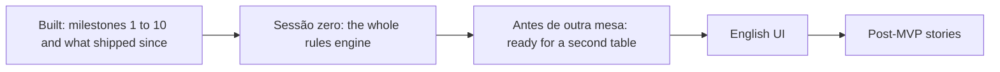

# Roadmap

The app is built, hardened, rehearsed and running in production (see [Operations](operations/README.md)).
The MVP, the table's first full session through the app, waits for the whole rules engine.
Two milestones come next, "Sessão zero" and "Antes de outra mesa", and then the English UI and the post-MVP stories.
There are no dates: the pace depends on everyone's free time.

## Done

| Milestone | What the table can do |
| --- | --- |
| Foundation | A monorepo with a Go server, protobuf contracts, CI and a local environment with its own sign-in provider. |
| Sign-in and campaigns | Sign in, create a campaign, invite players and join through an invite ([MR-001](product/stories.md#mr-001-create-a-campaign), [MR-002](product/stories.md#mr-002-generate-an-invite), [MR-003](product/stories.md#mr-003-join-through-the-invite)). |
| Characters | The sheet in the official layout computed from the SRD 5.1, NPCs, the sheet lock and the Game Master's approval of a new character ([MR-004](product/stories.md#mr-004-character-sheet-in-the-pdf-format), [MR-005](product/stories.md#mr-005-create-npcs), [MR-006](product/stories.md#mr-006-locked-sheet), [MR-024](product/stories.md#mr-024-approve-the-character-from-the-invite), [MR-049](product/stories.md#mr-049-reserved-characters-and-claim-links)). |
| Live session | Points of interest, maps without spoilers, starting and following a session, the campaign document, the image gallery and showing an image to the players ([MR-008](product/stories.md#mr-008-points-of-interest), [MR-009](product/stories.md#mr-009-map-without-spoilers), [MR-011](product/stories.md#mr-011-start-the-session), [MR-012](product/stories.md#mr-012-follow-the-session), [MR-018](product/stories.md#mr-018-campaign-document), [MR-019](product/stories.md#mr-019-image-gallery), [MR-028](product/stories.md#mr-028-show-an-image-to-the-players)). |
| Combat | Initiative, the 1.5 m grid, actions, spells, reactions, saves, death saves and the log ([MR-013](product/stories.md#mr-013-turn-order), [MR-014](product/stories.md#mr-014-your-turn)). |
| RP and XP | RP scene actions with player rolls, XP by enemies, gold, free-form or milestone, with undo ([MR-015](product/stories.md#mr-015-rp-scene-actions), [MR-016](product/stories.md#mr-016-award-xp)). |
| The table | Scene hooks and clues, player notes, NPCs on stage, combat highlights, the guided level-up and printing the map ([MR-029](product/stories.md#mr-029-scene-hooks-and-clues) to [MR-033](product/stories.md#mr-033-print-the-map-with-the-grid), [MR-040](product/stories.md#mr-040-level-up-from-the-sheet)). |
| Deep combat and map | Circle movement, jumping, cover, opportunity attacks, map layers, traps, per-player fog of war, treasure, and the character's creatures ([MR-034](product/stories.md#mr-034-special-movement) to [MR-037](product/stories.md#mr-037-creatures-of-the-character), [MR-041](product/stories.md#mr-041-treasure-and-xp-by-gold)). |
| Content and generation | The table's own content and rules, the dungeon generator, puzzles, AI-generated images, the bestiary, the encounter builder, the treasure generator, spell look-up, casting outside combat and the campaign package ([MR-025](product/stories.md#mr-025-register-table-content), [MR-010](product/stories.md#mr-010-generate-dungeons), [MR-038](product/stories.md#mr-038-puzzles), [MR-039](product/stories.md#mr-039-ai-generated-images-for-dungeons-and-scenes), [MR-042](product/stories.md#mr-042-bestiary) to [MR-045](product/stories.md#mr-045-look-up-spells), [MR-048](product/stories.md#mr-048-cast-spells-outside-combat), [MR-050](product/stories.md#mr-050-campaign-package-export-and-import)). |
| MVP gate | Hardening, rehearsals and the production deploy. |

Also built:

| What | Where it is described |
| --- | --- |
| The dice roll in a 2D tray, under the campaign's dice rule | [MR-052](product/stories.md#mr-052-the-free-dice-roller), [Design: rolls](design/session.md#rolls) |
| The map outside combat: the group on the map and the players moving their own characters | [MR-012](product/stories.md#mr-012-follow-the-session) |
| The light warning: the master is told of a character that sees nothing where it stands on a fog map | [MR-036](product/stories.md#mr-036-fog-of-war-by-sight), [Fog](architecture/maps/fog.md#the-masters-light-warning) |
| The master plays a character's turn for an absent player | [MR-053](product/stories.md#mr-053-the-master-acts-for-a-players-character) |
| Spell zones: Spirit Guardians, Moonbeam, Cloudkill, Web, Grease and Entangle keep their area on the map | [RN-37](product/rules.md#rn-37-areas-that-spells-keep-on-the-map), [Spell zones](architecture/play/spell-zones.md) |
| Compact screens: the turn is a strip from 1024 px, and the session page has a one-row bar | [MR-014](product/stories.md#mr-014-your-turn), [MR-012](product/stories.md#mr-012-follow-the-session) |
| A creature's actions from its turn, and answering its rider | [MR-054](product/stories.md#mr-054-use-a-creatures-action-from-its-turn), [MR-055](product/stories.md#mr-055-answer-a-creatures-rider) |
| Held rolls: the master answers every question the app asks about a held roll | [Held rolls](architecture/play/held-rolls.md) |

## Next

1. **"Sessão zero".** The MVP waits for it.
   It is made of the remaining features of the last wave (monster stat blocks, items on the sheet, more lasting zones ([#640](https://github.com/PuraFome/meuRPG/issues/640))) and the gaps in the engine under that milestone.
   Its acceptance test is a level-up ladder from level 4 to 12.
   The issues are on the [milestone](https://github.com/PuraFome/meuRPG/milestones), grouped there; this page does not list them.
2. **"Antes de outra mesa".** What must hold before a second table uses the app: [#657](https://github.com/PuraFome/meuRPG/issues/657), [#658](https://github.com/PuraFome/meuRPG/issues/658) and [#659](https://github.com/PuraFome/meuRPG/issues/659).
3. **English UI** ([#656](https://github.com/PuraFome/meuRPG/issues/656)).
   The screens are in Portuguese until then.
   Then the post-MVP stories below.

## After that

An idea the Game Master and the players asked for, with no story yet:

- A spectator screen.

Stories marked *Later* in [Stories](product/stories.md):

| Story | What |
| --- | --- |
| [MR-007](product/stories.md#mr-007-import-a-sheet-from-pdf) | Import a sheet from a PDF. |
| [MR-017](product/stories.md#mr-017-level-up) | The full level-up screen, with multiclass. |
| [MR-020](product/stories.md#mr-020-look-up-the-rulebook) | Look up the rulebook. |
| [MR-021](product/stories.md#mr-021-copy-a-character) | Copy a character to another campaign. |
| [MR-022](product/stories.md#mr-022-reuse-npcs) | Reuse NPCs in several campaigns. |
| [MR-023](product/stories.md#mr-023-hand-over-or-share-the-campaign) | Hand over or share a campaign. |
| [MR-026](product/stories.md#mr-026-propose-a-new-race-or-class) | The player proposes a race or class. |
| [MR-027](product/stories.md#mr-027-read-the-rules-from-a-pdf) | Read the rules from a PDF. |
| [MR-046](product/stories.md#mr-046-table-style-feature-by-feature) | Table style, feature by feature. |
| [MR-047](product/stories.md#mr-047-more-puzzles) | More puzzles. |

Other work: a list of past sessions with the summary of each, importing the characters of the old database, and the infrastructure items below.

## Infrastructure not built yet

- A shared channel for the live-session fan-out (a CockroachDB changefeed or Pub/Sub), which lifts `max-instances` above 1.
- Enforcing the Cloud Armor OWASP rules after reading their matches from real sessions.
- A production log pipeline from Cloud Logging to the ELK stack.
- Evaluating CockroachDB against Cloud SQL.
- Automating the release and the infrastructure.

## See also

- [Stories and acceptance criteria](product/stories.md)
- [Architecture](architecture/README.md)
- [CONTRIBUTING.md](../CONTRIBUTING.md)
