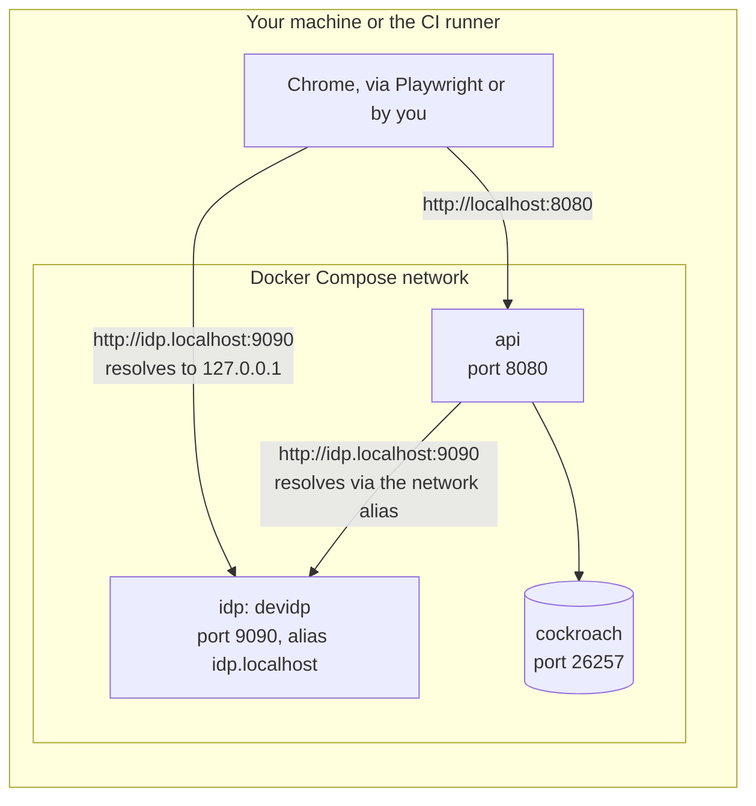

# Testing

Every acceptance criterion of a story becomes an automatic test, and a story is done only when its tests pass.
Tests run in layers, and none depends on an outside identity provider.
This page says what each layer proves, how to run it and what CI runs; the CI jobs themselves are in [CI](ci.md).

| Layer                     | Tool                                                   | Proves                                                             |
| ------------------------- | ------------------------------------------------------ | ------------------------------------------------------------------ |
| Unit                      | `go test`, case tables                                 | The `rules` maths and each business rule alone, with no database   |
| Characterization (golden) | `go test`, golden files under `testdata/`              | What a function answers, refuses and writes stays as reviewed      |
| Integration               | `go test` with `MEURPG_TEST_DATABASE_URL`              | Queries, migrations, the retry on error `40001`, who may do what   |
| Architecture              | `go test`, `backend/internal/archtest`                 | Module boundaries and no production import of the test dice (it reads the source with `go/parser`) |
| Leak (RN-10)              | `go test` with a database, `backend/internal/leaktest` | What the master hid never reaches a player                         |
| Web unit                  | Vitest through `ng test`                               | Components and services                                            |
| End to end                | Playwright in `e2e/`, against the local stack          | Acceptance criteria through the screen                             |
| Accessibility             | axe in Playwright                                      | No serious or critical WCAG 2.1 A/AA violation on each main screen |

## Go unit and characterization tests

`make test` runs `go test -race ./...` in `backend/`; tests that need a database skip without `MEURPG_TEST_DATABASE_URL`.
The `rules` packages are pure (no database, Docker or network) and are the fast loop for the engine:

```bash
cd backend
go test ./internal/rules/...                              # the engine, the SRD snapshot, the formulas
go test ./internal/rules -update                          # rewrite every golden of the package (testdata/golden/*.json) after an intentional change; review the diff
go test ./internal/rules/dungeon -update                  # changing the generator's output also requires bumping Version in types.go
```

Characterization tests pin what a function answers, refuses and writes, so that it can be split without changing it (see [CI](ci.md#complexity-limits)); they sit next to the code in every module, with their golden files under `testdata/` (the sweeps of `rules/grid`, `vision`, `puzzle`, `combat` and `encounter` keep `testdata/*.sha256` hashes instead).
A failing one means the output changed, which is not necessarily wrong: read the diff, and if the change is intended, refresh the files with the package's `-update` flag.
Run a new golden test with `-count=5` once before committing it: a Go map's order is random, and a golden that depends on it fails only some of the time.
In `internal/play` the goldens are written with `UPDATE_GOLDEN=1 go test -run <name> ./internal/play`. `runGolden` plays each scenario on a fight of its own and compares the blocks by name; `wantGolden` compares one whole text; both live in `harness_test.go`, with `wantRefusal` for a refusal's code and exact message. A block prints `state unchanged` when the call left every printed table as it found it, so a refusal that writes nothing reads as one line. `testdata/turn_options.golden` prints the turn options of a hero and viewer whole once and the other scenarios as how they differ from it.
Golden files outside `internal/rules` are compared by `backend/internal/platform/goldentest` (`Compare`, `JSON`, `Names` for IDs, `MaskTimes`), and `go test ./internal/<pkg> -update` rewrites them: one flag for every package that uses it; read the diff.
Stored session events keep decoding as the code changes: `internal/play/testdata/events/<kind>/` holds one payload for each shape the code has written (today's, from the writer's type with every field set; hand-copied ones from other modules; older ones from the commit that first wrote the kind), and `TestStoredPayloadsDecode` reads each with the undo, the combat log, the highlights and the summary, with no database. A new kind of `session_event_kinds` fails `TestEveryEventKindHasAStoredPayload` until it has a fixture; `go test ./internal/play -run TestTodaysPayloads -update` writes today's.
`dbtest.QueryFaults` fails a sqlc query by name (`Arm`, or `ArmOnce(name, skip)` after skipping runs), so a test reaches a database-error path without a broken database; wrap the service pool's tracer with it.
Other pure suites: `rules/grid` and `rules/vision` (geometry, movement, cover, sight), `rules/puzzle` (the puzzle maths), `rules/encounter` (the party budget and the generator) and `rules/dungeon` (properties over many options; `DUNGEON_SWEEP=1` adds a sweep of thousands of combinations).
Fuzz targets exist for the formulas (`FuzzCompileFormula`), the dungeon options (`FuzzOptions`), the encounter generator (`FuzzGenerate`) and the treasure generator (`FuzzGenerateTreasure`).
CI does not run them, so run them when you touch that code:

```bash
go test ./internal/rules/formula -run '^$' -fuzz FuzzCompileFormula -fuzztime 30s
```

The content loaders refuse malformed content, and `TestSnapshot`, `TestReferences`, `TestNamesPT` and the `*PT` coverage tests fail when content is missing; see [Rules content](rules-content.md).

## Integration tests

Integration tests run against a real CockroachDB: set `MEURPG_TEST_DATABASE_URL` and run `make test`.
Without the variable they skip; with `MEURPG_REQUIRE_DB=1` (CI sets it) a missing variable fails them instead (`backend/internal/platform/testenv`).

```bash
make db-test-start        # an in-memory CockroachDB on port 26258
MEURPG_TEST_DATABASE_URL='postgresql://root@localhost:26258/defaultdb?sslmode=disable' make test
make db-test-stop
```

Port 26257 (the `make up` or native database) also works, but the in-memory test database is faster and does not fill the development database.
More than one test database can run at once on different ports; see [Development](development.md#test-databases).

How `backend/internal/platform/dbtest` shapes the tests:

- **Databases are reused.** Migrations run once into a template database named after a hash of the migration files (`meurpg_tpl_<hash>`). A package copies the template's tables into as many test databases as it runs tests at once, and between tests only empties them with `DELETE`, child tables first. Parallel tests never share a database. Templates of old migration sets stay on the test server, empty, and can be dropped with `DROP DATABASE meurpg_tpl_... CASCADE`.
- **Seeded tables survive.** Rows a migration inserts into a reference table (listed in `referenceTables`) are in the template and never emptied. A new table of that kind goes into that list.
- **Every package that uses a database has a `TestMain` calling `dbtest.Main(m)`**, which drops the databases the package created. An interrupted run leaves `meurpg_<package>_test_...` databases to drop by hand; stopping `make db-test-start` deletes everything.
- **Each test pool has one connection** (`MaxConns = 1`) and tracks `Acquire`. A read through the pool from inside a `db.InTx` fails the test at once, with the stack, and a wait longer than 90 s for a connection brings down the package's test binary. So the suite proves that no write takes a second connection (see [Architecture](architecture/transactions.md#transactions-and-the-connection-pool)).
  - A test that races transactions asks for a bigger pool before building the harness, `dbtest.PoolSize(t, n)` with `n` at least the number of runners, and starts them together with `start := dbtest.NewBarrier(n)` and `start.Wait()` first thing in each goroutine.
  - A test that holds a transaction open while the service works uses `dbtest.SideConnection(t, pool).Begin(...)`.
  - `MEURPG_TEST_POOL_MAX_CONNS=8` applies to the whole process and lists all the violations at once.
- **Migrations are tested from scratch** by `backend/migrations`. `TestMigrationsAreSafeToRerun` requires every migration to run twice without error, and `TestEveryEventKindOfTheCodeIsInTheTable` requires every session event kind of the code to have a row in `session_event_kinds`. The rules for writing a migration are in [Data](data/README.md).

### Dice in tests

The services roll with deterministic dice in tests: `backend/internal/platform/dice/dicetest`, or `play`'s `scriptedRoller`.
The app rolls an NPC's initiative, and two combatants with the same total take one joint turn, so a random tie makes a test that assumes one actor fail by chance.
`play.New` and `characters.New` reject a nil `Roller`.
Production passes `dice.Crypto{}` explicitly.
Tests pass `dicetest.New()` or a scripted roller.
The harnesses of `leaktest`, `progression`, `maps`, `campaignpackage` and `characters` hand the services a `dicetest.New()`.

- **The default is fixed.** The same calls give the same faces, and the roller never runs out.
- **Same bonus never ties.** On a roller that has rolled no other d20, up to 20 creatures with the same initiative bonus get 20 different totals.
- **Different bonuses can tie.** Only four creatures whose bonuses are within 5 of each other are safe, on such a roller.
- **Script the d20 of an attack or a save rolled before the initiative.**
  Every unscripted d20 takes the next face of the default sequence.
  Scripting those rolls keeps the sequence where the test expects it.
- **A test pins a roll with `ScriptFor(t, sides, faces...)`.**
  The faces go to the next rolls of that die only, and the default goes on after them.
  A face that does not fit its die fails the test at once.
  A scripted face that is never rolled fails the test at the end, naming the die and the faces.
  The check belongs to the test that first scripts the roller: script through the test that built it.
  A test scripts only the rolls it makes.
  It also asserts the roll a face was for, such as `requireOwnTotal`, because a later roll of that die can take a face its own roll left.
- **A creature added to a running combat is scripted and checked.**
  The master cannot set its initiative after the combat began, so the test scripts the d20 (`scriptD20`).
  It then calls `requireOwnTotal` (`requireOwnTotals` in `progression`).
  A tie fails with "script the faces with ScriptFor", on every run.
- **`play` rolls with its own `scriptedRoller`.**
  It gives the lower of 10 and the die's sides when no face is queued.
  Creatures with the same bonus tie by default in its tests, and that is deterministic.
  A test that needs one actor queues its faces.

Production keeps `dice.Crypto`: nothing in a production build selects the test roller, and `archtest` fails for any non-test file that imports `dicetest` or a package under it.
That rule also fails when it finds no test file that imports `dicetest`, so a walk of the wrong tree cannot pass.
The end-to-end tests roll with `dice.Crypto`, so an NPC's initiative total can tie with another combatant's at random.
An e2e helper types the initiative of every creature it adds, with `SubmitInitiative` and `d20Face`, before the combat begins.
The helpers are `beginAttackCombatRPC` and its `monsters` argument for an SRD creature.
A creature added to a running combat is rolled by the app and cannot be typed.
A test that depends on who acts starts the combat with that creature.
`beginAttackCombatRPC` fails when a creature added that way has the same total as another combatant.

### Leak tests (RN-10)

`TestLeakMatrix` (`backend/internal/leaktest`) proves in one test that a player never receives what the master hid, on every read and every stream event.
The per-feature `TestRN10_*` tests remain; this one sits on top of them and does not let a new read escape.
It runs against CockroachDB with all modules wired as in `cmd/api`, the production table-content source and the real HTTP stack; only sign-in is swapped, by a test header.

**The scenario** (`world_test.go`) is a campaign where the master created one hidden thing of each kind: maps, points, traps, treasures, NPCs and creatures, reserved characters, combat, scenes, puzzles, images and table content.
Every free-text field carries a unique marker (`LEAKCANARY-<kind>-<n>`), secret numbers are improbable (4,321 HP, 7,777 gp, DCs from 25 to 29) and the hidden things' IDs are recorded.
The people are the master, two players whose characters see different parts of a fogged map, a pending member, a stranger and someone without a session.

**The reads table** (`reads_test.go`) has a row per read that matters: the procedure constant (for example `mapsv1connect.MapServiceGetMapProcedure`), the request and who may read.
Each row is asked by each person through the app's own path (Connect with JSON).
The master is the positive control; whoever may not read must get an error that says nothing.
Every response goes through three checks (`inspect_test.go`):

1. The raw body has no marker and no ID of a hidden thing.
2. The message, read field by field with `protoreflect`, has no secret number in a numeric field. A small number such as a DC only counts in fields whose name has `dc`; a number is never searched in text.
3. The master-only fields (`masteronly_test.go`: an explicit list of message and field, each with its reason) are empty for a player. `TestMasterOnlyFieldsExist` fails if an entry stops existing in the `.proto` files.

A marker a player may read has readers, and the test demands it in their responses (`canaries_are_reachable`); every marker must also appear in some master response, or the kind goes to the `unreachable` list with a reason, because a needle nobody finds proves nothing.
`inspect_unit_test.go` tests the checks themselves without a database: each layer gets a response with a planted leak and must find it.

The rest of the test, in order:

- **The players' actions** (`actions_test.go`) run before the reads, so the reads see what the actions left.
- **Images and fog tiles** are requested by each person. Whoever may gets `200`; the others get `404`, like an image that does not exist. Two players must receive different tiles, or the test could not tell a tile of theirs from one that is not.
- **State the matrix does not reach** (`firedtrap_test.go`, `notescenes_test.go`).
- **What is not a read** (`classify_test.go`): each RPC that writes is asked by someone who is not the master, with the IDs of the hidden things (`probe_test.go`). A master-only RPC never answers `OK`, and no error says what the request aimed at.
- **The stream** (`stream_test.go`): the master and two players open `WatchGameSession`; the others are refused. Everything the stream announces is done, every read is asked again, and each event goes through the same three checks. An event kind the script does not cause fails the test unless it is in `notTriggered` with a reason.

**The completeness guard** `TestEveryProcedureIsClassified` (no database) reads the services' descriptors and fails for a procedure that is not in exactly one table: the reads (`reads`, `readsAfterTheCombat`, `readsAfterTheSession`), the actions (`actions`) or the rest (`notReads`, with the class and the reason).
A new RPC must be classified for the suite to pass.

To add a read, add a row to `reads`; if the response may carry something the scenario does not hide yet, add that thing to `world_test.go` with a marker in each text field.
To add an RPC that writes, add a row to `notReads`.
A failing check names the procedure, the person, the field and the needle.
If it is a product decision and not a defect, the row carries `ignore` with the reason, never a looser test.
`LEAKTEST_LOG=1` shows the servers' log, to find out why a scenario call failed.

**Needles.** What a test looks for in an answer, to prove something hidden did not arrive, is a unique marker that is neither hexadecimal nor a word, an exact ID or a secret number in a numeric field; never a short word or a piece of text (the letters `dc` appear in one UUID in 65).
Every test that looks for something absent needs a positive control that shows the same needle in the answer of someone who may read it.

### Architecture tests

`backend/internal/archtest` asserts the module boundaries: from another module only its `link` package or a shared root may be imported, nothing imports `cmd/`, and every module-level dependency is in a table (a new dependency fails until it is added on purpose).
It also holds the import rule of [Dice in tests](#dice-in-tests).
See [Architecture](architecture/overview.md#module-boundaries-are-a-test).

## Before ready

`make before-ready` runs only the lines of the list that your change can affect (a line runs when the change reaches its package, what it imports or what it reads; `make before-ready ALL=1`, or `BEFORE_READY_ALL=1`, runs every line), against the test database like `make test`.
It exists because a change often makes stale a test that nobody thought to run: a golden file, a hash, a frozen table or refusal message, a stored event fixture, or a list that must name every service method, error reason or event kind.
Run it before you write `ready:` (the status commit a session pushes when its branch is final) and before you open a pull request.
The rule for what belongs in it: the tests that compare against a stored file or against literals the project froze (names with `Frozen` or `Golden`), and the inventory tests.

```bash
make db-test-start
export MEURPG_TEST_DATABASE_URL='postgresql://root@localhost:26258/defaultdb?sslmode=disable'
make before-ready
```

By default it runs only the lines of the list that the change can affect. It compares the working tree (committed, staged, unstaged and untracked files) with the merge base on `origin/main`, and a line runs when the change touches:

- any file under the line's package directory, at any depth: sub-packages, `testdata/` and embedded data included;
- a package the line's tests import, directly or not (the dependencies that `go list -test` reports for the package and its tests): a change in `internal/rules/combat` runs the `internal/play` goldens, and a change in `internal/play` runs the lines of the packages that import it;
- a file under `proto/` (the lines of the packages that import the generated code), or one of the line's `inputs`, the fifth column of the list: the files its tests read outside their package, such as `proto/error-reasons.json`, `backend/migrations`, `NOTICE` or `web/src/app/pages/credits/credits.ts`.
  `TestBeforeReadyInputsAreComplete` fails for a path that goes up from the package, that a listed test reads, and that no input of its line covers.
  An input `.` covers the whole repository, so it selects its line for every changed file; the `internal/archtest` line avoids it.
  The test also fails for a `..` next to a base it cannot resolve, naming the file and line.
  It cannot see a path built at run time with no `..` in it, or one read in another package.
  How a path is resolved is in the comment of `upwardReads` in `backend/internal/archtest/before_ready_paths_test.go`, and its cases are the fixtures under `backend/internal/archtest/testdata/`.
  That every input exists is checked by the tests of `backend/internal/archtest/beforereadylist`, which read the whole repository and are on no line;
- the tool itself (`.github/scripts/before-ready.sh`, the `Makefile`, `backend/cmd/beforeready`, `backend/internal/archtest/beforereadylist`) or the dependencies (`backend/go.mod`, `backend/go.sum`): every line runs. A change to `backend/internal/archtest/before_ready.txt` runs the lines it adds or edits, and the `internal/archtest` line.

A change that touches none of this (web, docs) runs nothing, says so and exits 0, without asking for the database.
The output names each package that runs and the changed file or import that selected it, then the packages it skipped.
When the selection cannot be computed (no merge base, no `origin/main`, `go list` fails) it runs every line and says why: it never runs nothing for lack of knowledge. A failure of the selection step itself (an unreadable list, an unwritable output file, an invalid `ONLY`) is different: it exits 2 and runs nothing.

`BEFORE_READY_ALL=1` (or `make before-ready ALL=1`) runs every line, whatever the change; any value but empty or `0` does the same.
To measure a run, time it: `time make before-ready` for the default run, `time make before-ready ALL=1` for the whole list.
`ONLY` narrows the lines that would run, or every line with `ALL=1`: `make before-ready ONLY='internal/play$'` (a Go (RE2) regex on the package directory, written as typed, `$` and quotes included; `BEFORE_READY_ONLY` is the same variable; a pattern that RE2 cannot read, or that matches no package of the list, stops the run with exit 2; the packages the change selected but `ONLY` left out are listed as skipped, and when nothing is left the output says that nothing ran), and `make before-ready ALL=1 ONLY='internal/play$'` runs that group whatever the change.
`BEFORE_READY_BASE=<revision>` compares the working tree with that revision instead of the merge base (`HEAD`: only what is not committed yet).
`BEFORE_READY_JOBS` sets how many packages run at once (4 by default).
`BEFORE_READY_LIST=<file>` runs another list in the same format, to try a few tests: every line of it runs, whatever the change, and the output says so.

Without `MEURPG_TEST_DATABASE_URL` it stops and says how to set it, because those tests would skip and pass for nothing.
On a failure it prints the command that rewrites the failed test's file (`-update`, `UPDATE_GOLDEN=1` or the package's own flag), or says to edit the expected values by hand when there is no generator.
Rewrite a file only when the change is intended, read the diff of every rewritten file before you commit it, and run a new golden test with `-count=5` once, because a Go map's order is random.

The tests, grouped by package, and the command that regenerates each group are in `backend/internal/archtest/before_ready.txt`: one place, one tab-separated line for each group.
A test that turns a second train round red (a train round is one CI run of the merge train) is added to it.
The list says, for each line, its package, the `-run` regex, the regenerate command and the inputs.
`TestBeforeReadyListIsWhole` keeps it whole. It fails for a test that reads a `.golden`, `.sha256` or `testdata` file (or a constant that holds one), calls `goldentest.Compare` or `goldentest.JSON`, reads a `flag.Bool` or a variable named for the frozen digests or the goldens, and is on no line of its package; for a line that matches no test; and for a `helper` line whose plain function its package does not declare (a method cannot be a helper: the guard follows plain calls only). It looks at every package under `backend/` that has tests, skipping only `testdata`, hidden directories and the generated protobuf package `backend/gen`. The list is read by the same parser, `backend/internal/archtest/beforereadylist`, that the tool uses, and a path is covered by an input by the same function.
It follows plain function calls of the same package, not method calls (names collide between types), so a test that compares through a method keeps to a naming convention in its line, for example `TestLasting(Core|RPC)` in `internal/play`, and `Frozen|Golden` names are on the list by their name.

## Web unit tests

`make web-test` runs `cd web && npm test` (Vitest through the Angular `unit-test` builder).
The spec files are not isolated from one another, so the shared setup keeps tests independent of file order:

- `web/src/test-setup.ts` undoes every `vi.stubGlobal` and restores real timers after each test, and gives each test fresh `scrollIntoView` and `window.scrollTo` mocks (jsdom has none).
- `web/src/test-providers.ts` turns off the Material animations.
- `fakeCombatClient({ rollAttack, ... })` (`web/src/app/core/combat/combat-client-testing.ts`) builds a `CombatClient` from the calls a spec answers, each placed in the part that owns it; `anyCallCombatClient` answers every call by name.
- A spec settles a component with `settle(fixture)` or waits one turn with `nextTurn()` from `web/src/test-settle.ts`, never with its own `setTimeout` (ESLint fails a `setTimeout(` in a `*.spec.ts`): under a fake clock the turn advances that clock instead of waiting for a timer that would never fire.
- A spec that turns a fake clock on (`vi.useFakeTimers`) or stubs a global also undoes it in its own `afterEach`, because with `--coverage` the setup file's hooks reach only the first file of each worker.

Coverage: `cd web && npx ng test --watch=false --coverage --exclude src/test-setup.spec.ts` writes `web/coverage/` (the exclusion is what CI runs: the setup file's own spec cannot run under `--coverage`).
The floors are `coverageThresholds` in `web/angular.json`; see [CI](ci.md#coverage-floors).

## End-to-end tests (Playwright)

The acceptance tests through the screen live in `e2e/`, a Playwright project with its own `package.json` and pinned versions.
`make e2e` starts the local environment (like `make up`), installs the `e2e/` dependencies if missing, runs the tests and prints where the HTML report is (`cd e2e && npx playwright show-report`); the stack stays up until `make down`.

- Locally the tests drive the installed Google Chrome (`channel: 'chrome'`); in CI they drive the Chromium that `npx playwright install chromium` downloads, at the version pinned by `package-lock.json`. `E2E_BROWSER_CHANNEL` overrides both (empty means Playwright's Chromium). `E2E_BASE_URL` and `E2E_IDP_ORIGIN` point the suite at another stack.
- In CI every shard but plain 1/3 restores the backup the `database` job of `e2e` made (seed rows included) once CockroachDB is up, before `migrate` and the API start.
  Plain 1/3 migrates an empty database, so a broken migration fails e2e.
  See [CI](ci.md#end-to-end).
- In CI each shard runs a list of tests balanced by measured time (`e2e/timings.json`), not Playwright's own `--shard`.
  A new test needs no change to the file: it runs in the shard with the least time.
  The command that refreshes the file is in [CI](ci.md#end-to-end).
- There are no retries (`retries: 0`, checked by the e2e lint job) and no `test.skip` or `test.fixme` (the e2e lint fails on both): a flaky acceptance test is a bug to fix. See [Reproducing a flaky test](#reproducing-a-flaky-test).
- Each test that proves an acceptance criterion carries the story's or rule's tag, such as `@MR-001`; `npx playwright test --grep @MR-001` runs only that story's.
- RPCs from a test go through `page.request` (same cookies as the page) with `Connect-Protocol-Version: 1`.
- The dice animation never moves (`reducedMotion: 'reduce'`): the dice sit still in a card that neither dims nor blocks the page, so no overlay covers a control and layout checks measure a still screen.

**Sign-in and session reuse.** Sign-in goes through the devidp, clicking the test user as a person would.
`/auth/login` and `/auth/callback` share a per-client rate limit (`loginRateLimit` in `backend/internal/identity/login.go`), and signing in for every test exceeds it.
So the suite signs in for real only where signing in is the criterion (`login.spec.ts`, `ui.spec.ts`, the "visitor" half of `invite.spec.ts`).
Everything else reuses a session: the `setup` project (`e2e/tests/auth.setup.ts`, which the `chrome` project depends on) signs in once as "Mestre Teste", "Jogador Teste" and "E-mail Não Verificado" and saves each `storageState` in `e2e/.auth/` (git-ignored: it is a secret).
Tests then use `newSignedInContext(browser, 'Jogador Teste')` or `test.use({ storageState: authStatePath(...) })` from `e2e/tests/support.ts`.

- A test that signs out never reuses a session: it ends the real session on the server and would break every other test sharing it.
- `browser.newContext()` without an explicit `storageState` inherits the one a file set through `test.use()`; a context that must start signed out lives in a file with no `test.use()` at all.
- Only two player accounts have a saved state, so a table has the master and at most two players: `conversa.spec.ts` (RN-36) proves "a reader who was not chosen" with Pensantus and Toren, one chosen and the other not, and waits on a later line for everyone before it asserts that something is absent.
- No test sets the display name of the shared accounts: `ui.spec.ts` expects "Minha conta", the default text with no name set.

**Accessibility.** `a11y.spec.ts` runs axe (`@axe-core/playwright`) on the main screens in the light and dark themes, on desktop and mobile, and fails on any serious or critical violation of WCAG 2.1 A and AA.
On the same screens it runs the alignment checks of `e2e/tests/layout.ts`: an icon at the height of its own words, button content in the middle of it, nothing on top of an icon, words away from the edge of a radio card (see [Design](design/README.md#how-a-screen-is-made)).
`npx playwright test --grep @a11y` runs only it. Every new screen enters this file.

**e2e linters.** `cd e2e && npm run lint:install && npm run lint` runs ESLint with `no-floating-promises`, `await-thenable` (a missing `await` is the classic Playwright flake) and `eslint-plugin-playwright`.
`e2e/lint/` is its own small package because typescript-eslint needs an older TypeScript than the one `e2e/` type-checks with.
See [CI](ci.md#web-and-e2e-linters).

**Waiting for the page to show a change.**
A call that changes the server over RPC (`combatRPC`, `startEncounterRPC`, `passTurnsTo`, ...) answers at once, but the page learns of it a moment later.
A click in that gap acts on the old screen.
So a spec waits until the page shows the change before its next page action:

```ts
const enc = await combatRPC(m, 'EndTurn', { campaignId, encounterId, expectedCombatantId });
await waitForEncounterRevision(m, enc);
await m.getByRole('button', { name: 'Próximo turno' }).click();
```

- `waitForEncounterRevision(pages, encounter)` is in `e2e/tests/revision-support.ts`.
  Its failure names the combat, the revision expected and the one shown (`-1` means no combat view, or another combat).
- Wait on the page the next action uses.
  If the master and a player both act next, wait on both: `waitForEncounterRevision([m, p], enc)`.
- Wait only on a page that shows the session (`/campaigns/<id>/session`).
  A page elsewhere has no combat view and reads the state itself when it opens, so the helper fails at once for it.
- A player's revision on a fog-of-war map is not the server's number, so it cannot be waited on.
  Wait for the player's screen to show the change itself.
  Without fog (no map, or a map with the fog off) the player's page works.
- A move on a map gives the page no new revision, so the rule ignores it: wait for what the page shows.
  A change that touches only hidden combatants reaches the master alone.
  Wait for what the page shows there too, and put `// eslint-disable-next-line meurpg/rpc-revision-wait -- why` on the call.
- A page with no combat view (the bestiary, a player after the combat ended) cannot show a revision: disable the rule on that call with the reason.
- `meurpg/rpc-revision-wait` (`e2e/lint/rules`) is an error when an awaited helper that returns an `Encounter` is followed by a page action with no wait on that action's page.
  A wait that comes after the action, or on another page, does not count.
  A page action is a call on a Playwright `Locator`, `Page`, `Frame`, `ElementHandle`, or the page's keyboard, mouse or touchscreen, so `Set.clear()` is not one.
  The actions are `click`, `dblclick`, `fill`, `press`, `pressSequentially`, `check`, `uncheck`, `setChecked`, `selectOption`, `type`, `hover`, `focus`, `tap`, `dragTo`, `dragAndDrop`, `dispatchEvent`, `selectText`, `setInputFiles`, `clear`, and the keyboard's and mouse's `down`, `up`, `insertText`, `move` and `wheel`.
  The rule reads the receiver's type, where Playwright declares it: an app type called `Page` is not a page, and a receiver typed `any` is not seen.
  A callback of a directly awaited call (`await test.step(..)`) runs where it is written: the rule reads into it, and judges a call that ends it with what follows.
  `return step(..)`, `Promise.all([..])` and a step stored in a variable are not followed.
  A handler the page calls later (`route`, `exposeFunction`, the predicate of `waitForEvent`) or that nobody awaits (`page.on`) is not that moment.
  An action on a page the rule cannot name (a `Frame` or `ElementHandle` variable) is cleared by any wait.
  `goto`, `reload`, `openSessionPage`, `openPlayerMap`, `gotoCampaignTab` and `openLive` count as a wait, because the page then reads the state itself.
  Reads (`get*`, `list*`, `read*`) and moves (`MoveCombatant`, `movePensantus`) need none.
  The rule asks for a wait on every page that acts, because it cannot tell which pages show the session.
  It does not see calls that answer with nothing (a scene roll), helpers that click inside, or the next turn of a loop.
- The rule has no baseline: do not add suppressions for it.
  `npm run lint:test` runs it on `e2e/lint/fixtures`: `bad.ts` must fail and `fixed.ts` must pass.
- The combat view carries `data-encounter-id` and `data-encounter-revision` for the specs; nothing in the app reads them.

A failed CI run keeps `stack-logs/stack.log` (every container of the stack, with timestamps) in the `playwright-report-*` artifact.
The `flake-check` traces artifact (`flake-traces-*`) holds the same file, one per job.

## Reproducing a flaky test

A red test is a bug in the test or in the app until the evidence says which ([CI](ci.md#flaky-tests) has the rule and the banned fixes). Read the artifacts first, then reproduce before you fix.

- **Read the artifacts.** Playwright: `error-context.md`, the screenshots and the trace through the CLI: `npx playwright trace actions <trace.zip>` lists the steps, `npx playwright trace action <trace.zip> <n>` shows the one that failed. Go: the log and the stack of the panic.
- **Ask whether the app is wrong.** A page that kept a stale state, a request canceled early, an answer that arrived after the click: the fix is in the app and carries a unit test that fails without it.
- **Playwright:** `npx playwright test --grep "<title>" --repeat-each=<n>` repeats one test; `--shuffle <seed>` runs the files and tests in a random order, and the same seed gives the same order; `--workers=<n>` changes how many run at once. Run it in both colour schemes with `E2E_COLOR_SCHEME=light` and `=dark` for a test that does not pin one.
- **Go:** `go test -race -count=<n> -run '^TestName$' ./internal/pkg` repeats a test; `-shuffle=on` runs the tests of a package in a random order and prints the seed (`-shuffle=<seed>` repeats that order); `-race` is always on in CI.
- **On CI:** the [`flake-check`](ci.md#flake-check) workflow runs a test many times with and without a branch, on runners of their own.

A failure you cannot reproduce gets diagnostics that will explain its next occurrence (an assertion message that names the state, a log line, a screenshot at the step), and a note that says so. It never gets a guessed fix.

**When it is fixed.** The fix fails before and passes after, over about 3/p clean runs, where p is the failure rate you measured, and never fewer than 30: at p = 10% that is 30 runs, at p = 2% it is 150. A fix proved by one green run proves nothing. A new or changed test is repeated 10 times before it is pushed, and the repeat job of the pull request does it again ([CI](ci.md#repeat-of-the-changed-tests)).

## The devidp and the test identity provider

The Go tests use a fake OIDC provider (`backend/internal/identity/oidctest`) inside the test itself: HTTPS with `httptest`, signing the user in on the spot, so a test can break one thing at a time (claims, signing key, discovery).
The e2e suite uses the **devidp** (`backend/cmd/devidp`), the same provider served with a page that lists the test users.
It implements only what sign-in needs: discovery, JWKS with an RSA key generated at startup, `/authorize` with mandatory PKCE S256, `state` and `nonce`, `/token` for a confidential client, an RS256 ID token with `email`, `email_verified` and `auth_time`, and `max_age` and `prompt` measured against its own session.
With the `MEURPG_TEST_OIDC_*` variables (listed in the comment of `TestRealProviderSignIn` in `backend/internal/identity`) a test signs in for real with a local provider, without a browser.
The test users and the guards that keep the devidp out of production are in [Development](development.md#sign-in-with-the-devidp).

The issuer is `http://idp.localhost:9090` for both sides: the browser resolves any `*.localhost` to `127.0.0.1` by itself (RFC 6761) and reaches the devidp through the published port, and the API container reaches the same name through the `idp.localhost` network alias.
With the same string on both sides the ID token's `iss` matches `OIDC_ISSUER`.



The `__Host-meurpg_session` cookie requires `Secure` and still works on `http://localhost`, because Chrome treats `localhost` as a secure context.
Safari does not accept it, so local sign-in is in Chrome or Firefox.

## What CI runs

| Layer                                                  | Job                              |
| ------------------------------------------------------ | -------------------------------- |
| Go tests (all packages, with `-race` and the database) | `go-db`, nine groups in parallel |
| Web unit tests, lint, format, import rules, build      | `web / test and build`           |
| Web coverage                                           | `web / coverage`                 |
| Playwright tests and the accessibility checks          | `e2e`, in shards                 |
| Playwright lint and type-check                         | `e2e / lint and typecheck`       |
| The tests a PR changes, repeated                       | `repeat-changed`                 |

Details, triggers and gates are in [CI](ci.md).
