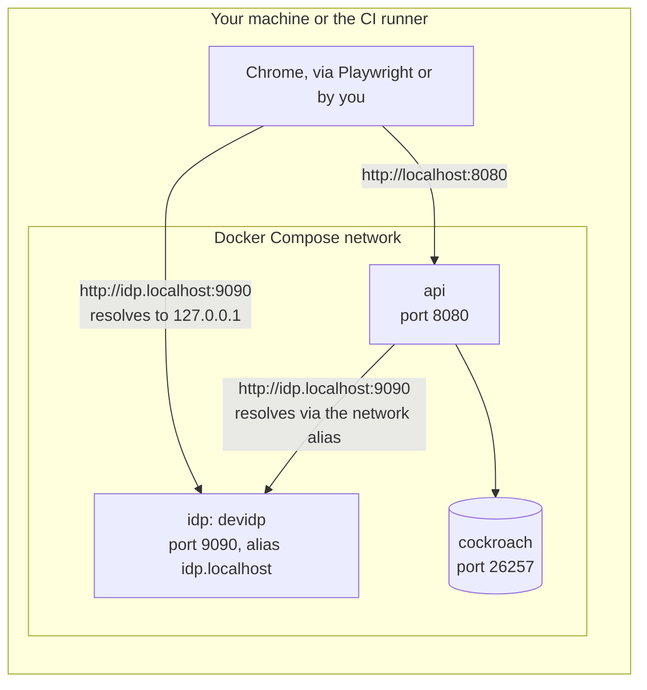

# Testing

Every acceptance criterion of a story becomes an automatic test, and a story is done only when its tests pass.
Tests run in layers, and none depends on an outside identity provider.
This page says what each layer proves, how to run it and what CI runs; the CI jobs themselves are in [CI](ci.md).

| Layer | Tool | Proves |
| --- | --- | --- |
| Unit | `go test`, case tables | The `rules` maths and each business rule alone, with no database |
| Characterization (golden) | `go test`, `testdata/golden/*.json` and `*_characterization_test.go` | The numbers the rules engine produces stay as reviewed |
| Integration | `go test` with `MEURPG_TEST_DATABASE_URL` | Queries, migrations, the retry on error `40001`, who may do what |
| Architecture | `go test`, `backend/internal/archtest` | Module boundaries (it reads imports with `go/parser`) |
| Leak (RN-10) | `go test` with a database, `backend/internal/leaktest` | What the master hid never reaches a player |
| Web unit | Vitest through `ng test` | Components and services |
| End to end | Playwright in `e2e/`, against the local stack | Acceptance criteria through the screen |
| Accessibility | axe in Playwright | No serious or critical WCAG 2.1 A/AA violation on each main screen |

## Go unit and characterization tests

`make test` runs `go test -race ./...` in `backend/`; tests that need a database skip without `MEURPG_TEST_DATABASE_URL`.
The `rules` packages are pure (no database, Docker or network) and are the fast loop for the engine:

```bash
cd backend
go test ./internal/rules/...                              # the engine, the SRD snapshot, the formulas
go test ./internal/rules -run Golden -update              # rewrite testdata/golden/pensantus.json after an intentional change; review the diff
go test ./internal/rules -run TableCharacterGolden -update
go test ./internal/rules/dungeon -run Golden -update      # changing the generator's output also requires bumping Version in types.go
```

The `*_characterization_test.go` files in `internal/rules` pin the behaviour of the engine's large functions; a failing one means the output changed, which is not necessarily wrong, so review it.
Other pure suites: `rules/grid` and `rules/vision` (geometry, movement, cover, sight), `rules/puzzle` (the puzzle maths), `rules/encounter` (the party budget and the generator) and `rules/dungeon` (properties over many options; `DUNGEON_SWEEP=1` adds a sweep of thousands of combinations).
Fuzz targets exist for the formulas (`FuzzCompileFormula`), the dungeon options (`FuzzOptions`), the encounter generator (`FuzzGenerate`) and the treasure generator (`FuzzGenerateTreasure`).
CI does not run them, so run them when you touch that code:

```bash
go test ./internal/rules/formula -run '^$' -fuzz FuzzCompileFormula -fuzztime 30s
```

The content loaders refuse malformed content, and `TestSnapshot`, `TestReferences`, `TestNamesPT` and the `*PT` coverage tests fail when content is missing; see [Rules content](rules-content.md).

## Integration tests

Integration tests run against a real CockroachDB: set `MEURPG_TEST_DATABASE_URL` and run `make test`.
Without the variable they skip; with `MEURPG_REQUIRE_DB=1` (CI sets it) a missing variable fails them instead (`backend/internal/platform/testenv`).

```bash
make db-test-start        # an in-memory CockroachDB on port 26258
MEURPG_TEST_DATABASE_URL='postgresql://root@localhost:26258/defaultdb?sslmode=disable' make test
make db-test-stop
```

Port 26257 (the `make up` or native database) also works, but the in-memory test database is faster and does not fill the development database.
More than one test database can run at once on different ports; see [Development](development.md#test-databases).

How `backend/internal/platform/dbtest` shapes the tests:

- **Databases are reused.** Migrations run once into a template database named after a hash of the migration files (`meurpg_tpl_<hash>`). A package copies the template's tables into as many test databases as it runs tests at once, and between tests only empties them with `DELETE`, child tables first. Parallel tests never share a database. Templates of old migration sets stay on the test server, empty, and can be dropped with `DROP DATABASE meurpg_tpl_... CASCADE`.
- **Seeded tables survive.** Rows a migration inserts into a reference table (listed in `referenceTables`) are in the template and never emptied. A new table of that kind goes into that list.
- **Every package that uses a database has a `TestMain` calling `dbtest.Main(m)`**, which drops the databases the package created. An interrupted run leaves `meurpg_<package>_test_...` databases to drop by hand; stopping `make db-test-start` deletes everything.
- **Each test pool has one connection** (`MaxConns = 1`) and tracks `Acquire`. A read through the pool from inside a `db.InTx` fails the test at once, with the stack, and a wait longer than 90 s for a connection brings down the package's test binary. So the suite proves that no write takes a second connection (see [Architecture](architecture/transactions.md#transactions-and-the-connection-pool)).
  - A test that races transactions asks for a bigger pool before building the harness, `dbtest.PoolSize(t, n)` with `n` at least the number of runners, and starts them together with `start := dbtest.NewBarrier(n)` and `start.Wait()` first thing in each goroutine.
  - A test that holds a transaction open while the service works uses `dbtest.SideConnection(t, pool).Begin(...)`.
  - `MEURPG_TEST_POOL_MAX_CONNS=8` applies to the whole process and lists all the violations at once.
- **Migrations are tested from scratch** by `backend/migrations`. `TestMigrationsAreSafeToRerun` requires every migration to run twice without error, and `TestEveryEventKindOfTheCodeIsInTheTable` requires every session event kind of the code to have a row in `session_event_kinds`. The rules for writing a migration are in [Data](data/README.md).

### Leak tests (RN-10)

`TestLeakMatrix` (`backend/internal/leaktest`) proves in one test that a player never receives what the master hid, on every read and every stream event.
The per-feature `TestRN10_*` tests remain; this one sits on top of them and does not let a new read escape.
It runs against CockroachDB with all modules wired as in `cmd/api`, the production table-content source and the real HTTP stack; only sign-in is swapped, by a test header.

**The scenario** (`world_test.go`) is a campaign where the master created one hidden thing of each kind: maps, points, traps, treasures, NPCs and creatures, reserved characters, combat, scenes, puzzles, images and table content.
Every free-text field carries a unique marker (`LEAKCANARY-<kind>-<n>`), secret numbers are improbable (4,321 HP, 7,777 gp, DCs from 25 to 29) and the hidden things' IDs are recorded.
The people are the master, two players whose characters see different parts of a fogged map, a pending member, a stranger and someone without a session.

**The reads table** (`reads_test.go`) has a row per read that matters: the procedure constant (for example `mapsv1connect.MapServiceGetMapProcedure`), the request and who may read.
Each row is asked by each person through the app's own path (Connect with JSON).
The master is the positive control; whoever may not read must get an error that says nothing.
Every response goes through three checks (`inspect_test.go`):

1. The raw body has no marker and no ID of a hidden thing.
2. The message, read field by field with `protoreflect`, has no secret number in a numeric field. A small number such as a DC only counts in fields whose name has `dc`; a number is never searched in text.
3. The master-only fields (`masteronly_test.go`: an explicit list of message and field, each with its reason) are empty for a player. `TestMasterOnlyFieldsExist` fails if an entry stops existing in the `.proto` files.

A marker a player may read has readers, and the test demands it in their responses (`canaries_are_reachable`); every marker must also appear in some master response, or the kind goes to the `unreachable` list with a reason, because a needle nobody finds proves nothing.
`inspect_unit_test.go` tests the checks themselves without a database: each layer gets a response with a planted leak and must find it.

The rest of the test, in order:

- **The players' actions** (`actions_test.go`) run before the reads, so the reads see what the actions left.
- **Images and fog tiles** are requested by each person. Whoever may gets `200`; the others get `404`, like an image that does not exist. Two players must receive different tiles, or the test could not tell a tile of theirs from one that is not.
- **State the matrix does not reach** (`firedtrap_test.go`, `notescenes_test.go`).
- **What is not a read** (`classify_test.go`): each RPC that writes is asked by someone who is not the master, with the IDs of the hidden things (`probe_test.go`). A master-only RPC never answers `OK`, and no error says what the request aimed at.
- **The stream** (`stream_test.go`): the master and two players open `WatchGameSession`; the others are refused. Everything the stream announces is done, every read is asked again, and each event goes through the same three checks. An event kind the script does not cause fails the test unless it is in `notTriggered` with a reason.

**The completeness guard** `TestEveryProcedureIsClassified` (no database) reads the services' descriptors and fails for a procedure that is not in exactly one table: the reads (`reads`, `readsAfterTheCombat`, `readsAfterTheSession`), the actions (`actions`) or the rest (`notReads`, with the class and the reason).
A new RPC must be classified for the suite to pass.

To add a read, add a row to `reads`; if the response may carry something the scenario does not hide yet, add that thing to `world_test.go` with a marker in each text field.
To add an RPC that writes, add a row to `notReads`.
A failing check names the procedure, the person, the field and the needle.
If it is a product decision and not a defect, the row carries `ignore` with the reason, never a looser test.
`LEAKTEST_LOG=1` shows the servers' log, to find out why a scenario call failed.

**Needles.** What a test looks for in an answer, to prove something hidden did not arrive, is a unique marker that is neither hexadecimal nor a word, an exact ID or a secret number in a numeric field; never a short word or a piece of text (the letters `dc` appear in one UUID in 65).
Every test that looks for something absent needs a positive control that shows the same needle in the answer of someone who may read it.

### Architecture tests

`backend/internal/archtest` asserts the module boundaries: from another module only its `link` package or a shared root may be imported, nothing imports `cmd/`, and every module-level dependency is in a table (a new dependency fails until it is added on purpose).
See [Architecture](architecture/overview.md#module-boundaries-are-a-test).

## Web unit tests

`make web-test` runs `cd web && npm test` (Vitest through the Angular `unit-test` builder).
The spec files are not isolated from one another, so the shared setup keeps tests independent of file order:

- `web/src/test-setup.ts` undoes every `vi.stubGlobal` and restores real timers after each test, and gives each test fresh `scrollIntoView` and `window.scrollTo` mocks (jsdom has none).
- `web/src/test-providers.ts` turns off the Material animations.
- `fakeCombatClient({ rollAttack, ... })` (`web/src/app/core/combat/combat-client-testing.ts`) builds a `CombatClient` from the calls a spec answers, each placed in the part that owns it; `anyCallCombatClient` answers every call by name.
- A spec settles a component with `settle(fixture)` or waits one turn with `nextTurn()` from `web/src/test-settle.ts`, never with its own `setTimeout` (ESLint fails a `setTimeout(` in a `*.spec.ts`): under a fake clock the turn advances that clock instead of waiting for a timer that would never fire.
- A spec that turns a fake clock on (`vi.useFakeTimers`) or stubs a global also undoes it in its own `afterEach`, because with `--coverage` the setup file's hooks reach only the first file of each worker.

Coverage: `cd web && npx ng test --watch=false --coverage --exclude src/test-setup.spec.ts` writes `web/coverage/` (the exclusion is what CI runs: the setup file's own spec cannot run under `--coverage`).
The floors are `coverageThresholds` in `web/angular.json`; see [CI](ci.md#coverage-floors).

## End-to-end tests (Playwright)

The acceptance tests through the screen live in `e2e/`, a Playwright project with its own `package.json` and pinned versions.
`make e2e` starts the local environment (like `make up`), installs the `e2e/` dependencies if missing, runs the tests and prints where the HTML report is (`cd e2e && npx playwright show-report`); the stack stays up until `make down`.

- Locally the tests drive the installed Google Chrome (`channel: 'chrome'`); in CI they drive the Chromium that `npx playwright install chromium` downloads, at the version pinned by `package-lock.json`. `E2E_BROWSER_CHANNEL` overrides both (empty means Playwright's Chromium). `E2E_BASE_URL` and `E2E_IDP_ORIGIN` point the suite at another stack.
- There are no retries (`retries: 0`): a flaky acceptance test is a bug to fix.
- Each test that proves an acceptance criterion carries the story's or rule's tag, such as `@MR-001`; `npx playwright test --grep @MR-001` runs only that story's.
- RPCs from a test go through `page.request` (same cookies as the page) with `Connect-Protocol-Version: 1`.
- The d20 roll animation never plays (`reducedMotion: 'reduce'`), so no overlay covers a control and layout checks measure a still screen.

**Sign-in and session reuse.** Sign-in goes through the devidp, clicking the test user as a person would.
`/auth/login` and `/auth/callback` share a per-client rate limit (`loginRateLimit` in `backend/internal/identity/login.go`), and signing in for every test exceeds it.
So the suite signs in for real only where signing in is the criterion (`login.spec.ts`, `ui.spec.ts`, the "visitor" half of `invite.spec.ts`).
Everything else reuses a session: the `setup` project (`e2e/tests/auth.setup.ts`, which the `chrome` project depends on) signs in once as "Mestre Teste", "Jogador Teste" and "E-mail Não Verificado" and saves each `storageState` in `e2e/.auth/` (git-ignored: it is a secret).
Tests then use `newSignedInContext(browser, 'Jogador Teste')` or `test.use({ storageState: authStatePath(...) })` from `e2e/tests/support.ts`.

- A test that signs out never reuses a session: it ends the real session on the server and would break every other test sharing it.
- `browser.newContext()` without an explicit `storageState` inherits the one a file set through `test.use()`; a context that must start signed out lives in a file with no `test.use()` at all.
- No test sets the display name of the shared accounts: `ui.spec.ts` expects "Minha conta", the default text with no name set.

**Accessibility.** `a11y.spec.ts` runs axe (`@axe-core/playwright`) on the main screens in the light and dark themes, on desktop and mobile, and fails on any serious or critical violation of WCAG 2.1 A and AA.
On the same screens it runs the alignment checks of `e2e/tests/layout.ts`: an icon at the height of its own words, button content in the middle of it, nothing on top of an icon, words away from the edge of a radio card (see [Design](design/README.md#how-a-screen-is-made)).
`npx playwright test --grep @a11y` runs only it. Every new screen enters this file.

**e2e linters.** `cd e2e && npm run lint:install && npm run lint` runs ESLint with `no-floating-promises`, `await-thenable` (a missing `await` is the classic Playwright flake) and `eslint-plugin-playwright`.
`e2e/lint/` is its own small package because typescript-eslint needs an older TypeScript than the one `e2e/` type-checks with.
See [CI](ci.md#web-and-e2e-linters).

## The devidp and the test identity provider

The Go tests use a fake OIDC provider (`backend/internal/identity/oidctest`) inside the test itself: HTTPS with `httptest`, signing the user in on the spot, so a test can break one thing at a time (claims, signing key, discovery).
The e2e suite uses the **devidp** (`backend/cmd/devidp`), the same provider served with a page that lists the test users.
It implements only what sign-in needs: discovery, JWKS with an RSA key generated at startup, `/authorize` with mandatory PKCE S256, `state` and `nonce`, `/token` for a confidential client, an RS256 ID token with `email`, `email_verified` and `auth_time`, and `max_age` and `prompt` measured against its own session.
With the `MEURPG_TEST_OIDC_*` variables (listed in the comment of `TestRealProviderSignIn` in `backend/internal/identity`) a test signs in for real with a local provider, without a browser.
The test users and the guards that keep the devidp out of production are in [Development](development.md#sign-in-with-the-devidp).

The issuer is `http://idp.localhost:9090` for both sides: the browser resolves any `*.localhost` to `127.0.0.1` by itself (RFC 6761) and reaches the devidp through the published port, and the API container reaches the same name through the `idp.localhost` network alias.
With the same string on both sides the ID token's `iss` matches `OIDC_ISSUER`.



The `__Host-meurpg_session` cookie requires `Secure` and still works on `http://localhost`, because Chrome treats `localhost` as a secure context.
Safari does not accept it, so local sign-in is in Chrome or Firefox.

## What CI runs

| Layer | Job |
| --- | --- |
| Go tests (all packages, with `-race` and the database) | `go-db`, nine groups in parallel |
| Web unit tests, lint, format, import rules, build | `web / test and build` |
| Web coverage | `web / coverage` |
| Playwright tests and the accessibility checks | `e2e`, in shards |
| Playwright lint and type-check | `e2e / lint and typecheck` |

Details, triggers and gates are in [CI](ci.md).
