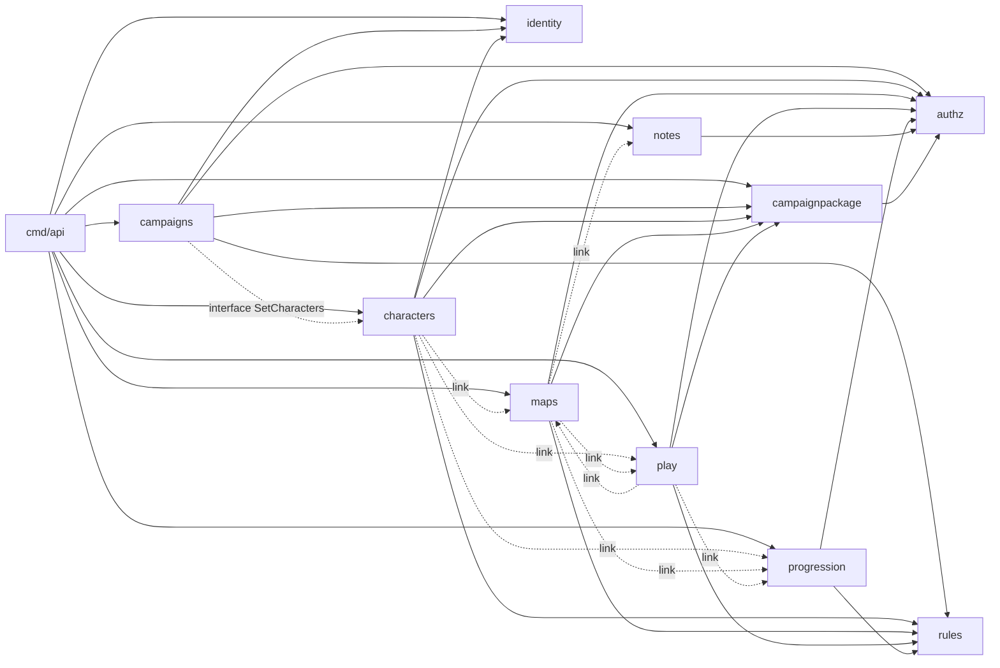

# MeuRPG code health baseline

Measured on `main` @ `a62ebd57` (local checkout; the fork's `origin/main` has since moved to `7e5e7db7`, not measured), 2026-10-16. Read-only: no repo file was changed. Raw tool output lives in `/tmp` (scratchpad), not in the repo. Figures marked *(est.)* are estimates, everything else is a tool number. Sizes: 111.5K Go ncloc + 126.9K TS + 29.2K HTML + 43.4K SCSS = 311K ncloc (SonarQube, tests/gen/sqlc excluded); Go tests 147K lines, web specs 131K lines.

## 1. Verdict

**Mostly healthy at the edges, unhealthy in one place: the combat core.** Structure between modules is clean (no cross-module reach into internals, no package cycles, duplication 0.8%, 0 hotspots), and the complexity is concentrated, not spread: p50 cyclomatic is 4 (Go) and 3 (web). But the tail is severe and it sits where the churn is. The three numbers that matter:

1. **424 Go functions have cyclomatic > 15 and 409 have cognitive > 20; 5 functions have maintainability index 0** (`takeBack` cog 472 / cyc 224, `castSpell` 303/153, `dungeon.check` 284/178, `rollAttack` 269/150, `MoveCombatant` 198/123). `internal/play` holds 215 of the 424 and 22 of the 39 functions with MI < 20.
2. **Web: `combat-view.ts` is 2,721 LOC, cyclomatic 980, fan-out 113, and the most-changed file since 2026-09-25 (3,842 lines, 47 commits).** 163 of 902 web files have file-level MI < 20; 8 import cycles and 68 page→page imports (46 into `pages/live-session`).
3. **Web coverage is unmeasured** (the report-only job writes no summary) and Go's 75.4% total hides `cmd/*` at 14.8–41.1% and `play` at 81.0% while it carries the worst functions.

SonarQube's stock profile says "A, 554 min debt (ratio 0.0%)" — that is misleading: Community Build's default Go profile has **6 rules** and no cognitive-complexity rule. With every Go/TS/Web/CSS rule on it reports 35K smells but 1.3% / rating A; the useful signal is `S3776` (992 functions over 15). The flaky-CI suspicion is partly supported: no `waitForTimeout` in e2e and retries are off (good), but 26 Go `time.Sleep`s in tests and ~52 web specs built on real `setTimeout(0)` flush loops exist (§7).

## 2. Metrics table

| Metric | Tool + version | Repo | Backend (Go) | Web (TS) | Sane target | Proposed gate (ratchet) |
|---|---|---|---|---|---|---|
| ncloc | SonarQube 26.10.0.133078-community | 311,029 | 111,531 | 126,935 TS (+29,167 HTML, 43,396 SCSS) | — | — |
| Cyclomatic, total | Sonar / gocyclo v0.6.0 / ESLint 10.12.0 | 59,283 (Sonar) | 30,442 (gocyclo, 4,614 fns) | 25,456 (ESLint, 6,599 fns) | — | no growth per package |
| Cyclomatic p50/p90/p99/max | same | — | 4 / 15 / 40 / 224 | 3 / 7 / 15 / 82 | p90 ≤ 10, max ≤ 30 | new/changed fn ≤ 15 |
| Functions cyclomatic > 15 | same | 489 | 424 | 65 | 0 | count ≤ today (424 / 65) |
| Cognitive, total | Sonar / gocognit v1.2.0 | 42,656 (Sonar) | 34,263 (gocognit) / 29,000 (Sonar) | 13,656 (Sonar) | — | no growth |
| Cognitive p50/p90/p99/max | gocognit | — | 4 / 22 / 77 / 472 | n/a (not measured by ESLint here) | p90 ≤ 15, max ≤ 50 | new fn ≤ 20 |
| Functions cognitive > 20 / > 50 | gocognit | — | 409 / 78 | n/a | 0 | ≤ 409 / ≤ 78 |
| Maintainability index (functions < 20) | golangci-lint v2.14.0 `maintidx` | — | 39 (5 at 0) | n/a | 0 | ≤ 39 |
| Maintainability index (files) | custom TS script (classic 171−5.2lnV−0.23G−16.2lnLOC, ×100/171) | — | n/a | p10 13.9 / p50 32.5; 163 files < 20 | tracked, not gated (see §5 caveat) | no file below its own baseline |
| Technical debt (stock profile) | SonarQube | 554 min (9.2 h), ratio 0.006% (shown 0.0%), rating A | 0 min (6 rules) | 554 min | ratio ≤ 5% (A) | Sonar "no new issues" |
| Technical debt (all rules on) | SonarQube, `baseline-all` profile | 116,868 min (1,948 h), ratio 1.3%, rating A | — | — | — | informational only (§3) |
| Code smells / bugs / vulns | SonarQube stock | 93 / 10 / 2 | 0 / 0 / 0 | 93 / 10 / 2 | 0 bugs/vulns | 0 new bugs/vulns |
| Duplication | SonarQube | 0.8% | — | — | < 3% | < 3% on new code |
| Coverage (statements) | CI (given) | n/a | 75.4% total; hand-written 79.6–98.6% | **not produced** | ≥ 80% hand-written | per-package floor = today's value |
| Module cycles | go list / dependency-cruiser 18.6.0 | — | 0 package cycles; 1 module-level mutual pair via `link` | 8 distinct cycles | 0 | cycles ≤ 8, then 0 |
| Cross-module internal imports | go list script | — | 0 (13 `rules/*` sub-package imports, by design) | 68 page→page, 18 shared→pages, 5 core→pages | 0 | known-violations baseline |
| Ce > 15 | go list / depcruise | — | 4 packages (maps 24, play 22, characters 19, cmd/api 18) | 6 folders (live-session 68) | ≤ 15 | no new |
| Max depth of inheritance | TS compiler API | — | n/a | 1 (698 classes; 693 at 0) | ≤ 2 | ≤ 1 |
| Real-sleep tests | grep | — | 26 `time.Sleep` / 18 files | 174 `setTimeout` / 119 spec files | 0 | count ≤ today |

## 3. SonarQube

Ran: `sonarqube:26.10.0.133078-community` (analyzers: go 1.47.0.9174, javascript 14.0, web 3.32) + scanner CLI 8.1.0.6389 (image digest in §10). `sonar.sources=backend,web/src`; tests declared as `**/*_test.go,**/*.spec.ts`; excluded `**/gen/**`, `**/*db/**` (sqlc), `node_modules`, tests, `testdata`, `backend/migrations`, `*.sql`. 3,086 files indexed. Quality gate "Sonar way": OK (no conditions on overall code).

**Run A — stock "Sonar way core" profile (Go 6 rules, TS 198, Web 34, CSS 25)**

| | value |
|---|---|
| Technical debt | 554 min = 9 h 14 min; debt ratio 0.006% (30 min/line cost model); maintainability rating **A** |
| Smells / bugs / vulnerabilities / hotspots | 93 / 10 / 2 / 0 (105 issues; reliability **D**, security **C**) |
| Severity (all 105) | BLOCKER 31 · CRITICAL 33 · MAJOR 25 · MINOR 16 |
| Cognitive / cyclomatic | 42,656 / 59,283 (Go 29,000 / 30,233; web 13,656 / 29,050) |
| Language of issues | ts 95 · web 8 · css 2 · **go 0** |

Top rules hit: `S7651` output named like a DOM event 30 (BLOCKER; equals the 30 `no-output-native` suppressions in `web/eslint-suppressions.json`) · `S7059` async work in constructor 29 · `S7773` Number.* statics 15 · `S8786` regex backtracking 9 · `Web:S6845` tabindex on non-interactive 5 · `S2871` sort without comparator 4 (BUG) · `Web:InputWithoutLabelCheck` 3 (BUG) · `S6671` 2 · `S2245` PRNG in security context 2 (the 2 vulnerabilities: `core/images/bytes-url.ts:16`, `pages/live-session/scene/stage-master/stage-list.ts:96`; likely non-security randomness, verify) · `css:S4656` 1. Real bugs worth a look: `shared/combat-map/combat-map.ts:505` (`reduce()` with no initial value), `core/combat/conditions.ts:65` (sort without comparator). Most debt by file (min): `core/format/text.ts` 40, then eight files at 20 (`combat-options.ts`, `content-pack.ts`, `creature-names.ts`, `joint-turn.ts`, `package-copy.ts`, `scene-clues.ts`, `treasure-text.ts` …).

**Run B — same code, every available rule enabled (`baseline-all`: Go 37, TS 551, Web 95, CSS 43)**, project `meurpg-all`. Upper bound, not a target: it is full of rules the repo already decides otherwise (prettier/gofumpt formatting, Portuguese-only UI).

| | value |
|---|---|
| Technical debt | 116,868 min (1,948 h), ratio 1.3%, rating **A** (issue effort sum 137,751 min) |
| Issues | 36,592: smells 35,095 · bugs 1,495 · vulns 2; MAJOR 20,198 · MINOR 11,174 · CRITICAL 3,129 · BLOCKER 2,090 |
| Excluding formatting/i18n/header rules *(est., by subtraction)* | ≈ 60,900 min (≈ 1,015 h), ratio ≈ 0.65% |

Top 10 rules: `go:S103` line length 11,176 (11,176 min) · `ts:S1537` trailing commas 6,774 · `ts:S1774` ternary 4,256 (21,280 min) · `ts:S3524` arrow parens 2,922 · `Web:InternationalizationCheck` 1,368 (20,520 min; the UI is Portuguese by design) · `Web:MaxLineLengthCheck` 982 · **`go:S3776` cognitive complexity 944 (19,390 min, CRITICAL)** · `ts:S1451`/`go:S1451`/`Web:HeaderCheck` license headers 905/869/285 · `go:S131` switch without default 682 · `go:S1067` expressions too complex 458 · `ts:S3358` nested ternaries 413. Also `S3776` in TS: 48. The 1,495 "bugs" are 1,368 i18n + 107 `<b>/<i>` tags + 20 real ones (see Run A).

Top 20 files by debt (all rules, min): `web/…/combat/combat-view.ts` 1,502 · `web/…/core/combat/combat-log.ts` 1,499 · `backend/internal/play/combat_actions.go` 1,063 · `web/…/character-editor/character-editor.ts` 988 · `web/…/shared/markdown/markdown.ts` 920 · `web/…/core/combat/cast-flow.ts` 774 · `web/…/character-editor-source.live.ts` 702 · `backend/…/play/combat_undo.go` 685 · `backend/…/play/combat_log.go` 679 · `web/…/core/combat/combat-client.ts` 669 · `web/…/combat/cast-sheet/cast-sheet.ts` 621 · `backend/…/play/combat_spells.go` 564 · `backend/…/rules/content.go` 514 · `backend/…/play/combat.go` 511 · `web/…/attack-sheet/attack-sheet.ts` 501 · `web/…/core/combat/reactions.ts` 501 · `web/…/core/content/content-read.ts` 494 · `web/…/levelup/levelup-summary.ts` 477 · `web/…/summon-sheet.ts` 465 · `web/…/live-session/live-session.ts` 458.

Reading: Sonar agrees with the other tools about *where* (the combat files) but, with its stock profile, it is blind on Go. Its debt ratio never leaves rating A because the model prices a function of cognitive 472 as ≈ 20 min. Use it for TS/HTML/CSS bug rules and as a second opinion; do not use the ratio as the health gate.

## 4. Go

Scope: 450 hand-written non-test files, 4,614 functions (closures count inside their parent), excluding `gen/` and `*db/` (sqlc). gocognit v1.2.0 lists 3,730 (it omits zero-score functions).

| | p50 | p90 | p99 | max | > threshold |
|---|---|---|---|---|---|
| Cyclomatic (gocyclo) | 4 | 15 | 40 | 224 | >15: 424 · >30: 91 · >50: 27 |
| Cognitive (gocognit) | 4 | 22 | 77 | 472 | >20: 409 · >30: 214 · >50: 78 |
| MI per function (maintidx, 0–100) | 59 | p10 38 | p1 20 | 0 | <20: 39 · <10: 15 · =0: 5 |

By module (functions / cyc>15 / cog>20 / MI<20): play 1,710/215/201/22 · rules 1,029/89/93/12 · maps 633/52/51/2 · characters 551/48/42/2 · platform 218/2/3/0 · campaignpackage 120/1/2/0 · identity 104/3/0/0 · campaigns 84/2/2/0. Totals per package (cyc/cog): play 13,382/16,143 · rules 4,554/5,205 · maps 3,417/3,658 · characters 3,375/3,669. The repo's own golangci thresholds (gocyclo 30, gocognit 50, `backend/.golangci.yml`) flag 91 and 78 of these; the existing ratchet only fails new issues.

20 worst functions (by cognitive):

| # | function | file:line | cognitive | cyclomatic | MI (0-100) |
|--|--|--|--|--|--|
| 1 | play.(*Service).takeBack | internal/play/combat_undo.go:344 | 472 | 224 | 0 |
| 2 | play.(*Service).castSpell | internal/play/combat_spells.go:214 | 303 | 153 | 0 |
| 3 | dungeon.check | internal/rules/dungeon/check.go:11 | 284 | 178 | 0 |
| 4 | play.(*Service).rollAttack | internal/play/combat_actions.go:600 | 269 | 150 | 0 |
| 5 | play.(*Service).MoveCombatant | internal/play/combat_move.go:247 | 198 | 123 | 0 |
| 6 | play.buildLog | internal/play/combat_log.go:202 | 179 | 91 | 8 |
| 7 | play.(*Service).rollDamage | internal/play/combat_actions.go:1164 | 174 | 92 | 4 |
| 8 | play.(*Service).TakeAction | internal/play/combat_actions.go:2004 | 161 | 81 | 7 |
| 9 | play.(*Service).StartContest | internal/play/combat_contests.go:181 | 153 | 77 | 8 |
| 10 | rules.(*content).applyCorrections | internal/rules/content.go:906 | 147 | 77 | 9 |
| 11 | play.(*Service).AddCharacterEffect | internal/play/lasting_effects_charadd.go:34 | 147 | 73 | 9 |
| 12 | rules.(*content).compileEffect | internal/rules/effects.go:199 | 139 | 105 | 7 |
| 13 | rules.(*deriver).characterSpells | internal/rules/spellcasting.go:158 | 137 | 94 | 5 |
| 14 | play.(*Service).SearchForTraps | internal/play/traps.go:124 | 133 | 82 | 6 |
| 15 | play.(*Service).AddLastingEffect | internal/play/lasting_effects_rpc.go:273 | 132 | 66 | 12 |
| 16 | play.(*Service).ListTrapActivity | internal/play/traps_activity.go:72 | 125 | 66 | 12 |
| 17 | play.(*Service).EndTurn | internal/play/combat.go:773 | 119 | 64 | 12 |
| 18 | rules.(*content).loadTraps | internal/rules/traps.go:247 | 116 | 91 | 10 |
| 19 | play.(*logEntry).reactionLine | internal/play/combat_reaction_log.go:52 | 106 | 83 | 12 |
| 20 | play.(*Service).RollEffectSave | internal/play/lasting_effects_save.go:186 | 104 | 51 | 15 |

Other MI < 20 (beyond the five at 0): `rollDamage` combat_actions.go:1164 (4), `logEntry.view` combat_log.go:500 (5), `characterSpells` rules/spellcasting.go:158 (5), `SearchForTraps` play/traps.go:124 (6), `TakeAction` combat_actions.go:2004 (7), `compileEffect` rules/effects.go:199 (7), `StartContest` combat_contests.go:181 (8), `buildLog` combat_log.go:202 (8), `AddCharacterEffect` (9), `applyCorrections` rules/content.go:906 (9), `loadTraps` rules/traps.go:247 (10), `EndTurn` combat.go:773 (12) … `cmd/api/main.go:150 run` (20). Many are loaders/translators (`rules/*`, `buildLog`, `reactionLine`) that are long switch tables: high cyclomatic, but table-shaped and cheap to flatten. The `play` actions (`takeBack`, `castSpell`, `rollAttack`) are real branching logic.

### Coupling (R. C. Martin metrics)

56 hand-written packages (`go list -json ./...`, non-test imports; Ce counts hand-written internal imports; Ce incl. gen/sqlc in parentheses where it differs a lot). A = interfaces / (interfaces + other types) from the AST; I = Ce/(Ca+Ce); D = |A+I−1|.

| package | Ca | Ce | I | A | D | ifaces/types |
|--|--|--|--|--|--|--|
| maps | 1 | 24 | 0.96 | 0.12 | 0.08 | 11/91 |
| play | 1 | 22 | 0.96 | 0.08 | 0.04 | 17/216 |
| characters | 2 | 19 | 0.9 | 0.26 | 0.16 | 15/58 |
| cmd/api | 0 | 18 | 1.0 | 0.0 | 0.0 | 0/5 |
| campaigns | 1 | 11 | 0.92 | 0.25 | 0.17 | 4/16 |
| campaignpackage | 5 | 10 | 0.67 | 0.19 | 0.14 | 4/21 |
| progression | 1 | 8 | 0.89 | 0.54 | 0.43 | 7/13 |
| identity | 3 | 6 | 0.67 | 0.1 | 0.24 | 2/21 |
| notes | 1 | 6 | 0.86 | 0.5 | 0.36 | 2/4 |
| rules | 8 | 4 | 0.33 | 0.0 | 0.67 | 0/250 |
| cmd/migrate | 0 | 3 | 1.0 | 0 | 0.0 | 0/0 |
| cmd/devidp | 0 | 2 | 1.0 | 0.0 | 0.0 | 0/1 |
| characters/contenttest | 0 | 2 | 1.0 | 0 | 0.0 | 0/0 |
| maps/link | 3 | 2 | 0.4 | 0.11 | 0.49 | 1/9 |
| platform/dbtest | 0 | 2 | 1.0 | 0.0 | 0.0 | 0/5 |
| platform/httpserver | 1 | 2 | 0.67 | 0.12 | 0.21 | 1/8 |
| cmd/srdimport | 0 | 1 | 1.0 | 0.0 | 0.0 | 0/13 |
| authz | 7 | 1 | 0.12 | 0.27 | 0.6 | 3/11 |
| maps/images/gen | 2 | 1 | 0.33 | 0.06 | 0.6 | 1/16 |
| maps/refimg | 1 | 1 | 0.5 | 0.0 | 0.5 | 0/4 |
| platform/rpclog | 1 | 1 | 0.5 | 0.33 | 0.17 | 1/3 |
| rules/combat | 2 | 1 | 0.33 | 0.0 | 0.67 | 0/46 |
| rules/vision | 4 | 1 | 0.2 | 0.0 | 0.8 | 0/7 |
| identity/oidctest | 1 | 0 | 0.0 | 0.0 | 1.0 | 0/8 |
| leaktest | 0 | 0 | 0 | 0 | 1 | 0/0 |

Reading: **play, maps, characters are the efferent hubs** (I 0.90–0.96, Ce 19–24; including generated/sqlc imports 30/32/27). `rules` is the stable core (Ca 8, I 0.33) with **A = 0.0: 250 concrete types, zero interfaces** → D 0.67; `authz` (Ca 7, I 0.12, A 0.27, D 0.60) and the `platform` leaf utilities (logging Ca 12, names 9, idem 7, rpcerr 7) are stable-and-concrete by nature (zone of pain by the book, harmless for pure helpers). Median D is 1.0 — in Go most packages are concrete, so D is a weak signal; Ce and the cycle check carry the information. No package in the zone of uselessness.

**Boundary check** (production imports only): every cross-module edge goes through a `link` package (`maps/link`, `play/link`, `progression/link`, `notes/link`) or through the shared roots `authz`, `identity`, `campaignpackage`. No module imports another's internals. The only imports into another module's sub-packages are 13 edges into `rules/{combat,vision,grid,dungeon,encounter,puzzle,reaction}` from play/maps/characters; `rules` is the shared domain library, so I read these as intended, but nothing enforces that `rules` stays a leaf (it imports no other module today — good). `campaigns ↔ characters` is cut with an interface wired at runtime in `cmd/api` (`SetCharacters`, documented in `docs/architecture.md`); `maps ↔ play` depend on each other's `link` packages (no package cycle, one module-level pair). **Test-only coupling is looser:** `play` tests import `maps`, `characters`, `campaigns`, `identity` roots; `maps` tests import `play`, `characters`, `campaigns`, `progression`, `notes` (integration harnesses; still the reason `play`↔`maps` changes ripple).



## 5. Web

Cyclomatic: ESLint 10.12.0 `complexity` rule at threshold 1 with a standalone config (TS parser only), 1,544 files, 9,745 functions. Production code (6,599 fns): p50 3 · p90 7 · p99 15 · max 82 · sum 25,456; >10: 233 · >15: 65 · >20: 34. Specs (3,146 fns): p50 2, max 13. The 65 functions > 15 are exactly the 65 `complexity` suppressions in `web/eslint-suppressions.json` (48 files), so the repo's gate (15) holds and the debt is fully tracked.

Worst 20 functions:

| # | function | file:line | cyclomatic |
|--|--|--|--|
| 1 | blockedMessage | core/combat/combat-errors.ts:136 | 82 |
| 2 | connect | pages/live-session/live-stream.ts:184 | 69 |
| 3 | logLine | core/combat/combat-log.ts:874 | 62 |
| 4 | spellDetailsFromGen | shared/spell-details/spell-details-map.ts:68 | 61 |
| 5 | readEntry | core/content/content-read.ts:184 | 54 |
| 6 | spellToDraft | core/content/spell-draft.ts:257 | 49 |
| 7 | attackSheet | pages/live-session/combat/combat-view.ts:1958 | 46 |
| 8 | toFormFullSheet | pages/character-editor/character-editor-source.live.ts:409 | 46 |
| 9 | draftToEffect | core/content/effect-draft.ts:140 | 46 |
| 10 | castRow | core/combat/cast-flow.ts:554 | 44 |
| 11 | castSheet | pages/live-session/combat/combat-view.ts:2105 | 42 |
| 12 | changeRows | core/levelup/levelup-summary.ts:237 | 41 |
| 13 | toStoryVm | pages/character-sheet/character-sheet-source.live.ts:289 | 38 |
| 14 | watch | pages/live-session/live-session-source.live.ts:165 | 36 |
| 15 | castSubtitle | core/combat/cast-flow.ts:405 | 35 |
| 16 | draftFromRules | core/campaigns/table-rules.ts:60 | 33 |
| 17 | violationText | core/content/content-violations.ts:334 | 32 |
| 18 | submit | pages/character-editor/character-editor.ts:1914 | 30 |
| 19 | refusalMessage | core/levelup/levelup-errors.ts:60 | 30 |
| 20 | toCharacterSheetVm | pages/character-sheet/character-sheet-source.live.ts:355 | 29 |

Heaviest files by summed function complexity: `combat-view.ts` 980 · `combat-log.ts` 438 · `character-editor.ts` 430 · `cast-sheet.ts` 349 · `attack-sheet.ts` 324 · `live-session.ts` 319 · `cast-flow.ts` 228 · `levelup-draft.ts` 227. Sonar's cognitive total for web is 13,656 (Go 29,000) — web is simpler per line.

**Maintainability index.** Own script (`webmi.cjs`, TypeScript compiler API): Halstead volume from the token stream (operators vs identifiers/literals), G = file cyclomatic from the ESLint run, LOC = non-blank non-comment lines, classic formula `171 − 5.2·ln V − 0.23·G − 16.2·ln LOC` scaled ×100/171, floored at 0. **Caveat:** this is whole-file MI, Go's is per-function (`maintidx`), and inline Angular templates/HTML are not counted — the two are not comparable, and file-level MI punishes any big file (a 1,000-line file with modest complexity already scores < 20). 902 files: p10 13.9 · p50 32.5 · < 20: 163 · < 40: 652 · < 65: 894. Use it as a ranking, with the ratchet "no file gets lower", not as an absolute grade. Worst by file cyclomatic:

| # | file | LOC | Halstead V | file cyclomatic | MI |
|--|--|--|--|--|--|
| 1 | pages/live-session/combat/combat-view.ts | 2721 | 48061 | 751 | 0 |
| 2 | core/combat/combat-log.ts | 1120 | 26126 | 377 | 0 |
| 3 | pages/character-editor/character-editor.ts | 1692 | 10115 | 323 | 0 |
| 4 | pages/live-session/combat/cast-sheet/cast-sheet.ts | 1061 | 23639 | 259 | 0 |
| 5 | pages/live-session/combat/attack-sheet/attack-sheet.ts | 949 | 12342 | 244 | 0 |
| 6 | pages/live-session/live-session.ts | 1125 | 17110 | 227 | 0 |
| 7 | core/combat/cast-flow.ts | 561 | 7580 | 202 | 0 |
| 8 | core/levelup/levelup-draft.ts | 741 | 7862 | 176 | 0 |
| 9 | core/puzzles/puzzle-draft.ts | 699 | 21001 | 173 | 0 |
| 10 | shared/image-generate/image-generate-dialog.ts | 790 | 10228 | 172 | 0 |
| 11 | pages/character-editor/character-editor-source.live.ts | 803 | 10004 | 169 | 0 |
| 12 | pages/character-sheet/creatures-panel/summon-sheet.ts | 567 | 10622 | 148 | 0 |
| 13 | pages/live-session/combat/move-page/move-page.ts | 551 | 6450 | 148 | 0 |
| 14 | pages/live-session/combat/reaction-sheet/reaction-sheet.ts | 947 | 10321 | 141 | 0 |
| 15 | pages/live-session/puzzles/master-run/master-run.ts | 348 | 7761 | 140 | 0 |
| 16 | core/content/spell-draft.ts | 547 | 10541 | 139 | 0 |
| 17 | pages/level-up/level-up.ts | 681 | 15268 | 138 | 0 |
| 18 | core/combat/reactions.ts | 639 | 12688 | 132 | 0 |
| 19 | pages/maps/map-editor/map-editor.ts | 700 | 21942 | 129 | 0 |
| 20 | shared/area-picker/area-map.ts | 555 | 4397 | 122 | 0 |

**Depth of inheritance** (698 classes, resolved with the type checker): DIT 0: 693; DIT 1: 5 — `UploadFailed`, `InspirationQuestion`, `InspirationAsked` (extend `Error`), `PageTitleStrategy` (`TitleStrategy`), `EditorStepper` (`CdkStepper`); max 1. No component inherits. Healthy.

**dependency-cruiser 18.6.0** (MIT; `src/app`, specs/gen excluded; 932 modules, 5,948 dependencies). The layer rules are **my proposal, not enforced today**, so the counts are a baseline, not regressions:

| rule | violations |
|---|---|
| circular imports | 8 distinct cycles |
| `core` → `pages` | 5 (e.g. `core/resources/pools.ts` → `pages/live-session/live-session.types.ts`) |
| `core` → `shared` | 19 (mostly `shared/session-time/session-time.ts`, `shared/spell-details/*`, `shared/map-view/map-*`) |
| `shared` → `pages` | 18 (all into `pages/live-session/combat/sheet-host.ts` / `sheet-frame`, `move-page/segmented`, `maps/dungeon-new/choice-row`) |
| page → another page's internals | 68 (46 target `pages/live-session`; importers: `character-sheet` 13, `encounters` 8, `campaign-detail` 6, `content` 5, `bestiary` 4, `maps` 3, `spells` 3, …) |
| `core`/`shared` → `shell` | 1 (`core/content/content-watcher.ts` → `shell/live-notice/open-sessions.ts`) |

Cycles: (1) `core/combat/combat-log` → `trap-log`/`combat-view`/… → `core/resources/{metamagic,pools}` → **`pages/live-session/live-session.types.ts`** → `core/combat/{combat-state,theatre,combat-view}` → back (seven spellings of one 9-node knot involving `combat-log`, `combat-view`, `creature-names`, `joint-turn`, `pools`, `metamagic`); (2) `core/connect/transport` ↔ `core/auth/auth.service`; (3) `shell/live-notice/open-sessions` ↔ `open-sessions-client`. The first knot exists because `live-session.types.ts` (a `pages/` file) is used as the shared model by `core/`.

Coupling per top-level folder: Ce `pages/live-session` 68 (Ca 19, I 0.78), `pages/maps` 29, `app.routes.ts` 29, `pages/character-sheet` 28, `pages/campaign-detail` 27, `pages/character-editor` 18. Highest fan-in: `core/format/text.ts` 121, `core/connect/idempotency.ts` 84, **`pages/live-session/combat/sheet-host.ts` 65 and `sheet-frame.ts` 50** (used app-wide but living inside one page: they belong in `shared/`), `core/units.ts` 60, `core/connect/connect-errors.ts` 56. Highest fan-out: `combat-view.ts` 113, `live-session.ts` 82, `cast-sheet.ts` 48, `map-editor.ts` 42. File fan-out p50 2 · p90 10.

## 6. Hotspots (churn × complexity × coverage)

Churn = lines added+deleted from `git log main --since=2026-09-25 --numstat` (512 commits; the clone was shallow, so I ran `git fetch --unshallow origin main` — affects `.git` only). Complexity = summed function cyclomatic per file (gocyclo / ESLint). Coverage: **no per-file coverage exists** (Go CI publishes package totals; web has none), so it is shown as context (Go package %, web: number of spec files importing the file) and is **not** in the score. Score = churn rank + complexity rank (lower = riskier), prod files only, 1,163 files.

| # | file | churn | commits | cyc | coverage context | why risky |
|---|---|---|---|---|---|---|
| 1 | web `live-session/combat/combat-view.ts` | 3,842 | 47 | 980 | 18 spec imports | God component (2,721 LOC, fan-out 113); every combat feature lands here |
| 2 | go `play/combat_actions.go` | 3,178 | 46 | 640 | play 81.0% | `rollAttack` 150, `rollDamage` 92, `TakeAction` 81 in one file; MI 0–7 |
| 3 | go `maps/mapservice.go` | 2,134 | 20 | 439 | maps 86.1% | big service (Sonar cognitive 417, 3rd highest file) |
| 4 | web `character-editor/character-editor.ts` | 2,724 | 31 | 430 | 3 spec imports | 1,692 LOC, `submit` cyc 30 |
| 5 | go `play/combat.go` | 1,951 | 31 | 338 | play 81.0% | `EndTurn` MI 12, 119 cognitive |
| 6 | web `core/combat/combat-log.ts` | 1,504 | 32 | 438 | 8 spec imports | `logLine` cyc 62; in the 9-node import cycle |
| 7 | go `rules/content.go` | 1,578 | 32 | 322 | rules 94.3% | `applyCorrections` cog 147 |
| 8 | web `combat/cast-sheet/cast-sheet.ts` | 1,384 | 18 | 349 | 10 spec imports | `castSheet` cyc 42; fan-out 48 |
| 9 | go `rules/levelup.go` | 1,654 | 10 | 318 | rules 94.3% | high but well covered |
| 10 | go `cmd/srdimport/main.go` | 1,705 | 8 | 297 | cmd 14.8–41.1% | **lowest coverage of the list**; one-shot importer |
| 11 | web `live-session/live-session.ts` | 1,545 | 44 | 319 | 1 spec import | 44 commits; `watch`/`connect` cyc 69 in `live-stream.ts` |
| 12 | go `maps/imagegen.go` | 1,662 | 15 | 293 | maps 86.1% | |
| 13 | web `combat/attack-sheet/attack-sheet.ts` | 1,341 | 19 | 324 | 10 spec imports | `attackSheet` cyc 46 |
| 14 | go `play/combat_log.go` | 1,176 | 35 | 341 | play 81.0% | `view` cyc 110, `buildLog` cog 179; 35 commits |
| 15 | web `shared/image-generate/image-generate-dialog.ts` | 1,758 | 4 | 224 | 1 spec import | its spec is 57/57 failing under coverage |
| 16 | go `play/combat_parts.go` | 1,245 | 7 | 312 | play 81.0% | |
| 17 | go `play/combat_undo.go` | 1,145 | 31 | 340 | play 81.0% | `takeBack` cog 472, MI 0, 31 commits |
| 18 | go `play/combat_spells.go` | 1,324 | 28 | 287 | play 81.0% | `castSpell` cog 303, MI 0 |
| 19 | go `maps/dungeons.go` | 1,399 | 10 | 237 | maps 86.1% | |
| 20 | go `characters/levelup.go` | 1,457 | 14 | 230 | chars 87.6% | |

Next: `play/combat_move.go` (MI 0 `MoveCombatant`), `web core/puzzles/puzzle-draft.ts`, `characters/rpc.go`, `play/combat_contests.go`. Reading: the same ~15 combat files recur in churn, complexity, Sonar debt and (play) import fan-out. `takeBack`, `castSpell`, `rollAttack` are where a bug is most likely and a refactor most dangerous, so they need characterization tests before anything else.

## 7. Flakiness risks

**Why the web coverage run times out.** I could not reproduce it on one file. `clue-list.spec.ts` (17 tests, listed as 12/17 failing in CI): `npx ng test --watch=false --include <file>` → 17/17 pass, tests 1.72 s, wall 4.25 s; with `--coverage` → 17/17 pass, tests 2.11 s, wall 4.98 s. v8 instrumentation costs ≈ 1.2× on this file, nowhere near a 5 s per-test timeout. So instrumentation alone is not the cause. What the code shows: every failing spec in the list (`image-generate-dialog` 57 tests, `grid-panel`, `claim-page`, `gallery`, `clue-list`) uses the same helper, `const flush = () => new Promise(r => setTimeout(r, 0))`, called 9–41 times per file (e.g. `image-generate-dialog.spec.ts:46` loops it 6×, and `settle()` adds `whenStable`+`detectChanges`), with **no fake timers** (0 `useFakeTimers` in all five). The flush is a *count* of real macrotask turns, not a wait for a condition: it is cheap on an idle worker and balloons when a worker is starved. The CI run is the starved case: `src/test-setup.ts` documents that with `--coverage` the builder uses 9 workers for 381 files with `isolate: false` (shared module state), plus 4,757+ tests (now 6,293 `it(`) sharing a 2–4 vCPU runner and the inspector's precise-coverage overhead. *(Hypothesis: load × real-timer turns; not proven.)* Fix approach, cheapest first: (1) in the coverage job only, raise `testTimeout` (e.g. 30 s) via a Vitest `runnerConfig`, and cap workers; read the number. (2) Replace `flush`/`settle` with `vi.useFakeTimers()` + `await vi.advanceTimersByTimeAsync(0)` (or just `await fixture.whenStable()`), starting with the five files; a shared `settle(fixture)` in `src/test-*.ts` removes 52 copy-pasted helpers (28 `setTimeout(resolve,0)` + 24 `setTimeout(r,0)`). (3) If still slow, try `coverage.provider: 'istanbul'` (pays at build, not at runtime). (4) Only then make the job blocking with a ratchet. Evidence to collect first: run the full suite once with `--coverage` and `--reporter=verbose` on a 4-vCPU box and sort test durations.

**Ranked flake risk**

| rank | pattern | count | where | risk |
|---|---|---|---|---|
| 1 | Web specs whose async settling is a counted loop of real `setTimeout(0)` | 52 helpers; 113 files contain `for (let i…)` loops (loose grep, not all are flushes); 119 files / 174 `setTimeout`, 167 / 308 `new Promise`, 0 `fakeAsync`, 48 files use `useFakeTimers` | the five coverage-failure specs head the list: `image-generate-dialog` (36 flush calls), `grid-panel` (41), `clue-list` (27), `gallery` (15), `claim-page` (9) | high: pass/fail depends on machine load |
| 2 | Go tests that *assert absence* after a fixed sleep | `migrations/lock_test.go:229` (200 ms, "anything already sent has landed"), `maps/imagegen_test.go:992` (200 ms), `leaktest/hiddenhints_test.go:23` (`contentHintSettle`) | passes when too fast; a slow runner makes the negative check vacuous or the positive one fail | high |
| 3 | Go long fixed sleeps | `play/rosterretry_test.go:114` (2.5 s), `platform/db/db_integration_test.go:166` (1.2 s), `migrations/lock_test.go:177` TTL race (5 ms polls, `time.After(2*ttl)`) | slow and timing-coupled | medium |
| 4 | Go short polling sleeps (1–50 ms) in loops | 21 more of the 26 `time.Sleep`s (`maps/imagegen_test.go` ×4, `slowclient_test.go` ×4, `upload_slow_test.go` ×2, `tiles_test.go:510`, `kinds_test.go:962`, `gold_test.go:235` w/ 30 s deadline, `campaignpackage/*` ×3, `play/live/hub_test.go:217`) | mostly bounded polls — OK; candidates for `testing/synctest` (0 uses today) | low–medium |
| 5 | Real clocks | 110 `time.Now()` in 62 test files; 41 `time.After/NewTimer/Tick` | only a risk where a boundary (day, TTL) is crossed; injection exists in `identity`, `ratelimit` | low–medium |
| 6 | e2e click → RPC read without an assertion between | 6 sites / 4 files: `monsters.spec.ts:373-375`, `:459-460`, `bestiary.spec.ts:68-70` (two `selectOption`s then `callRPC`), `map-editor.spec.ts:479-481`, `gold.spec.ts:236-239` | Reads right after "Cancelar"/"Voltar"/`selectOption` assert *nothing happened*; use `afterRender(page)` (`e2e/tests/support.ts:121`) or an `expect` on the UI first | medium (exactly the past failure class) |
| 7 | e2e overall | 552 tests / 112 files; **0** `waitForTimeout`, 0 sleep helpers; 3 `networkidle`; `retries: 0`; `fullyParallel`; 10 `skip/fixme/slow`; many `test.setTimeout(120–180 s)` in `combat.spec.ts` | well disciplined; long timeouts mean long setup | low |

(The click→RPC scan is a 3-line-window heuristic, so it under-counts; the `a11y.spec.ts` file has the highest e2e churn, 8,882 lines/90 commits.)

## 8. Proposed CI gates

All thresholds are set at today's baseline (ratchet: may only go down). "Cost" is CI wall-clock *(est.)* unless measured. Licenses: only tool *configs* would be committed; none of these tools' code is vendored.

| # | gate | tool @ pinned version | license | where | threshold today | cost |
|---|---|---|---|---|---|---|
| 1 | Go cyclomatic/cognitive for changed code (exists; tighten) | golangci-lint v2.14.0 `gocyclo`/`gocognit` + `new-from-rev` | GPL-3.0 (tool run as a binary; fine for Apache-2.0 code) | `backend.yml` lint job | lower 30/50 → 15/20 for new code only | +0 (already runs) |
| 2 | Go totals must not grow | `fzipp/gocyclo@v0.6.0`, `uudashr/gocognit@v1.2.0` (script counting `>15`, `>20`) | BSD-3-Clause, MIT | backend lint job | cyc>15 ≤ 424, cog>20 ≤ 409 | < 1 min |
| 3 | Go MI | golangci-lint v2.14.0 `maintidx` (yagipy/maintidx v1.0.0) `under: 20` | GPL-3.0 tool / MIT linter | backend lint job | ≤ 39 functions (as baseline-file) | measured 1.3 s warm |
| 4 | Module boundaries | golangci `depguard` rules: `internal/<m>/…` importable by other modules only via `link`, `authz`, `identity`, `campaignpackage`, `rules/*` | GPL-3.0 tool | same | 0 violations (already true) | ~0 |
| 5 | Web cycles + layers | dependency-cruiser 18.6.0 with `--ignore-known` baseline file | MIT | `web.yml` | cycles ≤ 8, core→pages ≤ 5, shared→pages ≤ 18, page→page ≤ 68, then ratchet to 0 | measured 3 s |
| 6 | Web complexity | ESLint 10.12.0 `complexity: 15` + existing suppressions file (already ratcheting) | MIT | exists | 65 suppressions | 0 |
| 7 | Flake lint | golangci `forbidigo` on `time.Sleep` in `_test.go` (ratchet), ESLint `no-restricted-globals`/`no-restricted-syntax` for `setTimeout` in `*.spec.ts` (ratchet), `playwright/no-wait-for-timeout` | GPL-3.0 / MIT | lint jobs | Go 26, web 174, e2e 0 | ~0 |
| 8 | Coverage floors | Go: per-package floor = today's % (extend the 90% rule beyond `rules/*`); web: after §7 fix, `coverage-summary.json` total as floor | — | `backend.yml`, `web.yml` | play 81.0, characters 87.6, maps 86.1, campaigns 86.6, … | exists / +0 |
| 9 | SonarQube (optional, nightly) | `sonarqube:26.10.0.133078-community` + scanner image digest in §10; enable `go:S3776`/`typescript:S3776` in a custom profile; gate on *new code* | **LGPL-3.0 server, analyzers under SSALv1 (source-available, not OSI)** — run as an external service, never commit or bundle it | scheduled workflow, not per-PR | new-code: 0 bugs/vulns, no new S3776 | measured ≈ 2–3 min start + 2–3 min scan on 4 vCPU; ~6 min total |

SonarQube adds little over golangci-lint for Go (6 stock rules) and TypeScript smells are largely already ESLint; its value is the trend dashboard. If the owner wants the named metrics (debt ratio, maintainability rating, smells) as a number on a badge, run it nightly; do not gate PRs on it.

## 9. Ranked fix plan

Rule for every item: **characterization tests first** (record current outputs, then refactor under them), one function per PR, behavior frozen.

1. **Make the web coverage number exist** (½ day): timeout/worker experiment, then the shared fake-timer `settle` (§7). Without it, items 4–6 have no safety net.
2. **Pin the combat engine's behavior** (play: `takeBack`, `castSpell`, `rollAttack`, `rollDamage`, `MoveCombatant`, `TakeAction`, `AddCharacterEffect`): extend existing event-sequence tests into table/golden tests per branch of the function until each branch is hit (use `-coverprofile` on those functions, not the package number). Then split each into phase functions (validate → resolve → apply → log); target cyc ≤ 15 per piece. Biggest risk reduction: 5 functions are MI 0 and sit in the 46-commit file.
3. **`rules/dungeon/check.go:check`** (cyc 178, pure function, rules coverage 92%): easiest large win; golden tests already exist under `rules/testdata`. Same for the table-shaped loaders `compileEffect` (105), `loadSpellEffects` (97), `loadTraps` (91), `applyCorrections` (77): convert to table-driven.
4. **Web: break the import knot and fix layers** (1–2 days): move `live-session.types.ts` models into `core/` (or `core/play-model`), move `sheet-host.ts`/`sheet-frame` to `shared/` (removes 18 shared→pages and ~25 page→page imports), fix `transport`↔`auth.service` and `open-sessions` cycles. Then switch on gates 5.
5. **Web: split `combat-view.ts`** (cyc 980, fan-out 113) by sheet (attack/cast/reaction/move already have their own folders), then `character-editor.ts`, `cast-sheet.ts`, `attack-sheet.ts`; move pure logic (`blockedMessage` cyc 82, `logLine` 62, `connect` 69) into tested `core/` functions.
6. **`internal/play` package split** (1,710 functions, Ce 22): carve combat out behind an interface in its own sub-package; cut `play`↔`maps` through `link` only; add `depguard`. Do after 2, never before.
7. **Flake cleanups** (rank 1–3 of §7): fake-timer helper for the five specs; `synctest` for `migrations/lock_test.go`, `imagegen_test.go:992`, `hiddenhints_test.go`; 6 e2e click→RPC sites.
8. **Quick Sonar findings**: `combat-map.ts:505` reduce without initial value, 4 sorts without comparator, 3 unlabeled inputs, 29 async constructors (`S7059`). Small, real.
9. **Coverage on `cmd/*` (14.8–41.1%)**: `cmd/api/main.go:run` (cyc 21, MI 20) via a smoke test of `mountModules`; low priority.

## 10. Exact commands, versions, failures

Environment: 4 vCPU, 15 GB, Go 1.27.2 (toolchain downloaded per `go.mod`), Node 22.22.0, Docker 29.8.2. Scratch dir: `/tmp/claude-0/-home-user-meuRPG/47d814f8-5221-5c40-8ec2-88b437c665b4/scratchpad`. `npm_config_ignore_scripts=true` throughout; `npm ci --ignore-scripts` in `web/`; no install script ran.

```sh
# Go (in backend/); prod = hand-written, non-test, no gen/ and no *db/ (sqlc) dirs
find . -name '*.go' ! -path './gen/*' ! -name '*.sql.go' ! -path '*/*db/*' ! -name '*_test.go' > prod.txt
go run github.com/fzipp/gocyclo/cmd/gocyclo@v0.6.0 $(cat prod.txt)       # no -over: full distribution; -over 15 = same list filtered
go run github.com/uudashr/gocognit/cmd/gocognit@v1.2.0 $(cat prod.txt)   # -over 20 = filter
GOTOOLCHAIN=go1.27.2 GOBIN=$S/bin go install github.com/golangci/golangci-lint/v2/cmd/golangci-lint@v2.14.0
$S/bin/golangci-lint run --config maintidx.yml ./...   # throwaway config outside the repo
#   maintidx.yml: version: "2"; run.tests:false; linters.default:none; enable:[maintidx]; settings.maintidx.under:100;
#   exclusions.generated:strict, paths:[^gen/, 'db/']; issues.max-issues-per-linter:0, max-same-issues:0
go list -json ./... > golist.json     # coupling (python script); abstractness via a go/parser program
# Web (in web/)
npx eslint --config $S/eslint.cx.mjs --no-inline-config --suppressions-location $S/none.json \
  -f json -o web_cx.json 'src/**/*.ts'      # config: typescript-eslint parser + complexity:['warn',1]
node webmi.cjs $S                           # MI + DIT with the repo's typescript 5.9.3
npm i dependency-cruiser@18.6.0 && depcruise src/app src/gen --config dc.cjs --output-type json
npx ng test --watch=false --include src/app/pages/maps/clue-list/clue-list.spec.ts            # 17 pass
npx ng test --watch=false --coverage --include src/app/pages/maps/clue-list/clue-list.spec.ts # 17 pass
git log main --since=2026-09-25 --numstat --format=
```

SonarQube:

```sh
sudo dockerd >/tmp/dockerd.log 2>&1 &   # waited for `docker info`
docker run -d --name sq -p 9000:9000 \
  --tmpfs /opt/sonarqube/data:size=6g,uid=1000,gid=0 --tmpfs /opt/sonarqube/temp:size=1g,uid=1000,gid=0 \
  -e SONAR_SEARCH_JAVAADDITIONALOPTS=-Dnode.store.allow_mmap=false sonarqube:26.10.0.133078-community
# admin/admin -> new password via POST /api/users/change_password; token via POST /api/user_tokens/generate
docker run --rm --network host -v <repo>:/usr/src:ro -v <tmp>:/work \
  sonarsource/sonar-scanner-cli@sha256:a3f4215076706c95a17a68c19322ee916e40a3acd081a8c1a1e839e0194afa57 sonar-scanner \
  -Dsonar.host.url=http://localhost:9000 -Dsonar.token=<token> -Dsonar.projectKey=meurpg -Dsonar.projectBaseDir=/usr/src \
  -Dsonar.working.directory=/work -Dsonar.sources=backend,web/src -Dsonar.tests=backend,web/src \
  -Dsonar.test.inclusions='**/*_test.go,**/*.spec.ts' \
  -Dsonar.exclusions='**/gen/**,**/*db/**,**/node_modules/**,**/*_test.go,**/*.spec.ts,**/testdata/**,backend/migrations/**,**/*.sql' \
  -Dsonar.inclusions='backend/**/*.go,web/src/**/*.ts,web/src/**/*.html,web/src/**/*.scss' -Dsonar.scm.disabled=true
```

Pinned: SonarQube Community Build **26.10.0.133078** (image tag `26.10.0.133078-community`); scanner **SonarScanner CLI 8.1.0.6389**, run from `sonarsource/sonar-scanner-cli:latest`, which resolved to digest `sha256:a3f4215076706c95a17a68c19322ee916e40a3acd081a8c1a1e839e0194afa57` — pin by digest (I did not find a version tag for it); golangci-lint **v2.14.0** (repo's; the VM's preinstalled 2.5.0 was not used); gocyclo v0.6.0; gocognit v1.2.0; ESLint 10.12.0; typescript 5.9.3; dependency-cruiser 18.6.0 (an earlier 17.4.3 install was replaced); Run B used quality profiles `baseline-all` (copies of every available rule, set as default, scanner re-run as project `meurpg-all`).

Failures and deviations:
- **SonarQube data dir is on tmpfs because the VM disk was ~90% full**: the first start (default volume) died — Elasticsearch hit its 90% disk watermark ("high disk watermark exceeded … free 22.3gb[8.8%]"), shards unavailable, `IndexCreator` threw. A `--ulimit nofile` retry was refused by the sandbox (rlimit not permitted). The tmpfs start worked; the data is gone with the container (stopped).
- golangci-lint v2.14.0 built with Go 1.26 refused the module (`go 1.27.2`); rebuilt with `GOTOOLCHAIN=go1.27.2`.
- The clone was shallow (49 commits from 2026-10-10); unshallowed with `git fetch --unshallow origin main` (565 commits on `main`). This touched `.git` only.
- gocognit omits zero-score functions (3,730 vs 4,614 listed by gocyclo); Sonar's Go cognitive total (29,000) differs from gocognit's (34,263) because they count closures and `else if` chains differently. Both are reported.
- Not done: Go per-file coverage (needs the CockroachDB-backed suite), the full web test run (per instructions), e2e run. Hotspot coverage is therefore context only. The web layer rules are my proposal; Go Ce/Ca count production imports only (test imports listed separately in §4).
- The 4,614 Go functions include `cmd/*` and `platform/dbtest` helpers; `internal/maps/images/gen` is hand-written image code, not generated, and was included.
